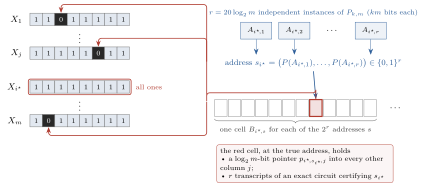
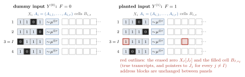

## 1. The fourth power

OpenAI's separation improves the exponent while giving up a factor of $m$ in the randomized lower bound. Compare the balanced AND–OR cheat sheets of Aaronson, Ben-David and Kothari [@ABK2016, §3] with OpenAI's construction [@OpenAI2026], which puts a separate certificate array in each column of a pointer function [@GPW2018; @ABBLSS2017]. Use the same partial function $P$ on $\Theta_k(m)$ bits in both, with a polylogarithmic quantum decoder and an exact circuit of size $\widetilde O_k(m)$ for its promise and value. For $1\le L\le m$ below $R(P)$, the estimates are, up to logarithms,
$$
\begin{array}{lcc}
 & \text{quantum upper bound} & \text{randomized lower bound} \\
 \text{balanced AND–OR cheat sheet} & m & m^2 L \\
 \text{one array per column} & \sqrt m & m L .
\end{array}
$$
For $k$-fold Forrelation one can take $L$ of order $m^{1-1/k}$ up to logarithms [@BansalSinha2021]. The quantum saving more than pays for the classical loss: $3-1/k$ becomes $4-2/k$.

How can one search $m$ columns for a certificate that itself costs about $\sqrt m$ queries to check? The winning column is all ones, and its certificate points to a zero in every other column. Given two candidate addresses, follow their pointers into each other. The winner defeats its rival on this single test even if the rival's address is wrong. Comparing first and verifying only a short list makes the two square-root costs add. On the classical side, these pointers are kept at addresses made of hard partial-function answers. A query to the right cell must name the entire address before it gets a single bit back.

**Theorem 1** (OpenAI [@OpenAI2026, Theorem 1.1], with explicit bounds from this reconstruction). *For each integer $k\ge2$ there are total Boolean functions $F_{k,m}$ indexed by powers of four $m\ge4$ such that, for a constant $C_k$ and $\ell=\log_2m$,*
$$
 Q(F_{k,m})\le C_k\sqrt m\,\ell^6,
 \qquad R(F_{k,m})\ge \frac{m^{2-1/k}}{400\ell^2}.
\tag{1}
$$
*The quantum bound holds for all such $m$ and the randomized bound for all sufficiently large $m$ at fixed $k$. The optimal universal exponent in $R(f)=O((1+Q(f))^\alpha)$ for total Boolean $f$ is four.*^[We use worst-case bit-query caps and error at most $1/3$. For partial functions the cap applies on every input and branch, the error bound on the promise.]

Aaronson, Ben-David, Kothari, Rao and Tal proved $R\le D=O(Q^4)$ and conjectured $R=O(Q^3)$ [@ABKRT2021, Conjecture 2]. The earlier cheat sheets, combined with optimal partial separations [@BansalSinha2021; @SSW2023], attain powers approaching three. Already $k=3$ in (1) excludes the cube.

## 2. The certificate

Each column $i\in[m]$ has a candidate string $X_i\in\{0,1\}^m$, an address given by $r=20\log_2m$ inputs $A_{i,1},\ldots,A_{i,r}$ to $P$, and an array of certificate cells $B_{i,s}$ indexed by $s\in\{0,1\}^r$. Even with one cell for every possible address there are just $2^r=m^{20}$ cells per column.

A certificate has to do more than point to zeros. The address itself could be false, or one of the partial-function answers could be undefined. Fix an exact fan-in-two Boolean circuit $\mathcal C$ with two outputs, a domain bit and the value of $P$ on its domain. Each cell holds a proposed evaluation of $\mathcal C$ for each address input, one bit per non-input gate. It also holds one $\ell$-bit row pointer $p_{i,s,j}$ into each column $j\ne i$. Every pointer word names a row.

Column $i$ **wins** if $X_i=1^m$, all its address inputs belong to the domain of $P$, and the cell with label
$$
s_i=\bigl(P(A_{i,1}),\ldots,P(A_{i,r})\bigr)
$$
contains the true transcripts and points to a zero in every other column. The function outputs one if a column wins, zero otherwise. All input bits are freely chosen. An off-promise column loses, whatever is written in its cells. Two winners are impossible because neither all-one column could point to a zero in the other.

{width=85%}

If a claimed address $s$ is false, where can a verifier catch it? Test the $m$ bits of $X_i$ and follow the $m-1$ outward pointers. For each address input test the transcript against every gate of $\mathcal C$ and test the two outputs against $(1,s_h)$. A consistent transcript must be the true evaluation, by induction in circuit order. A fabricated transcript therefore fails at some gate, and a true transcript for an undefined input or wrong answer fails an output test. In particular a losing column has a defect at *every* address. This gives the verifier a search problem with
$$
 K=m+(m-1)+r(S+2)
\tag{2}
$$
tests, where $S$ counts non-input gates. Each test reads at most $\max\{3,\ell+1\}$ bits. Both query bounds concern this same circuit and the function encoded by its cells.

We use three properties of $k$-fold Forrelation [@OpenAI2026, Lemma 2.1], whose promise is specified in §5. A reversible decoder for $P$ with error $\eta$ on its domain costs $O_k(1+\log(1/\eta))$ queries on every input. An exact circuit as above has $S=O_k(m\ell^2)$, so $K=O_k(m\ell^3)$ and the entire input is polynomial in $m$ at fixed $k$. Finally, for fixed $k$ and sufficiently large $m$,
$$
 L:=\left\lfloor m^{1-1/k}/\ell^2\right\rfloor < R(P).
\tag{3}
$$

## 3. Finding a winner by comparison

### 3.1 What one comparison reveals

Decode the two column addresses, follow the two pointers directed at each other, and favour the column whose pointer finds a zero when the other finds a one. Break ties by smaller index. Suppose $i^\star$ wins. With its address decoded correctly, its pointer finds a zero. Whichever cell its rival decodes, the return pointer goes into $X_{i^\star}=1^m$ and reads a one. This comparison works even when none of the rival's address inputs obeys the promise.

Write $\varepsilon$ for the allowed error in decoding a promised column. Running the decoder on each address bit with error $\varepsilon/r$ suffices. Use the same coherent circuit for each unordered pair, retaining both decoded addresses, and assign a loss to self-comparison. Since the two directions now denote complementary outcomes of *one* comparison, the probabilities $a_{ij}=\Pr[i\text{ defeats }j]$ on a fixed input satisfy
$$
 a_{ij}+a_{ji}=1\quad(i\ne j),\qquad a_{ii}=0.
\tag{4}
$$
Only the winning column has a dominance guarantee, $a_{i^\star j}\ge1-\varepsilon$ for every $j\ne i^\star$. The probabilities between losers may lie anywhere in $[0,1]$. One comparison or its inverse costs $c=O_k(r\log(r/\varepsilon)+\ell)$ queries.

### 3.2 A tournament with probabilistic comparisons

How do we find the dominant candidate when all we know about the other comparisons is (4)? OpenAI's tournament [@OpenAI2026, Proposition 3.2] needs only $O(\log m)$ pivots and reversible access to the comparison circuit controlled by the candidate indices.

For fixed comparison outcomes one can keep precisely the candidates that beat all previous pivots and draw uniformly from this set [@AIK2026, §6.1]. For fractional comparisons the analogue of membership is the probability of beating those pivots in fresh comparisons. After pivots $\rho_1,\ldots,\rho_n$, this gives weights
$$
 w_i=\prod_{h=1}^n a_{i\rho_h},\qquad W=\sum_i w_i.
$$
Initially all weights are one. A pivot $j$ updates $w_i$ to $w_i a_{ij}$ and removes itself. How should we draw $j$ once the weights are unequal? For a pivot law $q$, the pair $i,j$ contributes $w_i q_j a_{ij}+w_j q_i a_{ji}$ to the expected remaining mass. A uniform pivot leaves the larger weight on one direction. To cancel the bias we need equal coefficients, $w_i q_j=w_j q_i$. Drawing $j$ with probability $w_j/W$ achieves this for every pair. Hence, while $W>0$,
$$
 \mathbb E[W_{\rm new}\mid w]
 =\frac1W\sum_{i,j}w_i w_j a_{ij}
 =\frac{W^2-\sum_i w_i^2}{2W}
 \le\frac W2.
\tag{5}
$$
The sum pairs two independent draws from the weights. On distinct draws either is equally likely to defeat the other, and coincident draws contribute zero.

Stop on extinction, keeping $W=0$ thereafter. After $T$ steps the expected mass is at most $m2^{-T}$. An unselected dominant candidate, however, still has weight at least $(1-\varepsilon)^T\ge1-T\varepsilon$. Take $T=\lceil\log_2(1000m)\rceil$ to make the first quantity small and $\varepsilon=1/(1000T)$ to keep the second above $1/2$. Missing this candidate now requires more than half a unit of weight to survive. By Markov's inequality that happens with probability at most $2m2^{-T}$.

\Needspace{11\baselineskip}

How does the algorithm draw this pivot? It has access to the comparison circuit but none of the numbers $a_{ij}$. Fix the measured pivots so far. Prepare a uniform superposition of $i$, and, controlled on $i$, compare it with each pivot using a fresh workspace. If $|\phi(i,\rho_b)\rangle$ is the entire state of one comparison, the preparation produces
$$
 \frac1{\sqrt m}\sum_i |i\rangle\bigotimes_{b=1}^n |\phi(i,\rho_b)\rangle.
$$
Flag the event that *all* comparisons favour $i$. Within a fixed label the independent comparison registers multiply the success probabilities. Across distinct labels their masses add. Consequently
$$
 \Pr[i\text{ and flag}]=\frac{w_i}{m},\qquad
 \Pr[\text{flag}]=\frac Wm,\qquad
 \Pr[i\mid\text{flag}]=\frac{w_i}{W}.
\tag{6}
$$
The same half unit of surviving weight pays for this draw. Until $i^\star$ is listed, its contribution gives flag probability $W/m>1/(2m)$. Use bounded amplitude amplification with this threshold and failure tolerance $\varepsilon$. The [finite schedule](https://github.com/wcook04/quartic-query-lean/blob/5188cb6fd1cc37c123c4b30dce672f9d30c99320/docs/reasoning_record.md#upper-small-probability) costs $O(\sqrt m\log(1/\varepsilon))$ calls to the preparation and its inverse on every branch. Grover rotations preserve the direction of the flagged component, so every successful trial has *exactly* the label distribution in (6) [@BBHT1998; @BHMT2002; @OpenAI2026, Lemma 3.1].

Append the measured pivot on success and stop on failure or after $T$ draws. Before the winner is listed, each successful transition can be coupled to the ideal draw, with probability at most $\varepsilon$ of stopping instead. Hence
$$
 \Pr[i^\star\text{ absent from the list}]\le 2m2^{-T}+T\varepsilon.
\tag{7}
$$

Rebuilding at most $T$ comparisons per preparation for at most $T$ stages costs $O(c\sqrt m\,T^2\log T)$ queries on every input.

### 3.3 Paying for verification

The tournament must find the winner on a one-input. On a zero-input it may return *any* list of at most $T$ columns. Even a column with false transcripts might beat every rival. The verifier must reject such a column at whichever address its decoder supplies.

For each listed column decode a fresh address with error at most $\varepsilon$ on promised inputs, then search the $K$ local tests at that address for a defect. A uniform test flags a defect with probability at least $1/K$ whenever any test fails. Evaluating the test reversibly and using the bounded search above costs $O(\ell\sqrt K\log(1/\varepsilon))$ queries. Accept if the search finds no defect for some column. At the winner's true address no test can flag, so listing the winner and decoding it correctly suffice for acceptance. A one-input is rejected with probability at most (7) plus $\varepsilon$. On a zero-input every proposed pair has a defect by §2. Fresh searches give a false-acceptance probability of at most $T\varepsilon$, conditional on any list. Both errors are below $1/3$.

The cost of checking the list is $O(T(c+\ell\sqrt K\log T))$, including fresh address decoding. With $T=O(\ell)$, $c=O_k(\ell\log\ell)$ and $K=O_k(m\ell^3)$, this and the tournament cost sum to at most $C_k\sqrt m\,\ell^6$. The number of candidates sets the first square-root cost and the size of a single certificate sets the second.

\Needspace{22\baselineskip}

## 4. A cell query predicts an address

### 4.1 Planting one certificate

For the **dummy input** $Y^{(0)}$, choose the row $J_i$ of the sole zero in $X_i$ independently and uniformly in each column. Draw all address inputs independently from a law $\mu$ on the promise of $P$, independently also of the zero positions, and set every cell bit to zero. Every column loses. Choose $I$ uniformly and independently of the entire dummy input. For the **planted input** $Y^{(1)}$, erase the zero in column $I$ and fill its true cell $B_{I,s_I}$ with the correct transcripts and the pointers $J_j$ to the other zeros. Column $I$ wins.

{width=100%}

Run a deterministic tree on the dummy board. It sees the same replies on the planted board until it queries either the erased zero or the filled cell. The acceptance gap is at most the sum of the two discovery probabilities on the dummy run, which knows nothing about $I$ [@ABK2016, Lemma 6; @BenDavid2015, §5.1]. To reach the cell, the tree can investigate a few columns deeply and hope $I$ is among them, or it can try addresses in many columns after learning little about each.

For any integer $1\le L\le m$ with $L<R(P)$, minimax gives a $\mu$ under which every deterministic depth-$L$ tree computes $P$ with success at most $\beta=2/3$ [@Yao1977]. Give the tree on the board $G=\lfloor mL/100\rfloor$ queries. We first bound the chance of bypassing the address search altogether.

### 4.2 Searching for the erased zero

If the tree discovers $Z$ zeros, the probability that one of them belongs to column $I$ is exactly $\mathbb E Z/m$. Before discovery, a column's zero is uniform among the rows not yet queried there, even given the entire transcript. Until half the rows have been queried, a query makes a new discovery with probability at most $2/m$. We expect at most $2G/m$ such early discoveries. Each remaining discovery costs at least $m/2$ queries to its column, so the run has at most $2G/m$ late discoveries. Hence
$$
 \Pr[\text{query }X_I[J_I]]\le\frac{4G}{m^2}.
\tag{8}
$$

\Needspace{20\baselineskip}

### 4.3 Predicting the filled cell

To query a bit of $B_{i,s}$ the tree has to announce $s$ in the query index. At the right cell this is a prediction of all $r$ answers in column $i$. Call a column *heavy* if the full dummy run makes more than $L$ queries to its address inputs, counting repetitions. There are at most $G/L$ such columns on any run. Because $I$ is independent of that run,
$$
 \Pr[I\text{ heavy}]\le\frac{G}{mL}.
$$

In a light column, a query to the true cell names $r$ hard answers after at most $L$ queries to their inputs. It is tempting to condition on the column being light and apply a direct-product bound. But the answers seen by the tree may determine whether it continues in that column. Conditioning on its final query count can change the input law.

Under the *original* product law $\mu^{\otimes r}$, a predictor capped at $L$ queries per input on every branch has success at most $\beta^r$, even with adaptive interleaving and jointly independent auxiliary information and coins [@Drucker2012, §3; @OpenAI2026, Lemma 4.1]. At a fixed transcript the posterior factors across inputs. For each input consider the best success probability achievable with its queries left. Querying one input leaves the other values fixed. Even for the queried input the expected value cannot rise, since that query was already an available first move. The [separate-cap proof](https://github.com/wcook04/quartic-query-lean/blob/5188cb6fd1cc37c123c4b30dce672f9d30c99320/docs/reasoning_record.md#CL-product-law) takes the product of these values, which cannot increase in expectation.

Fix a column $i$ and query time $\tau\le G$. Embed the predictor's unknown tuple as column $i$'s address inputs on a dummy board, and sample all other data independently of the tuple. Simulate the tree through time $\tau$, paying only for queries to these address inputs. Stop before the $(L+1)$-st such query in total. If query $\tau$ is in a cell $B_{i,s}$, output $s$ before reading the cell. If the query at that time has any other form, or if the simulation aborts or halts earlier, output a fixed vector.

This total cap enforces the separate caps. On every run in which $i$ ends up light, the simulator can follow the tree up to its $\tau$-th query if it has one. Thus a light run that queries $B_{i,s_i}$ at that time is a successful prediction. Applying the direct product to the predictor gives the joint bound
$$
 \Pr[i\text{ light and query }\tau\text{ is in }B_{i,s_i}]
 \ \le\ \Pr[\text{predictor outputs }s_i]\ \le\ \beta^r.
\tag{9}
$$

For each fixed column there are at most $G$ opportunities to make this prediction. Average over the independent choice of $I$ and add the chance of a heavy column to obtain
$$
 \Pr[\text{query }B_{I,s_I}]
 \le \frac G{mL}+\frac1m\sum_{i=1}^m G\beta^r
 = \frac G{mL}+G\beta^r .
\tag{10}
$$

### 4.4 The randomized bound

Combining (8) and (10), the gap between the acceptance probabilities on the two laws is at most
$$
 \frac{4G}{m^2}+\frac G{mL}+G(2/3)^r <\frac13.
\tag{11}
$$
Here $G\le mL/100\le m^2/100$, and $r=20\log_2m$ makes $(2/3)^r\le m^{-10}$ small enough for all $G$ guesses. Averaging over coins gives (11) for a randomized tree, while correctness with error at most $1/3$ on both supports would force a gap of at least $1/3$. Thus every such construction requires more than $\lfloor mL/100\rfloor$ randomized queries. For (3) at fixed $k$, the erased-zero term is $O(L/m)=o(1)$ and the lucky-address term also vanishes. The term that fixes the budget is $G/(mL)$, the bound on the fraction of deeply queried columns.

\Needspace{17\baselineskip}

## 5. Forrelation and the optimal exponent

The partial function supplying these parameters is the Walsh–Hadamard form of $k$-fold Forrelation [@AA2018; @BansalSinha2021]. Let $H$ be the normalized Walsh–Hadamard matrix of order $m$, $u=m^{-1/2}(1,\ldots,1)^{\mathsf T}$, and $D_z$ the diagonal matrix of a sign vector. For $k$ such vectors of length $m$, put
$$
 \Phi=u^{\mathsf T}D_{z_1}H D_{z_2}H\cdots H D_{z_k}u,\qquad \delta=2^{-5k}.
$$
Set $P=1$ when $\Phi\ge\delta$, $P=0$ when $|\Phi|\le\delta/2$, and leave $P$ undefined elsewhere. Applying the unitary product to $u$ and projecting onto $u$ succeeds with probability $\Phi^2$. For fixed $k$ the two promised cases have a constant gap, giving the claimed decoder by repetition with trial registers retained. This experiment loses the sign: a large negative $\Phi$ can pass the projection test and still be outside the promise. For the exact circuit, compute the signed numerator by $k-1$ unnormalized fast Walsh–Hadamard transforms on integers of $O_k(\ell)$ bits and compare it to the thresholds above. This yields both domain and value bits in $O_k(m\ell^2)$ fan-in-two gates [@OpenAI2026, Lemma 2.1]. The lower bound of Bansal and Sinha [@BansalSinha2021, Corollary 1.4] gives (3). Fixing this circuit in the cells defines $F_{k,m}$.

For sufficiently large $m$, the floor in (3) gives $L\ge m^{1-1/k}/(2\ell^2)$ and $\lfloor mL/100\rfloor\ge mL/200$, proving the randomized inequality of (1). Now fix $0\le\alpha<4$. Choose $k\ge2$ with $k>2/(4-\alpha)$ and hold it fixed as $m$ grows through powers of four. By (1),
$$
 \frac{R(F_{k,m})}{(1+Q(F_{k,m}))^\alpha}
 \ \ge\ \frac{1}{400(1+C_k)^\alpha}\,
 \frac{m^{2-1/k-\alpha/2}}{(\log_2 m)^{2+6\alpha}}
 \ \longrightarrow\ \infty.
$$
Each fixed $k$ thus forces the universal exponent to be at least $4-2/k$. Taking the supremum over these families gives four, the exponent of the universal upper bound.

\Needspace{30\baselineskip}

## References

::: {#refs}
:::

**Reconstruction.** The [complete argument](https://github.com/wcook04/quartic-query-lean/blob/5188cb6fd1cc37c123c4b30dce672f9d30c99320/docs/reasoning_record.md) includes the [uniform estimates for a growing parameter](https://github.com/wcook04/quartic-query-lean/blob/5188cb6fd1cc37c123c4b30dce672f9d30c99320/docs/reasoning_record.md#ROOT-GROWING-K). The [theorem index](https://github.com/wcook04/quartic-query-lean/blob/main/docs/proof_index.md) links the formal statements and Lean proofs. Will Cook directed the reconstruction. AI systems drafted and revised the manuscripts and Lean development.

<!-- lean-links -->
<!-- /lean-links -->
