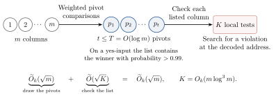

# 1. Finding a column of ones

Does any column in this table have a one in every row?

|       | Column 1 | Column 2 | Column 3 | Column 4 |
|:------|:--------:|:--------:|:--------:|:--------:|
| Row 1 | 1 | 0 | 1 | 1 |
| Row 2 | 1 | 1 | 0 | 1 |
| Row 3 | 1 | 1 | 1 | 0 |
| Row 4 | 0 | 1 | 1 | 1 |

Read down column 1. Its first three numbers are ones, but the number in row 4 is zero. Columns 2, 3 and 4 also contain zeros, in rows 1, 2 and 3 respectively. So the answer is no. Now change the zero in row 4 of column 1 to a one. Column 1 has four ones, and the answer changes to yes.

Cover all sixteen numbers. You may name a row and a column and uncover the number written there. Each number is a *bit*, either zero or one. Reading the bit in one square of your choice costs one *query*. If you ask for row 2 of column 3, you get zero on either table. You can cross out column 3. If you ask for row 4 of column 1, you get zero on the original table and one on the changed table. One query in that square distinguishes these two tables.

What if we move the zeros around before covering the numbers? Put a single zero in each column, choosing its row uniformly at random and independently in each column. Fill every other square with a one. Make a copy of the table, choose one of the four columns uniformly at random, and change its zero to a one in the copy. Suppose you read the four numbers across the top row of each table. You get different answers on the two tables precisely when the changed zero was in the top row. The probability is $1/4$. Reading the top two rows costs eight queries per table and raises the probability to $1/2$.

On a table with $m$ rows and $m$ columns, reading the first $h$ rows costs $mh$ queries and detects the change with probability $h/m$. Here we chose all the rows in advance. In Section 5 the algorithm can use every bit it has already read to choose its next square.

**What counts as a quantum query?** A classical algorithm reads one bit at a time. It can use coin flips to choose which bit to read next. For a quantum query, take two squares in column 1. Call the number in row 1 $x_1$ and the number in row 4 $x_2$. We want to know whether these two numbers agree. Prepare the unit vector $(1,1)/\sqrt 2$. Its first coordinate, called an *amplitude*, corresponds to row 1 and its second to row 4. In one quantum query we can multiply each amplitude by $+1$ if the corresponding bit is zero and by $-1$ if it is one. The resulting vector is
$$
       \frac{1}{\sqrt2}\bigl((-1)^{x_1},(-1)^{x_2}\bigr).
$$
On the printed table the bits are $(1,0)$, so the vector lies on the line through $(1,-1)$. After the change the bits are $(1,1)$, so it lies on the line through $(1,1)$. In fact *every* unequal pair gives the first line and every equal pair gives the second. The lines are perpendicular, so a quantum measurement in these two directions tells us with certainty whether the bits agree. A classical algorithm that must answer for all four possible pairs has to read both bits to be certain. [@BuhrmanDeWolf2002, §3; @deWolf2026, §2.4]

**How far apart can the two costs be?** Let $f$ be a yes-or-no question about a string of bits. We call $f$ *total* if every string of the specified length has an answer. Write $R(f)$ for the least number of queries sufficient for a randomized classical algorithm to answer $f$ correctly with probability at least $2/3$ on each string. That number limits the queries on every run, including runs on which the algorithm errs. Define $Q(f)$ using the same requirements for a quantum algorithm. In both models we count only queries to input bits.

Aaronson, Ben-David, Kothari, Rao and Tal proved that a constant times $(1+Q(f))^4$ suffices as an upper bound on $R(f)$ for every total $f$ [@ABKRT2020]. Could we replace four by a smaller power and still find one constant that works for all $f$? OpenAI proved that we cannot [@OpenAI2026, Theorem 1.1][^ai]. For each power below four, the ratio of $R(f)$ to that power of $1+Q(f)$ can be arbitrarily large. This is what *nearly quartic* means here.

Return to the table after we changed column 1. Someone who wants to show you that columns 2, 3 and 4 each contain a zero can tell you exactly where to look. For column 2 read row 1, for column 3 read row 2, and for column 4 read row 3. In OpenAI's construction these three row numbers can be written beside column 1. Whoever writes them is free to give the wrong rows. How much can we learn from a row number before we know whether it really points to a zero?

# 2. Comparing two columns

[]{#base-board}Suppose column 1 has the row numbers $1,2,3$ written beside it, one for each of columns 2, 3 and 4 in that order. Take the middle number, $2$. It tells us to look in row 2 of column 3. The bit written there is $0$. The stored number $2$ is called a *pointer*. Following the pointer takes two steps. First read the row number, then read the bit at that row in the other column.

In the full construction each column has several lists of row numbers, stored in separate *cells*. How do we choose which cell to read? Two additional strings of bits stored in column 1 give a small example. Each string is the input to a yes-or-no question. If the first answer is one and the second is zero, read the cell labelled $10$. This label is the *address*. Figure 1 draws the four bits of each column horizontally, in row order. The box $B_{1,10}$ denotes the cell labelled $10$ in column 1.

An address question has a prescribed answer on some bit strings. The set of those strings is its *promise*. Figure 1 uses three strings, called $a^+, a^0, a^-$. The answer is one for $a^+$ and zero for $a^0$. The third string, $a^-$, is outside the promise and has no prescribed answer. Thus the pair $(a^+,a^0)$ in column 1 gives address $10$. The pair $(a^-,a^0)$ in column 2 gives no address. Section 4 writes out the eight bits in each string and calculates the answers.

{width=92%}

To obtain a yes answer on the enlarged board, we need a column with ones in every row. Its address questions must all have prescribed answers. The cell labelled by those answers must contain the correct steps of their calculation, together with a pointer to a zero in every other column. We call such a column a *winning column*, and the contents of that cell its *certificate*. There can be at most one winning column. If two columns consisted entirely of ones, neither could contain the zero needed for the other's certificate. If no column meets all the conditions, the answer on the board is no.

**What can we learn by following two pointers?** Compare column 1 with column 3 in Figure 1. In cell $10$ of column 1, read the row number stored for column 3. It is $2$, and row 2 of column 3 contains zero. Now read the row number stored for column 1 in *any* cell of column 3. Whatever row number we find there for column 1, the bit we read in column 1 will be one. In this comparison we return the number of the column that supplied the pointer to a zero, namely 1.

For any two columns we use the same rule. Follow one pointer in each direction. If exactly one of the two bits read is zero, return the number of the column in which that pointer was stored. If both bits are zero or both are one, return the smaller column number. Whenever we use the correct cell of a winning column, the comparison returns its column number even if we chose the wrong cell of the other column.

Could we declare a column the winner just because every comparison returns its number? In cell $10$ of column 1, change the pointer for column 2 from $1$ to $2$. Now we read row 2 of column 2, which contains one. We also read one in column 1, so the tie rule still returns 1. The comparisons with columns 3 and 4 give the same answers as before. Yet column 1's certificate now contains an incorrect pointer. The other three columns each contain a zero, so the board's answer is no. We can use comparisons to draw up a short list of columns, but we must still verify the certificate of each column on the list.

**Which columns should go on the list?** Draw an arrow from $i$ to $j$ if comparing those columns returns $i$. In Figure 2, the pointer from column 2 to column 3 specifies row 2, where the bit is zero. The return pointer also specifies row 2, but in column 2 the bit in that row is one. Hence the arrow from 2 to 3. Comparing 3 with 4 returns 3, and comparing 4 with 2 returns 4. These three arrows form a cycle, so we cannot sort the columns in an order that agrees with every comparison.

{width=53%}

Choose one column uniformly at random and put its number on the list. Call this choice the *pivot*. For the next round keep only the other columns whose comparison with the pivot returns their own number. Take column 2 as the pivot. The arrows into 2 come from 1 and 4, so columns 1 and 4 remain. If we had picked 1, no column would remain, and we would already have put the winning column on the list. For pivots $1,2,3,4$ the numbers of columns left are $0,2,2,2$. Their mean is $(0+2+2+2)/4=3/2$.

Now take $m$ columns and suppose each pair has a fixed comparison result. If comparing $i$ and $j$ returns $i$, then $i$ remains when $j$ is pivot, but $j$ drops out when $i$ is pivot. This pair therefore contributes exactly one to the total number retained when we sum over all the pivots. There are $m(m-1)/2$ pairs and $m$ equally likely pivots. On average $(m-1)/2$ columns remain. In the quantum algorithm two estimates of the same address may select different cells. What becomes of this count when a second comparison between the same two columns can return a different number?

# 3. Finding a winner by comparisons

Compare columns $2$ and $3$ twice on the same board. For some choices of pointer records the first comparison might return column number $2$ and the second column number $3$. The bits stored on the board are fixed. What can differ between comparisons is the estimated address used to select a pointer record in each column.

## 3.1 Counting the indices retained by random comparisons

Suppose the first pivot is column number $2$ and a fresh comparison of columns $3$ and $2$ returns $3$ with probability $1/2$. Give column $3$ a *weight* of $1/2$. Now suppose the next pivot is $4$ and a fresh comparison of $3$ with $4$ also returns $3$ with probability $1/2$. The chance of obtaining $3$ in *both* comparisons is $1/2\times1/2=1/4$, since we make the comparisons independently. The new weight of column $3$ is $1/4$. In general, the weight of a column is the probability that we would keep its number after comparing it afresh with every pivot already listed. With fixed comparison results, the weight is one for each retained number and zero for each discarded number.

How can we draw a pivot without making a list of all the retained numbers? Draw a column number uniformly. Discard the number if it is already on the pivot list. Otherwise compare the drawn column with every listed pivot and accept the draw if every comparison returns the drawn number. Suppose column 2 is the only pivot so far. Each column has probability $1/4$ of being drawn. To get the probability of drawing *and* accepting column 3, multiply $1/4$ by the probability $1/2$ of accepting it once drawn.

| Column $i$ | Keep $i$ once drawn | Draw and keep $i$ |
|:----------:|:----------------:|:-------------------:|
| $1$ | $1$   | $1/4$  |
| $2$ | $0$   | $0$    |
| $3$ | $1/2$ | $1/8$  |
| $4$ | $1/4$ | $1/16$ |

Adding the four probabilities in the last column gives $7/16$, the probability of accepting a draw. Given that the draw was accepted, the probability that it was column $3$ is $(1/8)/(7/16)=2/7$. For column numbers $1,2,3,4$, the probabilities of being chosen as the next pivot are $4/7,0,2/7,1/7$, respectively.

For $m$ columns, write $w_i$ for the weight of column $i$ and $W=w_1+\cdots+w_m$ for the sum of all column weights. Before we choose any pivot, each weight is one. The probability of drawing $i$ and accepting is $w_i/m$. The probability of accepting any draw is $W/m$. Thus when $W>0$ an accepted draw yields pivot $i$ with probability $w_i/W$. Consider the procedure that always draws the next pivot with these probabilities, stopping if $W=0$. When we append pivot $p$, retaining a drawn column number requires one more comparison to return that number. Let $a_{ip}$ be the probability of retaining $i$ on comparing it with $p$, with $a_{pp}=0$ because we discard the pivot itself. The new weight of column $i$ is $w_i a_{ip}$.

Fix the list so far. What is the expected total weight after choosing one more pivot? If the next pivot is $2$, an event of probability $w_2/W$, the new weight of column $3$ is $w_3a_{32}$. If the next pivot is $3$, an event of probability $w_3/W$, the new weight of column $2$ is $w_2a_{23}$. Multiplying each new weight by the probability of that pivot and adding gives
$$
\frac{w_2}{W}\,w_3a_{32}+\frac{w_3}{W}\,w_2a_{23}
=\frac{w_2w_3}{W}.
$$
The two probabilities $a_{32}$ and $a_{23}$ sum to one because the comparison always returns one of the two column numbers. Adding the corresponding products for all pairs, counting each pair once, gives
$$
\text{expected total weight after the next pivot}
=\frac{\sum_{i<p}w_iw_p}{W}
=\frac{W^2-\sum_iw_i^2}{2W}\le\frac W2 .
$$
The square of $w_1+\cdots+w_m$ counts every product of distinct weights twice and each square once. With four initial weights of one, the expected total is $(16-4)/8=3/2$, as for the fixed comparisons in Section 2 [@AIK2026v3, §§4 and 6.1].

The expected total weight starts at $m$ and falls by at least half at each step. After $T$ pivots it is at most $m/2^T$, counting the total as zero if the procedure stopped earlier. Now suppose there is a winning column. Section 4 gives a comparison that returns its number with probability at least $1-\varepsilon$ against each other column. For any list of at most $T$ other pivots, the probability of even one incorrect comparison with the winning column is at most $T\varepsilon$. So while its number is missing from the list, the winning column has weight at least $1-T\varepsilon$.

Take $T=\lceil\log_2(1000m)\rceil$ and $\varepsilon=1/(1000T)$. The expected total weight after $T$ steps is at most $1/1000$, yet an unlisted winning column would have weight greater than $1/2$. If the winning number were missing with probability $d$, its contribution alone to the expectation would be at least $d/2$. Therefore $d\le1/500$. Other listed numbers can belong to nonwinning columns. We will test each listed number separately.

## 3.2 Sampling the next pivot

One trial from Section 3.1 accepts with probability $q=W/m$. When exactly one column has weight one and the rest have weight zero, $q=1/m$. Independent draws would take $m$ trials on average to obtain that column number. We can use a quantum calculation to increase the probability of acceptance while preserving the distribution of column numbers among accepted draws.

Section 1 assigned one amplitude to row $1$ of column $1$ and another to row $4$ of the same column. Here we assign an amplitude to each possible *column number*. For four columns, the vector $(1/2,1/2,1/2,1/2)$ gives amplitude $1/2$ to each of the four numbers. A measurement in this basis returns one column number. Its probability is the square of that column's amplitude, here $1/4$. We use real amplitudes throughout these examples. Two amplitudes with opposite signs have the same square, but their signs matter when an operation adds them.

A *superposition* of column numbers is a linear combination of their basis vectors. For example the basis vector for column $2$ is $(0,1,0,0)$. A quantum operation on a superposition acts linearly. It suffices to specify the output for each basis vector and then take the same linear combination of the outputs.

Start with equal amplitudes on all $m$ column numbers. For each number $i$, compute fresh comparisons with all listed pivots, retaining each comparison result. Compute one more bit, the *acceptance flag*. Set it to one when $i$ is new and every comparison returns $i$. Set it to zero otherwise. Call the preparation $A$. Each possible measurement result now specifies the drawn column number, the comparison results and the flag, together with the intermediate bits used to compute them. The probability of measuring both number $i$ and flag one is $w_i/m$, summed over all possible intermediate results. We have not yet measured anything.

Suppose the fixed comparisons of Figure 2 give us the pivot list $2,4$. The acceptance flag is one only for column $1$. In column order the four amplitudes are $(1/2,1/2,1/2,1/2)$, with each column's comparison results and flag recorded. Apply the following two operations before measuring.

1. Reverse the sign of each amplitude whose flag is one. The four amplitudes become $(-1/2,1/2,1/2,1/2)$.
2. Reflect the vector about the line spanned by the original equal-amplitude vector. For four equal starting amplitudes this replaces each current amplitude $x$ by $2\bar x-x$, where $\bar x$ is the mean of the four current amplitudes. That mean is $1/4$. The amplitude for column $1$ becomes $1/2-(-1/2)=1$. The amplitude for each of columns $2,3,4$ becomes $1/2-1/2=0$.

Measuring now gives column number $1$ with certainty. To implement the second reflection, undo $A$, reflect about the initial state in which all the algorithm’s bits are zero, and apply $A$ again. Keeping the intermediate comparison results makes it possible to undo $A$ [@BHMT2002, Lemma 1; @deWolf2026, §§7.1–7.3].

For arbitrary weights, split the prepared vector into the sum of two vectors. One contains all amplitudes whose flag is one and has zeros in the other coordinates. The second contains all amplitudes whose flag is zero and has zeros elsewhere. Their squared lengths are the acceptance probability $q$ and the rejection probability $1-q$. The two vectors are orthogonal because their nonzero coordinates have disjoint labels. When $0<q<1$, divide each by its length to get unit vectors $g$ for acceptance and $b$ for rejection. The prepared state is $\sqrt q\,g+\sqrt{1-q}\,b$.

The sign reversal negates the coefficient of $g$ and leaves the coefficient of $b$ unchanged. The second reflection is about the prepared vector, also in the plane of $g$ and $b$. Consequently, after either operation all amplitudes with flag one are still proportional to their original amplitudes, with the same multiplier for every accepted column number. Conditional on measuring flag one, column $i$ still has probability $w_i/W$.

[]{#pivot-schedule}Let $\theta$ be the angle from $b$ to the prepared vector, measured towards $g$, so $\sin\theta=\sqrt q$. The sign reversal takes angle $\theta$ to $-\theta$. Reflection about the prepared vector takes $-\theta$ to $3\theta$. Each pair of reflections adds $2\theta$, so after $u$ pairs the probability of measuring flag one is $\sin^2((2u+1)\theta)$. For small $q$, $\theta$ is approximately $\sqrt q$ radians. The number of pairs needed to approach angle $\pi/2$ is therefore of order $1/\sqrt q$. More pairs can reduce the probability again. In the four-column example, $\theta=\pi/6$ and the first pair gives probability one, but the second gives $\sin^2(5\pi/6)=1/4$. When $q=0$ the flag is always zero, and when $q=1$ the initial preparation already gives flag one.

The algorithm has no prior value for $q$, so it chooses the number of reflection pairs at random, sometimes using zero pairs. The [schedule in Appendix A.3](#amplification-schedule) uses $O(\sqrt m\log(1/\varepsilon))$ calls to $A$ or its inverse on every board. When $q\ge1/(2m)$, the probability that every trial gives flag zero is at most $\varepsilon$ [@BBHT1998, Lemma 2]. At the first flag one, append the measured column number. Its conditional probabilities are the same $w_i/W$ for every choice of rotation count.

Stop if the schedule obtains no accepted number or the list reaches length $T$. While the winning number is missing, its weight exceeds $1/2$ and hence $q=W/m>1/(2m)$. Whenever the schedule succeeds we can use its measured number as the draw for the ideal procedure of Section 3.1. The chance of stopping on failure before listing the winning number is at most $T\varepsilon$, summed over at most $T$ stages. Together with the ideal procedure's error bound, this gives probability at most $1/500+T\varepsilon$ of omitting the winning number. Each preparation compares with at most $T$ pivots. The entire list therefore uses $O(T^2\sqrt m\log(1/\varepsilon))$ comparisons and reversed comparisons.

# 4. Computing an address and checking its certificate

In Figure 1, column $1$ has two address inputs. Each is a string of eight bits. The prescribed answer for $0111\,1000$ is the digit one and the prescribed answer for $0100\,1000$ is the digit zero. Together these digits specify pointer record $10$. Here is how to calculate the digits.

Split each eight-bit input into two blocks of four bits. Both examples have second block $1000$. Replace each zero in the block by $+1$ and each one by $-1$, giving the sign vector $z_2=(-1,1,1,1)$. Compare $z_2$ with each of the four fixed rows of signs below. At a position where the signs agree, their product is $+1$. At a position where they disagree, the product is $-1$. The dot product of one row with $z_2$ therefore counts agreements minus disagreements.

| Row label | Signs in the row | Agreements | Disagreements | Dot product with $z_2$ |
| :--- | :--- | ---: | ---: | ---: |
| $00$ | $(1,1,1,1)$ | 3 | 1 | $2$ |
| $01$ | $(1,-1,1,-1)$ | 1 | 3 | $-2$ |
| $10$ | $(1,1,-1,-1)$ | 1 | 3 | $-2$ |
| $11$ | $(1,-1,-1,1)$ | 1 | 3 | $-2$ |

Divide each of the four rows of signs by two to form a matrix $H$. For example its row labelled $01$ is $(1,-1,1,-1)/2$. Each row has length one. Any two different rows agree in two signs and disagree in two, so their dot product is zero. Multiplying by $H$ therefore preserves length. This multiplication is the *normalized Walsh transform*. The four numbers in $Hz_2$ are the four dot products in the table divided by two, namely $(1,-1,-1,-1)$.

Let $z_1$ be the sign vector from the first block. Define $\Phi=(z_1/2)\mathbin{\cdot}(Hz_2/2)$, the dot product of two unit vectors. The signs from $0111$ give $z_1=(1,-1,-1,-1)=Hz_2$, hence $\Phi=(1+1+1+1)/4=1$. The signs from $0100$ give $z_1=(1,-1,1,1)$ and $\Phi=(1+1-1-1)/4=0$. The signs from $1000$ give $z_1=-Hz_2$ and $\Phi=-1$. On arbitrary blocks the coordinates of $Hz_2$ can have different magnitudes. The same dot product measures alignment of $z_1/2$ with $Hz_2/2$ [@AA2018, §§1.1.1 and 3.2].

For two blocks, set $\delta=2^{-10}$. The prescribed digit is one when $\Phi\ge\delta$ and zero when $|\Phi|\le\delta/2$. An input lies in the promise precisely when its $\Phi$ satisfies one of these two inequalities.

| Eight input bits | Signed dot product $\Phi$ | Prescribed address digit |
| :--- | ---: | :--- |
| $a^+=0111\,1000$ | $1$ | $1$ |
| $a^0=0100\,1000$ | $0$ | $0$ |
| $a^-=1000\,1000$ | $-1$ | undefined |

In column $1$ of Figure 1 the pair $(a^+,a^0)$ gives address $10$. In column $2$ the pair $(a^-,a^0)$ has an undefined first digit, so column $2$ has no true address.

**How a query supplies the signs.** A bit query takes a position $j$ in one input block and an answer bit $b$. If the bit $x_j$ stored at $j$ is zero, the query leaves $b$ unchanged. If $x_j$ is one, the query exchanges the possible answer-bit values $0$ and $1$. Starting with $b=0$ would thus give $x_j$ as the answer bit. Instead prepare the answer bit with amplitude $1/\sqrt2$ for zero and $-1/\sqrt2$ for one. Exchanging these two amplitudes negates the answer vector. For each position $j$, the answer vector after the query is therefore $(-1)^{x_j}$ times the original answer vector. In a superposition of positions the same answer vector factors out, leaving the amplitude at each position $j$ multiplied by $(-1)^{x_j}$. This implements the sign query used in Section 1 [@deWolf2026, §2.4].

For $a^+$, label the four positions within either block by $00,01,10,11$ in order. Start with equal position amplitudes $u=(1,1,1,1)/2$. Query the signs in the second block, multiply the amplitude vector by $H$, then query the signs in the first block. The four numbers at each step below are amplitudes in that same position order.
$$
\tfrac12(1,1,1,1)
\ \longmapsto\ \tfrac12(-1,1,1,1)
\ \longmapsto\ \tfrac12(1,-1,-1,-1)
\ \longmapsto\ \tfrac12(1,1,1,1).
$$
Apply $H$ a second time and measure the position label. Row $00$ of $H$ is $u$, so the amplitude for outcome $00$ is half the sum of the four amplitudes immediately before this last multiplication. For $a^+$ the sum is two, the amplitude for $00$ is one, and measuring gives $00$ with certainty. More generally, immediately before this last multiplication the amplitudes are the coordinates of $Hz_2/2$ multiplied by the corresponding signs from $z_1$. Half their sum is $\Phi$. Hence the probability of measuring **position $00$** is $\Phi^2$. Multiplications by the fixed matrix $H$ cost no input queries.

For $a^0$ the measured position can never be $00$. For $a^-$ the amplitude for $00$ is $-1$, so $00$ occurs with certainty, just as for $a^+$. Thus even measuring $00$ with certainty does not establish that an address digit is defined.

**From two queries to a comparison.** At full size the input for one address digit has $k$ blocks of $m=4^t$ bits, $t\ge1$. Write $F_{k,m}$ for the yes-or-no function on the resulting boards. The $m$ position labels now have $2t$ binary digits. In row $a$ and column $b$ of the Walsh matrix the coefficient is $H_{ab}=(-1)^{a\cdot b}/\sqrt m$. The sign is negative when an odd number of bit positions contain a one in both $a$ and $b$. For $m=4$ this gives the four rows above, with the factor $1/2$.

Start with position amplitudes $u=(1,\ldots,1)/\sqrt m$. Query each block in turn from last to first, multiplying by $H$ between queries. Write $D_j$ for the diagonal matrix whose diagonal consists of the signs from block $j$. After the last query, apply $H$ once more. Its row with all-zero label is $u$, so the amplitude for measuring that position is
$$
\Phi=u^{\mathsf T}D_1H D_2H\cdots H D_k u .
$$
This is the $k$-block *Forrelation* quantity [@AA2018, §3.2, Figure 1]. For these inputs the address prescription uses $\delta=2^{-5k}$. One trial takes $k$ bit queries. If the prescribed digit is one, the all-zero position label occurs with probability $\Phi^2\ge\delta^2$. If the prescribed digit is zero, that label occurs with probability $\Phi^2\le\delta^2/4$. Repeat the trial independently and record the fraction of measured position labels that are all zero. Return digit one if this fraction is at least $\delta^2/2$, and digit zero otherwise. For fixed $k$, $O_k(\log(1/\eta))$ queries suffice to estimate one prescribed digit with error probability at most $\eta$. On inputs outside the promise the algorithm still returns a digit within that query budget. [Appendix A.5](#decoder-repetitions) gives the repetition count.

Set $\ell=\log_2 m$. Each column has $r=20\ell$ address inputs, one for each digit selecting a record among $2^r=m^{20}$ records. Estimate each digit with error probability at most $\varepsilon/r$ on the promise. If all $r$ address inputs satisfy the promise, the probability of even one wrong digit is at most $r(\varepsilon/r)=\varepsilon$. For a comparison of columns $i$ and $p$, estimate the address in each column. Read the $\ell$ pointer bits for column $p$ from the selected record in column $i$. Interpret the bits as a row number, then read the string bit at that row in column $p$. Read the pointer and string bit in the reverse direction as well.

If $i$ is the winning column, its correct record contains a pointer to a zero in column $p$. Every pointer into column $i$ specifies a row containing a one. Thus whenever the algorithm estimates the address in column $i$ correctly, the comparison returns $i$ regardless of which record it selected in column $p$. The probability of returning $i$ is therefore at least $1-\varepsilon$, as required in Section 3. For comparisons of two nonwinning columns, either result is allowed. Run the comparison in increasing order of column number whichever way the pair was presented, so $a_{ip}$ and $a_{pi}$ refer to complementary outcomes of the same procedure.

For use inside the quantum search, retain each trial’s position label in a separate quantum register, a group of qubits whose basis labels distinguish the possible positions. Use those labels to compute the estimated address digits. Use the digit strings to locate the pointer bits, then use the pointers to read the two column-string bits and compute the comparison result. Retain all intermediate register values so that each operation can be reversed. The comparison or its inverse costs $O_k(r\log(r/\varepsilon)+\ell)$ bit queries. Arrays indexed by several answers appear in the construction called *cheat sheets* [@ABK2016, §3.1]. Earlier pointer functions use stored pointers to zeros [@GPW2018; @ABBLSS2017]. OpenAI puts such an array and its pointers in every column [@OpenAI2026, §2].

{width=90%}

**What is stored as evidence?** The quantum measurement gives the same position label on $a^+$ and $a^-$, although only $a^+$ has prescribed digit one. To check that a digit is defined, compute the signed number $\Phi$ exactly. Walsh sums use additions and subtractions, and all denominators are known, so integer comparisons suffice for both thresholds. Record two output bits. The *domain bit* is one when $\Phi$ satisfies either promise inequality and zero otherwise. The *value bit* is the prescribed address digit on the promise and is set to zero outside it. Thus the output pair (domain bit, value bit) is $(1,0)$ for $a^0$ and $(0,0)$ for $a^-$.

The exact calculation can be written as a Boolean *circuit*, an ordered sequence of operations called gates. Each gate takes at most two bits from the original input or earlier gate outputs and computes one output bit. A *transcript* lists the proposed output bit for every gate in order. For instance, one gate in the four-position circuit computes $u$ OR $y$, with $u$ the output of an earlier gate and $y$ an input bit. The verifier reads the listed bit for $u$, the original input bit $y$ and the listed output for the OR gate. If these three bits are $(1,0,0)$, there is an error because one OR zero equals one. In any incorrect transcript there is a first gate whose listed output differs from its true output. That gate uses correct input bits and correctly listed earlier outputs, so its local check must expose the error. Conversely, passing every check ensures that the two listed circuit outputs are correct. One address input uses $S=O_k(m\ell^2)$ gates ([Appendix A.6](#exact-certification)).

[]{#domain-bit-board}Take column strings $0111,1111,1011,1101$ and give column $2$ the address inputs $(a^-,a^0)$. In every record of column $2$ store the exact gate outputs for those two inputs and pointers to zeros in columns $1,3,4$. Consider the record labelled $00$. The two value bits are zero and zero, matching the record label. But the domain bit for $a^-$ is zero. Thus the all-one column has an undefined first address digit, and every other column contains a zero. The board's answer is no.

For each listed column number, estimate the address afresh. The verifier uses tests on the column string and the record at this estimated address. There is one test for a one at each of the $m$ positions in the column string and one test for a zero at each of the $m-1$ pointer destinations. For each of the $r$ transcripts there is one test per gate and two more tests on the circuit outputs. The domain bit must be one, and the value bit must match the corresponding digit in the record label. In all there are
$$
K=m+(m-1)+r(S+2)=O_k(m\ell^3)
$$
tests. Each pointer test reads $\ell$ pointer bits and the indicated string bit. Each other test reads at most three bits. If at least one test fails, a uniform choice of test number gives a failure with probability at least $1/K$. Applying the quantum search of Section 3.2 to *test numbers*, with flag one for a failed test, detects a failure with probability at least $1-\varepsilon$ using $O(\sqrt K\log(1/\varepsilon))$ test evaluations. If all tests pass, the flag is always zero.

Return one for the whole board if at least one listed column number yields no detected failure. On a board with no winning column, at least one test must fail for each listed column and every record the address estimate can select. Summing over at most $T$ searches, the chance of returning one is at most $T\varepsilon$. On a board with a winning column, the probability of omitting its number is at most $1/500+T\varepsilon$. The chance of estimating its address incorrectly during verification is at most $\varepsilon$. All tests pass for its true record.

For fixed $k$, constructing the list costs about $\sqrt m$ comparisons up to powers of $\log m$, with each comparison costing at most a power of $\log m$ in bit queries. Verification costs about $\sqrt m$ bit queries per listed column up to powers of $\log m$, and there are at most $T$ listed columns. Adding the costs gives $Q(F_{k,m})\le C_k\sqrt m(\log_2 m)^6$, with the logarithmic factors counted in [Appendix A.1](#quantum-query-count).

{width=92%}

# 5. A classical query to the hidden cell

How many ordinary bit queries would it take to find the winning certificate? Return to the table at the start of Section 1. Reading down its columns gives $1110,0111,1011,1101$. Put address strings satisfying the promise beside each column and fill every certificate cell with zeros. This is the upper board in Figure 5. Each column contains a zero, so the answer is $0$. Copy the board and change the fourth bit of column $1$ from $0$ to $1$. The answers to the two address questions in that column are $1$ and $0$. In the cell labelled $10$, write the output bit of every gate for each of the two address inputs. In the same cell write row number $1$ for column $2$, row number $2$ for column $3$, and row number $3$ for column $4$. Each of these three row numbers identifies a zero, and column $1$ now contains four ones. The answer on the copy is $1$.

{width=90%}

Consider one query. Specify column $1$, cell $10$, and the position in its first transcript reserved for the domain bit. The reply on the upper board is $0$ because all bits in all cells are zero. The reply on the lower board is $1$ because the first address input satisfies the promise and this cell contains the correct gate outputs. If we were given the true label in every column, we could read the first domain bit in each indicated cell. At most $m$ queries would suffice to detect the change.

Without those labels, the algorithm still has to specify a column, a cell label, and a position within the cell *before* it receives its one-bit reply. Specifying $10$ in the changed column of Figure 5 already gives both correct address digits, even if the algorithm merely guessed. On a random board, how often could the algorithm encounter either the zero we erased or the cell we filled? Those are the only places where a reply can differ. We will count the two probabilities separately.

## 5.1 Two runs of the same decision tree

Figure 5 shows one choice of four zero locations and one choice of the column to change. Suppose on this particular upper board we read row $1$ in each of columns $1,2,3$ and row $3$ in column $4$. In column order the four replies are $1,0,1,0$. If we now choose a column uniformly to change, there are four possible copies. Changing column $2$ or $4$ alters one of the four replies. Changing column $1$ or $3$ leaves all four replies as they were. Two of the four choices select a zero we read. We can do the same count after *any* sequence of queries to the upper board, even when each new position is chosen from all earlier replies.

To build the first board, start with $m$ columns of $m$ ones. In each column independently choose one of its $m$ row numbers uniformly and replace the one there by a zero. Independently of the zeros, draw each of the $r$ address strings in each column independently from the same distribution on promised strings. Section 5.2 will choose this distribution so that predicting an address digit from a few bits is difficult. Set all transcript and pointer bits in all cells to zero. Every column string now contains a zero, so the answer is $0$. Now draw a column number $I$ uniformly, independently of everything on that board. Copy this board and change the zero in column $I$ to one. Compute its $r$ address digits and fill the cell with that label. Write the correct gate outputs there and, for each other column, the row number of its zero. The answer on this copy is $1$. In each run the algorithm is given access to just one of the boards and must specify a bit position for each read.

Suppose the algorithm uses at most $G$ queries. Use the same random choices of the algorithm on both boards. After fixing these choices the algorithm is a *decision tree*. An internal node specifies a bit position. The reply $0$ or $1$ determines which of its two edges to follow. A leaf specifies the output. Starting from the same node, identical replies therefore give the same next node, however strongly the next query depends on the past. For different outputs the two runs must first receive different replies at a common node. It suffices to count, **on the run on the first board**, queries to the string position that changed from zero to one and queries to any bit in the cell filled on the copy. Some bits in that cell may still be zero. Counting a read of any of them gives an upper bound on the chance of different replies.

**Reading the erased zero.** In our four-column example the queries read two distinct zeros and hence detected the erased bit for two possible choices of the changed column. In general, after a complete run on the first board let $Z$ count the columns in which a query read a zero in the column string. Among the $m$ choices for $I$, exactly $Z$ select such a column. The conditional probability of reading the erased zero is therefore $Z/m$. Averaging over first boards gives $\mathbb E[Z]/m$. This is why the choice of $I$ had to be independent of what was read on the first board.

Before any query has found the zero in a column's string, the row number of that zero is uniform among the rows whose bits are unread. Moving it between those rows preserves all previous replies, including the replies from the blank cells. If fewer than $m/2$ different rows of the column have been read, at least $m/2$ rows can still contain its zero. A query at a new row of that column finds the zero with probability at most $2/m$. Summing these probabilities over at most $G$ queries bounds the expected number of these discoveries by $2G/m$. Every other discovery occurs in a column where at least $m/2$ rows have already been read. At most $G/(m/2)$ columns can have this many reads. Thus $\mathbb E[Z]\le4G/m$, and the probability of reading the erased zero is at most $4G/m^2$.

## 5.2 Predicting the label of a queried cell

Now consider the other way a reply could differ. A query must name the filled cell in the changed column. How many of the bits used to calculate its label has the algorithm already read? Fix for now a positive integer $L$. For each column, count the bit queries made to its $r$ address strings over the *entire* run on the first board. Call the column **heavy on this run** if the count exceeds $L$, and **light on this run** otherwise. Reading a row bit, a pointer bit or a gate output uses one of the $G$ queries. Only a read from an address string increases this column count. Each heavy column accounts for more than $L$ of the $G$ available reads, so at most $G/L$ columns can be heavy. Hence the independent random column $I$ is heavy with probability at most $G/(mL)$. For a light column we can reconstruct a proposed cell label using at most $L$ reads of its address inputs.

Here is that reconstruction for a four-query tree. To see both branches with just four input bits, replace Forrelation in this example by the parity $a\oplus b$, which equals one when the two bits differ. Use column $2$ as the target. Its two address strings are the independent pairs $(a,b)$ and $(c,d)$ of fair bits. Its address is $(a\oplus b,c\oplus d)$. Allow the predictor one read in total from these four bits. It can generate all other address strings and row bits independently, and fill every cell with zeros.

Query one reads row $1$ of column $1$ from the generated board. Query two reads the first bit $a$ of the first address string in column $2$. This uses the one permitted target read.

- If $a=1$, query three reads row $2$ of column $3$. The predictor supplies this bit from its generated board. Query four specifies the first transcript's domain bit in cell $10$ of column $2$. The predictor outputs $10$ immediately. For instance, if $(a,b)=(1,0)$ and $(c,d)=(1,1)$, both predicted digits are correct.
- If $a=0$, query three specifies $c$, the first bit of the second address string in column $2$. That would be a second target read. The predictor stops *before* reading $c$ and outputs a fixed default, say $00$.

The example has two counts. Query four on the first branch was reached with just one target read. On the second branch, even query three would already require a second target read. [Appendix C](#predictor-trace) computes the probabilities on both branches.

**Choosing the address strings.** Return to the Forrelation function of Section 4, and write $P(U)$ for the single address digit specified by a promised string $U$. Fix $k\ge2$. For all sufficiently large powers of four $m$ we may take
$$
L=\left\lfloor\frac{m^{1-1/k}}{(\log_2 m)^2}\right\rfloor\ge1.
$$
Bansal and Sinha prove $R(P)>L$. Thus each randomized algorithm using at most $L$ queries has error greater than $1/3$ on at least one promised input. To draw the first board we need a *single* distribution $\mu$ on promised strings for which every deterministic algorithm limited to $L$ reads has success probability at most $2/3$. Finite minimax gives this distribution. Otherwise every input distribution would admit a tree with success greater than $2/3$, and minimax would give a random choice of trees with success at least $2/3$ on every promised input, contrary to $R(P)>L$. Draw each address string independently from this $\mu$. [@BansalSinha2021, Theorem 1.3 and Corollary 1.4; @Yao1977]

Now fix *in advance* any column $i$ and query number $j\le G$. The predictor receives query access to the $r$ independently drawn address strings of column $i$. It must output their $r$ answers in order, one digit $P(U)$ for each string $U$. Generate the rest of the first board independently, as in the example. Replay the queries before $j$. Use the generated board for every reply except when the query specifies a bit in one of the target strings. Read that bit unless it would be target read number $L+1$, in which case stop and output the all-zero label. At step $j$, if the requested position lies in a cell of column $i$, output its cell label without reading the bit there. Output the all-zero label for any other position, or if the tree stops before step $j$.

On any run where $i$ is light and the $j$th query is in its true cell, the predictor reproduces the entire preceding history within its allowance and returns the true label. Thus the probability of these **two events together** is at most the predictor's probability of getting all $r$ answers right. Conditioning on lightness would change the target distribution. For example, a tree can stop early on the inputs where its first read determines the answer and take more reads on the others.

By the choice of $\mu$, $L$ reads of one string give the correct digit with probability at most $2/3$. For $r$ independent samples, the chance of predicting *all* the answers is at most $(2/3)^r$ if at most $L$ bits may be queried in each string, counting repeated reads. Our predictor uses at most $L$ reads across all the samples, so it meets each separate limit. This multiplication requires proof because the predictor can switch between samples in response to earlier bits. For any fixed sequence of queries and replies, each sample is restricted only by its own recorded bits. With the tree fixed, these restrictions suffice to reproduce that sequence, so the conditional distributions still factor. Reading a bit of one sample can improve the best attainable success on that sample for a particular reply, but cannot improve it *on average* over the two replies. Taking this very query was already one possible strategy. The other samples retain their distributions and their remaining allowances. The calculation for the product is in [Appendix B](#direct-product-proof). [@Shaltiel2003; @Drucker2012, §1.3 and Lemmas 3.1–3.2]

For a fixed $i$ there are at most $G$ times when such a visit could occur. Adding the bounds gives $G(2/3)^r$ for a true-cell visit while $i$ is light. Averaging these $m$ bounds over the uniform choice $I$ gives the same bound. Taking $r=20\log_2m$ makes $(2/3)^r\le m^{-10}$, since $(2/3)^2<1/2$. Thus the chance of reading a bit of the correct cell in the selected column while it is light is at most $Gm^{-10}$.

[]{#classical-finish}We have covered every way for the two outputs to differ. The following bounds are probabilities over the random pair, for each fixed choice of the algorithm's coins.

| Event on the first board | Probability at most |
| --- | --- |
| A query reads the zero of column $I$. | $4G/m^2$ |
| More than $L$ queries read address inputs of column $I$. | $G/(mL)$ |
| At most $L$ such reads occur, and a query visits the true cell of $I$. | $G(2/3)^r$ |

Set $G=\lfloor mL/100\rfloor$. Since $L\le m$, the sum is at most $4/100+1/100+1/(100m^8)<1/3$. Averaging over the coins preserves this inequality. But an algorithm of error at most $1/3$ on every board must output $1$ on the second board with probability at least $2/3$ and on the first with probability at most $1/3$. The difference is at least $1/3$, and is at most the probability that the two outputs differ. This contradicts the bound. Consequently $R(F_{k,m})>\lfloor mL/100\rfloor$.

# 6. Why the exponent is four

Could there be a constant $C$ such that $R(f)\le C(1+Q(f))^3$ for every total Boolean function $f$, whatever its input length? Try the boards with $k=3$. Ignoring logarithmic factors for a moment, their quantum cost is at most $\sqrt m$ and their classical cost is at least $m^{5/3}$. Cubing $\sqrt m$ gives $m^{3/2}$. The ratio $m^{5/3}/m^{3/2}=m^{1/6}$ grows without bound. Restoring the logarithms divides this ratio by at most a fixed power of $\log m$ and still leaves a quantity tending to infinity. Thus every proposed cubic constant fails on sufficiently large boards.

More generally, OpenAI constructs, for every fixed integer $k\ge2$ and all sufficiently large powers of four $m=4^t$, a total Boolean function $F_{k,m}$ with $Q(F_{k,m})=\widetilde O_k(\sqrt m)$ and $R(F_{k,m})=\widetilde\Omega_k(m^{2-1/k})$ [@OpenAI2026, Theorem 1.1 and its proof]. The tildes suppress powers of $\log m$. In explicit form, [Appendix A.1](#quantum-query-count) and Section 5 give the following bounds on this same function, using the same circuit in both estimates.
$$
Q(F_{k,m})\le C_k\sqrt m\,(\log_2m)^6,
\qquad
R(F_{k,m})\ge \frac{m^{2-1/k}}{400(\log_2m)^2}.
$$
The first comes from listing columns by quantum comparisons and checking the list. For the second, the bound $R>\lfloor mL/100\rfloor$ uses the limit of $L=\lfloor m^{1-1/k}/(\log_2m)^2\rfloor$ bit reads for predicting a single address digit. With $m$ possible columns, $mL/100$ total reads leave at most one column in a hundred above that limit. For large $m$, rounding down to $L$ retains at least half the unrounded value, so the displayed constant $1/400$ suffices. Both the quantum constant $C_k$ and the size threshold for $m$ may depend on $k$.

Measured in powers of $\sqrt m$, the classical exponent is $4-2/k$, since $(\sqrt m)^{4-2/k}=m^{2-1/k}$. Given any proposed $0\le\alpha<4$, first choose an integer $k\ge2$ with $4-2/k>\alpha$. Keep this $k$ fixed and increase $m$. In the ratio of the classical lower bound to the $\alpha$th power of the quantum upper bound the excess exponent of $m$ is now positive:
$$
\frac{R(F_{k,m})}{(1+Q(F_{k,m}))^\alpha}
\ \ge\ c_{k,\alpha}\,
\frac{m^{2-1/k-\alpha/2}}{(\log_2m)^{2+6\alpha}}
\ \longrightarrow\ \infty.
$$
Here $c_{k,\alpha}>0$ is independent of $m$. Hence for every constant $C$ some total function violates $R(f)\le C(1+Q(f))^\alpha$.

It remains to show that the power four suffices for *every* total Boolean function. Write $D(f)$ for the least worst-case number of queries in a deterministic algorithm that computes $f$ exactly. The theorem of Aaronson, Ben-David, Kothari, Rao and Tal, building on Huang's sensitivity theorem, gives $D(f)=O(Q(f)^4)$ for total functions. A randomized algorithm may use the deterministic one, so $R(f)\le D(f)$. If $\alpha_{\rm tot}$ denotes the infimum of the nonnegative exponents for which one constant works for all total functions, these two results give $\alpha_{\rm tot}=4$. [@ABKRT2020; @Huang2019]

[^ai]: The theorem and construction are OpenAI's. This exposition and its Lean development were prepared with AI systems under the author's direction.

# Appendix A. Supporting calculations {.unnumbered}

[]{#quantum-query-count}

## A.1 Counting the quantum queries

We count calls to the bit oracle on the longest possible run of the algorithm in Sections 3 and 4, including all choices of the number of amplification iterations.

To evaluate the local tests on a superposition of test labels, compute each next input position reversibly and retain the earlier replies. To implement a read that is active only on some branches, query $x_j$ into a temporary bit, conditionally copy it to the answer bit, then query $j$ again to clear the temporary bit. This uses two ordinary oracle calls. On an inactive branch the answer and temporary bits are both restored. Padding to a common number of these controlled reads therefore has a fixed cap even in superposition. Running the computation backwards then restores its workspace. This implements the same tests using $O(\ell+1)$ bit queries per evaluation. [The controlled-read construction](https://github.com/wcook04/quartic-query-lean/blob/11a229980430460236d53580798d703674c56ee5/docs/reasoning_record.md#AC-coherent) gives the gate sequence.

**Comparisons and verification.** A comparison uses $O_k(r\log(r/\varepsilon))$ queries for its decoders and $O(\ell+1)$ for its pointers, including the constant overhead of a reversible implementation. We count the tournament first, then verification.

Each stage uses $O(\sqrt m\log(1/\varepsilon))$ preparations, and each preparation makes at most $T$ comparisons. There are at most $T$ stages. Multiplying these three factors bounds the entire tournament by $O(\sqrt m\,T^2\log(1/\varepsilon))$ comparisons.

Verification makes at most $T$ fresh address decodings. For each candidate it searches the $K$ local tests, using $O(\sqrt K\log(1/\varepsilon))$ test evaluations. Thus the list requires $O(T\sqrt K\log(1/\varepsilon))$ test evaluations in all.

Adding the numbers of bit queries gives
$$
O_k\!\left(\sqrt m\,T^2\log(1/\varepsilon)
 [r\log(r/\varepsilon)+\ell]
 +T[r\log(r/\varepsilon)+\sqrt K\log(1/\varepsilon)\ell]\right).
$$
The first term counts queries during comparisons. The second counts queries during verification, both fresh address decoding and the search for a failed local test. Here $r,T,1/\varepsilon=O(\ell)$ and $K=O_k(m\ell^3)$. Bounding $\log(1/\varepsilon)=O(\ell)$, $\log(r/\varepsilon)=O(\ell^2)$ and $\sqrt K=O_k(\sqrt m\,\ell^2)$ deliberately enlarges the logarithms and square root. These substitutions give $O_k(\sqrt m\,\ell^6)$ for the tournament and $O_k(\sqrt m\,\ell^5)$ for verification ([the explicit count](https://github.com/wcook04/quartic-query-lean/blob/11a229980430460236d53580798d703674c56ee5/docs/reasoning_record.md#upper-explicit-log6)). Therefore
$$
Q(F_{k,m})\le C_k\sqrt m\,(\log_2m)^6.
$$
Thus the sixth power of the logarithm is sufficient. The factor $\sqrt m$ in the tournament comes from sampling the next pivot. In verification the comparable factor comes from the square root of the number of local tests. Full verification occurs only after the list has been produced, at most once per listed column.

[]{#earlier-recipe}

## A.2 Why the balanced AND–OR recipe stops at a cube

In the cheat-sheet construction [@ABK2016, §3.1], each of the $n$ input bits of a partial function $g$ is replaced by the answer to its own AND–OR instance on $n^2$ bits, for $n^3$ bits overall before adding certificates. In one instance, arrange the bits in $n$ rows of $n$ bits. Its answer is $1$ exactly when every row contains a $1$. To certify a $1$, specify the position of one $1$ in every row. To certify a $0$, specify one row and read all $n$ bits in it to check that every bit is zero. In either case $n$ bit values suffice to verify the answer once their positions are given. Doing this for all instances determines an $n$-bit input to $g$. Given those bits, a computation using no further queries can decide whether they satisfy the promise of $g$.

Up to logarithmic factors, the cited composition and cheat-sheet argument supplies randomized lower bound $R(g)n^2$ and quantum upper bound $n$ when $Q(g)$ is polylogarithmic in $n$. Reading all $n$ bits gives $R(g)\le n$, so this calculation reaches at most a cubic separation. Ben-David's earlier Forrelation construction [-@BenDavid2015] and cheat sheets first gave power $5/2$. Tal [-@Tal2020] reached $8/3-o(1)$, and the nearly linear partial-function bounds of Bansal and Sinha [-@BansalSinha2021] and Sherstov, Storozhenko and Wu [-@SSW2023] gave $3-o(1)$. In the present construction, an address instance has about $m$ bits while the quantum search costs about $\sqrt m$. The partial-function hardness can therefore contribute almost two powers of the quantum cost. Section 3 explains how comparisons make that square-root search possible.

The search problem in Section 3 also differs from quantum minimum-finding, which uses an order [@DH1996], and from search with bounded-error tests for fixed Boolean answers [@HMW2003]. Three pairwise comparisons can form a directed cycle. The comparison model also allows each of two indices to be returned with probability $1/2$, so assigning one outcome as the fixed correct answer need not give success greater than $1/2$.

For a fixed input, its certificate size is the smallest number of bit positions one can specify so that every input agreeing at those positions has the same function value. The largest such size is the certificate complexity. Ben-David and Kothari construct total functions whose randomized query complexity is smaller than their certificate complexity [@BDK2026, §§2–3].

\Needspace{8\baselineskip}

[]{#amplification-schedule}

## A.3 The amplification rotation and a finite schedule

For $0<q<1$, write $A|0\rangle=\sin\theta\,g+\cos\theta\,b$ as in Section 3.2. Here $A$ prepares the whole state, including the register holding the column number, the comparison registers and the final flag bit. To reflect about $A|0\rangle$, apply $A^{-1}$, reflect about $|0\rangle$, and apply $A$ again. Retaining the decoder and pointer-read registers makes this inverse possible and gives it the same query cost as $A$. The two reflections act on the plane spanned by these orthonormal success and failure vectors. In the ordered orthonormal basis $(g,b)$, the success phase flip and the reflection about $A|0\rangle$ have matrices
$$
S=\begin{pmatrix}-1&0\\0&1\end{pmatrix},\qquad
R_{A0}=\begin{pmatrix}-\cos2\theta&\sin2\theta\\\sin2\theta&\cos2\theta\end{pmatrix}.
$$
Their product $R_{A0}S=\left(\begin{smallmatrix}\cos2\theta&\sin2\theta\\-\sin2\theta&\cos2\theta\end{smallmatrix}\right)$ sends $(\sin\theta,\cos\theta)$ to $(\sin3\theta,\cos3\theta)$. This calculation gives the rotation formula used in Section 3.2. The coefficient of the successful direction $g$ changes. Given a successful measurement, the probabilities of the different column numbers are still the squared coordinates in that direction, summed over all other registers.

We require a bound on the number of queries even when the success probability $q$ is arbitrarily small, and a bound on failure when $q$ is at least a known threshold $\gamma$. Set $M=\lceil10/\sqrt\gamma\rceil$ and $N=\lceil\ln(1/\eta)/\ln(40/31)\rceil$. In each fresh trial use zero iterations with probability $1/2$, and otherwise choose $u$ uniformly from $0,\ldots,M-1$. Stop at the first acceptance, or after $N$ failures. Each trial uses at most $2M+1$ calls to $A$ or $A^{-1}$, so $N(2M+1)$ is an all-input cap.

To bound the failure probability, first suppose $\gamma\le q\le1/2$. Averaging the rotation formula gives [@BBHT1998, Lemma 2]
$$
\frac1M\sum_{u=0}^{M-1}\sin^2((2u+1)\theta)
=\frac12-\frac{\sin(4M\theta)}{4M\sin(2\theta)}
\ge\frac12-\frac1{4M\sqrt{2\gamma}}\ge\frac9{20},
$$
since $\sin(2\theta)=2\sqrt{q(1-q)}\ge\sqrt{2\gamma}$. Thus the randomized-iteration branch alone contributes at least $9/40$ to the trial's acceptance probability. If $q\ge1/2$, the zero-iteration branch contributes at least $q/2\ge1/4$. In either case, $N$ fresh trials all fail with probability at most $(31/40)^N\le\eta$. Given that the flag is one, the column number has the distribution derived in Section 3.2 on every trial. The first trial on which the flag is one has this same conditional distribution. If $q<\gamma$, the cap still holds, although the acceptance guarantee need not.

\Needspace{8\baselineskip}

## A.4 The small circuit and its local tests

[]{#circuit-check}The [explicit circuit for the four-column board](https://github.com/wcook04/quartic-query-lean/blob/11a229980430460236d53580798d703674c56ee5/docs/reasoning_record.md#AC-example-promise) has $S=180$ non-input gates, so each candidate has $K=4+3+2(180+2)=371$ tests. In its zero-based numbering, write $x,y$ for input bits $6$ and $7$. Gates $1$ and $2$ compute $u=\neg x$, then $v=u\lor y$. On $a^+$ these last two input bits are both zero. To test gate $2$, read two bits from the transcript, the recorded outputs $u$ and $v$ of gates $1$ and $2$. Read $y$ from position $7$ of the address input itself. If $(u,y,v)=(1,0,0)$, the recorded output $v=0$ is wrong for those two input values, since $1\lor0=1$. Gate $178$ reports promise membership and gate $179$ reports the address digit. Every cell contains $6$ pointer bits and $360$ transcript bits. With four cells in each of four columns, the full board has $4[4+16+4(6+360)]=5936$ input bits. To verify a listed column, read transcript and pointer bits only from the cell at its proposed address. The row bits identified by the pointers are in the other columns. This four-column example uses $r=2$. Substituting $m=4$ into the formula $r=20\log_2m$ would give $r=40$. The classical lower bound applies for sufficiently large $m$.

[]{#decoder-repetitions}

## A.5 Repeating the projection experiment

For any requested error $0<\eta<1/2$, the projection experiment of Section 4 extends to every $k$. Each of the $k$ address blocks supplies its signs in one query. After applying the final Walsh matrix, the probability of measuring the first position is $p=\Phi^2$. On the promise, either $p\ge c=\delta^2$ or $p\le c/4$. Start each trial in fresh registers and repeat independently
$$
\rho=\lceil16c^{-1}\ln(1/\eta)\rceil
$$
times. Let $Z$ count how often the measured position is the first one. Return the digit one if $Z\ge\rho c/2$, and zero otherwise. The standard Chernoff bounds for independent trials give the following error probabilities.

| Promised case | Wrong decision | Tail bound used |
| --- | --- | --- |
| $p\ge c$ | $Z<\rho c/2$ | At most $\exp(-\rho c/8)$, hence at most $\exp(-\rho c/16)$. |
| $p\le c/4$ | $Z\ge\rho c/2$ | At most $\exp(-\rho c/16)$, by the upper tail at $p=c/4$ and monotonicity. |

Thus each error is at most $\eta$. The cap is $k\rho=O_k(\log(1/\eta))$ on every input. Here the subscript allows dependence on $k$, including the factor $c^{-1}=2^{10k}$. For a coherent comparison apply the trials in separate registers to the same fixed input. The resulting product state has the same joint outcome probabilities as the independent measurements.

[]{#exact-certification}

## A.6 Exact certification and the input size

The circuit uses integer arithmetic. The factors $1/\sqrt m$ from the initial and final copies of $u$ and the $k-1$ factors $1/\sqrt m$ from the Walsh matrices give $\Phi=N/2^{t(k+1)}$ for an integer $N$. A fast Walsh transform recursively transforms two half-size vectors, then takes the sum and the difference of the two resulting numbers at each position. These steps compute the numerator using additions and subtractions, and integer comparisons decide the two thresholds exactly. Since $m=4^t$ and $\sqrt m=2^t$, $\Phi\ge2^{-5k}$ is equivalent to $2^{5k}N\ge2^{t(k+1)}$. The small-value test is $2^{5k+1}|N|\le2^{t(k+1)}$. Words of $O(k\log m)$ bits suffice, including the threshold shifts. The [circuit construction](https://github.com/wcook04/quartic-query-lean/blob/11a229980430460236d53580798d703674c56ee5/docs/reasoning_record.md#forr_circuit) gives the arithmetic and gate count. To check a gate, read its output bit from the transcript. For each of its at most two inputs, read either the address-string bit at the specified position or the output of the specified earlier gate from the same transcript.

**Why the choice of $L$ in Section 5.2 works.** For fixed $k$, Bansal and Sinha's lower bound for this one-sided promise [-@BansalSinha2021, Theorem 1.3 and Corollary 1.4] is at least a positive constant depending on $k$ times $m^{1-1/k}/(\log_2(km))^{1-1/k}$. Dividing this by the quantity $m^{1-1/k}/(\log_2m)^2$ used to define $L$ gives a factor of order $(\log m)^{1+1/k}$, which tends to infinity and absorbs the constant.

**Input length.** A column contains $m$ string bits, $rkm$ address-input bits, and $2^r$ cells, each containing $(m-1)\ell$ pointer bits and $rS$ transcript bits. Thus the general function has $n=m\bigl[m+rkm+2^r((m-1)\ell+rS)\bigr]$ input bits, which is $O_k(m^{22}(\log m)^3)$ since $2^r=m^{20}$. The input length is therefore polynomial in $m$. Both query bounds concern this same $n$-bit function, with $m$ counting its columns.

\Needspace{8\baselineskip}

[]{#direct-product-proof}

# Appendix B. The separate-cap direct product {.unnumbered}

Suppose one input $U$ is drawn from a distribution $\mu$, and $\beta$ is an upper bound on the probability of computing $P(U)$ using at most $L$ bit queries. Draw $r$ independent inputs $U_1,\ldots,U_r$ from $\mu$. A single algorithm can interleave its reads in any order, but must apply the limit $L$ to each input on every run. We prove that its chance of producing the entire word $(P(U_1),\ldots,P(U_r))$ correctly is at most $\beta^r$. The algorithm may also have random coins and other data drawn jointly independently of the inputs. The separately capped model is due to Shaltiel. We use Drucker's conditional-probability argument. [@Shaltiel2003; @Drucker2012, §1.3 and Lemmas 3.1–3.2]

Start with $P(x,y)=x\mathbin{\rm AND}y$, which equals one only on $11$. Give each of the four bit pairs equal probability and allow one query. If the first bit is zero, the answer is certainly zero. If it is one, the unread second bit is fair, so either guess has success $1/2$. The optimal success probability is $(1+1/2)/2=3/4$ (either bit could be read first). With two independent pairs and one read allowed from each, consider the first query to the first pair. The optimal success still available for the second pair is $3/4$ in either case. After a zero reply the product of the two best probabilities is $1\cdot(3/4)$. After a one reply it is $(1/2)(3/4)$. Their average is $9/16$, precisely $(3/4)^2$.

For general $P$, fix all the coins and other independent data, leaving the tree deterministic. Fix a history $\tau$ of queries and replies having positive probability. For sample $U_h$ let $E_h(\tau)$ consist of the inputs consistent with its recorded bits. A tuple in $E_1(\tau)\times\cdots\times E_r(\tau)$ reproduces the first reply, therefore the same second query and reply, and so on to the end of $\tau$. Conversely, every tuple producing that history must belong to this product. Thus conditioning on the history leaves independent samples with respective laws $\mu(\cdot\mid E_h(\tau))$.

Write $V_h(\tau)$ for the best success on $U_h$ with this conditional distribution and with its remaining queries (the original $L$ less the number already used on $U_h$). Suppose the next query reads $U_h$. Reading that bit and continuing optimally for each possible reply $b$ is one permissible strategy before the query, so
$$
\sum_b\Pr(b\mid\tau) V_h(\tau b)\le V_h(\tau).
$$
For every other sample both its conditional distribution and its remaining allowance are the same before and after this query. Multiplying the inequality by the other $V$'s shows that the conditional expected product after one query is at most its current value. The initial product is at most $\beta^r$.

At a leaf the tree outputs some fixed word $s$. By the independence just proved, the conditional probability that $s$ is correct is $\prod_h\Pr(P(U_h)=s_h\mid\tau)$. Each factor is at most $V_h(\tau)$, since guessing $s_h$ is an available strategy. Averaging first over leaves (there are at most $rL$ reads per run) and then over the fixed coins and other data proves the bound.

Return to the [final gap bound in Section 5](#classical-finish).

# Appendix C. Testing the classical hypotheses {.unnumbered}

Each of the following small experiments changes one feature of the probability argument in Section 5. The AND and parity functions let us count the possible inputs directly.

\Needspace{13\baselineskip}

### Independent planting

Choose a row in advance in each of four columns and read its bit. Let $Z$ count the zeros read. Each of the four reads has probability $1/4$ of finding a zero, so $\mathbb E[Z]=1$. Choosing $I$ independently and uniformly selects a discovered zero with probability $\mathbb EZ/4=1/4$.

Now choose $I$ uniformly among columns where a zero was found, falling back to a uniform choice from all four if none was found. By symmetry each column still has probability $1/4$ of selection. But the selected zero was read whenever *any* zero was found, with probability $1-(3/4)^4=175/256$. Independence from the run is what permits the averaging step in Section 5.1.

### Lightness is a joint event

Take AND on the three equally likely promised inputs $01,10,11$. A single query to either bit settles the answer on one input (the reply is zero) and leaves an equal choice between the two answers on the other two inputs. Thus the best one-query success is $2/3$.

Now read the first bit, return $0$ if it is zero, and otherwise read the second bit and return it. This procedure is always correct. It stays within one read only on input $01$. Its success *given* that it stays within one read is therefore $1$. The probability of success *and* staying within one read is $1/3$, below the one-query bound $2/3$. Section 5.2 uses this joint probability. The [one-query AND example](https://github.com/wcook04/quartic-query-lean/blob/11a229980430460236d53580798d703674c56ee5/docs/reasoning_record.md#CL-conditioning-counterexample) also gives the randomized query complexity of this three-input problem.

[]{#predictor-trace}

### Two clocks in a capped simulation

Return to the parity example in Section 5.2. The target column is $i=2$. Write $B_{i,s}$ for the cell at label $s$ in column $i$. The tree's fourth query specifies the first transcript's domain bit in $B_{i,(a,0)}$, then the tree stops. In the [four-query tree](https://github.com/wcook04/quartic-query-lean/blob/11a229980430460236d53580798d703674c56ee5/docs/reasoning_record.md#CL-simulator-example), the simulator counts only its reads of $a,b,c,d$ against its limit $L=1$. The table records this count as $q$.

| Query number | Tree specifies | Simulator action |
| --- | --- | --- |
| $1$ | Row $1$, column $1$ | Supply the generated bit, $q=0$. |
| $2$ | $a$ | Read it, so $q=1$. |
| $3$, if $a=1$ | Row $2$, column $3$ | Supply the generated bit, $q=1$. |
| $3$, if $a=0$ | $c$ | Stop and return $00$ before reading $c$. |
| $4$, if $a=1$ | First domain bit in $B_{i,10}$ | Output $10$ before this read. |

On the $a=1$ branch, $10$ is correct exactly when $b=0$ and $c=d$. The chance of this branch *and* a correct label is $(1/2)(1/2)(1/2)=1/8$. On the $a=0$ branch, the default $00$ is also correct when $b=0$ and $c=d$, contributing another $1/8$. The predictor succeeds with probability $1/4$, whereas the probability that the tree stays within one target read and queries the correct cell at time four is only $1/8$. The difference comes entirely from correct default guesses. For a single fair pair, reading either bit leaves its parity uniformly random, so the two-input bound of Appendix B is $(1/2)^2=1/4$.

### Separate caps and independent information

*Separate caps.* Take the two independent AND inputs of Appendix B. With one read allowed from each, the probability of getting both answers right is at most $9/16$. With two reads to spend anywhere, read both bits of the first pair and guess zero for the second. This strategy is right on both answers with probability $3/4$.

*Joint independence.* For independent fair bits $X,Y$, suppose the task is to return $(X,Y)$ without any queries. A guess succeeds with probability $1/4$. If $X\oplus Y$ is supplied, output $(0,X\oplus Y)$. This is right whenever $X=0$, with probability $1/2$. The supplied bit is independent of each individual bit, yet it gives information about the pair. In Section 5.2 the simulated data are independent of the entire tuple.

# Appendix D. Exercises and answers {.unnumbered}

**Projection check.** Convert each bit of $1111\,1000$ to its sign as in Section 4. Calculate the signed amplitude $\Phi$, then the probability of measuring the first position after the final Walsh transform. ([Answer](#answer-projection).)

[]{#question-1}**Question 1 (promise certification).** For the all-one column $2$ in the [example with an unpromised address input](#domain-bit-board), consider each of the four possible cell labels. For each label, which recorded domain bits are zero and which recorded values differ from the digits of that label? ([Answer](#answer-1).)

[]{#question-2}**Question 2 (conditional sampling and overshoot).** On the board with fixed arrows in Section 3.2, suppose the first two pivots were $2,4$. Calculate the chance of sampling column $1$ after one amplification iteration, then after two. For the separate example in Section 3.1 the weights after pivot $2$ are $(1,0,1/2,1/4)$. Suppose the next pivot is $4$, and that the probabilities of retaining columns $1,2,3,4$ in a comparison with $4$ are $(1,3/4,1/2,0)$. For each column number, find the probability of drawing it and retaining it after both comparisons. Among draws retained, what fraction have each number? ([Answer](#answer-2).)

[]{#question-3}**Question 3 (independent planting).** In the first experiment in Appendix C, now read the bits at two fixed distinct rows in each column. What is the probability of reading the zero in column $I$ when $I$ is chosen independently? What is it under the second selection rule? If later queries may depend on earlier replies, which identity still holds for an independent $I$? ([Answer](#answer-3).)

[]{#question-4}**Question 4 (two query counts).** In the [four-query parity example](#predictor-trace), change the $a=0$ branch so that query three specifies the first transcript's domain bit in $B_{i,00}$. Suppose the tree stops after that read. What is the probability that $a=0$ and this is the true cell? Including the $a=1$ branch, what is the probability that the tree queries the true cell at time three or four and uses at most one target read in the whole run? Repeat the latter calculation if the $a=0$ branch reads $c$ *after* the cell query. ([Answer](#answer-4).)

[]{#question-5}**Question 5 (the power $3.5$).** Fix $k=4$. Which powers below four does Section 6 exclude using this one family of boards? Give a value of $k$ for which the calculation excludes $R(f)\le C(1+Q(f))^{3.5}$ itself. ([Answer](#answer-5).)

**Combined explanation.** Why is an all-one column with a valid certificate likely to be on the quantum list even if some trials produce no new pivot? In particular, what happens in a comparison with that column if the other proposed address comes from unpromised inputs? On the classical side, explain how the proposed coordinate of a cell query gives a prediction on the first board. Use the three events of Section 5 to bound the probability of different outputs by $4c+c+c/m^8$ when the query budget is at most $c\,mL$. Which part of the proof that $\alpha_{\rm tot}=4$ still needs a theorem about *all* total functions? ([Answer](#answer-combined).)

## Answers

[]{#answer-projection}**Projection check.** The Walsh sums for the second sign block are $(2,-2,-2,-2)$. Their dot product with the first sign block $(-1,-1,-1,-1)$ is $4$. Thus the signed amplitude is $\Phi=4/8=1/2$ and projection probability is $|\Phi|^2=1/4$.

[]{#answer-1}**[Question 1](#question-1).** All four bits in column $2$ are ones. Its three pointers lead to zeros, and its transcripts contain the correct gate outputs. The domain bits are $(0,1)$, so the first membership test fails at all four labels. The recorded value bits are $00$, so each digit $1$ in the label gives one additional failure. The failure counts at $00,01,10,11$ are therefore $1,2,2,3$.

\Needspace{15\baselineskip}

[]{#answer-2}**[Question 2](#question-2).** On the fixed-arrow board the weights after pivot $2$ are $(1,0,0,1)$. For each column, multiply its weight by the probability of retaining it against $4$. Those probabilities are $(1,0,1,0)$. This leaves $(1,0,0,0)$. A single unamplified preparation has success probability $q=1/4$, and every success returns column $1$. Thus $\theta=\pi/6$. One iteration gives success probability $\sin^2(3\pi/6)=1$, and two iterations give $\sin^2(5\pi/6)=1/4$. For the unequal-weight example, the new weights are $(1,0,1/4,0)$. Dividing by four gives the probabilities of drawing each index and accepting it, $(1/4,0,1/16,0)$. They add to $5/16$. Dividing by this total gives the conditional probabilities $(4/5,0,1/5,0)$.

[]{#answer-3}**[Question 3](#question-3).** Each zero is in a read position with probability $2/4$. With independent selection, $\Pr(\text{selected zero read})=\mathbb EZ/4=1/2$. Under the second selection rule, reading at least one zero suffices, which has probability $1-(1/2)^4=15/16$ because the row choices are fixed and the zero locations independent. For adaptive queries the identity $\mathbb EZ/4$ still holds for independent $I$. Once the whole run on the first board is specified, exactly $Z$ of the four choices of $I$ select a discovered zero.

[]{#answer-4}**[Question 4](#question-4).** The label $00$ in the third query is the true address when $a=0,b=0,c=d$, with probability $(1/2)(1/2)(1/2)=1/8$. If the tree stops after it, the target read count is one. The other branch gives a true-cell query at time four within the same cap when $a=1,b=0,c=d$, also with probability $1/8$. The two events are disjoint, so their union has probability $1/4$. If $c$ is read afterwards, there are two target reads on the $a=0$ branch. The cell query still occurred, but the run now exceeds the limit. Only the $a=1$ event at time four counts, with probability $1/8$.

[]{#answer-5}**[Question 5](#question-5).** At $k=4$ the exponent $4-2/k$ is $3.5$, so the ratio in Section 6 diverges for every $\alpha<3.5$ and proves $\alpha_{\rm tot}\ge3.5$. At $\alpha=3.5$ the power $2-1/k-\alpha/2$ of $m$ in the lower bound on the ratio is zero, leaving a reciprocal power of $\log m$. To get a diverging lower bound at this particular $\alpha$, choose $k=5$, giving $2-1/5-3.5/2=1/20>0$.

[]{#answer-combined}**Combined explanation.** When the correct address is used for the winning column, its pointer identifies a zero in the other column. Every pointer in the reverse direction identifies a one, for every proposed address. The probability of the correct comparison result is therefore at least the probability of decoding the winner's own address correctly. After $T$ pivots other than the winning one, the winning index would still have weight at least $(1-\varepsilon)^T\ge1-T\varepsilon>1/2$, yet the expected remaining total weight in the ideal sampling calculation is at most $m/2^T$. This bounds the probability of missing that index. Before its inclusion the actual sampler has success probability before amplification at least $1/(2m)$ and its probability of exhausting its trials is at most $\varepsilon$ per stage. Once a column is listed, later sampling failures cannot remove it.

In the classical simulation, stop at the proposed cell query and output its label. Stop earlier with a default if another target read would exceed $L$. A query to the true cell of a light column is therefore a correct prediction at that query time. For $G\le c\,mL$, the probabilities of reading the erased zero, selecting a heavy column, and visiting the true cell of a light selected column are respectively at most $4cL/m$, $c$, and $c\,mL\,m^{-10}$. Here $r=20\log_2m$ gives the last factor $m^{-10}$. The estimates use independence of $I$ to average over discovered zeros and heavy columns. For light columns one sums over times and averages over $I$. Since $L\le m$, the three bounds sum to at most $4c+c+c/m^8$. The constructed functions exclude every exponent less than four. The universal deterministic query bound gives the inequality at exponent four.

# Appendix E. Following the formal proofs {.unnumbered}

The [theorem index](https://github.com/wcook04/quartic-query-lean/blob/main/docs/proof_index.md) connects the mathematical statements to their Lean definitions and proofs. For example, the [winning condition](https://github.com/wcook04/quartic-query-lean/blob/main/docs/proof_index.md#def-wins) requires every address input of a winning column to satisfy the promise. In the example of Section 4, this excludes column $2$, the only all-one column. The [family theorem](https://github.com/wcook04/quartic-query-lean/blob/main/docs/proof_index.md#thm-headline) uses one circuit for both query bounds. The [explicit bounds](https://github.com/wcook04/quartic-query-lean/blob/main/docs/proof_index.md#src-constants) give the logarithmic exponent six and the factor $1/400$ in Section 6.

The formal quantum proof uses the probability distribution of the measured column label and verifies the resulting candidates. A stronger statement would identify the normalized state of all registers conditional on measuring flag one. That statement is still to be formalized. The [optimal-exponent theorem](https://github.com/wcook04/quartic-query-lean/blob/main/docs/proof_index.md#thm-alpha) combines the constructed family with a formal proof of the universal quartic bound.

# References {.unnumbered}

::: {#refs}
:::

<!-- lean-links -->
<!-- /lean-links -->
