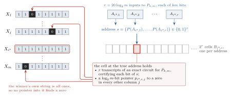
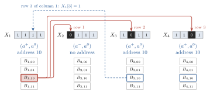
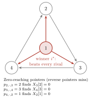
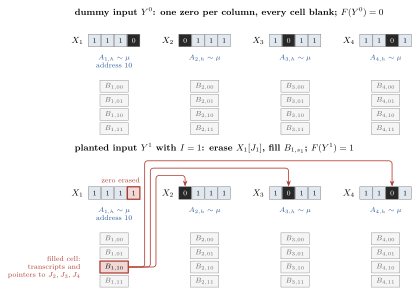

# 1. The fourth power

A quantum algorithm can search among $m$ candidates with about $\sqrt m$ tests. What if each test itself requires a search? Suppose a candidate offers a certificate with $m$ entries, any one of which might be false. Searching for a false entry costs another $\sqrt m$. Put that test inside the first search and the two costs multiply back to $m$.

OpenAI's nearly quartic separation turns on a different use for the certificate. A candidate can challenge a rival by reading just one pointer from its certificate. A genuine winner beats every rival in such a comparison. The losers may beat one another in cycles. Nevertheless, the comparisons suffice to find a short list that contains the winner with high probability. Now the cost of finding candidates and the cost of checking their certificates **add**. Both are about $\sqrt m$.

A classical algorithm also has the right to inspect any certificate bit it chooses. Its difficulty is choosing *where* to look. The winning certificate lies at an address formed from answers to several classically hard problems. Even an algorithm that never explicitly computes those answers makes a prediction about all of them each time it names a cell. We will see why this remains true when the algorithm uses the answers to earlier queries to decide where to look next.

**Theorem** [@OpenAI2026, Theorem 1.1].[^ai] *Four is the optimal exponent relating randomized and quantum query complexity for total Boolean functions.* For each fixed integer $k\ge2$, OpenAI's construction gives functions $F_{k,m}$ for which, at all sufficiently large powers of four $m$,
$$
Q(F_{k,m})\le C_k\sqrt m\,(\log_2m)^6,
\qquad
R(F_{k,m})\ge\frac{m^{2-1/k}}{400(\log_2m)^2}.
$$
Here $m$ counts candidates, and $k$ controls the difficulty of one address input. Up to logarithms, the classical bound approaches $m^2$ while the quantum cost grows as $m^{1/2}$. The ratio of the powers approaches four. Aaronson, Ben-David, Kothari, Rao and Tal had proved that four suffices for every total function and conjectured that three might suffice [@ABKRT2020]. The displayed family rules out three, and indeed every exponent below four. The logarithmic power and numerical coefficient displayed here come from the reconstruction.

**Queries.** The input is a string of bits. A classical query reads one specified bit. A quantum query applies the same bit-reading operation in superposition, as we will calculate in Section 3. Computation between queries is free. The numbers $R(f)$ and $Q(f)$ are the least worst-case query budgets that give error at most $1/3$ on each input, randomized or quantum respectively. A total function gives an answer on every bit string of its length. For a partial function the answer is specified on a subset, its *promise*. Its algorithm may return either bit elsewhere, within the same query budget.

We assume finite-dimensional linear algebra, conditional probability and the usual notation for asymptotic bounds. A four-column example will let us follow a certificate through a comparison, calculate the law of the next candidate and see what a classical query to its cell would have to predict. The analytic lower bound for the address problem, finite minimax and the universal quartic upper bound are taken as inputs. For background on the quantum query model see [@BuhrmanDeWolf2002, §3; @deWolf2026, chapters 1, 2 and 7].

# 2. Four columns and their certificates

[]{#base-board}Consider the four strings
$$
(X_1,X_2,X_3,X_4)=(1111,\ 0111,\ 1011,\ 1101).
$$
Column $1$ can establish a claim against each of its rivals by naming a row. Its three claims are $X_2[1]=0$, $X_3[2]=0$ and $X_4[3]=0$. What claim could column $2$ make against column $1$? Every row it could name in column $1$ contains a one. This asymmetry gives the construction its comparison rule.

The three row numbers are stored as pointers in a cell of column $1$. There are four cells, labelled $00,01,10,11$. To decide *which* cell may speak for the column, evaluate two address inputs, each an instance of the same partial Boolean function $P$. Answers $(1,0)$ select cell $10$. If either answer is undefined, the column has no true cell and cannot win. All four cells still exist and their contents are arbitrary input bits.

{width=94%}

The cell must also justify its address. A public Boolean circuit takes an address input $a$ and returns two bits. Its *domain bit* is $1$ exactly when $a$ is promised. Its *value bit* is $P(a)$ on the promise and $0$ elsewhere. For each address input the cell supplies a transcript, a proposed value at every gate of that circuit.

Column $i$ wins at cell $s$ if its string is all ones, its transcripts are correct with every domain bit $1$ and value bits spelling $s$, and its pointers reach a zero in every other column. Define $F=1$ when some column wins and $F=0$ otherwise. This definition gives an answer to every board, however corrupt its transcripts. Two columns cannot both win: each would need a pointer to a zero in the other's all-one string.

Figure 2 fixes a board we will use several times. Columns $1,3,4$ have answers $(1,0)$. Column $2$ has an unpromised first input and second answer $0$. Every transcript records the actual gate values. In every cell the pointer into each of columns $2,3,4$, whenever present, names its zero. A pointer into column $1$ names the row encoded by the cell label, with $00,01,10,11$ standing for rows $1,2,3,4$.

{width=92%}

[]{#domain-bit-board}**Why certify the promise?** Give column $1$ a zero in its first row, erase the zero in column $2$, and point every pointer into column $1$ at its new zero. Column $2$ can now offer an all-one string and three correct pointers. Try cell $00$. Its two transcripts are accurate, and their value bits really are $(0,0)$. But the first zero means “outside the promise,” whereas the second means “promised, with answer zero.” Only the domain bits distinguish the two. The first domain bit disqualifies column $2$. Every other column contains a zero, so this modified board has $F=0$. Each subsequent alteration of Figure 2 starts again from the original board.

**Checking one candidate.** Each gate has at most two inputs. To check its equation, read its proposed value and the at most two bits that feed it. If every equation passes, induction in gate order forces the whole transcript to be the actual computation. It remains to read the domain and value bits, inspect the column's own string and follow its pointers. A nonwinner fails at least one of these tests at *every* address an algorithm might try.

At full size there are $m$ columns of length $m$. Each has $r=20\log_2m$ address inputs and $2^r$ cells. An address has $r$ bits, whereas a pointer to one of the $m$ rows has only $\ell=\log_2m$ bits. For an address circuit of $S$ gates, the number of tests at one proposed cell is
$$
K=m+(m-1)+rS+2r.
$$
The four summands count string bits, pointers, gate equations and output bits. Each test costs at most $\max(3,\ell+1)$ bit queries, including the bits of the pointer itself. The $2^r$ cells introduce no multiplier here: the proposed address has already selected one cell. Addressed certificates come from cheat sheets [@ABK2016, §3.1], and pointers to other columns' zeros from the pointer-function constructions [@GPW2018; @ABBLSS2017]. In OpenAI's board each addressed certificate carries its own outward pointers [@OpenAI2026, §2].

# 3. Reading an address

The board asks two different questions about an address input. During a comparison we just want a proposed answer, quickly. When checking a claim to be the winner, we must know whether the answer was defined at all. The following eight-bit calculation shows how a decoder can confidently return a bit even when the input has no answer.

Forrelation measures agreement between one sign pattern and the Walsh transform of another [@AA2018]. In the four-row example, split eight bits into two blocks of four and turn each bit $x$ into the sign $(-1)^x$. With $z_1,z_2$ the resulting sign vectors, set
$$
W=\begin{pmatrix}1&1&1&1\\1&-1&1&-1\\1&1&-1&-1\\1&-1&-1&1\end{pmatrix},
\qquad H=W/2,\qquad
\Phi=\left\langle z_1/2, H(z_2/2)\right\rangle .
$$
The rows of $W$ are orthogonal and have norm two, so $H$ preserves lengths. Fix the second block to be $1000$, that is, $g=(-1,1,1,1)$. Multiplying gives $Wg=(2,-2,-2,-2)$. We can now read the three inputs used in Figure 2.

| Address input | Relation of $z_1/2$ to $H(g/2)$ | $\Phi$ | $P$ |
| --- | --- | --- | --- |
| $a^+=0111\,1000$ | equal | $1$ | $1$ |
| $a^0=0100\,1000$ | orthogonal | $0$ | $0$ |
| $a^-=1000\,1000$ | opposite | $-1$ | undefined |

Column $1$ uses $(a^+,a^0)$ and column $2$ uses $(a^-,a^0)$. The promised cases, at this size, are $\Phi\ge2^{-10}$ and $|\Phi|\le2^{-11}$. In particular a large negative correlation is outside the promise. Its sign matters to certification.

**A two-query experiment.** A quantum state is a unit vector, with a basis vector $|j\rangle$ for each possible index. A measurement in that basis returns $j$ with probability equal to the squared modulus of its coefficient. One bit query flips an answer bit $b$ at each position $j$ where $x_j=1$, extending the rule $|j,b\rangle\mapsto|j,b\oplus x_j\rangle$ linearly. Give it the answer state $(|0\rangle-|1\rangle)/\sqrt2$. A flip reverses the sign of this vector. Thus one query multiplies *each amplitude* at position $j$ by $(-1)^{x_j}$, leaving the answer state available for reuse. Write $D_z$ for this diagonal operation.

Start with $u=(1,1,1,1)/2$. Query the second block, apply $H$, then query the first block. On $a^+$ the successive position states are
$$
u\ \longmapsto\ \tfrac12(-1,1,1,1)
\ \longmapsto\ \tfrac12(1,-1,-1,-1)
\ \longmapsto\ u .
$$
Asking whether the final state lies along $u$ succeeds with probability $|u^{\mathsf T}D_{z_1}HD_{z_2}u|^2=\Phi^2$. Concretely, apply $H$ once more and measure the first basis outcome, since $Hu=(1,0,0,0)$. This last transform costs no queries. On $a^0$ the success probability is zero. On $a^-$ the final state is $-u$ and the success probability is one. The decoder can therefore suggest the *same* first bit for columns $1$ and $2$ with certainty on our example. Only the former has a true address.

**The three scales.** In the full construction $m=4^t$, $t\ge1$, and each address input has $k$ sign blocks of length $m$. The normalized Walsh matrix has entries $H_{ab}=(-1)^{a\cdot b}/\sqrt m$ for binary indices of length $2t$. With $u=(1,\ldots,1)/\sqrt m$, put
$$
\Phi=u^{\mathsf T}D_{z_1}HD_{z_2}H\cdots HD_{z_k}u,\qquad \delta=2^{-5k}.
$$
The answer is $1$ for $\Phi\ge\delta$ and $0$ for $|\Phi|\le\delta/2$, and is undefined elsewhere. We need three facts about this one partial function.

* To **propose an address bit**, the preceding experiment takes $k$ queries, one per block. On promised inputs its success probability is either at least $\delta^2$ or at most $\delta^2/4$. Independent trials distinguish these ranges with error $\eta$ in $O_k(\log(1/\eta))$ queries. The constant can grow quickly with $k$. [Appendix A.5](#decoder-repetitions) gives the count.
* To **certify an address bit**, a circuit can compute the signed numerator of $\Phi$ exactly by Walsh additions and subtractions and compare it with the two thresholds. Its size is $S=O_k(m\ell^2)$. Consequently our $K$ local tests number $O_k(m\ell^3)$. The verifier searches those tests in one claimed cell. [Appendix A.6](#exact-certification) gives the integer calculation.
* To **discover an address bit classically**, Bansal and Sinha's lower bound [@BansalSinha2021, Theorem 1.3 and Corollary 1.4] gives $R(P)>L$ for all sufficiently large $m$ at fixed $k$, where
$$
L=\left\lfloor m^{1-1/k}/\ell^2\right\rfloor.
$$
The small board illustrates the operations only. The classical hardness is a theorem about arbitrarily large blocks.

We can now afford to decode the two addresses in a comparison and to read the pointers the two candidates offer against each other. This reveals one accusation from each side.

# 4. The quantum algorithm: a tournament

## 4.1 What a comparison decides

Decode both addresses, read each cell's pointer into the other column, and inspect the two bits they name. A zero disqualifies the column in which it lies. If exactly one column is disqualified, choose the other. Otherwise choose the smaller index. Use the same experiment for the unordered pair however the two columns were presented. Thus the probabilities $a_{ij}=\Pr(i\text{ beats }j)$ satisfy
$$
a_{ij}+a_{ji}=1\quad(i\ne j).
$$
By convention, a column loses to itself, so $a_{ii}=0$. If $i$ genuinely wins the board, no pointer can find a zero in $X_i$, whatever a rival's decoder produces. Once $i$ decodes its own address correctly its pointer finds a zero in every rival. Giving each of its $r$ decodings error at most $\varepsilon/r$ therefore gives $a_{ij}\ge1-\varepsilon$ against each rival.

Two small changes to Figure 2 show exactly what is left to do. First move column $1$'s pointer into column $2$ in cell $10$ from row $1$ to row $2$. It now finds a one. Column $1$ still beats $2$ by the index rule, and beats $3$ and $4$ as before. But the modified pointer is false, so the board has no winner. Even a column that beats everyone needs a final certificate check.

For the second change, restore Figure 2 and alter only pointers between losers. In every cell make column $2$ point to row $1$ of column $4$, column $3$ to row $2$ of column $2$, and column $4$ to row $1$ of column $3$. Try comparing $2$ with $3$. Column $2$ points to $X_3[2]=0$, while column $3$ points to $X_2[2]=1$, so $2$ wins. Following the other arrows in Figure 3 gives $3$ over $4$ and $4$ over $2$. Column $1$ still wins against all three.

{width=55%}

We cannot sort this tournament. In general a comparison between two losers can even come out differently on repeated trials, with no preferred orientation. Quantum minimum-finding uses an order [@DH1996], and bounded-error search assumes a definite answer to each test [@HMW2003]. Here each pair merely has complementary win probabilities.

## 4.2 How much survives a pivot?

Pick a column, call it a *pivot*, and keep it on a list. Next consider only columns that beat it. On Figure 3 this is literal elimination. If the first pivot is $2$, the possible next pivots are $1$ and $4$. If it is $1$, nobody survives, but the winner is already on the list. Over the four equally likely choices of first pivot the numbers left are $0,2,2,2$. The mean is $3/2$. The cycle has caused no trouble at all.

To extend that observation to probabilistic comparisons, give column $i$ a weight $w_i$, the probability that it would beat *all* pivots on the list in fresh, independent comparisons. Initially $w_i=1$. Suppose for a moment we could draw the next pivot $p$ with probability $w_p/|w|$, where $|w|=\sum_i w_i$. Append it to the list. One more comparison multiplies each weight by $a_{ip}$, giving $w_i'=w_i a_{ip}$. A pivot has zero weight thereafter. If all weights vanish, leave the list and weights as they are. This is an ideal experiment on paper. The actual algorithm has access only to queries on the board.

Why should the ideal experiment make progress? For each unordered pair $i,p$ there are two contributions to the expected remaining weight. Drawing $p$ as pivot leaves $w_i a_{ip}$ from $i$; drawing $i$ leaves $w_p a_{pi}$ from $p$. After multiplying by their respective selection probabilities, their combined contribution is $w_iw_p/|w|$, whatever happens in the comparison. For $|w|>0$ this gives
$$
\mathbb E[|w'|\mid w]
=\frac{\sum_{i<p}w_iw_p}{|w|}
=\frac{|w|^2-\sum_iw_i^2}{2|w|}
\le\frac{|w|}{2}.
$$
The missing diagonal accounts for the extra decrease below half: a pivot cannot survive itself. For four equal initial weights the formula gives $(16-4)/8=3/2$, just as on our cycle. The same equality holds if all six comparisons between distinct pairs are fair coin flips. It is *total weight*, rather than the number of surviving columns, that the proof can halve.

After $T$ stages, $\mathbb E|w_T|\le m2^{-T}$. Against any list of $T$ or fewer other pivots the genuine winner still has weight at least $(1-\varepsilon)^T\ge1-T\varepsilon$. Take $T=\lceil\log_2(1000m)\rceil$ and $\varepsilon=1/(1000T)$. An unlisted winner would account, by itself, for more than $1/2$ of a unit of weight. Hence
$$
\Pr(\text{winner missing from the list})
\le\Pr(|w_T|>1/2)\le 2m2^{-T}\le1/500 .
$$
This extends the pivot idea for a tournament with fixed orientations [@AIK2026v3, §§4 and 6.1]. The apparent obstacle is that the numbers $w_i$ used to draw each pivot are unknown.

## 4.3 Drawing from weights we cannot compute

Choose $i$ uniformly, compare it afresh with every pivot on the list, and accept it if it wins every comparison. For pivots $p_1,\ldots,p_j$,
$$
\Pr(\text{accept and draw }i)
=\frac{1}{m}\prod_{b=1}^j a_{ip_b}
=\frac{w_i}{m}.
$$
Sum over $i$ to obtain the acceptance probability $q=|w|/m$. Divide by $q$ to obtain the ideal pivot law $w_i/|w|$. The comparisons have done the weighting for us.

For example, suppose that against pivot $2$ the four win probabilities are $(1,0,2/3,1/4)$. These are possible *abstract* comparison probabilities, distinct from the deterministic arrows in Figure 3. The masses of acceptance with the four labels are $(1/4,0,1/6,1/16)$, for a total of $23/48$. On accepting, therefore, we draw $1,3,4$ with probabilities $12/23,8/23,3/23$. Choosing uniformly among the three possible labels would change the law used in the halving proof. To continue this example in the exercises, take the win probabilities against pivot $4$ to be $(1,3/4,2/5,0)$.

Independent rejection trials would cost $1/q$ attempts on average. Near the end of the tournament only a single column may retain much weight, and $1/q$ can be as large as order $m$ even with the winner still to find. Quantum amplitude amplification reduces the number of attempts. There is a distribution to preserve as well as a probability to increase.

Prepare a uniform superposition of the column labels and, controlled by each label $i$, run its comparisons with the earlier pivots in fresh registers. Retain the answers and compute a final bit indicating whether all comparisons were won. Conditional on $i$, squared amplitudes in distinct comparison registers multiply, so the mass on label $i$ with final bit one is exactly $w_i/m$. All operations so far are reversible. Write the resulting unit vector as
$$
\sin\theta\,g+\cos\theta\,b,\qquad \sin^2\theta=q,
$$
where $g$ is the normalized projection onto final bit one and $b$ the projection onto final bit zero, normalized likewise ($0<q<1$). Think of $g$ as one vector carrying all the successful labels in their correct proportions. A reflection that negates the successful states followed by a reflection about the initially prepared vector rotates their plane. After $v$ pairs of reflections the state is
$$
\sin((2v+1)\theta)\,g+\cos((2v+1)\theta)\,b .
$$
Only the *coefficient* of $g$ has changed. Measuring the label conditional on success still gives the probabilities within $g$, including the unequal probabilities we just calculated. A random iteration count or stopping on the first success of several fresh trials mixes copies of that same law [@BHMT2002, Lemma 1; @deWolf2026, chapter 7].

On Figure 3, try choosing pivots $2$ and then $4$. Only column $1$ beats both. Here $q=1/4$ and $\theta=\pi/6$. One rotation gives success probability $\sin^2(3\pi/6)=1$; a second brings it back to $1/4$. Since $q$ is unknown, the algorithm uses a bounded schedule of random rotation counts. With $O(\sqrt m\log(1/\varepsilon))$ preparations and inverses it succeeds except with probability $\varepsilon$ whenever $q\ge1/(2m)$ [@BBHT1998, Lemma 2]. It always stops within that cap. [Appendix A.3](#amplification-schedule) derives the schedule, including the reflection that uses the inverse preparation.

Append each successful measured label, stopping on failure or after $T$ pivots. Until the winner is listed, its weight exceeds $1/2$, so $q\ge1/(2m)$ and the success guarantee applies. We can draw the same label in the ideal and actual processes whenever the actual sampler succeeds, because its conditional law is exactly right. Over at most $T$ stages the chance of a failure before listing the winner is at most $T\varepsilon$. A failure *after* listing it costs nothing. For instance, once the list on Figure 3 is $(2,4,1)$, nobody can beat all three and nothing more need be found.

## 4.4 Checking the list

For each listed column, decode its address afresh and search the $K$ tests of Section 2 for a violation. A uniform test finds a violation with probability at least $1/K$ if any exists, so the same bounded amplification searches for one using $O(\sqrt K\log(1/\varepsilon))$ test evaluations. Accept the board if any listed column passes. On a $0$-board every candidate, at any decoded address, has a defect. Each search misses a defect with probability at most $\varepsilon$. With at most $T$ searches the total probability of a false acceptance is at most $T\varepsilon$. On a $1$-board the list misses its winner with probability at most $1/500+T\varepsilon$. Decoding the winner's address incorrectly adds at most $\varepsilon$ more. At its correct address all tests pass.

What costs a power of $m$ here? Sampling a pivot takes order $\sqrt m$ preparations up to logarithms. Each preparation uses at most $T$ comparisons, each comparison only a polylogarithmic number of queries. Checking one candidate costs order $\sqrt K$, again up to logarithms, and $K=O_k(m(\log m)^3)$. There are at most $T=O(\log m)$ candidates. Thus both stages fit within $\widetilde O_k(\sqrt m)$ queries, where the tilde suppresses powers of $\log m$. The [full count](#quantum-query-count) gives $C_k\sqrt m(\log_2m)^6$. The expensive certificate search has moved outside the search for candidates.

# 5. Where a classical algorithm would have to look

Start with a board on which every column has exactly one zero and all certificate cells are blank. Pick one column uniformly. Erase its zero, then fill its true cell with correct transcripts and pointers to the other zeros. There is now a winner. An algorithm that touched neither the erased zero nor the filled cell would see exactly the same answers on the two boards. The question is how much it can improve its chances of a hit by choosing its queries adaptively.

Fix $k$ and take $m$ large enough that $1\le L<R(P)$, with $L$ as in Section 3. By finite minimax there is one distribution $\mu$ on promised inputs of $P$ under which *every* deterministic $L$-query algorithm has success at most $2/3$ [@Yao1977]. Draw all the address inputs independently from $\mu$. In each string put its zero at an independent uniform position $J_i$. This produces the losing board $Y^0$. Draw the planted column $I$ uniformly and independently of the entire board, and make the two changes just described to get $Y^1$.

{width=90%}

Fix the coins of an algorithm making at most $G$ queries and follow its run on the losing board. Until the first answer that differs, the run on the winning board asks exactly the same queries. It therefore suffices to count, on the losing run, queries to the two places where answers *could* differ. That run is independent of $I$. Call a column *heavy* if the entire run devotes more than $L$ queries to its address inputs and *light* otherwise.

| A hit on the losing run | Upper bound |
| --- | --- |
| The run discovers the zero of the selected column. | $4G/m^2$ |
| The selected column is heavy. | $G/(mL)$ |
| The selected column is light and the run visits its true cell. | $G(2/3)^r$ |

**The hidden zero.** Suppose the run has yet to find the zero of column $i$. Given what it has seen, the zero is uniform among the unread rows of $X_i$: moving it from one unread position to another preserves every answer and hence every choice so far. While fewer than half of that column's rows have been read, the next query finds the zero with probability at most $2/m$. That gives at most $2G/m$ early discoveries in expectation over the whole board. A later discovery requires at least $m/2$ previous reads *in its own column*, and the budget allows at most $2G/m$ such columns. If the run finds $Z$ zeros, the independently planted column is among them with probability $Z/m$. Averaging gives the first row of the table. The second follows from the same counting principle: more than $L$ address queries per heavy column leave at most $G/L$ heavy columns.

**The hidden cell.** A bit in a cell has a coordinate $(i,s,u)$: column, address, offset within the cell. Suppose the next query is $(i,10,u)$. Before receiving a single bit from that cell, the algorithm has proposed that the two address answers of column $i$ might be $(1,0)$. On a visit to the true cell that prediction is exactly right. This observation applies to all $r$ answers, no matter how the algorithm chose the coordinate. It remains to show that an adaptive algorithm with much of the rest of the board at its disposal cannot make too many good predictions.

Consider one proposed query time $j$ and one column $i$. Imagine being handed the $r$ hidden address inputs of that column, with the task of predicting their answers. You can sample the rest of the losing board yourself: all other address inputs and all zero locations are independent of these $r$ inputs, and all cells are blank. Start the algorithm on this board. Answer its queries from what you sampled, except that a query to one of the hidden inputs must be forwarded and paid for. Stop *before* forwarding an $(L+1)$st such query. If the algorithm proposes $(i,s,u)$ at time $j$, output $s$ immediately, without reading that bit. On any other ending output a fixed address.

For instance, after spending your last allowed query, you may still answer arbitrarily many intervening queries to blank cells or other columns. If the next relevant move is $(i,10,u)$ at the appointed time, you output $10$. If instead the algorithm needs another bit of a hidden address input before reaching time $j$, you stop. The original algorithm was permitted that query. Your prediction procedure has its own, smaller budget.

On any run where $i$ is light, you can reproduce all choices up to time $j$. Thus
$$
\{i\text{ light and query }j\text{ in its true cell}\}
\ \subseteq\
\{\text{the capped procedure predicts all }r\text{ answers}\}.
$$
A prediction can succeed in other ways, including a lucky default on a stopped run. This direction of inclusion is precisely what we need. The probability on the right is taken over the original independent samples. Conditioning first on a run being light could bias those samples toward easy ones.

The separate-cap direct-product lemma bounds that prediction probability by $(2/3)^r$ [@Shaltiel2003; @Drucker2012]. In detail, when each sample separately admits at most $\beta$ success in $L$ queries, a procedure with *at most $L$ queries to each sample on every run* predicts all $r$ independent answers with probability at most $\beta^r$. It can interleave the queries and use jointly independent side information. Our procedure makes at most $L$ forwarded queries in total, so it meets every separate cap. One reason the product survives adaptivity is that a fixed history of queries and answers restricts each input only through the bits of that input already seen. Conditional on that history the input laws still factor. [Appendix B](#direct-product-proof) completes the proof by tracking the best remaining success on each input.

For fixed $i$, summing over the $G$ opportunities for a correct visit costs a factor $G$. To ask whether the *selected* column was visited we average this bound over $I$, giving $G(2/3)^r$ again. This proves the last row. The logarithmic address length pays for the algorithm's many chances to guess: $r=20\log_2m$ makes $(2/3)^r\le m^{-10}$.

[]{#classical-finish}Putting the three charges together, the probability of different outputs on the two boards is at most
$$
\frac{4G}{m^2}+\frac{G}{mL}+G(2/3)^r .
$$
Take $G=\lfloor mL/100\rfloor$. Since $L\le m$, the three terms sum to at most $4/100+1/100+1/(100m^8)<1/3$. The same bound holds after averaging over the algorithm's coins. Yet success $2/3$ on every input requires acceptance probability at least $2/3$ on the winning boards and at most $1/3$ on the losing boards. That gap requires different outputs with probability at least $1/3$ in our paired experiment. Hence $R(F_{k,m})>\lfloor mL/100\rfloor$.

# 6. Why the exponent is four

The universal exponent asks for a *single* power $\alpha$ and constant $C$ such that $R(f)\le C(1+Q(f))^\alpha$ for every total Boolean function $f$. Write $\alpha_{\rm tot}$ for the infimum of such nonnegative exponents. To see how the construction rules a power out, try $\alpha=3$. With $k=3$ the classical exponent in $m$ is $2-1/3=5/3$, whereas cubing the quantum bound gives only $3/2$. The surplus $1/6$ of a power of $m$ eventually outweighs any fixed power of its logarithm.

The same calculation works against any $0\le\alpha<4$. Choose an integer $k\ge2$ with $1/k<(4-\alpha)/2$. Now *hold $k$ fixed*. The constant in the quantum decoder and the size threshold in the classical hardness theorem can both depend on it. For large enough $m$, the floor in $L$ costs at most a factor two, giving the lower bound with coefficient $1/400$ stated in Section 1. The ratio of the two sides then satisfies
$$
\frac{R(F_{k,m})}{(1+Q(F_{k,m}))^\alpha}
\ \ge\ c_{k,\alpha}\,
\frac{m^{2-1/k-\alpha/2}}{(\log_2m)^{2+6\alpha}}
\ \longrightarrow\ \infty .
$$
The surplus power is positive by our choice of $k$. No uniform constant $C$ can work. In the other direction, the universal bound of Aaronson, Ben-David, Kothari, Rao and Tal, building on Huang's sensitivity theorem [@ABKRT2020; @Huang2019], gives deterministic query complexity $D(f)=O(Q(f)^4)$ for total functions. Since $R(f)\le D(f)$, four suffices. Thus $\alpha_{\rm tot}=4$.

On the four-column board, column $1$ could answer a challenge from any rival by reading a single outward pointer. To exploit that fact at large $m$, the quantum algorithm needs a quick way to reach the cell, and then a way to search using what *one pointer* says. Forrelation supplies the first. The halving identity supplies the second, even when the losers' comparisons are as disorderly as possible. Only the few measured pivots incur the cost of checking an entire certificate.

Now view that same cell from the losing board. A good classical strategy might spend enough queries to learn one column's address. But the planted column was chosen independently, and that expense can be afforded in few columns. Everywhere else each proposed cell is a prediction about independent hard inputs, made *before* the query can return any evidence from the cell. This is where the second power of $m$ comes from: a budget of order $mL$ would allow about $L$ address queries per possible planted column, and $L$ itself grows nearly as fast as $m$ when $k$ is large. The quantum comparison needs one outward pointer from that cell. For a classical algorithm, even the query that would read its first bit has to name all the answers in the address.

[^ai]: The theorem and construction are OpenAI's. This exposition and its Lean development were prepared with AI systems under the author's direction.

# Appendix A. Supporting calculations {.unnumbered}

[]{#quantum-query-count}

## A.1 Counting the quantum queries

The main quantum argument in Section 4 uses the following count. It charges the same comparisons and local tests on every branch; early stopping can only reduce the cost.

A coherent test evaluation works on a superposition of test labels. It computes the next input position reversibly and retains earlier answers. To implement a read that is active only on some branches, query $x_j$ into a temporary bit, conditionally copy it to the answer bit, then query $j$ again to clear the temporary bit. This uses two ordinary oracle calls; on an inactive branch the answer and temporary bits are both restored. Padding to a common number of these controlled reads therefore has a fixed cap even in superposition. Running the computation backwards then restores its workspace. This implements the same tests using $O(\ell+1)$ bit queries per evaluation; [the controlled-read construction](https://github.com/wcook04/quartic-query-lean/blob/25908361a5832d5b243846300960379b2ea228a9/docs/reasoning_record.md#AC-coherent) gives the controlled implementation. No full transcript is read during a single test.

**The count.** Early stopping and randomized iteration counts make the number of queries depend on the run. The caps are fixed in advance and hold on every input and branch. A comparison uses $O_k(r\log(r/\varepsilon))$ queries for its decoders and $O(\ell+1)$ for its pointers, including the constant overhead of a reversible implementation. We count the tournament first, then verification.

Each stage uses $O(\sqrt m\log(1/\varepsilon))$ preparations, and each preparation makes at most $T$ comparisons. There are at most $T$ stages. Multiplying these three factors bounds the entire tournament by $O(\sqrt m\,T^2\log(1/\varepsilon))$ comparisons.

Verification makes at most $T$ fresh address decodings. For each candidate it searches the $K$ local tests, using $O(\sqrt K\log(1/\varepsilon))$ test evaluations. Thus the list requires $O(T\sqrt K\log(1/\varepsilon))$ test evaluations in all.

In bit-query units the two costs add:
$$
O_k\!\left(\sqrt m\,T^2\log(1/\varepsilon)
 [r\log(r/\varepsilon)+\ell]
 +T[r\log(r/\varepsilon)+\sqrt K\log(1/\varepsilon)\ell]\right).
$$
The first bracket charges comparisons; the second charges fresh address decoding and local-test search. Here $r,T,1/\varepsilon=O(\ell)$ and $K=O_k(m\ell^3)$. Bounding $\log(1/\varepsilon)=O(\ell)$, $\log(r/\varepsilon)=O(\ell^2)$ and $\sqrt K=O_k(\sqrt m\,\ell^2)$ deliberately enlarges the logarithms and square root. These substitutions give $O_k(\sqrt m\,\ell^6)$ for the tournament and $O_k(\sqrt m\,\ell^5)$ for verification ([the explicit count](https://github.com/wcook04/quartic-query-lean/blob/25908361a5832d5b243846300960379b2ea228a9/docs/reasoning_record.md#upper-explicit-log6)). Therefore
$$
Q(F_{k,m})\le C_k\sqrt m\,(\log_2m)^6.
$$
The tournament and short-list verification costs add, in place of the earlier nested search product $\sqrt m\sqrt K$. Here $m$ counts columns. The exponent six is an artefact of this loose count. Square-root dependence comes from amplifying pivot sampling and searching the local tests. The short list limits how many verifications are needed; it is the quantum half of the exponent calculation.

[]{#earlier-recipe}

## A.2 Why the balanced AND–OR recipe stops at a cube

In the cheat-sheet construction [@ABK2016, §3.1], each of the $n$ input bits of a partial function $g$ is replaced by the answer to its own AND–OR instance on $n^2$ bits, for $n^3$ bits overall before adding certificates. In one instance, write the bits as $n$ rows of $n$ bits; its answer is $1$ exactly when every row contains a $1$. A $1$-certificate selects one $1$ in every row; a $0$-certificate selects one entire zero row. Thus either answer has a certificate of $n$ bits. Reading those certificates determines the $n$-bit vector supplied to $g$; the fixed domain predicate of $g$ can then be checked by free computation. The certificate reads remain charged.

Up to logarithmic factors, the cited composition and cheat-sheet argument supplies randomized lower bound $R(g)n^2$ and quantum upper bound $n$ when $Q(g)$ is polylogarithmic in $n$. Reading all $n$ bits gives $R(g)\le n$, so this calculation reaches at most a cubic separation. Ben-David's earlier Forrelation construction [-@BenDavid2015] and cheat sheets first gave power $5/2$; Tal [-@Tal2020] reached $8/3-o(1)$, and the nearly linear partial-function bounds of Bansal and Sinha [-@BansalSinha2021] and Sherstov, Storozhenko and Wu [-@SSW2023] gave $3-o(1)$. In the present construction, an address instance has about $m$ bits while the quantum search costs about $\sqrt m$. The partial-function hardness can therefore contribute almost two powers of the quantum cost. Section 4 explains how comparisons make that square-root search possible.

Certificate complexity is a separate measure: it counts the bits needed to force a function value. Ben-David and Kothari construct total functions for which randomized evaluation beats this measure [@BDK2026, §§2–3]. Their card encoding and the fixed-graph search cited in Section 4 are related constructions, not inputs to the randomized–quantum bound proved here.

\Needspace{8\baselineskip}

[]{#amplification-schedule}

## A.3 The amplification rotation and a finite schedule

For $0<q<1$, write $A|0\rangle=\sin\theta\,g+\cos\theta\,b$ as in Section 4.3. Here $A$ includes the index, all comparison registers and the final success flag. To reflect about $A|0\rangle$, apply $A^{-1}$, reflect about $|0\rangle$, and apply $A$ again. Retaining the decoder and pointer-read registers makes this inverse possible and gives it the same query cost as $A$. The two reflections act on the plane spanned by these orthonormal success and failure vectors. In the ordered orthonormal basis $(g,b)$, the success phase flip and the reflection about $A|0\rangle$ have matrices
$$
S=\begin{pmatrix}-1&0\\0&1\end{pmatrix},\qquad
R_{A0}=\begin{pmatrix}-\cos2\theta&\sin2\theta\\\sin2\theta&\cos2\theta\end{pmatrix}.
$$
Their product $R_{A0}S=\left(\begin{smallmatrix}\cos2\theta&\sin2\theta\\-\sin2\theta&\cos2\theta\end{smallmatrix}\right)$ sends $(\sin\theta,\cos\theta)$ to $(\sin3\theta,\cos3\theta)$. This calculation gives the rotation formula used in Section 4.3. It changes the total successful amplitude, leaving the normalized successful state unchanged.

Section 4 needs both a cap on every input and the conditional label law of Section 4.3. Set $M=\lceil10/\sqrt\gamma\rceil$ and $N=\lceil\ln(1/\eta)/\ln(40/31)\rceil$. In each fresh trial use zero iterations with probability $1/2$, and otherwise choose $v$ uniformly from $0,\ldots,M-1$. Stop at the first acceptance, or after $N$ failures. Each trial uses at most $2M+1$ calls to $A$ or $A^{-1}$, so $N(2M+1)$ is an all-input cap.

To bound the failure probability, first suppose $\gamma\le q\le1/2$. Averaging the rotation formula gives [@BBHT1998, Lemma 2]
$$
\frac1M\sum_{v=0}^{M-1}\sin^2((2v+1)\theta)
=\frac12-\frac{\sin(4M\theta)}{4M\sin(2\theta)}
\ge\frac12-\frac1{4M\sqrt{2\gamma}}\ge\frac9{20},
$$
since $\sin(2\theta)=2\sqrt{q(1-q)}\ge\sqrt{2\gamma}$. Thus the randomized-iteration branch alone contributes at least $9/40$ to the trial's acceptance probability. If $q\ge1/2$, the zero-iteration branch contributes at least $q/2\ge1/4$. In either case, $N$ fresh trials all fail with probability at most $(31/40)^N\le\eta$. Each successful trial has the label law derived in Section 4.3, so stopping at the first success preserves it. If $q<\gamma$, the cap still holds, although the acceptance guarantee need not.

\Needspace{8\baselineskip}

## A.4 The small circuit and its local tests

[]{#circuit-check}*Optional circuit census.* The [explicit circuit for the four-column board](https://github.com/wcook04/quartic-query-lean/blob/25908361a5832d5b243846300960379b2ea228a9/docs/reasoning_record.md#AC-example-promise) has $S=180$ non-input gates, so each candidate has $K=4+3+2(180+2)=371$ tests. In its zero-based numbering, input bits $6$ and $7$ feed gates $1$ and $2$: they compute $u=\neg x$, then $v=u\lor y$. On $a^+$ these last two input bits are both zero. To test gate $2$, read the proposed $u$, the actual $y$ and the proposed $v$. Reading $(1,0,0)$ exposes a false gate value, since $1\lor0=1$. The domain and value outputs are gates $178$ and $179$. Every cell contains $6$ pointer bits and $360$ transcript bits. With four cells in each of four columns, the full board has $4[4+16+4(6+360)]=5936$ input bits. Only one cell enters the tests for a given candidate. This toy uses $r=2$; the separation family uses $r=40$ when $m=4$, and its classical lower bound requires much larger $m$.

[]{#decoder-repetitions}

## A.5 Repeating the projection experiment

For any requested error $0<\eta<1/2$, the projection experiment of Section 3 extends to every $k$. Phase kickback uses one query per sign diagonal, so a trial uses $k$ queries and has projection probability $p=\Phi^2$. On the promise, either $p\ge c=\delta^2$ or $p\le c/4$. Start each trial in fresh registers and repeat independently
$$
\rho=\lceil16c^{-1}\ln(1/\eta)\rceil
$$
times; accept if at least $\rho c/2$ projections succeed. We use the following standard Chernoff estimates for the number $Z$ of successes in these independent Bernoulli trials:

| Promised case | Wrong decision | Tail bound used |
| --- | --- | --- |
| $p\ge c$ | $Z<\rho c/2$ | At most $\exp(-\rho c/8)$, hence at most $\exp(-\rho c/16)$. |
| $p\le c/4$ | $Z\ge\rho c/2$ | At most $\exp(-\rho c/16)$, by the upper tail at $p=c/4$ and monotonicity. |

Thus each error is at most $\eta$. The cap is $k\rho=O_k(\log(1/\eta))$ on every input. The subscript permits constants depending on $k$, here including $c^{-1}=2^{10k}$: cheap means fixed $k$ and growing $m$. Section 4 will retain the trial outcomes coherently instead of measuring them; their measurement probabilities and independence remain the same.

[]{#exact-certification}

## A.6 Exact certification and the input size

The circuit uses integer arithmetic. The two factors $1/\sqrt m$ in $u$ and the $k-1$ internal Walsh factors give $\Phi=N/2^{t(k+1)}$ for an integer $N$. A fast Walsh transform recursively transforms two half-size vectors, then adds and subtracts their corresponding entries. These split-and-combine steps compute the numerator using additions and subtractions, and integer comparisons decide the two thresholds exactly. For example, $\Phi\ge2^{-5k}$ is equivalent to $2^{5k}N\ge2^{t(k+1)}$; the small-value test is $2^{5k+1}|N|\le2^{t(k+1)}$. Words of $O(k\log m)$ bits suffice, including the threshold shifts. The [record's circuit construction](https://github.com/wcook04/quartic-query-lean/blob/25908361a5832d5b243846300960379b2ea228a9/docs/reasoning_record.md#forr_circuit) gives the arithmetic and gate count. The quantum verifier checks a stored computation of this circuit; it does not run the entire circuit on each candidate.

**The hardness allowance.** This is the consequence of the randomized lower bound of Bansal and Sinha for this one-sided promise [-@BansalSinha2021, Theorem 1.3 and Corollary 1.4]. For fixed $k$, the source bound is at least a positive constant depending on $k$ times $m^{1-1/k}/(\log_2(km))^{1-1/k}$. Dividing this by the unfloored expression for $L_{k,m}$ gives a factor of order $(\log m)^{1+1/k}$, which tends to infinity and absorbs the constant.

**Input length.** A column contains $m$ string bits, $rkm$ address-input bits, and $2^r$ cells, each containing $(m-1)\ell$ pointer bits and $rS$ transcript bits. Thus the general function has $n=m\bigl[m+rkm+2^r((m-1)\ell+rS)\bigr]$ input bits, which is $O_k(m^{22}(\log m)^3)$ since $2^r=m^{20}$. Thus the total input length is polynomial in $m$, although much larger than $m$. The three bracketed contributions are the column string, its address inputs, and its cell array. Here $n$ is the actual input length; $m$ controls the displayed query bounds. The comparison is between $R$ and $Q$ for this one function, with the same circuit; neither bound counts the time to read or allocate the whole input.

\Needspace{8\baselineskip}

[]{#direct-product-proof}

# Appendix B. The separate-cap direct product {.unnumbered}

We prove the separate-cap direct-product lemma used in Section 5. The input samples are independent, each has the same hard law, each individual cap holds on every branch, and the coins and side information are jointly independent of the entire tuple.

*Source note.* The separately capped setting goes back to Shaltiel's fair decision trees [-@Shaltiel2003]. The proof below is the conditional-value argument of Drucker's Lemmas 3.1–3.2, whose headline theorem uses one global budget instead [-@Drucker2012, §1.3 and the end of §3].

Fix the coins and side information. By joint independence the samples are still independent with law $\mu$, and the algorithm is a deterministic tree. Take a history $\tau$ of queries and answers that occurs with positive probability. Each recorded answer constrains only its own sample, and because the tree is deterministic, every tuple that agrees with these answers asks exactly these queries. So the tuples consistent with $\tau$ form a product $E_1(\tau)\times\dots\times E_r(\tau)$, and given $\tau$ the samples are independent with laws $\mu(\cdot\mid E_h(\tau))$.

Now measure the best success still available with the budget left. For AND on two independent fair bits with one query allowed, before querying it is $3/4$; after seeing a zero it is $1$, and after seeing a one with no queries left it is $1/2$. Let $q_h(\tau)$ count the queries to $U_h$ in $\tau$, and let $V_h(\tau)$ be the best probability of computing $P(U_h)$ under $\mu(\cdot\mid E_h(\tau))$ with at most $L-q_h(\tau)$ further queries. If the next query reads a bit of $U_h$, then querying it and continuing optimally is one strategy with that allowance, so averaging over the answer $b$,
$$
\sum_b\Pr(b\mid\tau)\,V_h(\tau b)\le V_h(\tau).
$$

One answer may raise $V_h$; only the average cannot. For two independent uniform AND inputs with caps of one query, observing first bit $0$ in $U_1$ gives $E_1=\{00,01\}$ and $E_2=\{00,01,10,11\}$; the second sample is still unrestricted. We have $V_1=V_2=3/4$ at the start; reading the first bit of $U_1$ makes $V_1=1$ or $1/2$ as the bit is $0$ or $1$, and $V_2$ stays $3/4$, so the product averages to $\tfrac12\cdot\tfrac34+\tfrac12\cdot\tfrac38=\tfrac9{16}$, its starting value.

In general the other samples keep their laws and allowances, so their values do not change, and $\prod_hV_h$ has nonincreasing expectation from step to step. It starts at most $\beta^r$. At a leaf with output $s$, the probability of being right given $\tau$ is $\prod_h\Pr(P(U_h)=s_h\mid\tau)\le\prod_hV_h(\tau)$. Averaging over leaves and then over the coins and side information finishes the proof; the query cap and the finite sets of input positions, answers and outputs allow only finitely many deterministic trees. Arbitrary independent randomness therefore reduces to a finite mixture of these behaviours.

Return to the [final gap bound in Section 5](#classical-finish).

# Appendix C. Testing the classical hypotheses {.unnumbered}

The following examples isolate the roles of independent planting, terminal lightness and the query caps. They change the partial function where stated; they are not small hard instances of the asymptotic family.

\Needspace{13\baselineskip}

### Independent planting

The identity $\Pr(\text{erased zero hit})=\mathbb EZ/m$ needs $I$ to be independent of the run. Query one fixed position in each of the four columns, so that $\mathbb EZ=1$ and an independent $I$ is hit with probability $1/4$. Suppose instead that $I$ is chosen uniformly among the columns where a zero was found, and uniformly among all four when none was found, which happens with probability $(3/4)^4=81/256$. By symmetry $I$ is still uniform on its own, but now it is hit whenever some zero was found, with probability $1-(3/4)^4=175/256$. A uniform marginal is a weaker condition than independence from the run, and the proof needs independence.

### Lightness is a joint event

**Why the event must be joint.** A run that stays light behaves like a capped algorithm, but it need not succeed with probability at most $\beta^r$ given that it stays light. Take $P=\text{AND}$ on the three promised inputs $01,10,11$, uniformly; any one-query algorithm is right with probability at most $\beta=2/3$. Read the first bit, output $0$ if it is $0$, and otherwise read the second bit. This algorithm stays within one query exactly on input $01$, where it is right, so its success given that it stays light is $1$. The true statement concerns the joint event: being right **and** staying within the caps has probability $1/3\le\beta$. This toy illustrates conditioning: it meets the one-query hard-law premise but has $R(P)=L=1$, so it does not instantiate the strict $L<R(P)$ regime of our construction ([record Appendix B.3](https://github.com/wcook04/quartic-query-lean/blob/25908361a5832d5b243846300960379b2ea228a9/docs/reasoning_record.md#CL-conditioning-counterexample)).

### Two clocks in a capped simulation

A small trace makes the cap concrete. Use the [record's XOR example](https://github.com/wcook04/quartic-query-lean/blob/25908361a5832d5b243846300960379b2ea228a9/docs/reasoning_record.md#CL-simulator-example), which changes the partial function to $P(a,b)=a\oplus b$. Use column $i$ as the target. In this separate toy, let the two inputs $(a,b)$ and $(c,d)$ be independent fair bit pairs, and set $L=1$. The dummy algorithm first reads an outside string bit, then $a$. Its third query is outside the target if $a=1$, and reads $c$ if $a=0$. Its fourth query proposes a bit in $B_{i,(a,0)}$.

| Global time | Proposed query | Forwarded count and action |
| --- | --- | --- |
| $1$ | Outside string bit | $q=0$; answer locally. |
| $2$ | $a$ | $q:0\to1$; forward. |
| $3$, $a=1$ | Outside target | $q=1$; answer locally. |
| $3$, $a=0$ | $c$ | $q=1=L$; stop before reading. |
| $4$, $a=1$ | Cell $B_{i,10}$ | $q=1$; output label $10$ without reading. |

If $a=1$, the simulator has spent its one target query learning $a$. It answers the third query from its outside information, then reaches the fourth query and outputs $10$, read from the proposed cell position. It does not read the bit in that cell.

If $a=0$, the proposed third query would read $c$, using a second target query. The simulator stops before that query and outputs the default address $00$. Its cap is enforced on this branch as well.

The first branch gives the light true-cell event exactly when $a=1,b=0,c=d$, with probability $1/8$. The simulator is also correct on $a=0,b=0,c=d$, another event of probability $1/8$. Its total success probability is $1/4$, the separate-cap bound $(1/2)^2$ for two fair XOR inputs. Aborting is part of the algorithm; the probabilities are under the original input distribution, without conditioning on the query count.

### Separate caps and independent information

*Separate caps.* Take AND on two independent inputs, each uniform on all four two-bit strings; one query to an input gives $\beta=3/4$. A pooled budget of two queries computes the first answer exactly and guesses $0$ for the second, which is right with probability $3/4>9/16$.

*Joint independence.* For the identity on fair bits $X,Y$ with $L=0$, the side information $X\oplus Y$ is independent of each bit separately, yet the guess $(0,X\oplus Y)$ is right whenever $X=0$, with probability $1/2>1/4$.

# Appendix D. Exercises and answers {.unnumbered}

These questions revisit the board, the weighted sampler and the capped predictor. The examples in Appendix C supply the independent-planting and two-clock setups. The answers follow the questions.

**Projection check.** For $1111\,1000$, calculate the signed amplitude $\Phi$ and then the projection probability. These are different quantities. The [answer](#answer-projection) is separated from the attempt.

[]{#question-1}**Question 1 (promise certification).** On the domain-bit board of Section 2, make one row for each of column $2$'s four addresses. In each row name the domain and value outputs that fail and count them; no gate indices are required. ([Answer](#answer-1).)

[]{#question-2}**Question 2 (conditional sampling and overshoot).** Reconstruct the cycled-board calculation in Section 4.3: after pivots $(2,4)$, why does one amplification iteration help and a second undo the gain? An iteration uses the entire preparation and its inverse, not one bit query. Now continue the unequal-weight example with pivot $4$: find the joint success masses and conditional label law. Multiply the current weights by the comparison probabilities; do not restart from all ones. ([Answer](#answer-2).)

[]{#question-3}**Question 3 (independent planting).** In the independent-planting example of Appendix C, now query two fixed distinct positions per column. How often is an independent $I$ hit, and how often the dependent one? If later queries depend on earlier replies, which identity still holds for an independent $I$, and why? ([Answer](#answer-3).)

[]{#question-4}**Question 4 (two clocks and the capped event).** In the two-clock trace of Appendix C, change the $a=0$ branch so that it proposes a query in $B_{i,00}$ at time $3$, before trying to read $c$. If the run stops after this cell query, what probability does the changed branch contribute, and what is the total probability of a light true-cell visit at either indicated time, including the unchanged $a=1$ branch at time $4$? What changes if the $a=0$ branch reads $c$ afterwards? Which fixed-time events must be bounded separately by the simulator lemma? ([Answer](#answer-4).)

[]{#question-5}**Question 5 (uniform constants and endpoint powers).** What does $k=4$ prove about $\alpha_{\rm tot}$? Which $k$ makes the argument of Section 6 exclude the endpoint bound $R(f)\le C(1+Q(f))^{3.5}$ itself? ([Answer](#answer-5).)

**Combined explanation.** Using the cycled board and the planted-pair/XOR examples, explain why the quantum list can contain a winner even when a later stage fails, and why any classical light visit gives a capped address prediction. Why does an arbitrary rival's off-promise decoder law not spoil comparison with a genuine winner? For the classical route, take an integer budget $G\le c\,mL$: reconstruct the three charges, show that their sum is at most $4c+c+c/m^8$, and identify where $L\le m$, $r=20\log_2m$ and averaging over the independent $I$ enter. Explain which half of $\alpha_{\rm tot}=4$ these mechanisms establish and which half uses the imported universal theorem. Try this before reading the [rubric](#answer-combined). A one-route reader may quote the other route's bound.

## Answers

[]{#answer-projection}**Projection check.** The first sign block is $(-1,-1,-1,-1)$ and its dot product with $(2,-2,-2,-2)$ is $4$. Thus the signed amplitude is $\Phi=4/8=1/2$ and projection probability is $|\Phi|^2=1/4$.

[]{#answer-1}**[Question 1](#question-1).** String, pointer and gate tests pass. Domain bits $(0,1)$ and value bits $(0,0)$ make the first domain test fail always, and a value test fail wherever the address differs from $00$: one failure at $00$, two at $01$ and $10$, three at $11$.

\Needspace{15\baselineskip}

[]{#answer-2}**[Question 2](#question-2).** Multiplying $(1,0,0,1)$ by $(a_{14},a_{24},a_{34},a_{44})=(1,0,1,0)$ gives $(1,0,0,0)$. A preparation succeeds with probability $1/4\ge\gamma$ and then yields column $1$; with $\theta=\pi/6$, one Grover iteration makes success certain, as $\sin^2(3\pi/6)=1$. A second iteration overshoots: $\sin^2(5\pi/6)=1/4$. For the fractional example the new weights are $(1,0,4/15,0)$, joint masses $(1/4,0,1/15,0)$, total success $19/60$, and conditional law $(15/19,0,4/19,0)$. Returning now to the cycled physical board, column $1$ passes verification from the list $\{2,4,1\}$. The unequal-weight example specifies only sampler probabilities; certification uses the board's strings, pointers and transcripts. Columns $2$ and $4$ have failed string tests; the bounded-error verifier discovers those failures with its stated high probability, not with certainty.

[]{#answer-3}**[Question 3](#question-3).** Even for adaptive queries, independence gives $\Pr(\text{erased zero hit})=\mathbb EZ/4$ by conditioning on the complete dummy run. For the fixed two-position experiment, an independent $I$ is hit with probability $\mathbb EZ/4=1/2$; the dependent choice misses only when no zero is found, so it is hit with probability $1-(1/2)^4=15/16$. This product uses two distinct fixed positions in each column and independent zero locations. An adaptive policy preserves the complete-run identity but need not preserve that fixed-pattern product.

[]{#answer-4}**[Question 4](#question-4).** First assume that the changed branch stops after the cell query. The cell query now occurs after only one target query, so the simulator reaches it and outputs $00$. It is a true-cell query when $a=0,b=0,c=d$, with probability $(1/2)(1/2)(1/2)=1/8$. Including the unchanged $a=1$ branch gives total probability $1/4$. If the algorithm instead reads $c$ afterwards, the entire $a=0$ branch is heavy and contributes zero to the joint light-visit event. No query is deleted from the count. The remaining probability is $1/8$, from the unchanged $a=1$ branch. In the stopping version, the fixed-time probabilities are $1/8$ at time $3$ and $1/8$ at time $4$; their union is $1/4$.

[]{#answer-5}**[Question 5](#question-5).** $k=4$ excludes every power strictly below $3.5$, so it proves $\alpha_{\rm tot}\ge3.5$. To exclude the endpoint inequality itself by this argument, take $k>2/(4-3.5)=4$, for example $k=5$. At $k=4$ and $\alpha=3.5$, the ratio estimate has $d=0$ and only a reciprocal logarithmic factor; it does not diverge. At $k=5$, $d=2-1/5-3.5/2=1/20>0$, so it does diverge.

[]{#answer-combined}**Combined explanation.** Each unlisted winner has weight at least $(1-\varepsilon)^T$. Halving makes this much remaining weight unlikely, and a later failure preserves the list already drawn. On the losing board, predict the address from a proposed query coordinate, aborting before the first unaffordable target query. Every light true-cell visit supplies a correct prediction at its query time. For $G\le c\,mL$ the three charges are bounded by $4cL/m$, $c$ and $c\,mL\,m^{-10}$. Since $L\le m$ these sum to at most $4c+c+c/m^8$. The first two charges use the independence of the planted column. In the third, sum over times and average over columns. These arguments exclude every smaller universal exponent; the deterministic quartic bound establishes that four suffices.

# Appendix E. Following the formal proofs {.unnumbered}

The [theorem index](https://github.com/wcook04/quartic-query-lean/blob/main/docs/proof_index.md) connects the mathematical statements to their Lean definitions and proofs. Start with the [winning condition](https://github.com/wcook04/quartic-query-lean/blob/main/docs/proof_index.md#def-wins): the domain-bit board fails precisely because one of its address inputs is not promised. The [family theorem](https://github.com/wcook04/quartic-query-lean/blob/main/docs/proof_index.md#thm-headline) uses one circuit for both complexities, and the [explicit bounds](https://github.com/wcook04/quartic-query-lean/blob/main/docs/proof_index.md#src-constants) give the six and $1/400$ printed here.

The formal quantum argument uses the exact probability law of the measured candidate, followed by verification. That law is what the Boolean algorithm needs. The stronger assertion about retaining the whole successful physical state has a separate correspondence still to be formalized; the headline result does not assume it. The [optimal-exponent theorem](https://github.com/wcook04/quartic-query-lean/blob/main/docs/proof_index.md#thm-alpha) combines the separating family with a formal proof of the universal quartic bound. The index explains these proof routes and gives their precise scope.

\clearpage

# References {.unnumbered}

::: {#refs}
:::

<!-- lean-links -->
<!-- /lean-links -->
