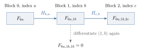

# OpenAI’s nearly quartic query separation: a complete proof reconstruction {.unnumbered .unlisted}

Will Cook · November 2026

**Abstract.** For total Boolean functions, four is the least exponent $\alpha$ for which randomized query complexity always satisfies $R=O((1+Q)^\alpha)$, where $Q$ is quantum query complexity. We reconstruct OpenAI’s proof. A winning column on a board of $m$ columns contains a certificate pointing to a zero in every rival. A quantum algorithm uses the pointers to compare columns and needs to verify only a short list. Probing the certificate cell requires naming its address. Under the classical hard distribution this amounts to predicting several independent answers at once. For each fixed $k\ge2$ the resulting costs are $\widetilde O_k(\sqrt m)$ and $\widetilde\Omega_k(m^{2-1/k})$. We give a direct proof of the underlying Forrelation lower bound by transporting a derivative along a Gaussian chain. Its explicit parameter dependence also gives a single growing-parameter family whose separation exponent tends to four.

Use the [three properties of one address bit](#forr_bundle) to build the total function in §4. The [quantum list](#upper-tournament-statement) and the [classical planting argument](#CL-first-difference) give the two bounds compared in §7. With the universal upper bound of [Appendix A](#R3-A-RESULT), they determine the [optimal power](#ROOT-NO-SMALLER). To prove the address hardness itself, [§8](#forr_target) starts afresh from the Walsh matrix. Its dependence on $k$ also gives the [single growing family](#ROOT-GROWING-K). A [shorter proof](expert_companion.md) and a [worked introduction](exposition.md) are available separately.

\setcounter{tocdepth}{2}
\tableofcontents
\clearpage

## 1. The theorem and the construction

<!-- passage:ROOT-RESULT -->
How many more bits can a randomized decision tree need than a quantum algorithm computing the same total Boolean function? Write $R(f)$ and $Q(f)$ for the least worst-case query budgets giving success at least $2/3$ on every permitted input. The known upper bound is quartic. To show that its power is necessary we need total functions with a cheap quantum algorithm and a large randomized lower bound on the same inputs.

<!-- claim:eq-1 -->
Define

\[
\alpha_{\mathrm{tot}}
=\inf\left\{\alpha\geq0:\
  \exists C_\alpha>0\ \forall n\geq1\
  \forall f:\{0,1\}^n\to\{0,1\},\quad
  R(f)\leq C_\alpha(1+Q(f))^\alpha
\right\}.
\tag{1.1}
\]

One constant must work for every input length and every total function. The additive $1$ includes constant functions without requiring a convention for $0^0$.

<!-- claim:thm-1.1 -->
**Theorem 1.1 (OpenAI).** The optimal power is $\alpha_{\mathrm{tot}}=4$. By the universal upper bound of [Aaronson et al., Theorem 2][ABKRT2020], there is an absolute constant $C>0$ such that every total Boolean function satisfies

\[
R(f)\leq C(1+Q(f))^4.
\]

For each fixed integer $k\geq2$, there are positive constants $c_k,C_k,b_k$, a threshold $m_0(k)$, and total Boolean functions $F_{k,m}$, defined for all powers of four $m\geq m_0(k)$, for which

<!-- claim:eq-2 -->
\[
Q(F_{k,m})\leq C_k\sqrt m\,(\log_2 m)^{b_k},
\qquad
R(F_{k,m})\geq c_k\frac{m^{2-1/k}}{(\log_2 m)^2}.
\tag{1.2}
\]

Here $m$ is the number of columns, each with an $m$-bit string; the final Boolean input also contains address inputs and certificate cells. Its physical length is counted in [§4.2](#AC-layout). The two inequalities concern the same function at each pair $(k,m)$. For the circuit family fixed in §4 we obtain $b_k=6$ in §5.4 and, after increasing the threshold, $c_k=1/400$ in §6.6.
<!-- /passage:ROOT-RESULT -->

The powers in (1.2) have ratio $4-2/k$. Already $k=3$ excludes the proposed universal cubic bound; arbitrarily large fixed $k$ exclude every power below four. Earlier families had reached a separation with power $3-o(1)$. [OpenAI, §1.1][OpenAI2026].

<!-- passage:ROOT-ARCHITECTURE -->
To obtain (1.2), let an all-one column certify a win by exhibiting a zero in every rival. We could search for that column by verifying candidates inside quantum search. But if one candidate presents $\widetilde O(m)$ possible defects, this takes $\sqrt m$ candidate checks at $\widetilde O(\sqrt m)$ queries each. The product already exceeds our quantum budget. We can afford a short list with false candidates, provided it includes the winner with high probability whenever one exists. This weaker task admits cheaper comparisons.

Consider the four columns in Figure 1. Each contains four bits and, below them, four cells indexed by two-bit words. The two auxiliary inputs of column 1 have answers $1,0$. Open cell $10$ of that column. Its first pointer says to inspect row 1 of column 2, where we find a zero; the other two find zeros in row 2 of column 3 and row 3 of column 4. A pointer coming *back* from column 3 to row 3 of column 1 finds a one. In fact every row it might have chosen contains a one.

{width=91%}

Why use the cell at $10$? A different cell might contain the same three pointers. It cannot prove a win: its address disagrees with at least one of the two auxiliary answers. A cell must certify the answers forming its own address. It does this by recording each gate of a circuit computation, including the bits reporting whether the input was promised and what its answer was. False entries can be read as readily as true ones; the verifier has to check the entries against the input.

Comparison is much cheaper. To compare two columns, try their addresses and follow one pointer in each direction. A winner’s own addresses are promised and quickly decoded quantumly. Even if its rival produces a meaningless address, every pointer back into the winner finds a one. No transcript needs to be checked to conclude that the comparison favors the winner with high probability. Pairs of losers can behave arbitrarily. We will nevertheless obtain a list of only $O(\log m)$ candidates. Searching for candidates and then checking the list costs $\widetilde O(\sqrt m)+\widetilde O(\sqrt m)$.

To see the other side, start with a zero in each column and blank cells throughout. Erase the zero in a randomly chosen column and fill its correct cell to make it win. A classical algorithm must see one of those two changes. Probing the filled cell requires naming the address *before a single bit of the cell has been read*. If a budget of $L$ queries leaves one auxiliary answer hard to predict, hiding the column as well as the address will force order $mL$ queries. An auxiliary problem of almost linear classical hardness thus suggests the two scales $m^{2-o(1)}$ and $m^{1/2+o(1)}$. This is the design of [OpenAI, §§1–4][OpenAI2026].

<!-- /passage:ROOT-ARCHITECTURE -->

## 2. What an address bit must do

<!-- passage:ROOT-LOGS -->
A randomized algorithm is a distribution on deterministic bit-query trees. A quantum query applies $|i,b,z\rangle\mapsto|i,b\oplus x_i,z\rangle$; finite work registers, input-independent operations and measurements are free. We charge the maximum number of queries on any branch. A partial function $P:D\to\{0,1\}$ imposes its success requirement only for $x\in D$, but the cap still holds on the whole cube. In particular an off-promise address decoder always finishes. The function built from the decoders will itself be total.

Throughout, $m=4^t$, $t\ge1$, so the $m$ possible rows fit exactly in $\ell=\log_2m=2t$ bits. Unqualified logarithms are base two; $\ln$ denotes the natural logarithm. [Appendix F](#ROOT-PARTIAL) derives the finite models and their equivalence with the usual bit-query conventions.

<!-- /passage:ROOT-LOGS -->

<!-- passage:forr_scope -->
There are three different ways the proof will use an input to a partial function $P$. Consider one column with $r$ such inputs whose answers, when defined, name its cell.

*Choosing a candidate.* Following a pointer and reading its target costs $\ell+1$ queries. To preserve that advantage, a quantum algorithm must also be able to *try* the address cheaply. It needs a coherent bit decoder with small error on the promise and a fixed query cap on the full cube. A rival’s inputs can fall anywhere on that cube.

*Checking its cell.* A decoder cannot certify that its input was promised. For that we ask for an exact circuit with separate domain and value outputs. If it has $S$ gates of fan-in two, a cell can supply $S$ proposed gate values per bit of address. Three queries check any one gate. With $m$ bits in the column and $m-1$ outward pointers, verifying a candidate will mean searching $O(m+rS)$ tests. Taking $r=O(\log m)$ and $S=\widetilde O(m)$ keeps this search within the quantum budget.

*Hiding the address.* To obtain the classical lower bound, a budget of $L$ queries must leave even one promised answer hard to predict. With independent inputs for the $r$ bits, guessing the address before finding its cell will be unlikely. A hidden column multiplies the one-input allowance by a factor of order $m$. To reach the classical power $2-1/k$ in (1.2), we therefore want $L$ of order $m^{1-1/k}$ up to logarithmic factors.

<!-- /passage:forr_scope -->

The following promise provides all three properties. These are the only properties used to deduce the two query bounds on the board.

## 3. The partial function that supplies the addresses

<!-- passage:forr_definition -->
### 3.1. The normalized Walsh product and the promise

A Forrelation input consists of $k$ sign vectors $z_0,\ldots,z_{k-1}$ of length $m=4^t$, with $k\ge2$. A raw bit $x_j(a)$ denotes $z_j(a)=(-1)^{x_j(a)}$. Index the entries by $a\in\mathbb F_2^{2t}$ and write $a\cdot b$ for the binary inner product. We use the normalized Walsh matrix $H$, the uniform unit vector $u$, and a sign diagonal $D_z$:

<!-- claim:def-walsh-sign -->
$$
W_{ab}=(-1)^{a\cdot b},\qquad H=m^{-1/2}W,
\qquad u=m^{-1/2}(1,\ldots,1)^{\mathsf T},
\qquad D_z=\operatorname{diag}(z).
$$

We define the real Forrelation value and the threshold by

<!-- claim:eq-3 -->
$$
\Phi(z)=u^{\mathsf T}D_{z_0}H D_{z_1}H\cdots H D_{z_{k-1}}u,
\qquad \delta=2^{-5k}.
\tag{3.1}
$$

There are $k$ sign diagonals and $k-1$ Walsh matrices. The partial function is

<!-- claim:eq-4 -->
$$
P_{k,m}(z)=
\begin{cases}
1,&\Phi(z)\ge\delta,\\
0,&|\Phi(z)|\le\delta/2,\\
\text{undefined},&\text{otherwise}.
\end{cases}
\tag{3.2}
$$

The asymmetry matters for the board. Alternating sign queries with the known Walsh transform gives an overlap $\Phi$ with $u$, so a projection onto $u$ sees $\Phi^2$. This distinguishes the promised cases after repetition. A large negative overlap can give just the same projection probability as a yes input, however. The domain output of the exact circuit is what will distinguish these cases in a certificate.

The one-input query allowance will be

<!-- claim:eq-5 -->
$$
L_{k,m}=\left\lfloor\frac{m^{1-1/k}}{(\log_2m)^2}\right\rfloor.
\tag{3.3}
$$

Here $\log_2m=2t$.
<!-- /passage:forr_definition -->

### 3.2. The complete Forrelation ingredient

<!-- passage:forr_bundle -->
**Lemma 3.1 (the Forrelation ingredient).** Fix $k\ge2$. For $m=4^t$, the function (3.2) and the allowance (3.3) have the following properties.

<!-- claim:lem-2.1 -->
1. For all sufficiently large $t$ (depending on $k$), $R(P_{k,4^t})>L_{k,4^t}$, by [§8.10](#forr_uniform_assembly).
2. For every $t\ge1$ and $0<\eta<1/2$, a single coherent quantum preparation, which retains its workspace, has a Boolean output on every input, error at most $\eta$ on every promised input, and bit-query cap $O_k(1+\log(1/\eta))$ on all inputs, by Appendix G.2.
3. For every $t\ge1$, one fan-in-at-most-two circuit $C_{k,t}$ of size $O_k(m(\log_2m)^2)$ has a domain bit $d$ and value bit $b$ with $d(x)=1$ exactly when $P_{k,m}(x)$ is defined, and $b(x)=P_{k,m}(x)$ on that domain, by [Appendix G.3](#forr_circuit).

For the size in part 3, evaluating the $m^k$ terms of the expanded product separately would cost too much. The exact circuit instead applies integer Walsh transforms successively, using the butterfly algorithm; since $\sqrt m=2^t$ and the thresholds are dyadic, its final comparisons use integer arithmetic. The verifier can inspect this short computation even though computing a promised answer classically requires many queries.

<!-- /passage:forr_bundle -->

<!-- passage:forr_references -->
Aaronson and Ambainis introduced the Walsh experiment. Bansal and Sinha proved hardness for the one-sided thresholds in (3.2). OpenAI invokes their result for part 1. Section 8 gives a direct proof, including the uniform dependence on $k$ used in §7.3. The remaining parts are constructed in Appendix G. [Aaronson and Ambainis, §1.1.3][AA18], [Bansal and Sinha, Theorem 1.3][BansalSinha2021], [source comparison](#forr_credit).

<!-- /passage:forr_references -->

## 4. Transcripts, addressed certificates, and the total function

<!-- passage:AC-interface -->
Suppose someone hands us a column number and an address. We can now ask whether the cell at *that* address proves that its column wins. OpenAI’s construction makes every false answer to this question detectable by one local test. To see how, first consider the part of the certificate that proves its own address. [OpenAI, §2.2, Lemma 2.2][OpenAI2026].

<!-- /passage:AC-interface -->

### 4.1. What a transcript certifies

<!-- passage:AC-circuit -->
Let $P:D\to\{0,1\}$, where $D\subseteq\{0,1\}^{n}$, and let $C$ be a Boolean circuit of fan-in at most two. We number its $S$ non-input gates in topological order; these gates include its two designated outputs, $d$ and $b$. We assume that, on every raw input $a\in\{0,1\}^{n}$,

$$
d_C(a)=1\quad\Longleftrightarrow\quad a\in D,
\qquad
a\in D\quad\Longrightarrow\quad b_C(a)=P(a).
\tag{4.1}
$$

Thus the value output on an unpromised input is unrestricted, while the domain output must be correct there as well. In the application $P=P_{k,m}$ and $n=km$, and §3.2 supplies a circuit with $S=O_k(m(\log_2m)^2)$. The construction below uses (4.1); its logical properties use no lower bound for computing $P$.
<!-- /passage:AC-circuit -->

<!-- passage:AC-transcripts -->
A transcript $\tau\in\{0,1\}^{S}$ proposes a value for every non-input gate. At a gate, we read an input predecessor from the actual string $a$ and a gate predecessor from its earlier entry in $\tau$; a constant predecessor is known without a query. We call the transcript *gate-consistent* when every proposed gate value agrees with that gate's Boolean truth table on these predecessor values. Let $\operatorname{ev}_C(a)$ denote the transcript obtained by evaluating the circuit in topological order. For example, a gate with rule $v=\operatorname{AND}(a_j,\tau_u)$ must satisfy $\tau_v=a_j\land\tau_u$: one predecessor is an actual input bit and the other is an earlier claimed gate value.

<!-- claim:NCL-transcript-characterization -->
**Transcript lemma.** For every circuit $C$, every input $a$, and every proposed transcript $\tau$,

$$
\operatorname{GateConsistent}(C,a,\tau)
\quad\Longleftrightarrow\quad
\tau=\operatorname{ev}_C(a).
\tag{4.2}
$$

**Proof.** The evaluated transcript satisfies each gate equation by definition. Conversely, assume all gate equations hold; we argue by induction along the topological order. At the first gate each predecessor is an input or a constant, so the claimed output equals the evaluated output. If equality holds at every earlier gate, then each predecessor of the next gate has its evaluated value, and that gate's equation forces its claimed output to take its evaluated value too. Hence equality holds at every gate. The argument applies equally to inputs outside $D$, since $C$ is a total circuit. In particular, every input has exactly one gate-consistent transcript. ∎

Combining (4.1) with (4.2), we see that gate consistency together with the two tests $\tau_d=1$ and $\tau_b=c$ certifies $a\in D$ and $P(a)=c$; conversely, the true transcript of a promised input of value $c$ passes these tests. Both the gate equations and the domain-output test are needed, since a correct transcript of an unpromised input has domain output zero.
<!-- /passage:AC-transcripts -->

### 4.2. Columns and their selected cells

<!-- passage:AC-layout -->
For the separation family, fix $k\geq2$ and $m=4^t$ with $t\geq1$. Put

$$
\ell=\log_2m=2t,
\qquad
r=\lceil20\log_2m\rceil=40t=20\ell.
\tag{4.3}
$$

For the four-column illustration $r=2$. For the theorem the address must survive many guesses. Suppose one can predict each of $r$ independent hard answers with probability at most $2/3$ under the query allowance. The direct-product proof will bound the chance of naming one whole address by $(2/3)^r$. Choosing $r=20\log_2m$ makes that probability at most $m^{-10}$, enough even for a union over $m^2$ query times. Yet $2^r=m^{20}$ cells still give a board of polynomial size. The constant 20 leaves room in both estimates.

There are $m$ columns, indexed by $[m]=\{1,\ldots,m\}$. Column $i$ contains the following disjoint blocks of input bits.

**$X_i$.** A string of $m$ bits.

**$A_{i,1},\ldots,A_{i,r}$.** $r$ strings of $n=km$ bits.

**$B_{i,s}$, for each $s\in\{0,1\}^{r}$.** One $\ell$-bit pointer $p_{i,s,j}$ into each column $j\ne i$, and one length-$S$ transcript $\tau_{i,s,h}$ for each $h\in[r]$.

A fixed bijection from $\{0,1\}^{\ell}$ to $[m]$ decodes the pointers, so in an expression $X_j[p]$ the pointer word $p$ is decoded by this bijection before indexing. Because $m=2^{\ell}$, every pointer word names a row. A cell is a collection of bits, and consulting a chosen pointer costs its $\ell$ individual bit queries. The $A$-strings and the contents of every cell may be arbitrary bit strings.
<!-- /passage:AC-layout -->

The input has $m\bigl[m+rkm+2^r\bigl((m-1)\ell+rS\bigr)\bigr]$ bits, since each column holds its string, its $r$ Forrelation inputs of $km$ bits and $2^r$ cells of $(m-1)\ell+rS$ bits each. With $r=20\ell$ we have $2^r=m^{20}$, and the circuit of Appendix G.3 has size $S=O_k(m\ell^2)$, so the input length is $O_k(m^{22}\ell^3)$, polynomial in $m$. Coordinate arithmetic is free in the query model; the algorithm pays for the bits it actually reads, rather than for constructing an index into this large array. Thus the addressed function is a total Boolean function of that many bits, and reading any pointer or transcript bit costs one query.

<!-- passage:AC-winner -->
If every $A_{i,h}$ lies in $D$, its partial-function values determine the *true address*

$$
s_i=(P(A_{i,1}),\ldots,P(A_{i,r})).
\tag{4.4}
$$

If any of these instances is unpromised, the column has no true address. For an arbitrary candidate address $s$, we define $W(y;i,s)$, with $y$ the complete input, by the conjunction

$$
\begin{aligned}
&X_i[q]=1 &&\text{for every }q\in[m],\\
&A_{i,h}\in D\text{ and }P(A_{i,h})=s_h
&&\text{for every }h\in[r],\\
&\tau_{i,s,h}=\operatorname{ev}_C(A_{i,h})
&&\text{for every }h\in[r],\\
&X_j[p_{i,s,j}]=0 &&\text{for every }j\ne i.
\end{aligned}
\tag{4.5}
$$

We say that $i$ *wins at $s$* when these four lines hold. The second line forces $s$ to equal the true address. A column with an unpromised address input cannot win at any cell.

<!-- /passage:AC-winner -->

<!-- passage:AC-total-unique -->
Define

$$
F(y)=1\quad\Longleftrightarrow\quad
\exists i\in[m]\ \exists s\in\{0,1\}^{r},\ W(y;i,s),
\tag{4.6}
$$

and let $F(y)=0$ otherwise. This defines a total Boolean function, since (4.5) is a predicate on finitely many input bits and an unpromised instance prevents its column from satisfying it; the definition consults a partial-function value only where it is defined. With the specified $P_{k,m}$, $C_{k,m}$, and parameters (4.3), this function is $F_{k,m}$.

**Uniqueness lemma.** For any $P,C$, pointer bijection, and complete input $y$, at most one pair $(i,s)$ satisfies (4.5).

**Proof.** Suppose, for contradiction, that $W(y;i,s)$ and $W(y;j,a)$ hold with $j\ne i$. The pointer from $B_{i,s}$ into column $j$ then exhibits a zero in $X_j$, whereas the winning condition for $j$ makes every bit of $X_j$ one. Hence any two satisfying pairs share their column. For a fixed column, the second line of (4.5) determines each address bit as the value of the same promised input, so the addresses agree as well. ∎

Totality and uniqueness follow from the semantic definition (4.5) alone; the exact realization property (4.1) enters only in the verification procedure.
<!-- /passage:AC-total-unique -->

### 4.3. A four-column instance

<!-- passage:AC-example-promise -->
Take $P_{2,4}$ and use just two address bits, giving four cells per column. We use a circuit for its finite truth table; the asymptotic family has $r=40$ at this size and uses the arithmetic circuit of Appendix G.3.

Figure 1 uses $a^+,a^0,a^-$ for the following three eight-bit inputs. The table gives their Forrelation values and the two exact circuit outputs. [Appendix G.4](#AC-example-tests) checks the arithmetic.

| Eight-bit string | $\Phi$ | Partial-function value | Exact outputs $(d,b)$ |
|---|---:|---|---|
| $0000\,0000$ | $1/2$ | $1$ | $(1,1)$ |
| $0001\,0010$ | $0$ | $0$ | $(1,0)$ |
| $1111\,0000$ | $-1/2$ | undefined | $(0,0)$ |

The projection decoder succeeds in a single projection with probability $\Phi^2$. It sees probability $1/4$ on both the first and third rows, although the third input has no promised value. Their domain bits differ. This is precisely the distinction the transcript must certify.

<!-- /passage:AC-example-promise -->

<!-- passage:AC-example-board -->
The same board can now be specified by its raw strings. A true address exists only when both partial values are defined.

| Column $i$ | $X_i$ | $A_{i,1}$ | $A_{i,2}$ | True address |
|---:|---|---|---|---|
| $1$ | $1111$ | $00000000$ | $00010010$ | $10$ |
| $2$ | $0111$ | $11110000$ | $00010010$ | none |
| $3$ | $1011$ | $00000000$ | $00010010$ | $10$ |
| $4$ | $1101$ | $00000000$ | $00010010$ | $10$ |

We encode the rows $1,2,3,4$ by $00,01,10,11$, respectively, and store in $B_{1,10}$ the true transcripts for column 1 together with the pointer words

$$
p_{1,10,2}=00\longmapsto1,\qquad
p_{1,10,3}=01\longmapsto2,\qquad
p_{1,10,4}=10\longmapsto3.
\tag{4.7}
$$

The pointers all reach zeros, and $X_1=1111$. Hence column 1 wins at $10$. Each other column has a zero of its own. In column 2 there is also an unpromised address input.

In each cell store the two true transcripts for its column. Every pointer into columns 2–4 goes to the designated zero of its target. A pointer back into column 1 uses its own cell address as a row number. Thus every possible reply from column 2, including a meaningless one, lands on a one.

<!-- /passage:AC-example-board -->

### 4.4. The local tests

<!-- passage:AC-tests -->
Fix a candidate pair $(i,s)$. We replace the partial-function conditions in (4.5) by the following tests on the stored transcripts, writing $g_e(y;i,s)=1$ when the test with label $e$ passes.

**Column tests.** For each of the $m$ bits of $X_i$ there is one test, which reads that bit with one query and passes exactly when it is one.

**Pointer tests.** For each of the $m-1$ other columns, a test reads the selected outward pointer in $B_{i,s}$ and checks that it reaches a zero in its designated target column. It reads the $\ell$ pointer bits, decodes the row without a query, and then reads that target bit, so its worst-case depth is $\ell+1$ although its target coordinate depends on the earlier answers.

**Gate tests.** For each of the $r$ stored transcripts and each of its $S$ non-input gates, the test checks that the claimed output equals the gate's truth table on its two predecessors. These $rS$ tests each read the claimed value and at most two predecessor values, so each uses at most three queries; an input predecessor is read from the actual address string, a gate predecessor from the transcript, and a constant costs no query. For example, a gate $v=\operatorname{AND}(x_a,\tau_u)$ is checked by reading the actual input bit $x_a$, the earlier transcript bit $\tau_u$ and the proposed output $\tau_v$, and testing $\tau_v=x_a\land\tau_u$. A proposed value for an input wire is never trusted.

**Output tests.** For each $h\in[r]$, one test requires the transcript's domain output to be one, and another requires its value output to equal $s_h$. These $r$ domain tests and $r$ value tests each use one query. They check the meaning of the output bits once gate consistency holds, since consistency alone says neither that the input is promised nor that its value is the chosen address bit.

To make the index set the same for every candidate, we list the other columns in increasing order, skipping $i$, and label their pointer tests by $[m-1]$. The common test set is then

$$
E=[m]\;\sqcup\;[m-1]\;\sqcup\;
\bigl([r]\times([S]\sqcup\{d,b\})\bigr).
\tag{4.8}
$$

The labels $d,b$ in the last summand denote the two output *tests*, which come in addition to the consistency tests at the corresponding output gates. Consequently

$$
K=|E|=m+(m-1)+r(S+2).
\tag{4.9}
$$

For $S\le A m\ell^2$, substituting $r=20\ell$ gives
\[
K=2m-1+20\ell(S+2)\le(42+20A)m\ell^3.
\tag{4.10}
\]
The square root of this count will be the cost of searching for a failed test, up to logarithms.

<!-- /passage:AC-tests -->

<!-- passage:AC-local-equivalence -->
**Lemma 4.1 (local verification).** Suppose $C$ satisfies (4.1). On every complete input $y$, and for every candidate $(i,s)$,

$$
W(y;i,s)\quad\Longleftrightarrow\quad
g_e(y;i,s)=1\text{ for every }e\in E.
\tag{4.11}
$$

Every test is computed by an exact deterministic adaptive decision tree of depth at most

$$
q_*=\max\{3,\ell+1\}=\ell+1
\qquad(m\geq4).
\tag{4.12}
$$

**Proof.** Suppose all tests pass. The column-bit and pointer tests give the first and last lines of (4.5). For each $h$, the gate tests and (4.2) identify $\tau_{i,s,h}$ as the true evaluation of $C$ on $A_{i,h}$, and its two output tests then give $A_{i,h}\in D$ and $P(A_{i,h})=s_h$ by (4.1); these are the remaining lines of (4.5). Conversely, (4.5) supplies true transcripts of promised inputs with the required values, so every test passes.

The procedures defining the tests use at most one, three or $\ell+1$ queries, according to their type, and they are exact on every input, including inputs at which the candidate is a nonwinner or its address instances are unpromised. Their largest depth is (4.12). ∎
<!-- /passage:AC-local-equivalence -->

<!-- passage:AC-dichotomy -->
It follows that a winning column passes all tests at its unique true address and fails at least one test at every other address. A nonwinner, including any column with an unpromised instance, fails some test at every address, since an address at which all tests passed would contradict (4.11). For an unpromised instance the true transcript has domain output zero, and changing that output to one makes at least one gate equation fail; hence gate consistency cannot repair the instance.
<!-- /passage:AC-dichotomy -->

On Figure 1’s board, all tests pass at $(1,10)$. Change the address to $00$: the stored computations still agree with the two inputs and the pointers still find zeros, but the first value-output test now fails. In column 2 the first computation reports domain bit zero, so every address fails even with a true transcript. [Appendix G.4](#AC-example-tests) counts the tests on this board.

An oracle for the local tests must allow their indices in superposition. Retain each queried bit, compute the next address reversibly, copy the test result, and run the computation backwards. The forward depth is $\max\{3,\ell+1\}$ and the clean oracle costs $O(\ell+1)$ physical bit queries. [Appendix E.4](#AC-coherent) gives the construction, including the cost of a read active on only some branches.

### 4.5. Why a winner defeats an unpromised opponent

<!-- passage:AC-comparison -->
For distinct columns $i,j$, the comparison routine in §5.3 decodes one address label for each column and, at those labels, follows the pointer from each column into the other, disqualifying a column if the other column's pointer finds a zero in its $X$-string. If exactly one is disqualified, the other wins; a fixed rule resolves the remaining cases. On every raw input each decoded label is a bit string, possibly unrelated to any true address, and it is produced within a query cap fixed for all inputs.

**Winner-comparison implication.** Fix $0<\varepsilon<1/2$, and suppose column $i^\star$ wins. For any opponent $j\ne i^\star$, every proposed rival address $a$, and every pointer stored there,

$$
X_{i^\star}[p_{j,a,i^\star}]=1.
\tag{4.13}
$$

This follows from the winner's all-one string alone, so the winner is never disqualified. Whenever its own decoder returns its true address $s_{i^\star}$, its outward pointer satisfies

$$
X_j[p_{i^\star,s_{i^\star},j}]=0,
\tag{4.14}
$$

so the rival is disqualified and the tie rule plays no part on this event. Therefore

$$
\Pr[i^\star\text{ wins against }j]
\ \geq\ \Pr[\widehat s_{i^\star}=s_{i^\star}]
\ \geq\ 1-\varepsilon.
\tag{4.15}
$$

All $r$ inputs of the winner are promised. Error at most $\varepsilon/r$ per decoded bit gives the last inequality by a union bound. For example, in Figure 1 column 2 can propose any label, but its pointer into column 1 always finds a one. At $B_{1,10}$ the pointer in the other direction always finds column 2’s zero. The only probabilistic hypothesis needed here is the winner’s own decoding guarantee.

<!-- /passage:AC-comparison -->

## 5. Choosing a candidate before verifying it

<!-- passage:upper-purpose -->
A comparison can cost polylogarithmically many queries even when verifying one candidate costs $\widetilde O(\sqrt m)$. The price of using comparisons is that they need not order the columns. In particular two losers may win against each other with probabilities arbitrarily close to $1/2$, so repetition cannot supply a uniformly reliable orientation of every edge.

Consider an abstract four-vertex example. A dominant vertex $s$ beats $a,b,c$ with certainty, while $a$ beats $b$, $b$ beats $c$, and $c$ beats $a$. Pick one of the four vertices uniformly as pivot and keep everyone who beats it. The four possible pivots $s,a,b,c$ leave, respectively,
\[
\varnothing,\qquad \{s,c\},\qquad \{s,a\},\qquad \{s,b\}.
\]
The mean number left is $3/2$. Moreover $s$ survives every pivot until it is chosen. This calculation has a fractional version: a candidate with probability $a$ of beating the pivot keeps the proportion $a$ of its current weight. One identity controls *all* probabilistic comparison tables.

OpenAI’s tournament uses this identity to produce a short list. A verifier then checks the listed columns for defects, accepting at the first candidate for which none is found. [OpenAI, §3][OpenAI2026].

<!-- /passage:upper-purpose -->

### 5.1. Complementary comparisons and the weight of a winner

<!-- passage:upper-comparison-model -->

We fix an input oracle for the duration of the argument. There are $m\geq2$ vertices, and each unordered pair of distinct vertices has one designated coherent comparison circuit, with an ordering convention determining which output bit means that the first named vertex wins. Let $a_{ij}$ be the probability that $i$ wins its comparison against $j$, and define $a_{ii}=0$; this fixes the comparison table. Since both orders use the same circuit with its two outcomes interpreted oppositely, we obtain equation (5.1):

<!-- claim:eq-10 -->
$$
0\leq a_{ij}\leq1,
\qquad a_{ij}+a_{ji}=1\quad(i\ne j),
\qquad a_{ii}=0.
\tag{5.1}
$$

The table may be intransitive: a cycle of certain wins is allowed, as is a pair with winning probability exactly one half, and comparisons made in separate fresh registers have their designated probabilities, which may lie far from zero and one. In the algorithmic theorem, all pair circuits are available coherently, including under control of their indices, with a uniform cap of $c\geq1$ bit queries for each comparison and for its inverse. When a controlled query is implemented from an ordinary bit query, the cap $c$ includes the constant overhead established below.
<!-- /passage:upper-comparison-model -->

<!-- passage:upper-tournament-parameters -->

The expected remaining weight after a round will be at most half the current weight. Starting from $m$, this takes about $\log_2m$ rounds to leave weight of order one. A dominant vertex should lose little of its own initial unit of weight over *all* those rounds, so its comparison error must be of order $1/T$ for $T$ rounds. Choose

<!-- claim:def-T-eps -->
$$
T=\left\lceil\log_2(1000m)\right\rceil,\qquad \varepsilon=\frac{1}{1000T}.
$$
The base two ensures $2^T\ge1000m$. Dominance means

<!-- claim:eq-11 -->
$$
a_{sj}\ge1-\varepsilon\qquad(j\ne s).
\tag{5.2}
$$

The resulting slack pays for three errors: winner-address error in §5.3 gives dominance, stage-sampler failure contributes at most $T\varepsilon$ before the winner is selected, and fresh verification contributes at most $\varepsilon$ for the winner or $T\varepsilon$ on a zero input. The ideal miss term $2m/2^T$ is separate.

<!-- /passage:upper-tournament-parameters -->

**Proposition 5.1 (OpenAI, probabilistic-comparison tournament).** With the parameters and comparisons above, one algorithm returns at most $T$ vertices and costs $O(c\sqrt m\,T^2\log T)$ queries on every input. For each dominant $s$ its list contains $s$ with probability at least $1-2m/2^T-T\varepsilon$. The algorithm is independent of $s$.

*Proof of [Proposition 5.1](#upper-tournament-statement).* Fix the comparison table and parameters just stated. The weights below are analytical quantities of the proof, unavailable to the algorithm.

<!-- passage:upper-ideal-process -->

We begin with weights $w_i=1$ and an empty ordered list $L$, and write $W=\sum_iw_i$. In one ideal step, if $W>0$, we choose a pivot $p$ with probability $w_p/W$, append it to $L$, and make the update in equation (5.3):

<!-- claim:eq-12 -->
$$
w_i\longleftarrow w_i a_{ip}\qquad(1\leq i\leq m).
\tag{5.3}
$$

If $W=0$, we leave the weights zero and append nothing. Running exactly $T$ steps, with this zero state absorbing, specifies the ideal process on every history. All weights remain nonnegative and at most one, because they are products of numbers in $[0,1]$; after a history $L=(p_1,\ldots,p_h)$,
\[
w_i(L)=\prod_{b=1}^{h}a_{ip_b},\qquad w_i([])=1.
\]
 A selected vertex receives the factor $a_{pp}=0$, so its weight is zero thereafter and it is never again selected on a positive-weight step. These observations also cover histories of probability zero, where they avoid any division by zero.
<!-- /passage:upper-ideal-process -->

<!-- passage:upper-weight-drift -->

We condition on any current weights with $W>0$. For pivot $p$ the new total weight is $\sum_iw_ia_{ip}$, and averaging over its probability $w_p/W$ gives the first expression in equation (5.4). We write its numerator as the sum over ordered pairs $(i,p)$. The diagonal terms vanish because $a_{ii}=0$, and pairing the term for $(i,p)$ with the term for $(p,i)$, for each unordered pair with $i\ne p$, gives $w_iw_p(a_{ip}+a_{pi})=w_iw_p$. Since the sum of the $w_iw_p$ over unordered pairs is half of $W^2-\sum_iw_i^2$, we obtain

<!-- claim:eq-13 -->
$$
\mathbb E[W_{\rm new}\mid w]
 =\frac1W\sum_{p,i}w_pw_i a_{ip}
 =\frac{W^2-\sum_iw_i^2}{2W}
 \leq\frac W2.
\tag{5.4}
$$

At $W=0$ both the current and the next total weight are zero, so the last inequality still holds, and taking expectations over histories gives $\mathbb E W_{h+1}\leq\tfrac12\mathbb E W_h$. Starting from $W_0=m$ and applying this inequality $T$ times, we obtain:

<!-- claim:claim-expected-WT -->
$$
\mathbb E W_T\leq\frac{m}{2^T}.
$$

Since the calculation uses only complementarity and nonnegativity, it applies equally to deterministic or cyclic tournaments and to comparisons whose probabilities are bounded away from both zero and one.
<!-- /passage:upper-weight-drift -->

<!-- passage:upper-dominant-weight -->

Suppose that $s$ is dominant and has not appeared among the first $h\leq T$ pivots. Then every factor in its weight is at least $1-\varepsilon$, which gives:

<!-- claim:claim-weight-lb -->
$$
w_s(h)\geq(1-\varepsilon)^h
\geq1-h\varepsilon
\geq1-T\varepsilon
=\frac{999}{1000}>\frac12.
$$

Bernoulli’s inequality gives the middle bound. Thus, until $s$ is selected, the total weight exceeds one half; in particular, the process stays out of the absorbing zero state before selecting $s$.

If $s$ is missing from the ideal list at time $T$, the same argument gives $W_T>1/2$, so the indicator of this event is at most $2W_T$ pointwise. Taking expectations proves equation (5.5) for every weight distribution:

<!-- claim:eq-14 -->
$$
\Pr[s\notin L_T]
\leq\Pr[W_T\geq1/2]
\leq2\,\mathbb EW_T
\leq\frac{2m}{2^T}.
\tag{5.5}
$$

The conclusion uses only complementarity and the lower bounds on the distinguished row, so comparisons between other candidates may be inconsistent with every ordering.
<!-- /passage:upper-dominant-weight -->

### 5.2. Drawing the next pivot

<!-- passage:upper-stage-state -->

Given the stored pivots $p_1,\ldots,p_h$, prepare a uniform candidate index $i$. Controlled by $i$, compare it to each pivot on **fresh registers**, retaining the full state $|\phi(i,p_b)\rangle$ of each comparison. The joint state is

<!-- claim:eq-15 -->
$$
\frac1{\sqrt m}\sum_{i=1}^m |i\rangle
 \bigotimes_{b=1}^{h}|\phi(i,p_b)\rangle.
\tag{5.6}
$$

Compute the all-wins flag reversibly, retaining the outcomes and work. At $h=0$ the empty conjunction succeeds for every index.

<!-- /passage:upper-stage-state -->

<!-- passage:upper-stage-law -->

For fixed $i$, the different comparisons act on separate initially fixed registers, so projection onto all successful outcome bits is a tensor product of their success projections. The squared norm of the projected state is therefore the product of their squared norms, namely the product of $a_{ip_b}$, which is $w_i$. Since distinct index values remain orthogonal, summing their squared norms and including the initial factor $1/\sqrt m$ proves:

<!-- claim:claim-success-prob -->
$$
\Pr[\text{success and index }i]=\frac{w_i}{m},
\qquad
\Pr[\text{success}]=\frac Wm,
\qquad
\Pr[i\mid\text{success}]=\frac{w_i}{W}\quad(W>0).
$$

<!-- /passage:upper-stage-law -->

<!-- passage:upper-label-contract -->
Use [bounded amplification (Lemma E.1 in §E.2)](#upper-amplification-statement) with threshold $\gamma=1/(2m)$ and error $\varepsilon$. On success it preserves the normalized success component of the preparation. Measuring the index therefore draws exactly from $w_i/W$. The algorithm appends this pivot, stops on failure, and makes at most $T$ draws. Failure has probability at most $\varepsilon$ whenever $W/m\ge\gamma$, and probability one when $W=0$. The cap of $O(\sqrt m\ln(1/\varepsilon))$ preparations or inverses holds on **every** branch, however small $W$ is.

<!-- /passage:upper-label-contract -->

<!-- passage:upper-coupling -->
While the real and ideal lists agree, the next successful draw has exactly the ideal law. Couple them by using the same pivot on success, as in the [transition calculation](#upper-quantum-tournament). Until the dominant vertex $s$ appears, its weight exceeds $1/2$. Hence $W/m\ge1/(2m)$ at every such history and the chance of a first disagreement there is at most $\varepsilon$ conditionally. Summing over the $T$ possible stages costs at most $T\varepsilon$. Once $s$ appears it stays on the list. By (5.5),
<!-- claim:claim-coupling -->
$$
\Pr[\text{the real list misses }s]\le\frac{2m}{2^T}+T\varepsilon.
$$

<!-- /passage:upper-coupling -->

<!-- passage:upper-tournament-cost -->

Only the pivot labels persist. Recomputing the $h$ comparisons at a new stage costs $O(c(h+1))$ queries per preparation or inverse, so summing the amplified costs for $0\le h<T$ gives

<!-- claim:claim-tournament-cost -->
$$
\text{queries}
=O\!\left(c\sqrt m\,T^2\ln(1/\varepsilon)\right)
=O\!\left(c\sqrt m\,T^2\log T\right).
$$

Here $1/\varepsilon=1000T$. This proves Proposition 5.1 without ever estimating the $a_{ij}$. Appendix E.3 gives a [cyclic example](#upper-cyclic-example) and the [finite query budget](#upper-padded-tournament-budget).
<!-- /passage:upper-tournament-cost -->

### 5.3. Decoding, comparison, and verification

<!-- passage:upper-section-interface -->
Return to the $m=4^t$ columns. For the tournament we must now construct one complementary comparison for each pair and prove that a winner is dominant. For the resulting list we have a different operation, a search over the $K=m+(m-1)+r(S+2)$ exact tests at a fixed address. Both query the same board.

<!-- /passage:upper-section-interface -->

<!-- passage:upper-decode -->

Keep $T$ and $\varepsilon$ from Proposition 5.1. Here $r=20\ell$ and $S=O_k(m\ell^2)$.

To decode an address, we run the quantum decoder of Lemma 3.1, part 2 on each of the $r$ Forrelation instances in the selected column, reducing the error on each promised instance to at most $\varepsilon/r$, and implement its trials and decision rule reversibly, retaining the outcome labels and all intermediate work. The output register always holds an $r$-bit string; when some promises fail, this string may bear no relation to a semantic address. The number of queries is nevertheless capped on every input, and the output label is defined even off promise.
<!-- /passage:upper-decode -->

<!-- passage:upper-decode-cost -->

For fixed $k$, each instance is decoded with $O_k(\ln(r/\varepsilon))$ queries, and running the $r$ copies gives:

<!-- claim:claim-decode-cost -->
$$
\text{address-decoding queries}
=O_k\!\left(r\ln(r/\varepsilon)\right),
\qquad
\Pr[\text{correct address}]\geq1-\varepsilon
\quad\text{if all }r\text{ promises hold}.
$$

A union bound over the $r$ promised bits gives the probability estimate. [Appendix E.5](#upper-oracle-access) counts the physical queries.

<!-- /passage:upper-decode-cost -->

<!-- passage:upper-comparator -->

To compare two columns, we fix a numerical ordering of the columns. A distinct pair is first arranged with its smaller index first, so that both ordered calls use the same underlying circuit, and both addresses are decoded with fresh work registers. At the decoded address of the first column we read the pointer directed toward the second column and then the addressed entry of the second column's $X$-block; if that entry is zero, the second column is disqualified. The reverse operation, using the second decoded address, tests whether the first column is disqualified. If exactly one column is disqualified, the other wins, and if both or neither are disqualified, the smaller column wins. A self-comparison always returns false and makes no pointer query. Apart from address decoding, this comparison reads only the selected pointer fields and targeted $X$ bits; it does not inspect gate transcripts. The verifier checks those later.

Reading a pointer takes its $\ell$ address bits followed by the targeted $X$-bit, and reversible reading keeps the pointer and the target address available for uncomputation. Thus the two pointer tests use $O(\ell+1)$ bit queries, up to a constant factor if controlled reads are needed, and together with the two decodings a comparison and its inverse have query cost $c=O_k(r\ln(r/\varepsilon)+\ell)=O_k(\ell\log\ell)$. The circuit is defined on all input strings, and since the bit oracle is its own inverse, reversing its gate sequence gives the inverse with the same number of queries.
<!-- /passage:upper-comparator -->

<!-- passage:upper-comparison-law -->

The retained label pairs occupy orthogonal registers. The pointer reads and the final winner test act separately on each such subspace, so the output probability sums the squared norms of the label branches on which the deterministic rule selects $i$. Both orientations of a pair use the same circuit; reversing the names counts the complementary event. Thus $a_{ij}+a_{ji}=1$ for $i\ne j$, and $a_{ii}=0$, on the entire cube.

<!-- /passage:upper-comparison-law -->

<!-- passage:upper-winner-dominates -->
The [event inclusion in §4.5](#AC-comparison) now applies to this mixture. A winner $i^\star$ decodes correctly with probability at least $1-\varepsilon$, hence
<!-- claim:claim-winner-dominates -->
$$
a_{i^\star j}\ge1-\varepsilon\qquad(j\ne i^\star).
$$
This is exactly the dominance hypothesis of Proposition 5.1.

<!-- /passage:upper-winner-dominates -->

<!-- passage:upper-verifier -->

Comparison retains both decoded labels coherently while using them to control pointers. Verification instead samples one fresh label before any test search: to verify a candidate, we decode its address afresh, measure it, and fix the resulting address $a$. Lemma 4.1 provides a finite list of exact local tests, whose number is

<!-- claim:def-K -->
$$
K=m+(m-1)+r(S+2)=O_k(m\ell^3).
$$

For this fixed address prepare a uniform test label, compute its failure bit with the [reversible test circuit](#AC-coherent), and apply Lemma E.1 with $\gamma=1/K$ and error $\varepsilon$. Reject if the search finds a failure. Verify the list in order with fresh preparations, returning one as soon as a candidate passes and zero if none does.

<!-- /passage:upper-verifier -->

<!-- passage:upper-verification-proof -->

If $h$ of the $K$ tests fail, the preparation flags a defect with probability $h/K$. At $h=0$ the search finds none with certainty. At $h\ge1$ it finds one with probability at least $1-\varepsilon$. By Lemma 4.1, $h\ge1$ at every address of a nonwinner. At the true address of a winner every test passes exactly, so $h=0$ and rejection is impossible. The winner can therefore be rejected only if its address was decoded incorrectly, an event of probability at most $\varepsilon$. Thus

<!-- claim:claim-verify -->
$$
\Pr[\text{accept a nonwinner}]\leq\varepsilon,
\qquad
\Pr[\text{reject the winner}]\leq\varepsilon.
$$

Each preparation or inverse costs $O(\ell+1)$ queries, so the search costs $O(\sqrt K\ln(1/\varepsilon)(\ell+1))$, in addition to one fresh decoding.

<!-- /passage:upper-verification-proof -->

<!-- passage:upper-total-error -->

We now bound the error for every input of the total function. On a zero input every column is a nonwinner. We condition on the complete tournament transcript and on its list, which has at most $T$ entries; each subsequent fresh verification then accepts its candidate with probability at most $\varepsilon$, whatever the transcript. By the union bound, for any fixed list the probability of at least one false acceptance is at most $T\varepsilon$, and averaging over the tournament transcript preserves this bound. Early stopping at the first acceptance leaves the event that at least one acceptance occurs unchanged.

On a one input, uniqueness of the winner gives a column $i^\star$, which the comparison argument makes dominant, so the tournament misses it with probability at most $2m/2^T+T\varepsilon$. If it occurs in the list, its fresh verification accepts with probability at least $1-\varepsilon$, even conditionally on the previous transcript, and any earlier acceptance already gives the correct output one. Thus an erroneous zero output is contained in the union of the miss event and the rejection of $i^\star$ when it is verified, and we obtain

<!-- claim:claim-error -->
$$
\begin{aligned}
\Pr_x[\text{error}]&\leq T\varepsilon &&\text{for every }x\text{ with }F_{k,m}(x)=0,\\
\Pr_x[\text{error}]&\leq\frac{2m}{2^T}+T\varepsilon+\varepsilon<\frac13
&&\text{for every }x\text{ with }F_{k,m}(x)=1.
\end{aligned}
$$

Indeed $2^T\ge1000m$ and $T\varepsilon=1/1000$.

<!-- /passage:upper-total-error -->

### 5.4. The cost of the list and its verification

<!-- passage:upper-asymptotic-bound -->

Each of the $T=O(\log m)$ pivot stages makes at most $O(\sqrt m\log T)$ preparations, and a preparation compares its candidate with at most $T$ previous pivots. A comparison costs $c=(\log m)^{O_k(1)}$ bit queries. The list therefore costs $O(c\sqrt m\,T^2\log T)$. For a listed candidate the search is instead over $K=O_k(m(\log m)^3)$ possible defects. Its $O(\sqrt K\log T)$ test calls and one fresh address decoding cost $\sqrt m(\log m)^{O_k(1)}$ queries altogether. There are at most $T$ such candidates. Adding the two costs proves the upper bound.

**Proposition 5.2 (quantum evaluation).**

<!-- claim:prop-3.3 -->
$$
Q(F_{k,m})\leq\sqrt m\,(\log m)^{O_k(1)}
\qquad(k\geq2,\ m=4^t,\ t\geq1).
$$

For the circuit of §3 the logarithmic factor can be bounded by $C_k(\log_2m)^6$ on every input and every branch. The [finite budget](#upper-finite-budget) and [constant $C_k$](#upper-explicit-log6) are derived in Appendix E.5. The square root has a simpler origin: the quantum algorithm searches for a candidate and then for a defect, and pays the two search costs in succession.

<!-- /passage:upper-asymptotic-bound -->

## 6. The classical lower bound

How can a tree recognize the winner without finding its certificate? Plant a winner in a board that previously had none. There are only two ways for the tree to notice. Figure 2 shows them on the same pair of boards. The dummy board $Y^{(0)}$ has one zero at row $J_i$ of each column $i$. Choose a column $I$ uniformly and independently. Erasing its zero and filling its cell at the true address $s_I$ gives the planted board $Y^{(1)}$. All the address inputs are identical on the two boards.

{width=100%}

The zero is hidden among $m$ rows in one of $m$ columns. The other change is harder to find for a different reason: merely naming the cell predicts *all* the answers making up its address. We will show that if one address input defeats trees of depth $L$, then a tree with budget $G=\lfloor mL/100\rfloor$ sees either change with probability below $1/3$. The three terms to beat are $2G/m^2$ for the erased zero, $G/(mL)$ for spending more than $L$ address queries in the chosen column, and $G(2/3)^r$ for naming its cell while that column is lightly queried. Their sum bounds the difference between the tree’s output probabilities.

### 6.1. The hard distribution and the hidden address

<!-- passage:CL-entry-interface -->
Use the board of §4 with $m=4^t$, $r=40t$, any partial function $P:D\to\{0,1\}$ and a circuit $C$ recognizing its domain and value. The circuit’s size drops out: we need only the existence of valid transcripts. The $m$ factor and the $r$ repeated inputs have different jobs. The unknown *column* spreads a budget of $G$ queries across $m$ places. The long *address* suppresses lucky guesses in columns receiving little of that budget. This division is what lets the lower bound reach $mL$. Addressing a certificate by partial-function values follows [Aaronson, Ben-David and Kothari, §6][ABK2019].

<!-- /passage:CL-entry-interface -->

<!-- passage:CL-minimax -->
Assume that \(L\) is a nonnegative integer and \(L<R(P)\), where \(R\) is defined with a query cap on every execution and success at least \(2/3\) on every promised input. Then the domain \(D\) is nonempty, since an empty promise has zero-query complexity.

The worst-case lower bound says that no mixture of shallow trees succeeds on every promised input. Planting needs the quantifiers in the other order: one input law under which every shallow tree fails often enough. We choose this law only after fixing $P$ and $L$; it may depend on both. Finite convex separation supplies it:
<!-- claim:claim-minimax-mu -->
\[
\exists\mu\text{ on }D\quad
\forall T\text{ with }\operatorname{depth}(T)\le L,\qquad
\Pr_{x\sim\mu}[T(x)=P(x)]\le\frac23.
\]

Indeed the finite game has depth-$L$ trees as rows, promised inputs as columns and correctness as payoff. No mixed row attains $2/3$ on every column. Finite minimax therefore gives a mixed column against which every row has success below $2/3$. [Appendix B.4](#record-minimax-proof) derives this from finite convex separation. We draw the address strings independently from this promised-input law.

<!-- /passage:CL-minimax -->

### 6.2. Coupled zero and one inputs

<!-- passage:CL-generic-statement -->
**Generic lower bound.** Let \(m=4^t\), \(t\ge1\), and \(r=40t\). Let \(P:D\to\{0,1\}\) be a partial Boolean function on a finite set of input coordinates, let \(C\) realize its promise and value, and let \(F_{P,C,m}\) be the addressed function just described. If
\[
1\le L\le m,\qquad L<R(P),
\]
then
<!-- claim:prop-4.2-generic -->
\[
R(F_{P,C,m})>\left\lfloor\frac{mL}{100}\right\rfloor.
\]
The implication holds whatever the size of the circuit. Thus the classical lower bound pays for the hardness of the address inputs, not for the length of the certificates.

Define the budget
<!-- claim:eq-17 -->
\[
G=\left\lfloor\frac{mL}{100}\right\rfloor
\tag{6.1}
\]
and fix a deterministic tree \(T\) of depth at most \(G\), together with the hard distribution \(\mu\) of §6.1. We construct both input distributions on one probability space.

<!-- /passage:CL-generic-statement -->

<!-- passage:CL-dummy -->
For each column \(i\), we choose \(J_i\) independently and uniformly from its \(m\) rows, and in the dummy input \(Y^{(0)}\) we put
<!-- claim:def-dummy -->
\[
X_i[j]=
\begin{cases}
0,&j=J_i,\\
1,&j\ne J_i.
\end{cases}
\]
Independently, we draw every \(A_{i,h}\) from \(\mu\) and fill every bit of every cell \(B_{i,s}\) with zero, so the blank cells reveal neither a zero location nor any value of \(P\).

<!-- /passage:CL-dummy -->

<!-- passage:CL-planted -->
Next we choose \(I\) uniformly from the \(m\) columns, independently of the entire dummy input, and obtain the planted input \(Y^{(1)}\) by replacing \(X_I\) by \(1^m\) and filling only \(B_{I,s_I}\). This cell receives the evaluation transcript of \(C\) on \(A_{I,h}\) in its \(h\)-th transcript field, and its pointer into column \(j\ne I\) receives the value \(J_j\). Since every \(A_{i,h}\) is promised, all true addresses exist.

Every dummy column has a zero, while column \(I\) of the planted input meets every winning condition. Thus
<!-- claim:claim-Y-values -->
\[
F_{P,C,m}(Y^{(0)})=0,\qquad
F_{P,C,m}(Y^{(1)})=1.
\]

<!-- claim:def-planted -->
<!-- /passage:CL-planted -->

<!-- passage:CL-first-difference -->
The two coupled inputs can differ only at \(X_I[J_I]\) and inside \(B_{I,s_I}\). Until \(T\) receives different answers on the two inputs, its histories coincide, and so do its next query and stopping decision. Hence, if the dummy execution never queries a differing bit, the two executions end at the same leaf.

Since the outputs are Boolean,
\[
\left|\mathbb E T(Y^{(1)})-\mathbb E T(Y^{(0)})\right|
\le\mathbb E\left|T(Y^{(1)})-T(Y^{(0)})\right|
=\Pr[T(Y^{(1)})\ne T(Y^{(0)})].
\]
On the dummy board, a query to the erased zero or to the filled cell is therefore necessary for different outputs. A union bound gives
<!-- claim:eq-18 -->
\[
\begin{aligned}
\left|\Pr[T(Y^{(1)})=1]-\Pr[T(Y^{(0)})=1]\right|
&\le
\Pr[T\text{ on }Y^{(0)}\text{ queries }X_I[J_I]]\\
&\quad+
\Pr[T\text{ on }Y^{(0)}\text{ queries a bit of }B_{I,s_I}].
\end{aligned}
\tag{6.2}
\]
All probabilities on the right can be evaluated on the dummy run, whose law is independent of $I$. A visit to the planted cell suffices for the bound even if the queried bit happens to keep its blank value. The blank-array argument in Aaronson, Ben-David and Kothari has only the cell term. Erasing a zero here gives the tree an additional way to distinguish the boards. [Aaronson, Ben-David and Kothari, Lemma 6, proof, pp. 12–13][ABK2019].

<!-- /passage:CL-first-difference -->

### 6.3. Discoveries and the erased zero

<!-- passage:CL-erased-zero-identity -->
Let \(Z\) count the columns whose unique zero is queried during the complete dummy run:
<!-- claim:def-Z -->
\[
Z=\sum_{i=1}^{m}
\mathbf1\{T\text{ on }Y^{(0)}\text{ queries }X_i[J_i]\}.
\]
Repeated queries to a discovered zero still contribute only one to \(Z\). Once all the dummy data are fixed, \(Z\) is fixed, and exactly \(Z\) of the \(m\) possible choices of \(I\) select a discovered zero. Averaging over \(I\) and then over the dummy data, we obtain the identity
\[
\Pr[T\text{ on }Y^{(0)}\text{ queries }X_I[J_I]]
=\frac{\mathbb EZ}{m}.
\]
The identity uses only the independence and uniformity of \(I\) (it holds at every depth and for every \(P\)), and a separate search estimate will bound its right-hand side.
<!-- /passage:CL-erased-zero-identity -->

<!-- passage:CL-zero-optional -->
**Proof of the search bound.** Fix a column, its address data, and everything outside its bit string. Run \(T\) on the reference input in which this column is all ones. List the distinct $X$ positions on that reference path as \(p_1,\ldots,p_d\), in order of first appearance. Matching the reference path is needed only until the first differing answer. Repeated calls and calls after discovery can only increase the counted $X$-query cost. A world with zero at \(p_s\) follows the reference path until that position is queried, so it discovers the zero and incurs at least \(s\) column queries. A world whose zero is absent from the list follows the whole reference path and never discovers the zero, although it incurs at least \(d\) column queries. Hence exactly \(d\) worlds discover the zero, and the total query count over all the worlds is at least
\[
1+\cdots+d+(m-d)d
=\frac{d(2m-d+1)}2
\ge\frac{d(m+1)}2.
\]
Let $Q_i$ count all reads of column $i$’s bit string and $Q_X=\sum_i Q_i\le G$. Averaging over the $m$ possible zero positions and then the fixed data shows that the discovery probability in column $i$ is at most $2\mathbb E Q_i/(m+1)$. Sum over $i$ and use the selection identity to get
<!-- claim:NCL-erased-zero-mplusone -->
\[
\mathbb EZ\le\frac{2}{m+1}\mathbb E Q_X,
\qquad
\Pr[T\text{ on }Y^{(0)}\text{ queries }X_I[J_I]]
\le\frac{2G}{m(m+1)}.
\]
Scanning one column without repetition until its zero is found attains the first, expectation-cost inequality, since its expected cost is \((m+1)/2\). Its worst-case cost is \(m\), and the example does not establish an optimal success curve for each prescribed worst-case budget.
<!-- /passage:CL-zero-optional -->

In particular the erased-zero probability is at most $2G/m^2$. The original early/late argument gives $4G/m^2$, also sufficient. [Appendix B.2](#CL-early-late) proves that estimate and the independent charging argument for the factor two.

### 6.4. A capped simulator for the planted cell

A query to a certificate cell specifies its address before reading a bit of the cell. We will regard that address as a prediction of the $r$ hidden answers. Fixing a column and a query time will give one prediction. To bound its success we first need a product estimate that allows adaptive queries.

<!-- passage:CL-direct-product-statement -->

**Lemma 6.1 (separate-cap direct product).** Let $D\subseteq\{0,1\}^{n}$, let
$P:D\to\{0,1\}$, let $\mu$ be a probability distribution supported on $D$,
and let $L,r\geq0$ be integers. Suppose that every deterministic Boolean-output
decision tree of depth at most $L$ has success probability at most $\beta$
for computing $P$ under $\mu$. Draw $U_1,\ldots,U_r$ independently from $\mu$.
A classical algorithm may choose queries adaptively among these inputs,
use random coins, and receive side information, provided that the side
information and coins together are independent of the entire tuple
$(U_1,\ldots,U_r)$. If it makes at most $L$ queries to each input on every
run, counting repeated queries, then

<!-- claim:lem-4.1 -->
\[
\Pr\!\left[\mathcal A(U_1,\ldots,U_r)
       =\bigl(P(U_1),\ldots,P(U_r)\bigr)\right]\leq\beta^r.
\tag{6.3}
\]

This is OpenAI’s separate-cap form of the direct product. The choice of which input to query next can depend on every answer so far. Section 6.5 proves the bound by splitting the probability mass at each query. [OpenAI, Lemma 4.1][OpenAI2026].

<!-- /passage:CL-direct-product-statement -->

<!-- passage:CL-address-guess -->
Apply Lemma 6.1 to independent \(U_1,\ldots,U_r\sim\mu\): if an algorithm makes at most \(L\) queries to each \(U_h\) on every execution, then
<!-- claim:claim-address-guess -->
\[
\Pr[\widehat s=(P(U_1),\ldots,P(U_r))]\le(2/3)^r.
\]
This uses the one-input success bound even when $\mu$ biases the answer bit. It requires the predictor to obey the cap on every run. The board tree has only the global budget $G$.

<!-- /passage:CL-address-guess -->

<!-- passage:CL-heavy -->
Let \(N_i\) be the number of queries made during the complete dummy run to the strings \(A_{i,1},\ldots,A_{i,r}\), counting repetitions, and call column \(i\) heavy when \(N_i>L\). Since \(\sum_iN_i\le G\), at most \(G/L\) columns are heavy, and \(I\) remains uniform conditional on the dummy run. Thus
<!-- claim:def-heavy -->
<!-- claim:eq-20 -->
\[
\Pr[I\text{ is heavy}]\le\frac{G}{mL}.
\tag{6.4}
\]
The threshold bounds the total number of queries to all \(r\) strings of a column, so in particular a nonheavy run uses at most \(L\) queries to each of those strings.
<!-- /passage:CL-heavy -->

<!-- passage:CL-joint-event -->
**Fixed-column, fixed-time prediction.** Fix $i\in[m]$ and $q\in\{1,\ldots,G\}$ before drawing the board. We claim
<!-- claim:eq-21 -->
\[
\Pr[i\text{ is nonheavy and query }q\text{ lies in }B_{i,s_i}]
\le(2/3)^r.
\tag{6.5}
\]
A run that stops before its $q$-th query does not contribute. Why keep nonheaviness inside the event? The tree decides whether to spend another query in column $i$ *after* seeing earlier answers there. For example, if it stops as soon as one answer settles the problem but continues on an ambiguous answer, the light runs select the easy cases. [Appendix B.3](#CL-conditioning-counterexample) gives a one-query instance with conditional success one. We need a predictor that operates on the original independent inputs.

<!-- /passage:CL-joint-event -->

<!-- passage:CL-simulator -->
*Proof.* Give the predictor $r$ independent target strings $U_h\sim\mu$. Fill column $i$ with them. Supply the zero locations of all columns, the address strings of every other column, and the blank cells. Together these data are independent of the target tuple and specify the rest of the dummy board.

Replay the queries *before time $q$*. Forward a query to a target string if fewer than $L$ target queries have been forwarded, and otherwise abort. Answer every other query from the supplied data. At time $q$ inspect just the proposed coordinate: if it lies in $B_{i,s}$, output $s$ without reading the bit. Output a fixed default vector on abort, early termination, or any other proposal. Thus $q$ counts all proposed board queries, while $L$ caps the forwarded target queries in total.
<!-- claim:def-simulator -->

On every run each target has been queried at most $L$ times, so (6.3) bounds the predictor’s success by $(2/3)^r$. On the joint event in (6.5), even the *complete* dummy run uses at most $L$ target queries. The replay therefore agrees up to time $q$ and outputs $s_i$. The joint event is therefore contained in predictor success, which can also include a correct default guess. This proves (6.5).

<!-- /passage:CL-simulator -->

<!-- passage:CL-cell-union -->
For a fixed $i$, any nonheavy visit to the true cell has a witness among the $G$ query times. Union over these times, average over the independent uniform column $I$, and add the heavy-column bound (6.4). This gives

<!-- claim:eq-22 -->
\[
\Pr[T\text{ on }Y^{(0)}\text{ queries a bit of }B_{I,s_I}]
\le\frac{G}{mL}+G(2/3)^r.
\tag{6.6}
\]
To see the cancellation, let $E_{iq}$ be the joint event in (6.5). The contribution from nonheavy columns is bounded by
\[
\frac1m\sum_{i=1}^m\sum_{q=1}^G\Pr(E_{iq})
\le\frac1m\sum_{i=1}^mG(2/3)^r=G(2/3)^r.
\]

Thus query times cost a factor $G$; the column index costs no factor because it is sampled uniformly. When $G=0$ there is no query time to consider.
<!-- /passage:CL-cell-union -->

### 6.5. Proof of the separate-cap direct product

Fix the coins and the independent outside data, leaving a deterministic predictor on $r$ independent inputs. Its guesses for the $r$ answers can be correlated: the next input to inspect and the entire output word may depend on the same history. Fix a transcript up to some node. The recorded answers determine every query the tree made on the way there, including which input it chose next. A tuple reaches that node exactly when each input agrees with its own recorded answers. Thus the compatible tuples form a product set, and their unnormalized weight factors even on a branch of weight zero. The induction will bound the correct mass there by a product of one-input values, each with its own remaining allowance.

<!-- passage:CL-weighted-values -->

We extend $\mu$ by zero outside $D$ and regard $P$ as a partial Boolean
function on the full cube, so that off-promise inputs never count as
correct. For any nonnegative weight $\nu$ on that cube, write
$\nu_{a,b}(x)=\nu(x)\mathbf1_{\{x_a=b\}}$, and define

<!-- claim:NCL-weighted-value -->
\[
\begin{aligned}
 W_0(\nu)&=\max_{b\in\{0,1\}}\sum_{x\in D:P(x)=b}\nu(x),\\
 W_{c+1}(\nu)&=\max\!\left\{W_c(\nu),\
       \max_{a}\bigl(W_c(\nu_{a,0})+W_c(\nu_{a,1})\bigr)\right\}.
\end{aligned}
\tag{6.7}
\]

(If there are no coordinates, the inner maximum is omitted.) The first term
in the second line keeps every strategy within the old allowance, and the
remaining terms query $a$ and then use its two best continuations.

Induction on depth shows that $W_c(\nu)$ is the maximum weighted success
of a tree of depth at most $c$. At depth zero the two constants are the
only choices. At the next depth, each displayed candidate is attained by
an old optimal tree or by a query followed by two optimal smaller trees;
conversely, every tree is a constant or starts with some query $a$, and
splitting its success sum by that answer bounds it by the corresponding
candidate. In particular, $W_c$ is nonnegative and nondecreasing in $c$,
and the two branch values with one fewer query sum to at most the old
value. Since a nonnegative weight of mass zero vanishes pointwise, all its
success values are zero.
<!-- /passage:CL-weighted-values -->

<!-- passage:CL-weighted-product -->
Now give input $h$ its own nonnegative weight $\nu_h$ and allowance $c_h$.
We claim that every vector-output tree $T$ respecting these allowances on
every branch satisfies

<!-- claim:NCL-weighted-product -->
\[
 \sum_{u_1,\ldots,u_r\in D}
    \left(\prod_{h=1}^{r}\nu_h(u_h)\right)
    \mathbf1_{\{T(u_1,\ldots,u_r)=(P(u_1),\ldots,P(u_r))\}}
 \leq\prod_{h=1}^{r}W_{c_h}(\nu_h).
\tag{6.8}
\]

At a leaf with output $s$, the success mass is exactly
\[
\prod_h \sum_{x\in D:P(x)=s_h}\nu_h(x)\le \prod_h W_{c_h}(\nu_h).
\]
For the induction step, suppose $T$ queries coordinate $a$ of input $h$, so $c_h>0$. On answer $b$, only the $h$-th factor changes: the new weight is $\nu_{h,a,b}(x)=\nu_h(x)\mathbf1_{\{x_a=b\}}$ and the allowance is $c_h-1$. Apply the induction hypothesis to both subtrees and add. Their combined success mass is at most
\[
\left(\prod_{j\ne h}W_{c_j}(\nu_j)\right)
\bigl(W_{c_h-1}(\nu_{h,a,0})+W_{c_h-1}(\nu_{h,a,1})\bigr)
\le \prod_jW_{c_j}(\nu_j)
\]
by (6.7). Each subtree was free to spend its next query on a different input. The only factor charged at their parent is the one actually queried there. This proves (6.8). At the root take every $\nu_h=\mu$ and $c_h=L$. Since $W_L(\mu)\le\beta$, the product is at most $\beta^r$.

<!-- /passage:CL-weighted-product -->

<!-- passage:CL-independent-information -->
Finally average the bound over the coins and outside information. Their joint independence from the input tuple leaves its law equal to $\mu^{\otimes r}$ for each induced tree. This proves Lemma 6.1. The word *joint* matters: for independent fair bits $X,Y$, their parity is independent of either one, but knowing it lets a zero-query tree guess the pair with probability $1/2$. $\square$

<!-- /passage:CL-independent-information -->

<!-- passage:CL-literature-and-verification -->
OpenAI proves the separate-cap product bound by multiplying conditional continuation values, following [Drucker, Lemmas 3.1–3.2][Drucker2012]. [Appendix B.1](#CL-product-law) gives that proof and identifies its potential with the weighted mass in (6.8). Drucker’s global-budget theorem and Shaltiel’s separate-cap XOR bound have related hypotheses and different conclusions. [OpenAI, §4.1][OpenAI2026]; [Shaltiel, §5][Shaltiel2001].

<!-- /passage:CL-literature-and-verification -->

### 6.6. The discrepancy contradiction and the floors

On the dummy board three events account for any distinguishing advantage: finding the selected zero, spending more than $L$ address queries in the selected column, or guessing the selected address at one of the $G$ query times.

<!-- passage:CL-discrepancy -->
By the reference-path bound of §6.3, the count of heavy columns, and the capped prediction bound,
<!-- claim:new-r2-planted-gap-absolute-two -->
\[
\left|\Pr[T(Y^{(1)})=1]-\Pr[T(Y^{(0)})=1]\right|
\le\frac{2G}{m^2}+\frac{G}{mL}+G(2/3)^r.
\tag{6.9}
\]
Using the original early/late estimate gives the slightly weaker form
<!-- claim:eq-23 -->
\[
\left|\Pr[T(Y^{(1)})=1]-\Pr[T(Y^{(0)})=1]\right|
\le\frac{4G}{m^2}+\frac{G}{mL}+G(2/3)^r.
\tag{6.10}
\]
<!-- claim:NCL-checked-gap -->

<!-- /passage:CL-discrepancy -->

<!-- passage:CL-tail-numeric -->
Take $G=\lfloor mL/100\rfloor$. Since $L\le m$, the zero and heavy-column terms are at most $4/100$ and $1/100$, even with the weaker zero estimate. As $r=20\log_2m$ and $(2/3)^2<1/2$, the remaining term satisfies
<!-- claim:claim-tail -->
\[
G(2/3)^r\le\tfrac1{100}m^{2-20\log_2(3/2)}
\le\tfrac1{100}m^{-8}.
\]
<!-- claim:claim-numeric -->
The entire bound is therefore at most $6/100<1/3$.

<!-- /passage:CL-tail-numeric -->

<!-- passage:CL-randomized-contradiction -->
Suppose, for contradiction, that a randomized algorithm with worst-case query cost at most \(G\) computed \(F_{P,C,m}\) with error at most \(1/3\) on every input. Since every dummy input is a zero-input and every supported planted input is a one-input, averaging the pointwise correctness requirements gives an output-one probability gap of at least \(2/3-1/3=1/3\).

Once we fix the algorithm's random coins, the resulting deterministic tree has depth at most \(G\), so its gap is at most \(6/100\). Averaging over the coins preserves that upper bound, contradicting the preceding lower bound. The total function has finitely many input bits, so reading all of them computes it exactly and its randomized complexity is a finite minimum. Since no algorithm of budget \(G\) exists, \(R(F_{P,C,m})>G\), which proves the generic theorem.

<!-- /passage:CL-randomized-contradiction -->

<!-- passage:CL-forrelation-input -->
Returning to the Forrelation family, we fix \(k\ge2\), let \(P=P_{k,m}\) on \(km\) bits, and choose
\[
L=\left\lfloor\frac{m^{1-1/k}}{(\log_2m)^2}\right\rfloor.
\]
The hardness theorem of [§8.10](#forr_uniform_assembly) gives $L<R(P_{k,m})$ for $t\ge13669k^2$. This is the only place that the identity of the partial function enters the classical bound. The factor $m$ comes from the uniform choice of column; $m^{1-1/k}/(\log_2m)^2$ is the allowed work on one address input.

<!-- /passage:CL-forrelation-input -->

For $t\ge8$ the unfloored allowance is at least one. Both floors, first in $L$ and then in $G$, cost at most a factor two apiece since $\lfloor x\rfloor\ge x/2$ for $x\ge1$. The [finite inequalities](#CL-floors) give the coefficient $1/400$ below.

<!-- passage:CL-concrete-lower -->
We choose \(t\) beyond both \(8\) and the fixed-\(k\) Forrelation threshold, and take the circuit $C_{k,t}$ (also denoted $C_{k,m}$ when $m=4^t$) that §4 used to define \(F_{k,m}\) and §5 used to prove its quantum upper bound. Since it realizes the same promise and value, the generic lower theorem applies to this circuit.

**Proposition 6.2 (randomized lower bound).** For each fixed integer \(k\ge2\), for every sufficiently large power of four \(m\), the total function from the construction satisfies
<!-- claim:prop-4.2 -->
\[
R(F_{k,m})>
\left\lfloor\frac m{100}
\left\lfloor\frac{m^{1-1/k}}{(\log_2m)^2}\right\rfloor\right\rfloor.
\]
Together with the floor calculation, this yields
<!-- claim:cor-R-omega -->
\[
R(F_{k,m})\ge
\frac1{400}\frac{m^{2-1/k}}{(\log_2m)^2}
=\Omega_k\!\left(\frac{m^{2-1/k}}{(\log m)^2}\right).
\]
The arithmetic coefficient is uniform in $k$, and $t\ge13669k^2$ is an explicit sufficient combined threshold for the hardness and floor estimates. The fixed-$k$ formulation allows the threshold to depend on $k$. (With natural logarithms the coefficient becomes \((\ln 2)^2/400\).)

The circuit $C_{k,t}$ needed only to realize the promise and its value. We may therefore use the very circuit that the quantum algorithm verifies. Both costs now apply to one function.

<!-- /passage:CL-concrete-lower -->

## 7. The optimal exponent

<!-- passage:ROOT-FAMILY-ASSEMBLY -->
On the quantum side the power of $m$ is $1/2$; on the classical side it is $2-1/k$. Their ratio is
\[
\frac{2-1/k}{1/2}=4-\frac2k .
\]
A positive gap below this ratio absorbs all fixed logarithmic factors. To exclude a proposed universal power we may choose $k$ *after* the power is proposed, then keep it fixed while $m$ grows. This is the last step in [OpenAI’s proof, §5][OpenAI2026].

 Fix \(k\geq2\), write \(m=4^t\), and let \(C_{k,t}\) be the exact circuit for the promise and value of \(P_{k,m}\) specified in §3.2 and constructed in Appendix G.3. In the notation of §4, set \(F_{k,m}=F_{k,m}[C_{k,t}]\). The quantum estimate of §5.4 and the randomized estimate of §6.6 give constants \(C_k>0\), \(b_k\in\mathbb N\), and \(t_0(k)\) such that
\[
Q(F_{k,m})\leq C_k\sqrt m\,(\log_2m)^{b_k},
\qquad
R(F_{k,m})\geq\frac1{400}\,
\frac{m^{2-1/k}}{(\log_2m)^2}
\qquad(t\geq t_0(k)).
\tag{7.1}
\]
The quantum estimate allows \(b_k=6\) for every \(k\); its constant and the threshold may depend on \(k\) and are independent of \(t\), and the circuit has size \(O_k(m(\log_2m)^2)\). Both inequalities in (7.1) concern this one circuit, since a separation needs a single function witnessing both estimates. These are the conclusions of [OpenAI (2026), Propositions 3.3 and 4.2][OpenAI2026]; the explicit logarithmic power and floor constant come from the accompanying formal development.

<!-- /passage:ROOT-FAMILY-ASSEMBLY -->

### 7.1. A fixed parameter and a strict exponent gap

<!-- passage:ROOT-RATIO -->
Fix \(0\leq\alpha<4\). Choose an integer \(k\geq2\) with
\[
k>\frac{2}{4-\alpha}.
\tag{7.2}
\]
This choice ensures that
\[
\varepsilon_\alpha=2-\frac1k-\frac\alpha2>0.
\]
We keep \(k\) fixed from now on. Since \(\sqrt m(\log_2m)^{b_k}\geq1\) for \(m\geq4\), the upper estimate in (7.1) gives
\[
1+Q(F_{k,m})\leq(1+C_k)\sqrt m\,(\log_2m)^{b_k}.
\]
All bases are positive and \(\alpha\geq0\), so exponentiation preserves this inequality, and combining it with the lower estimate yields the finite quotient bound
\[
\frac{R(F_{k,m})}{(1+Q(F_{k,m}))^\alpha}
\geq
\frac{1}{400(1+C_k)^\alpha}\,
\frac{m^{\varepsilon_\alpha}}{(\log_2m)^{2+\alpha b_k}}
\qquad(t\geq\max\{t_0(k),1\}).
\tag{7.3}
\]

The numerator is a positive power of $m$ and the denominator a fixed power of $\log_2m$, so the quotient tends to infinity. At the threshold $\alpha=4-2/k$ the power gap in (7.3) vanishes.

<!-- /passage:ROOT-RATIO -->

<!-- passage:R3-01-QUANTIFIERS -->
<!-- claim:claim-exponent-ratio -->
The divergence follows for every proposed power $\alpha<4$ by choosing $k$ with $2-1/k-\alpha/2>0$. In particular $k=3$ rules out even the shifted cubic bound, and therefore the original conjecture:
<!-- claim:cor-cubic-refuted -->
\[
\nexists C\in\mathbb R\quad\forall n\ge1\quad
\forall f:\{0,1\}^n\to\{0,1\},\qquad R(f)\le C Q(f)^3.
\]
Indeed any such $C$ would bound the quotient on the left of (7.3) by $\max\{C,1\}$ at $\alpha=3$. [Aaronson et al., Conjecture 2][ABKRT2020].

<!-- /passage:R3-01-QUANTIFIERS -->

### 7.2. Excluding all smaller universal powers

<!-- passage:ROOT-NO-SMALLER -->
Let \(K>0\) be any proposed universal constant. With \(k\) already chosen by (7.2), the quotient in (7.3) exceeds \(K\) for every sufficiently large \(t\), so the corresponding function violates
\[
R(f)\leq K(1+Q(f))^\alpha.
\tag{7.4}
\]
The construction uses a finite nonempty set of input coordinates, and a bijection with \([n]\), where \(n\geq1\) is its cardinality, preserves both query complexities: we rename each queried coordinate and leave every answer, probability and query count unchanged. Consequently the structured function is also a counterexample among the total functions \(\{0,1\}^n\to\{0,1\}\) quantified in (7.4).

Thus every $0\le\alpha<4$ fails on a total Boolean function. [Appendix A](#R3-A-RESULT) gives one absolute constant for the power four on all such functions. Four is therefore the minimum in (1.1), and $\alpha_{\mathrm{tot}}=4$.

The proof chooses the parameters in the order
\[
\alpha<4\ ;\quad k=k(\alpha)\ ;\quad K>0\ ;\quad t\text{ sufficiently large}.
\]
Letting \(k\) grow with \(t\) requires estimates uniform in \(k\); these go beyond what the theorem just proved requires, and §7.3 shows what they give.
<!-- /passage:ROOT-NO-SMALLER -->

### 7.3. Letting $k$ grow with $t$

<!-- passage:ROOT-GROWING-K -->
Write $m=4^t$, $\ell=2t$. We can also let $k$ grow, provided its cost in the decoder does not swallow the gain in classical hardness. Measured in base-two logarithms, the classical bound loses $\ell/k$, while the quantum bound raised to the fourth power loses $40k$ from the decoding factor $2^{10k}$. Balancing these gives
\[
k(t)=\left\lfloor\sqrt{t/20}\right\rfloor,\qquad F_t=F_{k(t),4^t}\quad(t\ge80).
\]
Both losses are of order $\sqrt\ell$, while the logarithm of the quantum budget is $\ell/2+O(\sqrt\ell+\log\ell)$. The [uniform Forrelation estimate](#forr_proof_spine) applies since $15k+2\le2t$. With the [finite rate in Appendix C.2](#record-schedule-proof) we obtain $R(F_t)\ge Q(F_t)^{4-O(1/\sqrt\ell+\log\ell/\ell)}$. The classical lower bound diverges along this family, so the universal quartic bound gives $Q(F_t)\to\infty$ as well.

<!-- /passage:ROOT-GROWING-K -->

## 8. Why Forrelation is hard

Up to this point Lemma 3.1 let us treat the classical hardness of one address bit as given. For a fixed $k$ the published Forrelation bound suffices. To see how the power $1-1/k$ arises, and to control the cost when $k$ grows, we now prove that bound directly for the promise used on the board.

### 8.1. The Walsh correlation and the classical lower bound

<!-- passage:forr_target -->
Fix $k\ge2$ and $m=4^t$. The bits in block $j$ specify signs $z_j(a)$ indexed by $a\in\mathbb F_2^{2t}$. Let $W_{ab}=(-1)^{a\cdot b}$, $H=W/\sqrt m$, $u=m^{-1/2}(1,\ldots,1)^{\mathsf T}$, and $D_z=\operatorname{diag}(z)$.

The normalization makes $H$ orthogonal. Indeed, the inner product of rows $a,c$ of $W$ is $\sum_{b\in\mathcal X}(-1)^{(a+c)\cdot b}$. If $a=c$, the sum is $m$. Otherwise we choose a coordinate in which $a+c$ is one and pair every $b$ with the vector obtained by flipping that coordinate, so the terms cancel in pairs. Together with the symmetry of $a\cdot b$ and the identity $z(a)^2=1$, this gives

<!-- claim:NEW-FOR-01 -->
$$
WW^{\mathsf T}=mI,\qquad H^{\mathsf T}=H,\qquad H^2=I,
\qquad \|u\|_2=1,\qquad D_z^{\mathsf T}D_z=I.
$$

Thus $|u^{\mathsf T}D_{z_0}H\cdots HD_{z_{k-1}}u|\le1$ by Cauchy–Schwarz. In fact a quantum algorithm can apply this product to $u$, from right to left, using one phase query per sign diagonal. The overlap with $u$ is the statistic in [§3.1](#forr_definition):

<!-- claim:eq-3 -->
\[
\Phi(z)=u^{\mathsf T}D_{z_0}H\cdots H D_{z_{k-1}}u,\qquad \delta=32^{-k}.
\tag{8.1}
\]
<!-- claim:eq-4 -->
The two promised sets are
\[
P^{-1}(1)=\{\Phi\ge\delta\},\qquad P^{-1}(0)=\{|\Phi|\le\delta/2\}.
\tag{8.2}
\]

**Theorem 8.1 (fixed-parameter Forrelation hardness).** For every fixed integer $k\ge2$, there is an integer $t_0(k)$ such that, for every $t\ge t_0(k)$,

<!-- claim:lem-2.1.i -->
\[
R(P_{k,4^t})>
L_{k,4^t},\qquad
L_{k,m}=\left\lfloor\frac{m^{1-1/k}}{(\log_2m)^2}\right\rfloor.
\tag{8.3}
\]

This is the lower-bound assertion of OpenAI's Lemma 2.1(i), with the same normalization and promise [OpenAI (2026), §2.1, pp. 3–4]. The proof gives the sufficient choice $t_0(k)=13669k^2$. All analytic logarithms below are natural (the logarithm in $L_{k,m}$ is base two).
<!-- /passage:forr_target -->

<!-- passage:forr_proof_spine -->
**Theorem 8.2 (uniform Forrelation hardness).** For integers $k\ge2$ and $t\ge1$, let $m=4^t$. If $15k+2\le2t$, then
\[
R(P_{k,m})>\frac2{18225}\frac{m^{1-1/k}}{k^2\ln(4km)}.
\]
This estimate implies (8.3) for fixed $k$ and supplies the lower bound for the growing family of §7.3. Its proof concludes in [§8.10](#forr_uniform_assembly).

We will compare independent fair signs with signs rounded from correlated Gaussian layers. Our construction pairs each Gaussian vector with its Walsh transform. It must do two things: produce a positive mean for $\Phi$, and keep the mean of a shallow tree’s output nearly unchanged. Interpolating from fair signs to the correlated law expresses both changes through the same paths, one coordinate per block and one Walsh entry per edge.

The Gaussian pairing and transformed integration by parts follow Bansal and Sinha. We use a bounded algebraic transform and interpolate only the first block. To bound what an adaptive tree can see we adapt the martingale argument of Girish, Tal and Wu to the product biases arising along that interpolation. [Bansal and Sinha, §3 and Lemma 4.3][BansalSinha2021], [Girish, Tal and Wu, §1.3][GirishTalWu2021].

<!-- /passage:forr_proof_spine -->

### 8.2. Multilinear expectation and derivatives

<!-- passage:forr_cube -->
Let $I$ be a finite coordinate set and $g:\{-1,1\}^I\to\mathbb R$. Its multilinear extension is

<!-- claim:NEW-FOR-06 -->
\[
F_g(\mu)=\mathcal E_\mu g
=\sum_{z\in\{-1,1\}^I}g(z)
   \prod_{i\in I}\frac{1+\mu_i z_i}{2}.
\tag{8.4}
\]

For $|\mu_i|\le1$ the weights are nonnegative and sum to one, so these factors define independent signs of means $\mu_i$. Thus $F_g$ is an expectation on that cube, and $|F_g(\mu)|\le\max_z|g(z)|$. For arbitrary real $\mu$, the same finite sum defines a polynomial that is affine in each coordinate.

For one coordinate $i$, the discrete difference

\[
\partial_i g(z)=\frac{g(z_{i\leftarrow1})-g(z_{i\leftarrow-1})}{2}
\]

is independent of $z_i$, and separating the terms of (8.4) with signs $+1$ and $-1$ gives

<!-- claim:NEW-FOR-07 -->
\[
\partial_i F_g(\mu)=F_{\partial_i g}(\mu),\qquad
\partial_i^2F_g=0,\qquad
\partial_i\partial_jF_g=\partial_j\partial_iF_g.
\tag{8.5}
\]

The derivative on the left is an ordinary polynomial derivative, and the subscript on the right is the discrete difference just defined. Every iterated discrete derivative is bounded in absolute value by $\max|g|$. For example, $g(z)=z_i z_j$ (with $i\ne j$) has $F_g(\mu)=\mu_i\mu_j$, $\partial_iF_g=\mu_j$, $\partial_i\partial_jF_g=1$ and $\partial_i^2F_g=0$.

When $|\mu_i|<1$, we define the centered derivative character

\[
\xi_i(z_i)=\frac{z_i-\mu_i}{1-\mu_i^2}.
\]

The one-coordinate identity

\[
\frac{1+\mu_i z_i}{2}\,\xi_i(z_i)=\frac{z_i}{2}
\]

and finite multiplication over distinct coordinates imply

\[
\partial_JF_g(\mu)
=\mathcal E_\mu\!\left[g(z)\prod_{i\in J}\xi_i(z_i)\right],
\qquad
\mathcal E_\mu\xi_i=0,
\qquad
|\mu_i|\le\tfrac12\ \Longrightarrow\ |\xi_i|\le2.
\tag{8.6}
\]

Here $J$ is a set of distinct coordinates, and $\partial_J$ means one derivative in each coordinate of $J$. These raw derivatives let us work under the biased product measure itself, in place of an orthonormal biased Fourier basis.
<!-- /passage:forr_cube -->

### 8.3. A bounded Gaussian integration identity

<!-- passage:forr_stein -->
To design the rounding function, work backwards from the identity needed to move a derivative. With $Z$ standard Gaussian we want $\mathbb E[\varphi(Z)g(Z)]=\mathbb E[\Psi(Z)g'(Z)]$. Integration by parts against the Gaussian density suggests starting with a positive weight $\Psi$ and setting $\varphi=x\Psi-\Psi'$. The bias must stay inside $[-1/2,1/2]$ for the tree bound, while a positive derivative $\varphi'$ will give the Forrelation signal its sign.

Try $\Psi=c(a+x^2)^{-1/2}$, with $a,c>0$. Then $x\Psi-\Psi'$ tends to $\pm c$ at the two ends of the line. Its derivative is
\[
c\,\frac{a(a+1)+(a-2)x^2}{(a+x^2)^{5/2}} .
\]
Choosing $a=2$ cancels the quadratic term and gives a positive derivative everywhere. With $c=1/2$ the limiting biases are the required endpoints. Thus put

<!-- claim:NEW-FOR-08 -->
\[
q(x)=\sqrt{2+x^2},\qquad
\Psi(x)=\frac1{2q(x)},\qquad
\varphi(x)=\frac{x(3+x^2)}{2q(x)^3}.
\tag{8.7}
\]

Differentiation gives

\[
\varphi'(x)=\frac3{q(x)^5},\qquad
\Psi'(x)=-\frac{x}{2q(x)^3},\qquad
\varphi=x\Psi-\Psi'.
\tag{8.8}
\]

The function $\varphi$ is odd and $|\varphi|\le1/2$; for the latter bound, we square the nonnegative sides of $|x|(3+x^2)\le q(x)^3$ and use

\[
(2+x^2)^3-x^2(3+x^2)^2=8+3x^2\ge0.
\]

Since both denominators in the next product are minimized at zero,

<!-- claim:r2-sharp-kernel -->
\[
0<\Psi(x)\varphi'(y)
=\frac{3}{2\sqrt{2+x^2}(2+y^2)^{5/2}}
\le\frac3{16}.
\tag{8.9}
\]

Equality holds at $x=y=0$. We use this sharp product estimate only after establishing the integration identity. The functions $\Psi$ and $\varphi$ are bounded, and so are their derivatives used below.

Let $\gamma(x)=(2\pi)^{-1/2}e^{-x^2/2}$, so that (8.8) gives $(\Psi\gamma)'=-\varphi\gamma$. If $G$ is continuously differentiable and both $G$ and $G'$ are bounded, we integrate $(\Psi G\gamma)'$ over $[-A,A]$ and let $A\to\infty$ to obtain

<!-- claim:NEW-FOR-09 -->
\[
\mathbb E[\varphi(Z)G(Z)]
=\mathbb E[\Psi(Z)G'(Z)],\qquad Z\sim N(0,1).
\tag{8.10}
\]

Indeed, the boundary term tends to zero, and the two remaining integrands are bounded multiples of the Gaussian density. Holding the other independent Gaussian coordinates fixed gives the coordinatewise version, and the uniform bounds used below ensure absolute integrability when we then average over those coordinates.

We also use two elementary facts about a standard Gaussian vector $U\in\mathbb R^m$. First, if $e$ is a unit vector, then $R_eU=U-2\langle e,U\rangle e$ has the same law as $U$, since the reflection is orthogonal: it preserves $\|U\|_2^2$ and its Jacobian has absolute determinant one. Second,

<!-- claim:NEW-FOR-10 -->
\[
\mathbb E\langle e,U\rangle^2=\sum_i e_i^2=1,
\tag{8.11}
\]

because independent centered standard coordinates have covariance $I$. Both facts concern the underlying product Gaussian measure; the pair $(U,HU)$ is correlated, and we never assign it an independent product law.

Gaussian integration by parts and bounded truncation have antecedents in the work of Bansal and Sinha [Bansal and Sinha, §4, especially Lemma 4.3], whose truncation is the Gaussian distribution function minus $1/2$. Formula (8.7) makes a different choice, so we prove its distribution and moment bounds here.
<!-- /passage:forr_stein -->

### 8.4. The rounded Gaussian chain and its zero endpoint

<!-- passage:forr_distribution -->
Write $h=k-1$ for the number of Gaussian links. We draw independent standard Gaussian vectors $U_0,\ldots,U_{h-1}\in\mathbb R^m$ and set

\[
V_j=HU_j,\qquad X_j(a)=\varphi(U_j(a)),\qquad Y_j(a)=\varphi(V_j(a)).
\]

For $0\le s\le1$, we give each coordinate of the $k$-block sign cube the bias

<!-- claim:NEW-FOR-11 -->
\[
w_s(r,a)=
\begin{cases}
sX_0(a),&r=0,\\
Y_{r-1}(a)X_r(a),&1\le r<h,\\
Y_{h-1}(a),&r=h.
\end{cases}
\tag{8.12}
\]

For $k=2$ there is one Gaussian layer and no middle block: the two biases are $s\varphi(U_0(a))$ and $\varphi((HU_0)(a))$. In general an interior block joins the preceding layer's $Y$ factor to the next layer's $X$ factor.

Conditional on all the Gaussian vectors, we draw signs independently with these means and denote their unconditional distribution by $\nu_s$, so that

\[
\mathbb E_{\nu_s}g=h_g(s):=\mathbb E_U F_g(w_s(U)).
\tag{8.13}
\]

The endpoint coordinates have bias of magnitude at most $1/2$ and the middle coordinates at most $1/4$, so the product weights in (8.4) show that $\nu_s$ is a probability distribution on the entire finite cube. The analytic comparison law is $\nu_1$; it need not be supported on promised inputs. After this section proves a complexity lower bound, the finite minimax argument in [§6.1](#CL-minimax) supplies a separate law $\mu$ supported on promised inputs for the planting construction.

**Lemma 8.3 (uniform endpoint).** The law $\nu_0$ is uniform on the full sign cube.

*Proof.* We clear the bias coordinates in block order. The induction invariant is that all earlier blocks and the already treated coordinates of the current block have bias zero without changing the expectation of any multilinear test.  At $s=0$, block zero already has zero bias. Suppose that every earlier block and some coordinates of the current block $r\ge1$ have been set to zero inside the extension. For a remaining coordinate $a$ in block $r$, we reflect $U_{r-1}$ across the unit row $H_{a,*}$. By row orthogonality, this negates $V_{r-1}(a)$ and leaves every other coordinate of $V_{r-1}$ unchanged. The reflection can change the coordinates of $X_{r-1}$, but these appear only in the preceding block, which has already been cleared, and all other Gaussian layers are unchanged.

Since $\varphi$ is odd, the reflection negates only the selected uncleared bias. Gaussian invariance leaves the average unchanged, and since $F_g$ is affine in that bias, the average of its values at opposite biases is its value at zero. Hence we may clear this coordinate while keeping the expectation fixed. Clearing finitely many coordinates and then finitely many blocks proves

<!-- claim:NEW-FOR-12 -->
\[
h_g(0)=F_g(0)=\mathbb E_{\mathcal U}g,
\tag{8.14}
\]

where $\mathcal U$ is the uniform distribution on the sign cube. Since the argument applies to every $g$, it identifies the whole distribution.
<!-- /passage:forr_distribution -->

### 8.5. Moving the derivative through the blocks

The endpoints of $h_g$ are now identified: $h_g(0)$ is the uniform expectation of $g$, and $h_g(1)$ is its expectation under the correlated sign law. We must bound their difference for a shallow tree. Differentiating the interpolation introduces one bias factor in the first block. The Gaussian identity will replace that factor by a derivative in the next block, repeating until the expression contains one derivative in every block. Each crossing contributes a Walsh entry of magnitude $m^{-1/2}$.

<!-- passage:forr_identity -->
For fixed Gaussian vectors, $F_g(w_s(U))$ is a polynomial in $s$ of degree at most $m$, whose finitely many coefficients are bounded functions of $U$ because all factors $X_j,Y_j$ are bounded. Taking expectations coefficient by coefficient shows that $h_g$ is itself a polynomial. In particular, differentiation commutes with the Gaussian average by finite linearity, and the ordinary chain rule gives

<!-- claim:r3-forr-polynomial-interpolation -->
\[
h_g'(s)=\sum_a\mathbb E_U
\left[X_0(a)\,\partial_{(0,a)}F_g(w_s(U))\right].
\tag{8.15}
\]

We apply (8.10) in $U_0(a)$. The derivative can then enter the bias $(0,a)$, where it creates a repeated derivative and vanishes, or a coordinate of the next block. If $k\ge3$, the latter produces a matrix entry and the factor $\varphi'(V_0(b))X_1(b)$, and the next Stein identity removes $X_1(b)$. If $k=2$, the next block is already the last, so there is no $X_1$ factor. The two-block case isolates the first step. Write $U=U_0$, $V=HU$ and $F=F_g$, so the biases are $w_s=(s\varphi(U),\varphi(V))$. For a coordinate $a$ of block zero,
\[
\frac{\partial}{\partial U_a}F_{0a}(w_s)
=s\varphi'(U_a)\underbrace{F_{0a,0a}(w_s)}_{0}
 +\sum_b H_{b,a}\varphi'(V_b)F_{0a,1b}(w_s).
\]
The first term vanishes because a multilinear polynomial has zero second derivative in any one coordinate. Applying (8.10) to the remaining factor $\varphi(U_a)$ in (8.15) gives
\[
h_g'(s)=\sum_{a,b}H_{b,a}\mathbb E\!\left[
\Psi(U_a)\varphi'(V_b)F_{0a,1b}(w_s)\right].
\]
There is one derivative in each block and one Walsh factor. For three blocks, the same step leaves another Gaussian bias factor, so integration by parts must be applied again. The next calculation shows why that iteration creates no extra term.
<!-- /passage:forr_identity -->

<!-- passage:forr_three_blocks -->
For $k=3$, write $U=U_0$ and $U'=U_1$ for the two independent Gaussian layers, $V=V_0=HU$, $V'=V_1=HU'$ and $F=F_g$. The first step differentiates $U_0(a)$, entering block 1 at $b$; the second differentiates $U_1(b)$, entering block 2 at $c$. The three biases are then

\[
w_s=(s\varphi(U),\ \varphi(V)\varphi(U'),\ \varphi(V')).
\]

With $F_{0a,1b}$ denoting the indicated mixed derivative, the first full coordinate derivative is

<!-- claim:r2-sharp-worked-chain -->
\[
\frac{\partial}{\partial U_a}F_{0a}(w_s)
=s\varphi'(U_a)\underbrace{F_{0a,0a}(w_s)}_{0}
 +\sum_bH_{b,a}\varphi'(V_b)\varphi(U'_b)F_{0a,1b}(w_s).
\tag{8.16}
\]

Hence (8.15) becomes

\[
h_g'(s)=\sum_{a,b}H_{b,a}\mathbb E
\left[\Psi(U_a)\varphi'(V_b)\varphi(U'_b)F_{0a,1b}(w_s)\right].
\tag{8.17}
\]

Since the accumulated factor $\Psi(U_a)\varphi'(V_b)$ is independent of the entire layer $U'$, we may apply (8.10) once more, and the remaining derivative is

\[
\frac{\partial}{\partial U'_b}F_{0a,1b}(w_s)
=\varphi(V_b)\varphi'(U'_b)
     \underbrace{F_{0a,1b,1b}(w_s)}_{0}
 +\sum_cH_{c,b}\varphi'(V'_c)F_{0a,1b,2c}(w_s).
\tag{8.18}
\]

{width=93%}

The weights accumulated at the first crossing depend only on the first Gaussian layer. Differentiation in the second layer therefore leaves them fixed.

Thus

\[
h_g'(s)=\sum_{a,b,c}H_{b,a}H_{c,b}\mathbb E
\left[\Psi(U_a)\varphi'(V_b)\Psi(U'_b)\varphi'(V'_c)
F_{0a,1b,2c}(w_s)\right].
\tag{8.19}
\]

The same index $b$ enters and leaves the middle block. The factor $\varphi(U'_b)$ in (8.17) is the one removed by the Stein identity, and it stays outside the remaining function that is differentiated; this is why no additional term arises.
<!-- /passage:forr_three_blocks -->

<!-- passage:forr_path_formula -->
**Path identity.** For general $k$, the derivative visits one coordinate in each block, in order. We prove this by induction for $0\le j\le k-2$. The base $j=0$ is (8.15): the derivative is $\partial_{(0,p_0)}$, the unremoved factor is $X_0(p_0)$, and the accumulated weight is one. The invariant is that, after the derivative enters block $j$, its selected coordinate $(j,p_j)$ has already been differentiated, the unremoved factor is $X_j(p_j)$, and all accumulated weights depend only on $U_0,\ldots,U_{j-1}$. Differentiation in $U_j(p_j)$ therefore leaves those weights fixed; its contribution through the same-block bias is zero, and its contributions through the next block supply

\[
H_{p_{j+1},p_j}\Psi(U_j(p_j))\varphi'(V_j(p_{j+1})).
\]

The last block carries no further $X$ factor, and for $k=2$ the first Stein step already reaches it. Defining the coordinate set of a path by $S_p=\{(r,p_r):0\le r<k\}$, we obtain by induction, for every $s\in[0,1]$,

<!-- claim:NEW-FOR-13 -->
\[
h_g'(s)=\sum_{p\in[m]^k}
\left(\prod_{j<k-1}H_{p_{j+1},p_j}\right)
\mathbb E_U\left[
\left(\prod_{j<k-1}\Psi(U_j(p_j))\varphi'(V_j(p_{j+1}))\right)
\partial_{S_p}F_g(w_s(U))\right].
\tag{8.20}
\]

Each Stein application is to a bounded function with a bounded continuous coordinate derivative, since the extension is a finite polynomial on a bounded bias box and the other relevant factors are bounded smooth functions. The sums are finite, and the underlying Gaussian measure is always the same product measure on the independent $U_j$; the argument never differentiates a Gaussian covariance and never uses a density for the singular pair $(U_j,HU_j)$.

Since $h_g$ is a polynomial, the mean value theorem supplies one common $s_*\in(0,1)$ such that

\[
\mathbb E_{\nu_1}g-\mathbb E_{\mathcal U}g=h_g'(s_*).
\tag{8.21}
\]

For each Gaussian realization, all paths in (8.20) are evaluated at the same bias $w_{s_*}(U)$. Thus a uniform bound on the derivative sum applies before the Gaussian average. The mean-value parameter may depend on $g$; it does not vary from path to path.

<!-- /passage:forr_path_formula -->

### 8.6. What the Gaussian chain does to Forrelation

<!-- passage:forr_moments -->
Apply the identity first to $g=\Phi$. In its Walsh expansion, the monomial along a path carries exactly the entries used to traverse that path:
\[
\Phi(z)=\frac1m\sum_{p\in[m]^k}
\left(\prod_{j<k}z_j(p_j)\right)
\left(\prod_{j<k-1}H_{p_{j+1},p_j}\right).
\tag{8.22}
\]

The orientation agrees with (8.1) because $H$ is symmetric. Under uniform independent signs each path monomial has mean zero. Two different paths disagree in at least one block, so the product of their monomials contains a block-coordinate pair appearing once and their mixed expectation is zero (equal numeric indices in different blocks are distinct coordinates), while each path multiplied by itself contributes one. Since there are $m^k$ paths, each with squared coefficient $m^{-(k+1)}$, we obtain

<!-- claim:NEW-FOR-20 -->
\[
\mathbb E_{\mathcal U}\Phi=0,\qquad
\mathbb E_{\mathcal U}\Phi^2=\frac1m.
\tag{8.23}
\]

We apply (8.20)–(8.21) with $g=\Phi$. Each monomial of $\Phi$ has one variable in every block. Differentiating at the selected coordinate in every block kills any monomial that uses a different coordinate in even one block, leaving precisely the path coefficient. Thus its path derivative is the constant

\[
\partial_{S_p}F_\Phi
=\frac1m\prod_{j<k-1}H_{p_{j+1},p_j}.
\]

Multiplying it by the path coefficient already present in (8.20) yields the nonnegative number

\[
\frac1m\prod_{j<k-1}H_{p_{j+1},p_j}^{\,2}=m^{-k}.
\]

The count of $m^k$ paths cancels this factor. It remains to bound the *expected* positive weight uniformly for every path. A pointwise positive function of a Gaussian can have arbitrarily small mean; the following estimate uses the normalizations of both Gaussian coordinates on each edge.

For the hard mean we use the elementary inequality $e^v\ge1+v$ with $v=(x^2-1)/3$, which implies

<!-- claim:NEW-FOR-21 -->
\[
q(x)\le\sqrt3\,e^{(x^2-1)/6},\qquad
\Psi(x)\varphi'(y)\ge
\frac1{18}\exp\!\left[-\frac{x^2-1}{6}-\frac{5(y^2-1)}6\right].
\tag{8.24}
\]

Multiplying these bounds along a path will produce an exponential $e^{-T_p}$. Its expectation is bounded below using only $\mathbb E T_p=0$, without independence between the selected $U$ and $V$ coordinates. For a fixed path $p$, let

\[
T_p=\sum_{j<k-1}
\left(\frac{U_j(p_j)^2-1}{6}
      +\frac{5(V_j(p_{j+1})^2-1)}6\right).
\]

Every selected $U$ coordinate has second moment one, and so, by (8.11) for the corresponding unit Walsh row, does every selected $V$ coordinate; hence $\mathbb E T_p=0$. Moreover $T_p\ge-(k-1)$, so $e^{-T_p}$ is bounded and $T_p$ is integrable. Multiplying (8.24) along the path and using $e^{-T_p}\ge1-T_p$, we obtain

\[
\mathbb E_U\prod_{j<k-1}
\Psi(U_j(p_j))\varphi'(V_j(p_{j+1}))
\ge18^{-(k-1)}.
\tag{8.25}
\]

This calculation uses only the marginal second moments, so it holds whatever the dependence between a selected $U$ coordinate and its correlated $V$ coordinate.

Since (8.25) applies to each of the $m^k$ paths and the uniform mean is zero, we obtain

<!-- claim:NEW-FOR-22 -->
\[
\mathbb E_{\nu_1}\Phi\ge a_k:=18^{-(k-1)}
\ge32^{-(k-1)}=32\delta.
\tag{8.26}
\]

For example, the inequality $\Phi\le\delta+\mathbf1_{\{\Phi\ge\delta\}}$ gives
$\nu_1(\Phi\ge\delta)\ge a_k-\delta\ge31\delta$, and Markov's inequality applied to (8.23) gives
$\mathcal U(|\Phi|>\delta/2)\le4/(m\delta^2)$.
<!-- /passage:forr_moments -->

### 8.7. What a shallow tree sees

<!-- passage:forr_biased_obstruction -->
Now let $g$ be the output of a depth-$d$ tree on the $km$ signs, with values in $[-1,1]$. Where $\Phi$ had supplied a second matching Walsh product, (8.20) now contains $\partial_{S_p}F_g$ at the random product bias $w_{s_*}(U)$. Taking absolute values costs $m^{-(k-1)/2}$ from the Walsh entries and at most $(3/16)^{k-1}$ from the other edge weights. The remaining obligation is to control
\[
\sum_{p\in[m]^k}|\partial_{S_p}F_g(\mu)|
\]
at every bias reached by the chain. A bound only at $\mu=0$ would leave a gap in this step.

Indeed expansion of (8.4) in uniform Fourier characters gives

<!-- claim:r2-sharp-worked-chain -->
\[
\partial_JF_g(\mu)
=\sum_{T\supseteq J}\widehat g(T)
    \prod_{i\in T\setminus J}\mu_i,
\qquad
\widehat g(T)=2^{-|I|}\sum_zg(z)\prod_{i\in T}z_i.
\tag{8.27}
\]

For example, the monomial $g(z)=\prod_{i\in T}z_i$ with $|T|=k+1$ has $\partial_JF_g(\mu)=\mu_q$ when $T=J\cup\{q\}$ and $|J|=k$. Thus a degree-$(k+1)$ term survives an order-$k$ derivative at a biased point. The following estimate covers all biases of magnitude at most $1/2$, including every $w_{s_*}(U)$.
<!-- /passage:forr_biased_obstruction -->

<!-- passage:forr_tree_growth -->
**Lemma 8.4 (derivative growth at a product bias).** Let $I$ have $n\ge1$ coordinates. Suppose that a deterministic decision tree with integer depth cap $d\ge1$ computes a real function $g$ with leaf values in $[-1,1]$. For every bias $|\mu_i|\le1/2$, every integer $r\ge1$, and every family $\mathcal J$ of distinct $r$-element subsets of $I$,

<!-- claim:r2-sharp-growth -->
\[
\sum_{J\in\mathcal J}|\partial_JF_g(\mu)|
\le \bigl(16rd\ln(4n)\bigr)^{r/2}+2^{-r}.
\tag{8.28}
\]

We use the bound at once. The [proof in §8.8](#forr_tree_growth_proof) controls the centered contributions from the signs actually revealed along a path.

<!-- /passage:forr_tree_growth -->

<!-- passage:forr_advantage -->
A path in (8.20) chooses one coordinate from each labeled block, so its set $S_p$ has size $k$, and two paths produce the same set only if they agree in every block. Thus the path family is eligible for (8.28), and no factor of $k!$ enters.

Substitute the lemma at the common bias inside the expectation in (8.20). With $r=k$ and $n=km$ the resulting bound is

<!-- claim:r2-sharp-advantage -->
\[
\left|\mathbb E_{\nu_1}g-\mathbb E_{\mathcal U}g\right|
\le
\left(\frac{3}{16\sqrt m}\right)^{k-1}
\left[\bigl(16kd\ln(4km)\bigr)^{k/2}+2^{-k}\right].
\tag{8.29}
\]

The bound (8.29) holds for every real-valued tree of depth at most $d\ge1$ with leaf values in $[-1,1]$ and, by linearity of expectation and the triangle inequality, for every convex mixture of such trees. In particular it holds for a randomized acceptance probability, since on a finite coordinate set with a fixed depth cap there are only finitely many deterministic bit-query trees, and arbitrary random coins can be collected into their probabilities.

For fixed $k$, the main term scales as $m^{-(k-1)/2}d^{k/2}$ up to logarithms. Thus for each fixed $k$ the bound stays below the positive Forrelation mean in (8.26) until depth of order $m^{1-1/k}$ up to logarithms. We prove the derivative estimate next; [§8.9](#forr_promise_gap) then converts the comparison of means into a promise lower bound.

<!-- /passage:forr_advantage -->

### 8.8. Proof of the biased derivative estimate

<!-- passage:forr_tree_growth_proof -->
Start with degree one. On revealing a fresh coordinate the tree adds a bounded centered sign times a coefficient already known. Even when the next index is chosen adaptively, this sum fluctuates on a $\sqrt d$ scale, up to a tail factor. At degree two, the coefficient of the newly revealed sign is itself a degree-one sum over previous reveals. Stop before any such coefficient exceeds its bound. Each of the next $d$ centered increments is then at most of order $\sqrt d$, and their sum has scale $d$. Each additional degree costs a factor of order $\sqrt d$ up to a logarithmic tail factor. Counting queried $r$-tuples would give the much larger scale $d^r$.

To relate these fluctuations to a derivative of the tree’s output, use the centered characters of (8.6) under the actual biased law. A monomial containing an unqueried coordinate has conditional mean zero at a leaf. Thus only the revealed polynomial needs to be controlled.

*The revealed polynomial.* Fix $\mu$. Ultimately we will choose each coefficient to be the sign of the corresponding derivative $\partial_JF_g(\mu)$, and zero outside $\mathcal J$. These are deterministic choices, made before any input is drawn. We prove the bound for every coefficient array of magnitude at most one, since the induction also needs the arrays obtained by fixing one coordinate.

Take independent signs with means $\mu_i$, so that their characters $\xi_i$ from (8.6) are independent, centered and bounded by $2$. Let $Q_j$ be the set of coordinates revealed after $j$ queries. A repeated query leaves this set unchanged, and once the tree reaches a leaf we hold the set fixed, so the process has the deterministic horizon $d$.

For each degree $r$ and coefficient array $|c(J)|\le1$, we put

<!-- claim:NEW-FOR-14 -->
\[
Y_r^c(Q,z)=
\sum_{\substack{J\subseteq Q\\|J|=r}}c(J)\prod_{i\in J}\xi_i(z_i).
\tag{8.30}
\]

\Needspace{8\baselineskip}

For a fresh coordinate $q\notin Q$, splitting the subsets according to whether they contain $q$ gives

\[
Y_r^c(Q\cup\{q\},z)-Y_r^c(Q,z)
=\xi_q(z_q)Y_{r-1}^{c^q}(Q,z),
\tag{8.31}
\]

where $c^q(J)=c(J\cup\{q\})$ when $q\notin J$, and $c^q(J)=0$ when $q\in J$; the contracted array is again bounded by one.

For degree two, suppose the revealed set is $Q=\{a,b\}$ and the next fresh query is $q$. Before that query the process is $c(\{a,b\})\xi_a\xi_b$; the new terms are exactly
\[
\xi_q\bigl(c(\{a,q\})\xi_a+c(\{b,q\})\xi_b\bigr).
\]
The factor in parentheses is already determined by the history and is $Y_1^{c^q}(Q,z)$. The fresh centered factor $\xi_q$ has conditional mean zero. In general the newly appearing $r$-subsets are exactly $J\cup\{q\}$ with $J\subseteq Q$ and $|J|=r-1$; removing $q$ is the inverse bijection. This proves the contraction for every degree, with the displayed calculation as its degree-two instance.

<!-- /passage:forr_tree_growth_proof -->

<!-- passage:forr_tree_leaves -->
A fresh coordinate keeps its original conditional distribution under adaptive querying. Indeed, a reachable root-to-node path fixes the values of its distinct queried coordinates, and conversely, by induction through the tree, every input with those values follows that path. The path event is therefore a cylinder under the original product measure, and all unqueried coordinates retain their independent laws on it. In particular, (8.31) is a centered increment conditional on the query history.

The same observation gives the identity we use at leaves. A monomial involving an unqueried centered coordinate has conditional expectation zero, and a monomial supported on the leaf's queried set is already determined. Since $g$ is constant at a leaf,

<!-- claim:NEW-FOR-27 -->
\[
\mathcal E_\mu[g(z)Y_r^c(I,z)]
=\mathbb E_\mu[g(z)Y_r^c(Q_d,z)].
\tag{8.32}
\]

By (8.6), the left side is $\sum_{|J|=r}c(J)\partial_JF_g(\mu)$. Thus a bound on the terminal polynomial controls a signed sum of derivatives, even though the tree has seen at most $d$ of the $n$ coordinates.

The right side is the sum, over reachable leaves, of each leaf's cylinder probability times its output and the terminal value of $Y_r^c$. Each leaf probability is the product of the answer probabilities at its distinct queried coordinates, with one factor per distinct coordinate however often it is queried. A zero-probability leaf contributes zero, so this finite-sum proof conditions only on events of positive probability.
<!-- /passage:forr_tree_leaves -->

<!-- passage:forr_tree_stopping -->
For $R,B>0$, a martingale $Z_j$ starting at zero and making $d\ge1$ increments of magnitude at most $B$ satisfies
<!-- claim:NEW-FOR-16 -->
\[
\Pr\!\left(\max_{j\le d}|Z_j|>R\right)
\le2\exp\!\left(-\frac{R^2}{2B^2d}\right).
\tag{8.33}
\]
The [finite exponential-martingale proof](#record-maximal-inequality) appears in Appendix C.3.

*Stopping by degree.* For degree one, (8.31) is a sum of at most $d$ centered increments bounded by $2$. For higher degree, each increment also contains a lower-degree polynomial. We control these factors inductively, paying one factor of order $\sqrt{d\Lambda}$ per degree. Fix $\Lambda>0$ and put $K=\sqrt{8d\Lambda}>0$. We claim that, for every bounded coefficient array and every $r\ge0$,

<!-- claim:NEW-FOR-17 -->
\[
\Pr\!\left(\max_{j\le d}|Y_r^c(Q_j,z)|>K^r\right)
\le(4n)^r e^{-\Lambda}.
\tag{8.34}
\]

For $r=0$, the expression is the constant $c(\varnothing)$, of magnitude at most one, so the event is empty. Suppose the claim holds at degree $r-1$ for every bounded coefficient array, with the same fixed $\Lambda$ (and hence the same $K$). We stop the degree-$r$ process before any step at which one of the $n$ contracted degree-$(r-1)$ expressions has absolute value greater than $K^{r-1}$; by induction and a union bound, the probability of such a failure is at most

\[
n(4n)^{r-1}e^{-\Lambda}.
\]

Each contracted expression is determined by the history before the next query. The stopping decision is therefore made before its fresh answer is read. Before the stop, the increment (8.31) is centered with magnitude at most $B=2K^{r-1}$, and after it the increment is zero. We apply (8.33) with $R=K^r$, whose exponent is

\[
\frac{R^2}{2B^2d}=\frac{K^2}{8d}=\Lambda.
\]

Since the original and stopped processes agree until a coefficient failure, the probability of a crossing for the original process is at most

\[
\bigl(2+n(4n)^{r-1}\bigr)e^{-\Lambda}
\le(4n)^r e^{-\Lambda},
\]

which proves (8.34). The stopping is essential here, because conditioning on the future event that every coefficient bound holds would not preserve the martingale property; Girish, Tal and Wu make this stopping-versus-conditioning distinction in the standard-decision-tree technical overview [Girish, Tal and Wu, arXiv v2, §1.3, footnote 2].
<!-- /passage:forr_tree_stopping -->

<!-- passage:forr_tree_derivative -->
At any leaf we have the crude bound $|Y_r^c|\le(2n)^r$, from at most $n^r$ subsets with products bounded by $2^r$, and outside the crossing event in (8.34) the better bound $K^r$. Hence (8.32) and $|g|\le1$ give

\[
\left|\mathcal E_\mu[gY_r^c(I,\cdot)]\right|
\le K^r+(2n)^r(4n)^r e^{-\Lambda}.
\tag{8.35}
\]

Choose the derivative-sign array described at the start of the proof. By (8.6), the left side of (8.35) is then exactly the sum of absolute derivatives in (8.28). Finally, take

\[
\Lambda=2r\ln(4n),\qquad K^2=16rd\ln(4n).
\]

The residual term becomes

\[
\frac{(2n)^r(4n)^r}{(4n)^{2r}}=2^{-r},
\]

proving (8.28). <!-- claim:NEW-FOR-18 -->
Since $2^{-r}\le1$, the proof also recovers the original bound $\sum_{J\in\mathcal J}|\partial_JF_g(\mu)|\le(16rd\ln(4n))^{r/2}+1$. All constants are uniform in the bias, the tree and the selected subset family.
<!-- /passage:forr_tree_derivative -->

### 8.9. Error reduction and inputs outside the promise

We now have the contrast promised by the path identity. Under the correlated law $\Phi$ acquires a positive mean (8.26), while every shallow tree has small advantage (8.29). It remains to connect the two facts: a decision tree for $P$ owes us an answer only on the promise. A large negative value of $\Phi$ is unpromised, as is a value in the gap between the two thresholds. Neither Gaussian rounding nor uniform sampling excludes such inputs, and a correct tree may accept or reject them freely. To derive a lower bound for $P$ we must force a gap for **its acceptance probability** under these same two laws. The yes mass guaranteed by the hard mean can be as small in our estimate as order $a_k$, so first reduce the tree’s error below that scale.

<!-- passage:forr_amplification -->
Suppose a randomized algorithm of query cap $D$ has error at most $1/3$ on the promise. We run it independently $2\tau$ times and take a majority, with any fixed rule for ties. Fix a promised input $z$ throughout this calculation; independence is over the fresh algorithmic coins of the repetitions. A wrong majority requires at least $\tau$ erroneous runs, and if $E_i$ indicates an erroneous run, then $\mathbb E2^{E_i}\le4/3$. Hence independence and Markov's inequality give

<!-- claim:NEW-FOR-23 -->
\[
\Pr(\text{wrong majority})
\le2^{-\tau}(4/3)^{2\tau}=(8/9)^\tau.
\tag{8.36}
\]

The amplified algorithm has cap $2\tau D$ on every input and every random branch. In (8.29) we may use the larger integer $d=2\tau D+1$, which ensures $d\ge1$ even when $D=0$. This is a larger parameter in the tree estimate, not an extra oracle call or a change to the amplified program.
<!-- /passage:forr_amplification -->

<!-- passage:forr_promise_gap -->
Let $A(z)\in[0,1]$ be any acceptance probability with promise error at most $\varepsilon\in[0,1]$. Then at every input

<!-- claim:NEW-FOR-24 -->
\[
(1-\varepsilon)(\Phi(z)-\delta)
\le A(z)
\le\varepsilon+\frac{4\Phi(z)^2}{\delta^2}.
\tag{8.37}
\]

For the lower inequality, correctness gives $A\ge1-\varepsilon$ when $\Phi\ge\delta$, where also $\Phi-\delta\le1$; when $\Phi<\delta$ the left side is nonpositive. For the upper inequality, correctness gives $A\le\varepsilon$ when $|\Phi|\le\delta/2$, and otherwise $4\Phi^2/\delta^2>1\ge A$. Thus (8.37) uses correctness only on promised inputs.

Taking expectations and using (8.23) and (8.26), we obtain

\[
\mathbb E_{\nu_1}A-\mathbb E_{\mathcal U}A
\ge (1-\varepsilon)(a_k-\delta)
       -\varepsilon-\frac4{m\delta^2}.
\tag{8.38}
\]

Thus even the least favorable choices off promise leave a gap whenever the right side of (8.38) is positive. A tree of the proposed depth must at the same time satisfy (8.29); we finish by comparing the two bounds. The promised distribution used in the planted board is obtained by [finite minimax](#CL-minimax) *after* this worst-case lower bound is established.

<!-- /passage:forr_promise_gap -->

### 8.10. A uniform estimate and the fixed-parameter threshold

<!-- passage:forr_uniform_assembly -->
**Proof of Theorem 8.2.** For $k\ge2$, $m=4^t$ and $15k+2\le2t$, we must show

<!-- claim:r2-sharp-original-constant -->
\[
R(P_{k,m})>
\frac2{18225}\,
\frac{m^{1-1/k}}{k^2\ln(4km)}.
\tag{8.39}
\]

The dimension condition is equivalent to $m\ge2^{15k+2}$; in particular, all denominators are positive. The factor $k$ in the derivative-growth estimate (8.28) survives in (8.29), while error reduction substitutes the depth $d=50kD+1$, with repetition parameter $\tau=25k$. Appendix D explains the cancellation obtainable instead from the external Fourier-growth theorem.

Suppose $D$ does not exceed the stated bound. Use the error reduction of §8.9 with $\tau=25k$ and padded depth $d=50kD+1$. Its error on the promise is at most $18^{-k}$. The two moment estimates then force a difference of at least $119a_k/144$ between its acceptance probabilities under the two laws, where $a_k=18^{-(k-1)}$. A zero-query algorithm has no such gap. For $D\ge1$, applying the tree estimate (8.29) at depth $d$ gives at most $a_k/3$ from the main term and $a_k/4$ from the residual. The powers cancel because $(m^{1-1/k})^{k/2}=m^{(k-1)/2}$. Since $7/12<119/144$, this is impossible. [Appendix C.4](#record-uniform-constants) gives the constant comparisons.

<!-- /passage:forr_uniform_assembly -->

\Needspace{12\baselineskip}

For fixed $k$, the right side of (8.39) exceeds $m^{1-1/k}/(\log_2m)^2$ for all sufficiently large $m$; [Appendix C.4](#forr_threshold) gives the sufficient threshold $t\ge13669k^2$. For fixed $k$ this is precisely the allowance [used in the planting proof](#CL-forrelation-input). For growing $k$ one uses (8.39) itself; [Appendix C.2](#record-schedule-proof) carries both query bounds along that schedule.

## Conclusion

On the total board a pointer serves two purposes. A true winner can use it against any opponent after one cheap address decoding. Yet the first classical query to the planted cell already commits the tree to a prediction of every bit in its address.

In both arguments the next query may depend on the entire history. For the quantum list it is enough that each pair’s two winning probabilities sum to one: the expected surviving weight still halves. For a classical predictor the independent address inputs contribute separate factors to its success bound: querying one input can change only that factor. At the level of a single Forrelation input, the analogous freedom to choose the next sign leaves a centered increment under a fixed product bias. Its derivative growth cannot compensate for the $k-1$ Walsh factors until depth roughly $m^{1-1/k}$.

Thus the same function has quantum cost $\widetilde O_k(m^{1/2})$ and classical cost $\widetilde\Omega_k(m^{2-1/k})$. The ratio of powers is $4-2/k$. Fixing $k$ large enough defeats any proposed universal power below four, and the universal quartic upper bound of Aaronson, Ben-David, Kothari, Rao and Tal attains four.

\clearpage

## Appendix A. The universal quartic bound

We reconstruct the known upper bound $R=O(Q^4)$, which makes four attainable. This appendix follows the star-adversary route with coefficient $35^4$. A reader who accepts the theorem of Aaronson, Ben-David, Kothari, Rao and Tal needs only the outline in the next two paragraphs.

<!-- passage:R3-A-RESULT -->
Every total Boolean function satisfies
\[
 R(f)\le D(f)\le 35^4 Q(f)^4
       =1{,}500{,}625\,Q(f)^4.
\tag{A.1}
\]
Here \(D\) is exact deterministic query complexity and \(R,Q\) use error at most \(1/3\), with a worst-case query cap. The constant is independent of the function and its number of input bits. Constant functions have zero query complexity, so the estimate includes the zero-dimensional cube. In particular, \(R(f)\le 1{,}500{,}625(1+Q(f))^4\); this is the upper endpoint needed in §7.

The quartic upper bound is due to [Aaronson, Ben-David, Kothari, Rao and Tal, arXiv:2010.12629v1, Theorem 2, printed p. 2][ABKRT2020]. We reconstruct the argument of [OpenAI's Appendix A, printed pp. 14–17][OpenAI2026], keeping its two applications of the nonnegative adversary method. One bounds block sensitivity, the other spectral sensitivity. Huang's signed cube converts spectral sensitivity into a degree bound; Midrijānis's decision tree then multiplies degree by block sensitivity. The explicit coefficient in (A.1) belongs to this derivation and is not an optimality claim.
<!-- /passage:R3-A-RESULT -->

### A.1. Degree, sensitive blocks and the sensitivity graph

<!-- passage:R3-A-DEFINITIONS -->
Let \(f:\{0,1\}^n\to\{0,1\}\) be total. Its unique real multilinear representation is obtained by interpolating on the cube:
\[
 p_f(x)=\sum_{a\in\{0,1\}^n}
 f(a)\prod_{i:a_i=1}x_i\prod_{i:a_i=0}(1-x_i).
\]
At a cube point only its own interpolation term survives. For uniqueness, let $p$ be the difference of two multilinear representations, so $p$ vanishes on the cube. Write $p=p_0+x_np_1$, where $p_0,p_1$ are multilinear polynomials in the other $n-1$ variables. Evaluation at \(x_n=0\) and then \(x_n=1\), followed by induction, gives \(p_0=p_1=0\). We write \(\deg(f)\) for its largest nonzero monomial size and assign degree zero to both constant functions. Invertible affine changes between bits and signs preserve this degree: each direction does not increase degree. Replacing a nonconstant output by its sign \(1-2f\) also preserves degree, since it rescales every nonconstant coefficient by \(-2\).

For \(B\subseteq[n]\), let \(x^B\) be obtained from \(x\) by flipping exactly the coordinates in \(B\). A sensitive block at \(x\) is a nonempty \(B\) with \(f(x^B)\ne f(x)\). Define \(\operatorname{bs}(f,x)\) as the largest number of pairwise disjoint sensitive blocks at \(x\), and \(\operatorname{bs}(f)=\max_x\operatorname{bs}(f,x)\).

The sensitivity graph has the cube inputs as vertices and an edge between two inputs exactly when they differ in one coordinate and have different function values. Let \(S_f\) be its real adjacency matrix and put
\[
 \lambda(f)=\|S_f\|.
\]
Every matrix norm below is the operator norm for the Euclidean norm; there is no normalization by the number of vertices. These quantities will enter through
\[
 \operatorname{bs}(f)\le 35^2Q(f)^2,
 \qquad \lambda(f)\le35Q(f),
 \qquad \deg(f)\le\lambda(f)^2,
 \qquad D(f)\le\operatorname{bs}(f)\deg(f).
\tag{A.2}
\]
The two adversary estimates in (A.2) use different matrices: the product $\operatorname{bs}(f)\deg(f)$ is bounded by a $Q^2$ factor from each. In particular, edges corresponding to a sensitive block may flip several coordinates and need not be edges of \(S_f\).
<!-- /passage:R3-A-DEFINITIONS -->

### A.2. The nonnegative adversary bound

<!-- passage:R3-A-ADVERSARY -->
Let \(\Gamma\) be a nonzero real symmetric matrix indexed by cube inputs, with nonnegative entries and \(\Gamma_{xy}=0\) whenever \(f(x)=f(y)\). For a coordinate \(i\), define
\[
 (\Gamma_i)_{xy}=\Gamma_{xy}\mathbf1_{\{x_i\ne y_i\}},
 \qquad M=\max_i\|\Gamma_i\|.
\]
Then
\[
 Q(f)\ge
 \frac{1-2\sqrt2/3}{2}\frac{\|\Gamma\|}{M}
 \ge\frac1{35}\frac{\|\Gamma\|}{M}.
\tag{A.3}
\]
The denominator is positive: a nonzero entry joins distinct opposite-output inputs, and some coordinate distinguishes those inputs. Its mask is therefore nonzero. In particular, the hypotheses already force \(f\) to be nonconstant and \(n\ge1\).

We first choose a nonnegative unit vector \(v\) with \(\Gamma v=\|\Gamma\|v\). By the spectral theorem there is a real unit eigenvector \(w\) whose eigenvalue has absolute value \(\|\Gamma\|\). For \(v=|w|\), entrywise nonnegativity implies
\[
 v^{\mathsf T}\Gamma v\ge
 |w^{\mathsf T}\Gamma w|=\|\Gamma\|.
\]
The reverse bound follows from the operator norm. Equality in the Rayleigh quotient makes \(v\) an eigenvector for \(\|\Gamma\|\). This argument needs neither irreducibility nor positive definiteness.

Consider an algorithm with error at most $1/3$ and query cap $q$. For a finite random selector with probabilities $p_j$, prepare $\sum_j\sqrt{p_j}|j\rangle$ and run the selected procedure controlled by $j$, retaining $j$ as an orthogonal history register. Tracing or measuring that register reproduces the mixture. This is a direct bit-oracle version of the deferred-measurement principle in Appendix F.5, used here to expose the adversary coefficient; we do not apply the two conversions successively. A projective measurement \(\{\Pi,I-\Pi\}\) can be stored coherently by the isometry
\[
\psi\longmapsto \Pi\psi\otimes|1\rangle+(I-\Pi)\psi\otimes|0\rangle.
\]
The two histories are orthogonal, and subsequent gates are controlled by the stored history, so the final output probabilities reproduce the sums of branch probabilities. Between successive query slots, controlled input-independent operations carry each live branch to its next query. For a halted branch, swap its query register with an auxiliary register prepared at a fixed valid index with answer \(|+\rangle=(|0\rangle+|1\rangle)/\sqrt2\). Every bit oracle fixes that auxiliary state. Swapping back after the query restores the branch's original registers. The program is finite and each branch has at most \(q\) queries, so the resulting fixed sequence has exactly \(q\) oracle slots and the same output probabilities. The input-independent isometries extend to unitaries after enlarging the workspace. Thus this conversion preserves the query cap; it introduces no extra factor two into (A.3).

Let \(\psi_x^t\) be its normalized pure state after \(t\) slots, including its histories. Track the real progress quantity written with complex overlaps
\[
 W_t=\sum_{x,y}v_xv_y\Gamma_{xy}
           \langle\psi_x^t,\psi_y^t\rangle.
\]
The $(x,y)$ and $(y,x)$ summands are conjugates, so $W_t$ is real. Initially all states agree, so \(W_0=\|\Gamma\|\), and every input-independent unitary preserves \(W_t\). Just before a query write
\(\psi_x=\sum_i|i\rangle\phi_{x,i}\), where
\(\sum_i\|\phi_{x,i}\|^2=1\). If \(x_i=y_i\), the same answer permutation acts on both vectors. Otherwise the change of their inner product has absolute value at most
\(2\|\phi_{x,i}\|\|\phi_{y,i}\|\). With
\(u_i(x)=v_x\|\phi_{x,i}\|\), the triangle inequality and nonnegative weights give
\[
 |W_{t+1}-W_t|
 \le2\sum_i u_i^{\mathsf T}\Gamma_i u_i
 \le2M\sum_i\|u_i\|^2
 =2M.
\tag{A.4}
\]
The last equality uses \(\sum_xv_x^2=1\). In the equivalent controlled-phase oracle used by the Lean source, only the active control subspace contributes, so the same calculation uses \(\sum_i\|u_i\|^2\le1\), which is sufficient.

For the final overlap, let \(\Pi\) be the output-one projector and suppose \(f(x)=0,f(y)=1\). Put \(a=\|\Pi\psi_x\|^2\le1/3\) and \(b=\|\Pi\psi_y\|^2\ge2/3\). Orthogonal decomposition and Cauchy–Schwarz imply
\[
 |\langle\psi_x,\psi_y\rangle|
 \le\sqrt{ab}+\sqrt{(1-a)(1-b)}
 \le\frac{2\sqrt2}{3}.
\]
For the last inequality, write \(a=\sin^2u,b=\sin^2v\) with \(u,v\in[0,\pi/2]\). The expression is $\cos(v-u)$. Here $u\le\arcsin\sqrt{1/3}$ and $v\ge\arcsin\sqrt{2/3}$, so $v-u$ is nonnegative; cosine decreases on $[0,\pi/2]$. Its largest possible value therefore occurs at the smallest gap, namely $a=1/3,b=2/3$. Summing this inequality against the weights gives
\( |W_q|\le(2\sqrt2/3)\|\Gamma\|\).
Telescoping (A.4), and then using the reverse triangle inequality, yields
\[
 (1-2\sqrt2/3)\|\Gamma\|
 \le |W_0-W_q|\le2qM.
\]
This proves the first inequality in (A.3), by taking \(q=Q(f)\). The exact comparison
\[
\frac29<\left(\frac{33}{70}\right)^2
\quad\text{since}\quad 9800<9801
\]
gives \((1-2\sqrt2/3)/2>1/35\), proving the second inequality. The reciprocal of the sharper coefficient is \(18+12\sqrt2<35\).

The same calculation works at any error \(0\leq\epsilon<1/2\). Define \(Q_\epsilon\) using that error and the same query cap. Replacing the endpoint probabilities by \(\epsilon\) and \(1-\epsilon\) gives
\[
Q_\epsilon(f)\geq
\frac{1-2\sqrt{\epsilon(1-\epsilon)}}2
\frac{\|\Gamma\|}{\max_i\|\Gamma_i\|}.
\]
The spectral adversary method is due to Barnum, Saks and Szegedy; [Høyer, Lee and Špalek, Theorem 1][HLS2007], give the coefficient used here. [Appendix D.4](#R3-A-PARITY-PREFACTOR) checks the prefactor in another formulation on two-bit parity.

<!-- /passage:R3-A-ADVERSARY -->

### A.3. Two applications of the same adversary theorem

<!-- passage:R3-A-STAR -->
Fix an input \(x\) and pairwise disjoint sensitive blocks \(B_1,\ldots,B_b\), first with \(b\geq1\). Their flipped inputs are distinct and have value opposite to \(f(x)\). Form the star with center \(x\), these \(b\) leaves, and no other edges. Its adjacency is an admissible nonzero \(\Gamma\). On the span of the center vector and the normalized sum of leaf vectors it acts by
\[
 \begin{pmatrix}0&\sqrt b\\\sqrt b&0\end{pmatrix};
\]
it vanishes on the orthogonal complement within the leaf coordinates and on all unused vertices. Therefore \(\|\Gamma\|=\sqrt b\). When \(b=0\), the matrix is zero and this identity still holds.

A coordinate belongs to at most one of the disjoint blocks, so its mask keeps at most one undirected star edge and has norm at most one. For \(b\ge1\), (A.3) gives \(\sqrt b\le35Q(f)\); the conclusion is automatic at \(b=0\). Taking the maximum over sensitive families and inputs gives
\[
 \operatorname{bs}(f)\le1225Q(f)^2.
\tag{A.5}
\]
The disjointness condition is essential to the unit mask bound. A family of overlapping blocks can leave several edges in the same mask.
<!-- /passage:R3-A-STAR -->

<!-- passage:R3-A-SPECTRAL -->
Now take \(\Gamma=S_f\). For each coordinate, its sensitive edges form a partial matching: each input has only one neighbor obtained by flipping that coordinate. The masked matrix is a direct sum of matrices \(\left(\begin{smallmatrix}0&1\\1&0\end{smallmatrix}\right)\) and zeros, so its norm is at most one. If \(f\) is nonconstant, a path in the cube between opposite-output inputs contains a sensitive edge, so \(S_f\ne0\). Applying (A.3) gives
\[
 \lambda(f)\le35Q(f).
\tag{A.6}
\]
For a constant function, \(S_f=0\) and (A.6) is immediate. This is the sensitivity-graph application in [Aaronson et al. (2020), arXiv v1, Lemma 9, printed p. 8][ABKRT2020]; (A.5) and (A.6) are the two conclusions of OpenAI's Lemma A.3.
<!-- /passage:R3-A-SPECTRAL -->

### A.4. A maximum-degree face and Huang's signed cube

<!-- passage:R3-A-FACE -->
We prove
\[
 \deg(f)\le\lambda(f)^2.
\tag{A.7}
\]
The assertion is immediate for constants. Otherwise write inputs and outputs as signs, and put \(d=\deg(f)\ge1\). Choose a nonzero monomial with support \(S\) of size \(d\). Fix every coordinate outside \(S\) to any signs. A term contributing to the full \(S\)-coefficient after restriction must originally contain \(S\); maximal degree excludes a nonzero coefficient on a strict superset. Thus the top coefficient survives unchanged for every outside assignment.

Let \(g:\{-1,1\}^d\to\{-1,1\}\) be one such restricted function. Products of distinct sign coordinates are orthogonal under uniform averaging, so its top coefficient is
\(\mathbb E[g(y)y_1\cdots y_d]\ne0\).
Choose \(\sigma\in\{-1,1\}\) making this correlation positive. Then
\[
 U=\{y:g(y)=\sigma y_1\cdots y_d\}
 \quad\hbox{satisfies}\quad |U|>2^{d-1}.
\tag{A.8}
\]
Indeed, the sign \(\sigma g(y)y_1\cdots y_d\) equals \(1\) on \(U\) and \(-1\) off \(U\); its positive mean is exactly the strict majority assertion. Every cube edge internal to \(U\) changes \(g\), because parity changes across that edge.
<!-- /passage:R3-A-FACE -->

<!-- passage:R3-A-HUANG -->
Define the signed cube adjacency by
\[
 H'_1=\begin{pmatrix}0&1\\1&0\end{pmatrix},\qquad
 H'_{j+1}=\begin{pmatrix}H'_j&I\\I&-H'_j\end{pmatrix}.
\tag{A.9}
\]
It is real symmetric and its entrywise absolute value is ordinary cube adjacency. Block multiplication gives \((H'_j)^2=jI\), since the off-diagonal blocks cancel, and \(\operatorname{tr}H'_j=0\). For \(j\ge1\), its only eigenvalues are the distinct numbers \(\sqrt j\) and \(-\sqrt j\). Their multiplicities sum to \(2^j\), and trace zero makes them equal, hence each is \(2^{j-1}\). This is [Huang's signed-matrix calculation, Annals edition, Lemma 2.2, printed p. 952][Huang2019]. The condition \(j\ge1\) belongs to the multiplicity statement: with the convenient extension \(H'_0=(0)\), there is only the eigenvalue zero on a one-dimensional space.

The positive eigenspace of \(H'_d\) has dimension \(2^{d-1}\), while the subspace of vectors supported on \(U\) has dimension \(|U|>2^{d-1}\). Their dimensions sum to more than \(2^d\), so their intersection contains a nonzero real vector \(v\). Put \(u=|v|\) coordinatewise. If \(A_U\) denotes the unsigned cube adjacency induced on \(U\), extended by zero, then
\[
 u^{\mathsf T}A_Uu
 \ge v^{\mathsf T}H'_dv
 =\sqrt d\,\|v\|^2
 =\sqrt d\,\|u\|^2.
\tag{A.10}
\]
The first inequality follows term by term from \(|H'_d|=A_{\rm cube}\) and the support of \(v\). Every edge of \(A_U\) is a sensitivity edge of \(g\). Because \(u\ge0\), adding the other sensitivity edges can only increase its quadratic form. Embed \(u\) into the original cube by the selected face map and set it to zero elsewhere. The embedding preserves its norm; the quadratic form of \(S_f\) on the extended vector is the restricted sensitivity quadratic form. Therefore \(\lambda(f)\ge\sqrt d\), proving (A.7).

This is the spectral consequence of Huang's construction used in [Aaronson et al. (2020), arXiv v1, Theorem 1 and its §3 proof, printed pp. 6–7][ABKRT2020]. Huang also records the spectral-radius consequence after his proof of Theorem 1.1, printed p. 953. The dimension argument above supplies the needed comparison without a general interlacing theorem.
<!-- /passage:R3-A-HUANG -->

### A.5. Midrijānis's decision tree

<!-- passage:R3-A-MIDRIJANIS -->
For every total Boolean function,
\[
 D(f)\le\operatorname{bs}(f)\deg(f).
\tag{A.11}
\]
The function $f$ is fixed when the decision tree is designed. Its truth table, polynomial representation and restricted polynomials are available to that design; computing them uses no input queries. The algorithm repeatedly considers the restriction determined by the answers so far. If it is constant, it outputs that value. Otherwise it selects a maximum-degree monomial and queries every still-free variable in its support. Fixing a deterministic order for the choices gives an ordinary decision tree. Each nonconstant round queries a nonempty set of new coordinates, so it terminates.

Fix one full input \(x\), and consider a round on its execution path. Let \(S\) be the support selected in the current restriction. Fix all other still-free variables to their values in \(x\). As in A.4, the nonzero coefficient on \(S\) survives because a maximum-degree support has no nonzero strict superset. The resulting function of \(S\) is nonconstant and therefore takes a value opposite to its value at \(x|_S\). The coordinates where such an assignment differs from \(x|_S\) form a nonempty block \(B\subseteq S\).

All coordinates outside \(B\) have their values from the same original input \(x\), including the earlier query answers. Hence \(f(x^B)\ne f(x)\). Different rounds select disjoint supports, so their resulting blocks are pairwise disjoint sensitive blocks at that original \(x\). The number of rounds on this path is at most \(\operatorname{bs}(f,x)\). Restriction does not increase degree, and each round queries at most \(\deg(f)\) coordinates. Its total query count is at most \(\operatorname{bs}(f,x)\deg(f)\le\operatorname{bs}(f)\deg(f)\), proving (A.11). Constants stop immediately.

Midrijānis proves the maximal-monomial property in [Lemma 3 and the product estimate inside the proof of Theorem 4, arXiv:quant-ph/0403168v2, printed pp. 3–4][Midrijanis2004]. Theorem 4's stated conclusion is the further cubic bound in degree. Its algorithm applies the maximal-monomial lemma only to nonconstant restrictions, as above; the empty monomial of a constant function would not supply a sensitive block.
<!-- /passage:R3-A-MIDRIJANIS -->

### A.6. The quartic estimate

<!-- passage:R3-A-ASSEMBLY -->
Equations (A.6) and (A.7) give \(\deg(f)\le1225Q(f)^2\). Multiplying by (A.5) in (A.11) gives
\[
 D(f)\le(1225Q(f)^2)(1225Q(f)^2)
       =1{,}500{,}625Q(f)^4.
\]
A deterministic tree is a randomized algorithm whose distribution is concentrated on that tree, so \(R(f)\le D(f)\). This proves (A.1) and supplies the admissible exponent four.

<!-- /passage:R3-A-ASSEMBLY -->

## Appendix B. Alternative classical arguments

A transcript-wise proof of the direct product explains how the hard law changes as adaptive queries arrive. Alternative ways to charge searches for a hidden zero and finite examples of conditioning on a query cap follow.

### B.1. Conditional continuation values under adaptive queries

Let $U_1,\ldots,U_r$ be independent draws from the hard law $\mu$, with at most $L$ queries allowed per input as in §6.5. The inductive proof there bounded success mass before normalizing the input weights. In OpenAI’s proof one conditions instead on the entire query history and keeps the best remaining success probability on each input. What makes this work is that a fixed transcript of a deterministic tree describes a rectangle in the product input space.

<!-- passage:CL-product-law -->
We first fix the independent information and coins, which leaves a
deterministic tree whose internal nodes ask for a coordinate of one input
and whose leaves output a vector in $\{0,1\}^r$. We return to the average
over this information once the deterministic case is proved.

A history $\tau$ records, in order, each queried input and coordinate
together with the answer. Write $H_\tau$ for the event that the run has this
history as a prefix; a terminal history also records that the tree has
reached its leaf. For each $h$, let $E_h(\tau)\subseteq D$ consist of the
inputs agreeing with every answer recorded from input $h$.

Consider a history with $\Pr(H_\tau)>0$, so that its query schedule is
compatible with the deterministic tree. Every run with this history
satisfies all the local constraints. Conversely, any tuple satisfying them
follows the same history, since its first answer agrees with the record,
the deterministic choice of the next query is therefore the recorded one,
and induction repeats the argument at every step. When the history ends at
a leaf, the same argument also gives the stop and its output. Thus

<!-- claim:claim-product-law -->
\[
 H_\tau=\bigcap_{h=1}^{r}\{U_h\in E_h(\tau)\},\qquad
 \Pr(H_\tau)=\prod_{h=1}^{r}\mu(E_h(\tau)),\qquad
 \mathcal L(U_1,\ldots,U_r\mid H_\tau)
   =\bigotimes_{h=1}^{r}\mu(\,\cdot\mid E_h(\tau)).
\tag{B.1}
\]

For the last identity, we divide the product mass of a compatible tuple by
$\prod_h\mu(E_h(\tau))$, and the quotient factors into the separate
conditional masses; every denominator is positive because $H_\tau$ has
positive probability. The bits within one input may be arbitrarily
dependent.

Compatibility of the schedule matters. An arbitrary string of proposed
queries can have consistent local bit constraints while asking a different
first query from the tree, and then its execution event is empty.
For example, a tree may query $U_{1,0}$ first and choose $U_{1,1}$ after answer zero but $U_{2,0}$ after answer one. The proposed history $(U_{1,0}=0,U_{2,0}=1)$ has compatible local bit values but is not an execution of that tree. Contradictory answers to a repeated query also give an empty event. We
assign no conditional law to either kind of impossible history; this is
harmless, because such histories have zero weight in all the finite
averages below. Repeating a consistent answer leaves the constraint set
unchanged, although it still spends a query.
<!-- /passage:CL-product-law -->

<!-- passage:CL-conditional-values -->
Let $q_h(\tau)$ count the queries to input $h$ in $\tau$, including
repetitions, so that $q_h(\tau)\leq L$ at every positive-probability history
of the capped algorithm. To measure what can still be learned from that
input, we define
<!-- claim:def-value-V -->
\[
 V_h(\tau)=
 \max_{\operatorname{depth}(T)\leq L-q_h(\tau)}
 \Pr\!\left[T(U_h)=P(U_h)\mid U_h\in E_h(\tau)\right].
\tag{B.2}
\]

The maximization ranges over single-input deterministic trees, which are
finite in number for each fixed depth: a depth-zero tree is one of two
leaves, and a tree of positive bounded depth is either a leaf or a choice of
one of $n$ coordinates and two smaller trees. Hence the maximum is attained,
and since stopping immediately is allowed, $1/2\leq V_h(\tau)\leq1$.

Suppose the next query asks coordinate $a$ of input $h$; a query then
remains in that input's allowance. For each answer $b$ of positive
conditional probability, we choose a tree attaining $V_h(\tau b)$, where
$\tau b$ appends this query and answer. The single-input strategy that
queries $a$ first and then runs the chosen tree uses at most
$L-q_h(\tau)$ queries, and its conditional success is the average of those
new optimal values. Optimality in (B.2) therefore gives

<!-- claim:eq-16 -->
\[
 \sum_{b:\,\Pr(U_h(a)=b\mid H_\tau)>0}
   \Pr(U_h(a)=b\mid H_\tau)\,V_h(\tau b)
   \leq V_h(\tau).
\tag{B.3}
\]

Inequality (B.3) is the finite form of the preprint's equation (16). A
branch of conditional probability zero contributes zero, and any tree can
be installed on that unreachable branch without defining a posterior there.
If the coordinate was queried earlier, only its already-known answer is
possible; then the budget decreases while the posterior stays the same,
which again cannot increase the optimum.

For $j\neq h$, the local constraints, posterior and remaining budget stay
the same, so $V_j(\tau b)=V_j(\tau)$ on every positive-probability child.
Here we use the transcript product law (B.1): learning a bit of $U_h$
leaves the conditional law of every other input unchanged.
<!-- /passage:CL-conditional-values -->

<!-- passage:CL-supermartingale -->
Let $Z(\tau)=\prod_{h=1}^{r}V_h(\tau)$. Since the other factors are
unchanged and nonnegative, multiplying (B.3) by their product gives

<!-- claim:claim-supermartingale -->
\[
 \mathbb E[Z(\tau')\mid H_\tau]\leq Z(\tau),
\tag{B.4}
\]

where $\tau'$ is the history after the next query. The product inequality
uses more than the fact that each factor separately has nonincreasing
expectation: at each step only the queried factor can change, and the
others are fixed by the current history.

The tree makes at most $rL$ queries. We keep $Z$ constant after an early
stop and sum (B.4) over positive-probability histories at each of these
finitely many steps, so the expected terminal product is at most its
initial value. At the empty history each factor is at most $\beta$ by the
one-input hypothesis, so this initial value is at most $\beta^r$. (Since the
iteration is finite, it needs no limiting stopping theorem.)

Write $U=(U_1,\ldots,U_r)$, and at a terminal history let
$s=(s_1,\ldots,s_r)$ be the fixed answer vector. The product law at that
history and the option of stopping immediately give

<!-- claim:claim-final-bound -->
\[
\begin{aligned}
 \Pr[\mathcal A(U)=P^r(U)\mid H_\tau]
 &=\prod_{h=1}^{r}\Pr[P(U_h)=s_h\mid H_\tau]\\
 &\leq\prod_{h=1}^{r}\max_{b\in\{0,1\}}
               \Pr[P(U_h)=b\mid H_\tau]\\
 &\leq\prod_{h=1}^{r}V_h(\tau)=Z(\tau),
\end{aligned}
\tag{B.5}
\]

where $P^r(U)$ denotes $(P(U_1),\ldots,P(U_r))$. Averaging over the terminal
histories proves (6.3) for the deterministic algorithm. Note that (B.5)
bounds a conditional probability; the realized success indicator can exceed
$Z$ pointwise, since it equals one on a successful input, where $Z<1$ is
possible.
<!-- /passage:CL-supermartingale -->

<!-- passage:CL-normalization -->
The two proofs rest on the same one-factor calculation. At a positive-probability
history, put $\nu_h^\tau=\mu\mathbf1_{E_h(\tau)}$. Dividing each
tree's weighted success by the positive mass $\mu(E_h(\tau))$ commutes with
the finite maximum defining the optimum, so

<!-- claim:NCL-product-normalization -->
\[
 V_h(\tau)=\frac{W_{L-q_h(\tau)}(\nu_h^\tau)}{\mu(E_h(\tau))},
 \qquad
 \Pr(H_\tau)\,Z(\tau)
   =\prod_{h=1}^{r}W_{L-q_h(\tau)}(\nu_h^\tau).
\tag{B.6}
\]

The second identity follows by cancelling the product of masses from
(B.1), so a transcript's probability times its normalized potential equals
its unnormalized product value. The weighted induction proves the bound
without divisions, and the conditional proof explains why adaptivity gives
no advantage.
<!-- /passage:CL-normalization -->

### B.2. Alternative search estimates

The proof of Proposition 6.2 used the reference path in §6.3. The original search estimate can also be derived as follows. Keep the dummy input of §6.2: the $m$ zero locations are independent and uniform, the address data are independent of them, and the cells are blank. The selected column $I$ is uniform and independent of the complete dummy run, so its erased zero is hit with probability $\mathbb EZ/m$. All costs below count queries to the $X$ strings, including repeated queries; the run has at most $G$ queries in total.

<!-- passage:CL-early-late -->
Before the zero in a column has been discovered, its conditional location is uniform among that column's unqueried rows. To handle adaptivity, we fix a positive-probability transcript prefix. As in the transcript-cylinder argument of Appendix B.1, a deterministic tree follows that prefix exactly on the inputs satisfying its recorded query answers (induction over the prefix gives both implications). Here the prefix event therefore gives separate constraints on the independent \(J_i\)'s and \(A\)-strings; the blank $B$ cells are fixed and constrain neither. For an undiscovered \(J_i\), the constraints exclude only the distinct rows already queried, and the blank cells add none. Therefore, if \(u\) rows remain,
<!-- claim:claim-uniform-zero -->
\[
\Pr[J_i=j\mid\text{that prefix}]
=
\begin{cases}
1/u,&j\text{ is unqueried in column }i,\\
0,&j\text{ was queried there}.
\end{cases}
\]
Here \(u>0\) because the prefix has positive probability, and a repeated query excludes nothing new.

Call a discovery early when fewer than \(m/2\) distinct positions of its column were queried beforehand. At a query that can make an early discovery, more than \(m/2\) positions remain, so its conditional discovery probability is at most \(2/m\); a repeated query makes no new discovery. Let $E_q$ indicate that query $q$ is the first zero discovery in its column and that fewer than $m/2$ distinct rows of that column were tested beforehand; set $E_q=0$ after a branch stops. Conditional on the pre-query history, $\mathbb E[E_q\mid\text{history}]\le2/m$. Summing over the deterministic horizon $q=1,\ldots,G$ gives $\mathbb E\sum_qE_q\le2G/m$.

Every late discovery belongs to a column that receives at least \(m/2\) queries. Since the column query counts sum to at most \(G\), every execution has at most \(2G/m\) such columns, each contributing at most one discovery. Writing \(Z=Z_{\mathrm{early}}+Z_{\mathrm{late}}\), we obtain
<!-- claim:claim-EZ -->
\[
\mathbb EZ_{\mathrm{early}}\le\frac{2G}{m},
\qquad
Z_{\mathrm{late}}\le\frac{2G}{m},
\qquad
\mathbb EZ\le\frac{4G}{m}.
\]
Combined with the selection identity, this proves the full display of the preprint:
<!-- claim:eq-19 -->
\[
\Pr[T\text{ on }Y^{(0)}\text{ queries }X_I[J_I]]
=\frac{\mathbb EZ}{m}
\le\frac{4G}{m^2}.
\tag{B.7}
\]
The identity and the search estimate prove separate parts of (B.7): the first uses independent selection, the second the cost of discovering zeros.
<!-- /passage:CL-early-late -->

<!-- passage:CL-zero-worlds -->
**An alternative search estimate.** Fix a column $i$ and every input bit except its $X_i$ string, including its own $A$ and $B$ fields. For each possible zero position $j$, let $x^j$ have its unique $X_i$ zero at $j$; these worlds agree on every other bit. For $U\subseteq[m]$, let $D_U(T)$ count the worlds $j\in U$ in which $T(x^j)$ queries that zero, and let $Q_U(T)$ count only queries to $X_i$ over those worlds, including repetitions and calls after discovery. In the induction below, a query outside this column means outside its $X_i$ string.

We prove by induction on \(T\) that
<!-- claim:NCL-zero-worlds -->
\[
|U|D_U(T)\le2Q_U(T).
\]
At a leaf both counts are zero. At a query outside the column, all worlds take the same subtree and incur no column query, so the induction hypothesis for that subtree applies. At a column query to \(p\notin U\), all worlds take the answer-one subtree and each incurs one additional query, so the inequality follows again.

If \(p\in U\), put \(V=U\setminus\{p\}\), \(n=|V|\), and write \(d=D_V(T_1)\), \(q=Q_V(T_1)\) for the answer-one subtree. Then \(nd\le2q\) by induction, and \(d\le n\). World \(p\) finds its zero immediately and all \(n+1\) worlds pay the root query, so
\[
D_U(T)=1+d,\qquad Q_U(T)\ge n+1+q,
\]
and
\[
(n+1)(1+d)=nd+n+d+1
\le2q+2n+1
\le2(q+n+1)
\le2Q_U(T).
\]
This proves the inequality for every set, including \(U=\varnothing\), and for runs that may continue after finding the zero.
<!-- /passage:CL-zero-worlds -->

<!-- passage:CL-zero-average -->
We take \(U=[m]\) and average uniformly over its \(m\) worlds; the preceding inequality then says that this column's discovery probability is at most \(2/m\) times its expected query count. We then average over the independent outside data and sum over the columns. If \(Q_X\) is the total number of queries to the \(X\)-bits, then \(Q_X\le G\) on every run, so
\[
\mathbb EZ\le\frac{2}{m}\mathbb E Q_X\le\frac{2G}{m}.
\]
The selection identity now yields
<!-- claim:NCL-erased-zero-two -->
\[
\Pr[T\text{ on }Y^{(0)}\text{ queries }X_I[J_I]]
\le\frac{2G}{m^2}.
\]
This stronger endpoint uses a different charging argument from the early/late decomposition. It does not determine the optimal distinguishing success at a fixed worst-case budget.
<!-- /passage:CL-zero-average -->

#### Alternative: a single global budget

Drucker's Theorem 1.1 can replace the separate-cap lemma in the planted reduction. This is a comparison of two sufficient inputs, not an additional step of our proof. For this comparison, assume a law $\mu$ under which every randomized algorithm of
depth $L$ succeeds with probability at most $2/3$; §6.1 constructs such a law after $L<R(P)$ is fixed. Take $T=L$,
$\varepsilon=1/3$, Drucker’s repetition parameter $k=r$ (distinct from the Forrelation parameter), and $\alpha=3/r\le3/40$. Then the global budget
$\alpha\varepsilon Tk$ is $L$, and the theorem bounds by
$(2^{1/r}\cdot2/3)^r=2(2/3)^r$ the probability that an algorithm with total
cap $L$ answers all of $r$ independent inputs from $\mu$. The simulator of
§6.4 is such an algorithm once its side information, which is jointly
independent of the $r$ target strings, is fixed. The guessing term
$G(2/3)^r$ of §6.6 would then become $2G(2/3)^r\le2/(100m^8)$, and the total
there would remain at most $6/100$: for $m\ge4$, $2/(100m^8)\le1/100$, so this term plus $4/100$ and $1/100$ is at most $6/100$. We use the separate-cap form (6.3)
because it gives $(2/3)^r$ itself and has a short proof.

#### The cap-event corollary

<!-- passage:CL-joint-cap -->
**Corollary B.1 (success together with respecting the caps).** Under the
one-input and independence hypotheses of Lemma 6.1, let $\mathcal A$ be any
finite adaptive vector-output algorithm, which need not respect the caps on every
run.
Let $Q_h$ be its terminal number of queries to input $h$, counting
repetitions, and put $E=\{Q_h\leq L\text{ for every }h\}$. Then

<!-- claim:NCL-joint-cap -->
\[
 \Pr\!\left[\mathcal A(U)=P^r(U)\ \text{and}\ E\right]\leq\beta^r.
\tag{B.8}
\]

We construct $\mathcal A^{\leq L}$ by following $\mathcal A$, stopping
immediately before the first query that would make some count $L+1$, and
outputting an arbitrary fixed vector at such a stop. The modified algorithm
obeys every cap on every branch, including branches with inconsistent
repeated-query answers. On $E$, every prefix count is at most the terminal
count, so truncation never occurs and the two algorithms produce the same
output. Hence every original run in the joint event in (B.8) is a
successful run of $\mathcal A^{\leq L}$, and (6.3) proves (B.8). As before,
the truncation is performed after fixing the independent information and
coins, and the bound is then averaged. $\square$

Conditioning on $E$ can change the input law. The joint event in (B.8) needs no such conditioning. The [example below](#CL-adaptive-example) exhibits the difference.

<!-- /passage:CL-joint-cap -->

#### Use in the planted argument

<!-- passage:CL-planted-interface -->
In §6.4 a simulator fixes the dummy data outside a target column and treats
that column's $r$ partial-function inputs as independent samples from the
hard law. It stops before its $(L+1)$-st target query in total,
which implies the separate allowance $L$ for every target input. Its
outside data must be independent of the whole target tuple, and so may not
include the hidden true address. With $\beta=2/3$, Lemma 6.1 then bounds the
simulator's probability of outputting the true address by $(2/3)^r$.

If the original dummy run is nonheavy and its proposed query at a fixed
time visits the true-address cell, the simulator reaches that query without
truncation and outputs its address, so the joint event is contained in
simulator success. This gives the fixed-time bound used in equation (21) of
the preprint, and §6.4 then takes a union over query times. The hard input
law is never conditioned on nonheaviness, and the queries made at different
times may be dependent.
<!-- /passage:CL-planted-interface -->

### B.3. Adaptivity and conditioning on the caps

The examples below examine the event inclusion used in §6.4 after the planted-cell bound has been proved. The first follows the capped simulator on an XOR board; the second shows why conditioning on a cheap run is invalid; the last treats separate per-instance cap events.

<!-- passage:CL-tiny-planted-example -->
**A four-column instance.** To illustrate the planting operation, we temporarily take \(m=4\), \(r=2\) and \(P(a,b)=a\mathbin{\mathrm{xor}}b\) on all two-bit inputs, computed by a two-gate circuit whose domain output is \(1\) and whose value output is \(a\mathbin{\mathrm{xor}}b\), so that its transcript is \((1,P(a,b))\). This toy is an instance of the generic addressed construction, with later example query budget $4$; it is neither a Forrelation instance nor a choice satisfying $r=40t$ and $G=\lfloor mL/100\rfloor$. Rows and columns carry zero-based labels in this example. Adding one to a row or column label translates it to the convention of §4; the pointer words here encode $0,1,2,3$ directly. The same toy continues at the [capped simulator trace](#CL-simulator-example).

\Needspace{12\baselineskip}

We choose the zero positions and strings as follows.

| Column \(i\) | \(J_i\) | \(X_i\) in \(Y^{(0)}\) | \(A_{i,1}\) | \(A_{i,2}\) | \(s_i\) |
|---|---:|---|---|---|---|
| 0 | 2 | \(1101\) | \(00\) | \(01\) | \(01\) |
| 1 | 0 | \(0111\) | \(10\) | \(11\) | \(10\) |
| 2 | 3 | \(1110\) | \(10\) | \(11\) | \(10\) |
| 3 | 1 | \(1011\) | \(01\) | \(10\) | \(11\) |

We plant column \(I=1\). Its string becomes \(1111\), and cell \(B_{1,10}\) receives transcripts \((1,1)\) and \((1,0)\) together with pointers into columns \(0,2,3\) with values \(2,3,1\), encoded as \(10,11,01\). These point to the displayed zeros, so the planted input has value one; all other cells remain blank.

<!-- /passage:CL-tiny-planted-example -->

<!-- passage:CL-selection-independence-example -->
**Independence of the selected column.** Take four columns with independent uniform zero locations, and query row zero in every column. (This finite example has budget four; it is not the asymptotic choice $G=\lfloor mL/100\rfloor$.) Each query finds a zero with probability $1/4$, so $\mathbb EZ=1$, and an independent uniform column $I$ is hit with probability $1/4=\mathbb EZ/4$.

Now we change only the rule for selecting $I$: after the queries, choose uniformly among the columns where a zero was found, or uniformly among all four if no zero was found (an event of probability $(3/4)^4=81/256$). Symmetry under column permutations still gives $\Pr[I=i]=1/4$ for every $i$, yet the selected zero is now hit exactly when at least one discovery occurred, which has probability
\[
1-(3/4)^4=\frac{175}{256}>\frac14.
\]
Thus the identity in (B.7) needs more than a uniform marginal law for $I$: it needs independence from the whole dummy run.
<!-- /passage:CL-selection-independence-example -->

<!-- passage:CL-simulator-example -->
A toy instance illustrates the reduction just proved. We return to the [four-column XOR board](#CL-tiny-planted-example) above and take \(L=1\), with both target strings independently uniform. Readers coming from the examples-first exposition should note two differences from its four-column board: here \(P\) is the total function \(a\mathbin{\mathrm{xor}}b\) on two bits, so every address is defined and only the planting and the cap are illustrated, and rows and columns are numbered from \(0\). Consider a four-query tree that first reads \(X_0[0]\), then the first bit \(a\) of \(A_{1,1}\). If \(a=1\), its third query is \(X_2[1]\); if \(a=0\), its third query is the first bit of \(A_{1,2}\). Its fourth query reads the first transcript's domain bit in \(B_{1,(a,0)}\), and it outputs that bit.

In the displayed planted configuration the target first bit is \(1\), and the simulator for \(i=1,q=4\) behaves as follows.

| Original time | Proposed query | Answer source | Target calls used | Simulator action |
| ---: | --- | --- | ---: | --- |
| 1 | $X_0[0]$ | Outside data: $1$ | 0 | Continue |
| 2 | First bit of $A_{1,1}$ | Target oracle: $1$ | 1 | Continue |
| 3 | $X_2[1]$ | Outside data: $1$ | 1 | Continue |
| 4 | Domain bit in $B_{1,10}$ | No cell answer read | 1 | Output address $10$ |

At time four the original tree receives \(0\) on the dummy input and \(1\) on the displayed planted input, while the simulator uses the blank dummy data and stops before that answer. On the other branch, \(a=0\), it aborts before the second target query at time three. Thus the cap is enforced during each execution, with no retrospective selection of the cheap ones.

The joint-event and simulator-success probabilities follow directly from the target strings $(a,b)$ and $(c,d)$. On the nonheavy branch $a=1$, the proposed address $(1,0)$ is true exactly when $b=0$ and $c=d$, an event of probability $1/8$. On $a=0$ the simulator truncates and defaults to $(0,0)$; correctness again requires $b=0$ and $c=d$, contributing another $1/8$. Thus the simulator succeeds with probability $1/4$. For uniform two-bit XOR, a one-query algorithm succeeds with probability at most $1/2$, so \(1/4=(1/2)^2\) is the relevant two-input bound.

We can also average over the zero locations. The tree always queries $X_0[0]$ and queries $X_2[1]$ only when $a=1$. Those two columns are distinct, so their contributions to $\mathbb EZ$ are $1/4$ and $(1/2)(1/4)$. Hence
\[
\mathbb EZ=\frac38,\qquad
\Pr[\text{erased-zero hit}]=\frac3{32}=\frac{\mathbb EZ}{4}.
\]
These identities use the four independent uniform zero positions and a uniform independent choice of $I$. The true-cell and simulator probabilities remain $1/8$ and $1/4$, as calculated above.
<!-- /passage:CL-simulator-example -->

<!-- passage:CL-conditioning-counterexample -->
The examples isolate different effects of conditioning. The [final example below](#CL-adaptive-example) shows how a union of transcript rectangles can lose its product law. The preceding simulator has extra success from its default output. The following example shows how conditioning on the nonheavy event in (6.5) selects inputs that are easier to solve. On the promised two-bit inputs \(\{01,10,11\}\), let \(P\) be AND and let \(\mu\) be uniform. Every one-query algorithm has success at most \(2/3\): after either coordinate is queried, one answer identifies a unique input and the other leaves two equally likely, oppositely labelled inputs.

Consider the tree that queries the first bit, stops with the correct output \(0\) on the answer-zero branch, and queries the second bit on the answer-one branch. With cap \(L=1\), the complete original run is nonheavy exactly on input \(01\), so its conditional success given nonheaviness is \(1\). A simulator that aborts before the second query and defaults to \(0\) has unconditional success \(2/3\), while correct-and-nonheavy has probability \(1/3\). Thus the unconditional bound holds, while the conditional bound would read \(1\le2/3\), which is false. This meets the separate-cap lemma’s hard-law premise, but $R(P)=L=1$: choose a coordinate uniformly, output $0$ after a $0$, and output $1$ with probability $2/3$ after a $1$. The success probability is $2/3$ on each promised input; no zero-query algorithm can achieve it on both labels. Thus the toy illustrates conditioning on terminal lightness, not the strict $L<R(P)$ regime of the final construction.
<!-- /passage:CL-conditioning-counterexample -->

<!-- passage:CL-adaptive-example -->
Let $P(x_0,x_1)=x_0\wedge x_1$ on a uniform pair
of bits and set $L=1$. A one-query algorithm succeeds with probability at
most $\beta=3/4$: after reading a zero the answer is known, while after
reading a one the other fair bit leaves maximum success $1/2$, and averaging
gives $3/4$, which the constant answer zero also attains.

Take independent inputs $A=(A_0,A_1)$ and $B=(B_0,B_1)$. We deliberately use a redundant query to mark runs that violate the cap. The example is an artificial test of conditioning, rather than an algorithm designed to learn efficiently. The algorithm
queries $A_0=a$, then queries $B_a=t$, and, if $a\neq t$, queries $A_0$
again; in every case it outputs $(0,0)$. Its second query is chosen adaptively, and
the repeated query spends budget without gaining information. The cap event
is $E=\{a=t\}$.

\Needspace{16\baselineskip}

Each row of the following table has probability $1/4$; its compatible
inputs form the rectangle $\{A:A_0=a\}\times\{B:B_a=t\}$, so its
conditional success is the product of the two separate best-guess
probabilities.

| $a$ | Second query | $t$ | Conditional success | Terminal counts | $E$ |
|---:|:---:|---:|:---:|:---:|:---:|
| 0 | $B_0$ | 0 | $1$ | $(1,1)$ | yes |
| 0 | $B_0$ | 1 | $1/2$ | $(2,1)$ | no |
| 1 | $B_1$ | 0 | $1/2$ | $(2,1)$ | no |
| 1 | $B_1$ | 1 | $1/4$ | $(1,1)$ | yes |

Let $C$ be the event that the output vector is correct; the first and last
rows give

<!-- claim:NCL-adaptive-cap-example -->
\[
 \Pr(E)=\frac12,\qquad
 \Pr(C\cap E)=\frac5{16}\leq\frac9{16}=\beta^2,
 \qquad \Pr(C\mid E)=\frac58>\beta^2.
\tag{B.9}
\]

The cap event selects a union of rectangles, which carries dependence
between the inputs: under $E$, the probabilities of $A_0=0$
and $B_0=0$ are $1/2$ and $3/4$, while their joint probability is $1/2$,
which differs from the product $3/8$. Truncating before the repeated query,
with output $(0,0)$ at the new stops, gives a valid capped tree with success
$9/16$, which proves the required upper bound on $5/16$.

The same distribution separates the two budget conditions. With a total budget $rL=2$, an algorithm can compute $P(A)$ exactly and guess zero for $P(B)$, succeeding with probability $3/4>9/16$, whereas a total budget $L=1$ implies the separate caps and so falls under Lemma 6.1.

<!-- /passage:CL-adaptive-example -->

### B.4. Minimax and the integer allowance

<!-- passage:record-minimax-proof -->
For a finite partial function $P:D\to\{0,1\}$ fix $L<R(P)$. We derive the hard law used in [§6.1](#CL-minimax).

The minimax step has a finite proof. There are finitely many depth-\(L\) trees on \(n\) coordinates; for each such tree let \(a_T\in\mathbb R^D\) be its vector of correctness indicators, and let \(K\) be the convex hull of these vectors. Equivalently, form the finite payoff matrix with trees as rows, promised inputs as columns and correctness indicators as entries. A row mixture gives its vector of per-input success probabilities, and $K$ consists of exactly those vectors. Each point of \(K\) is the success vector of a randomized mixture of depth-\(L\) trees, so by hypothesis \(K\) is disjoint from the closed orthant \(H=[2/3,\infty)^D\).

For \(a\in K\), the nearest point of \(H\) has coordinates \(c_x=\max(a_x,2/3)\). By compactness of \(K\) we choose a pair \(a,c\) of minimum distance, which is positive by disjointness. We set \(v=c-a\), so that \(v_x\ge0\), \(v\ne0\), and \(c_x=2/3\) whenever \(v_x>0\). For \(b\in K\), the point \(a+\theta(b-a)\) stays in \(K\) for \(0\le\theta\le1\). The squared distance \(\|c-a-\theta(b-a)\|^2\) is therefore minimized at \(\theta=0\) on this segment. Its right derivative gives
\[
-2v\cdot(b-a)\ge0,\qquad v\cdot(b-a)\le0.
\]
Consequently,
<!-- claim:NCL-strict-hard-distribution -->
\[
v\cdot b\le v\cdot a
=v\cdot c-\|v\|^2
=\frac23\sum_xv_x-\|v\|^2.
\]
The weights \(\mu(x)=v_x/\sum_yv_y\) form a probability distribution, and dividing the preceding inequality by the positive denominator proves the required bound, with a strict positive margin common to all the trees. This gives the promised-input law used for planting.

<!-- /passage:record-minimax-proof -->

**Rounding the allowance.** For $m=4^t$ take $L=\lfloor m^{1-1/k}/(2t)^2\rfloor$ and $G=\lfloor mL/100\rfloor$.

<!-- passage:CL-floors -->
We verify the remaining arithmetic with a threshold uniform in \(k\), starting from the fact that for every integer \(t\ge8\),
\[
4t^2\le2^t.
\]
Equality holds at \(t=8\). If the inequality holds at some \(t\ge8\), then \((t+1)^2\le2t^2\) because \(t^2-2t-1\ge0\), and hence \(4(t+1)^2\le8t^2\le2^{t+1}\), which completes the induction.

We put \(a=m^{1-1/k}/(2t)^2\), where \(m=4^t\). Since \(1/2\le1-1/k\le1\),
\[
m^{1-1/k}\ge\sqrt m=2^t\ge(2t)^2,
\qquad
1\le a\le m.
\]
Every real \(x\ge1\) satisfies \(\lfloor x\rfloor\ge x/2\), since if \(b=\lfloor x\rfloor\), then \(b\ge1\) and \(x<b+1\le2b\). Thus \(1\le L\le m\) and \(L\ge a/2\).

Also \(mL\ge4^8\ge200\), so the same floor estimate applies to \(mL/100\) and gives
\[
G\ge\frac{mL}{200}\ge\frac{ma}{400}.
\]
Since \(\log_2m=2t\), we obtain the baseline floor statement in explicit form:
<!-- claim:claim-floor -->
<!-- claim:NCL-explicit-floor -->
\[
\left\lfloor\frac m{100}
\left\lfloor\frac{m^{1-1/k}}{(\log_2m)^2}\right\rfloor\right\rfloor
\ge
\frac1{400}\frac{m^{2-1/k}}{(\log_2m)^2}
\quad(k\ge2,\ m=4^t,\ t\ge8).
\]
The two floor estimates each lose at most a factor two; neither changes the power of $m$.
<!-- /passage:CL-floors -->

## Appendix C. Quantitative refinements

### C.1. An alternative threshold estimate

The stronger estimate (8.39) gives the simpler threshold in §8.10. The derivation below uses a coarser consequence of (8.29); it gives a second, less sharp way to obtain an explicit sufficient threshold.

<!-- passage:forr_historical_threshold -->

Since $3/16\le3$ and $2^{-k}\le1$, (8.29) implies the coarser estimate

<!-- claim:NEW-FOR-19 -->
\[
\left|\mathbb E_{\nu_1}g-\mathbb E_{\mathcal U}g\right|
\le
\left(\frac{3}{\sqrt m}\right)^{k-1}
\left[\bigl(16kd\ln(4km)\bigr)^{k/2}+1\right]
\tag{C.1}
\]

for every tree, or mixture of trees, of depth at most $d\ge1$ with leaf values in $[-1,1]$.

<!-- claim:NEW-FOR-25 -->
For this historical estimate only, free $\tau$ and $\delta$ from their earlier dependence on $k$: fix integers $k=h+1\ge2$ and $\tau\ge0$, and a real $0<\delta\le1$. The parameters of the original Forrelation promise resume in [the closure argument](#forr_historical_closure). Define

\[
C=16k(2\tau+1)(\ln(4k)+2),\qquad
\eta_0=\min\left(1,\frac{\delta^2}{4\cdot9^h}\right)
\]

and

\[
t_0=\max\left\{
8,\left\lceil C/\eta_0\right\rceil,
\left\lceil2\cdot3^h/\delta\right\rceil,
\left\lceil4/\delta^3\right\rceil
\right\}.
\tag{C.2}
\]

For every integer $t\ge t_0$, put $m=4^t$,
$X=m^{1-1/k}/(2t)^2$, $L=\lfloor X\rfloor$ and $d=2\tau L+1$.
We claim that the coarse advantage expression (C.1), at this depth, is at most $\delta$, and that $4/(m\delta^2)\le\delta$.

First, $4t^2\le2^t$ for $t\ge8$, by the [induction in Appendix B.4](#CL-floors).
Since $1-1/k\ge1/2$, we have $m^{1-1/k}\ge2^t$, so $X\ge1$. It follows that

\[
d\le(2\tau+1)X,\qquad
\ln(4km)\le(\ln(4k)+2)t.
\tag{C.3}
\]

Using $k(1-1/k)=h$, the square of the main term in (C.1) is therefore at most

\[
9^h\left(\frac C{4t}\right)^k.
\tag{C.4}
\]

The threshold gives $C/(4t)\le\eta_0/4\le\eta_0\le1$.
Thus (C.4) is at most $9^h\eta_0\le\delta^2/4$.
The main term is nonnegative and is at most $\delta/2$.

The residual in (C.1) is $3^h2^{-th}$.
Since $h\ge1$, $2^t\ge t$, and $t\ge2\cdot3^h/\delta$, it is at most
$3^h/t\le\delta/2$. This proves the claimed advantage bound.
Also $4^t\ge t\ge4/\delta^3$, so $4/(m\delta^2)\le\delta$.
Thus (C.2) makes the depth-$d$ advantage at most $\delta$ and the exceptional mass $4/(m\delta^2)$ at most $\delta$.
<!-- /passage:forr_historical_threshold -->

<!-- passage:forr_historical_closure -->
For the original promise, take $\delta=32^{-k}$ and choose
$\tau=30k$. The exact integer inequality $32\cdot8^{30}<9^{30}$
gives $(8/9)^\tau<\delta$. If a randomized cap-$L$ algorithm existed,
(8.36) would provide an amplified acceptance probability $A$ with error
$\varepsilon<\delta$ and depth at most $2\tau L$.

The uniform expectation is at most
$\varepsilon+4/(m\delta^2)<2\delta$.
The coarse advantage just proved would then imply
$\mathbb E_{\nu_1}A<3\delta$.
On the other hand, (8.26) and $|\Phi|\le1$ give positive-promise mass at least
$31\delta$, so correctness on yes inputs implies

\[
\mathbb E_{\nu_1}A
\ge(1-\varepsilon)31\delta
\ge\frac{31}{2}\delta>3\delta,
\]

a contradiction. Thus $L<R(P_{k,4^t})$ for every $t\ge t_0$.

The coarser estimate proves (C.2). The [fixed-parameter estimate in Appendix C.4](#forr_threshold) gives the smaller sufficient threshold $t\ge13669k^2$.
<!-- /passage:forr_historical_closure -->

### C.2. Parameters for the growing family

Put $m=4^t$ and $\ell=2t$. We prove the bound in [§7.3](#ROOT-GROWING-K).

On the quantum side, the useful scale is $C_k\le2^{53}k2^{10k}$. Its exponential factor contributes $40k$ to $4\log_2Q$, which will be balanced against the classical loss $\ell/k$. To verify this envelope, expand the constant $C_k$ of Appendix E.5:
\[
C_k=2972284080\,k\,\bigl(1+1920000\cdot2^{10k}\bigr)+79491312000\,(k+1)^2+1131887160 .
\]
For $k\ge1$ we have $1\le k\le2^{10k}$, so $k(1+1920000\cdot2^{10k})\le1920001\,k\,2^{10k}$, $(k+1)^2\le4k^2\le4k\,2^{10k}$ and $1\le k\,2^{10k}$. Hence $C_k\le N\,k\,2^{10k}$ with $N=2972284080\cdot1920001+4\cdot79491312000+1131887160=5707107503019240<2^{53}$, and the bound of Appendix E.5 becomes
\[
Q(F_{k,4^t})\le2^{53}k\,2^{10k}\,2^t\,\ell^6\qquad(k\ge2,\ t\ge1).
\tag{C.5}
\]

On the classical side, suppose that $15k+2\le2t$ and $t\ge32$. Then the uniform estimate (8.39) gives $R(P_{k,m})>X$, where
\[
X=\frac2{18225}\,\frac{m^{1-1/k}}{k^2\ln(4km)} .
\]
Clearly $X<m$. Since $k\ge2$, we have $m^{1-1/k}\ge m^{1/2}=2^t$. Since $k\le2t/15$ and $\ln2<7/10$, we have
\[
\ln(4k)\le4k-1\le8t/15-1<3t/5<2t(1-\ln2).
\]
Here $\ln u\le u-1$, and the exponential series at $7/10$ already exceeds two through its fourth-degree term, proving the numerical bound on $\ln2$. Thus $\ln(4km)\le2t$ and $18225\,k^2\ln(4km)\le18225\cdot(4t^2/225)\cdot2t=648t^3$. Therefore $X\ge2\cdot2^t/(648t^3)\ge2$: at $t=32$ the exact comparison is $2^{32}=4294967296>21233664=648\cdot32^3$, and $2^t/t^3$ increases for $t\ge5$. Put $L=\lfloor X\rfloor$. The preceding estimates give the three admissibility conditions $1\le L\le m$ and $L<R(P_{k,m})$.

We can therefore apply the generic theorem of §6 to obtain $R(F_{k,m})>\lfloor mL/100\rfloor$. The integer-valued complexity satisfies
\[
R(F_{k,m})\ge\lfloor mL/100\rfloor+1>mL/100.
\]
Finally $L\ge X/2$, so
\[
R(F_{k,m})>\frac{mX}{200}=\frac{m^{2-1/k}}{1822500\,k^2\ln(4km)} .
\tag{C.6}
\]
The generic bound holds for every circuit realizing $P_{k,m}$, so (C.5) and (C.6) concern the same function, built with the circuit fixed in §4.

We now choose $k=\lfloor\sqrt{t/20}\rfloor$ with $t\ge80$. The following estimates check the floors and lower-order terms for the balance chosen at the start of this section. Then $k\ge2$, $15k+2\le2t$ and $t\ge32$. Write $x=\sqrt{\ell/40}$, so that $k=\lfloor x\rfloor$ and $x\ge2$, and let
\[
A=\Bigl(2-\frac1k\Bigr)\ell-\log_2\bigl(1822500\,k^2\ln(4km)\bigr),\qquad
B=\frac\ell2+10k+53+\log_2k+6\log_2\ell
\]
be the base-two logarithms of the right sides of (C.6) and (C.5). The lower bound (C.6) is positive, so $R(F_t)>0$. By the zero-query characterization in [Appendix F.6](#R3-01-ZERO), $F_t$ is nonconstant and $Q(F_t),R(F_t)\ge1$; these logarithms are therefore defined. Then $\log_2R(F_t)>A$, $\log_2Q(F_t)\le B$, and
\[
4B-A=40k+\frac\ell k+212+6\log_2k+\log_21822500+\log_2\ln(4km)+24\log_2\ell .
\]
We bound the terms one at a time. Since $\ell=40x^2$,
\[
40k+\frac\ell k-80x=\frac{40}{k}\bigl(k^2-2kx+x^2\bigr)=\frac{40(x-k)^2}{k}<20,
\]
because $0\le x-k<1$ and $k\ge2$; as $80x=2\sqrt{40\ell}$, this gives $40k+\ell/k\le2\sqrt{40\ell}+20$.
Next, $6\log_2k\le3\log_2(\ell/40)<3\log_2\ell-15.96$, $\log_21822500<20.80$, and $\log_2\ln(4km)\le\log_2\ell$ because $\ln(4km)\le\ell$. Adding these bounds gives $4B-A\le2\sqrt{40\ell}+28\log_2\ell+237$, since $20+212-15.96+20.80=236.84$, and we define
\[
\varepsilon(\ell)=8\sqrt{\frac{10}{\ell}}+\frac{56\log_2\ell+508}{\ell}\ \ge\ \frac{2(4B-A)}{\ell}.
\]
The constant $508$ leaves harmless slack in the rounding.
If $4B\le A$, then $A\ge4B$. Otherwise $B\ge\ell/2$ gives $(4B-A)/B\le2(4B-A)/\ell\le\varepsilon(\ell)$. In both cases $A\ge(4-\varepsilon(\ell))B$. The function $F_t$ is not constant, so $Q(F_t)\ge1$ and $R(F_t)\ge1$. When $\varepsilon(\ell)<4$ we obtain $\log_2R(F_t)>A\ge(4-\varepsilon(\ell))B\ge(4-\varepsilon(\ell))\log_2Q(F_t)$, and when $\varepsilon(\ell)\ge4$ the inequality below holds trivially. Thus, for every $t\ge80$,
\[
R(F_t)\ge Q(F_t)^{4-\varepsilon(\ell)},\qquad \varepsilon(\ell)\to0 .
\]
The lower bound (C.6) tends to infinity along this schedule: its leading logarithm is $(2-1/k)\ell$, while its denominator has logarithm $O(\log\ell)$. The universal quartic upper bound then forces $Q(F_t)\to\infty$. Thus the exponents tend to four on a family of unbounded complexity, although the argument gives no bound $R=\Omega(Q^4)$ for this family.

### C.3. A maximal inequality for bounded increments

<!-- passage:record-maximal-inequality -->
*A maximal inequality.* The increment in (8.31) is centered, but its size contains the random lower-degree expression $Y_{r-1}^{c^q}$. We first bound a martingale with deterministically bounded increments, then obtain that bound for the revealed polynomial by stopping. If a centered random variable $W$ lies in $[-B,B]$, convexity of the exponential gives

<!-- claim:NEW-FOR-15 -->
\[
\mathbb E e^{\lambda W}
\le \cosh(\lambda B)
\le e^{\lambda^2B^2/2}.
\tag{C.7}
\]

The first inequality follows by averaging the secant line through the endpoint values of the exponential, and the second follows term by term from $(2j)!\ge2^j j!$. The same argument applies conditionally whenever the conditional law is centered and satisfies the bound.

Let $B>0$, $R>0$, and let $d\ge1$ be an integer. For a martingale $Z_j$ that starts at zero and has increments of absolute value at most $B$, (C.7) makes

\[
M_j=\exp\!\left(\lambda Z_j-\frac{\lambda^2B^2j}{2}\right)
\]

a nonnegative supermartingale. We also stop at the first time $Z_j>R$, capped at $d$. Writing the stopping time as $\sigma$, the stopped process is $M_{j\wedge\sigma}$. At each deterministic step, $\mathbb E[M_{(j+1)\wedge\sigma}\mid\mathcal F_j]\le M_{j\wedge\sigma}$: on $\{\sigma\le j\}$ it is constant and otherwise the supermartingale inequality applies. Iterating from $j=0$ to $d-1$ shows that the stopped $M$ has expectation at most one, while on the crossing event its value is at least $\exp(\lambda R-\lambda^2B^2d/2)$. Taking $\lambda=R/(B^2d)$ and applying the same argument to $-Z$ yields

\[
\Pr\!\left(\max_{j\le d}|Z_j|>R\right)
\le2\exp\!\left(-\frac{R^2}{2B^2d}\right).
\]

The argument uses only conditional expectation over a finite horizon.

<!-- /passage:record-maximal-inequality -->

### C.4. Constants in the uniform Forrelation bound

<!-- passage:record-uniform-constants -->
For $m=4^t$, $15k+2\le2t$ and $k\ge2$, we finish the numerical comparisons in the proof of [the uniform estimate](#forr_uniform_assembly).

*Proof.* Suppose a promise algorithm has error at most $1/3$ and query cap
\[
D\le\frac{2m^{1-1/k}}{18225\,k^2\ln(4km)}.
\]
Set $\tau=25k$ and $\varepsilon=(8/9)^{25k}$. The integer inequality
$18\cdot8^{25}<9^{25}$ then implies

\[
\varepsilon\le18^{-k}=\frac{a_k}{18},
\qquad \delta\le\frac{a_k}{32},
\qquad \frac4{m\delta^2}\le\delta.
\tag{C.8}
\]

The dimension condition enters through the last inequality. Since $a_k-\delta\le1$, (8.38) gives a gap of at least

\[
a_k-2\delta-2\varepsilon
\ge\left(1-\frac1{16}-\frac19\right)a_k
=\frac{119}{144}a_k.
\tag{C.9}
\]

If $D=0$, the acceptance probability is constant on the cube, so its two expectations agree, contradicting (C.9). Hence $D\ge1$.

We use the padded depth $d=50kD+1$ of §8.9 in (8.29), matching the finite formal interface. The preceding $D\ge1$ gives $d\le50kD(1+1/(50k))$. Substituting the assumed upper bound on $D$ and using $800(2/18225)=(8/27)^2$ now imply

\[
16kd\ln(4km)
\le\left(\frac8{27}\right)^2
       \left(1+\frac1{50k}\right)m^{1-1/k}.
\tag{C.10}
\]

The binomial theorem gives

\[
\left(1+\frac1{50k}\right)^k
\le\sum_{j=0}^k50^{-j}
\le\frac{50}{49}
<\left(\frac98\right)^2.
\tag{C.11}
\]

Indeed, $\binom kj\le k^j$ bounds each term. With $b=3/16$, the main term in (8.29) is therefore at most

\[
\begin{aligned}
\left(\frac b{\sqrt m}\right)^{k-1}
      \bigl(16kd\ln(4km)\bigr)^{k/2}
&\le b^{k-1}\left(\frac8{27}\right)^k
       \left(1+\frac1{50k}\right)^{k/2}\\
&\le\frac8{27}\,a_k\frac98=\frac{a_k}{3},
\end{aligned}
\tag{C.12}
\]

where $b(8/27)=1/18$ and $k(1-1/k)=k-1$ cancel all powers of $m$. The dimension condition implies $\sqrt m\ge54$, so $b/\sqrt m\le3/54=1/18$. Also $2^{-k}\le1/4$ since $k\ge2$. As $a_k=18^{-(k-1)}$, these two inequalities bound the residual by

\[
2^{-k}\left(\frac b{\sqrt m}\right)^{k-1}
\le\frac{a_k}{4}.
\tag{C.13}
\]

Consequently the advantage is at most $7a_k/12$, which is strictly below $119a_k/144$ and contradicts (C.9). Applying this contradiction at the least successful integer cap proves (8.39). $\square$

<!-- /passage:record-uniform-constants -->

<!-- passage:forr_threshold -->
To derive (8.3) with an explicit threshold, we first note that if $1\le k\le t$ and $m=4^t$, then

\[
\ln(4km)=\ln(4k)+2t\ln2
\le(4k-1)+2t\le6t.
\tag{C.14}
\]

Here we use $\ln x\le x-1$ for $x>0$ and $\ln2\le1$. For $k\ge2$ and $t\ge13669k^2$ we have $k\le t$, $t>0$ and $15k+2\le2t$, so the proposition applies and gives

<!-- claim:r3-forr-explicit-fixed-threshold -->
\[
\begin{aligned}
R(P_{k,4^t})
&>\frac2{18225}\,
   \frac{m^{1-1/k}}{k^2\ln(4km)}\\
&\ge\frac{m^{1-1/k}}{54675k^2t}\\
&>\frac{m^{1-1/k}}{4t^2}
 \ge\left\lfloor\frac{m^{1-1/k}}{(2t)^2}\right\rfloor.
\end{aligned}
\tag{C.15}
\]

The strict comparison follows from
$4t\ge54676k^2>54675k^2$.
Since $\log_2(4^t)=2t$, the final floor equals $L_{k,4^t}$. This proves the theorem for every $t\ge13669k^2$, with the order of quantifiers required by §3.2, and the argument requires neither a subsequence nor a growing-$k$ total-function conclusion.

The lower bound also shows that both promise values occur in these dimensions, since if one of them were absent, a constant zero-query algorithm would compute the partial function on its domain, contradicting (8.39). The earlier four-term threshold, which is much larger, remains valid, and its proof is given in [the alternative derivation in Appendix C](#forr_historical_threshold).

**Optional threshold refinement.** Because the first inequality is already strict, the smaller threshold $\lceil54675k^2/4\rceil$ also follows from (8.39) and (C.14); we state the simpler integer multiple above because it suffices. Both thresholds are ordinary specializations of the quantitative theorem and make no claim about the first dimension at which the lower bound holds.
<!-- /passage:forr_threshold -->

## Appendix D. Antecedents and comparisons

### D.1. The Walsh promise and its known lower bounds

<!-- passage:forr_credit -->
**Promise and theorem.** Bansal and Sinha prove the hardness of the explicit $k$-fold Forrelation promise used here and supply its one-sided thresholds; their Theorem 1.3 is the original quantitative lower-bound theorem for (8.2).

**Gaussian architecture.** Bansal and Sinha's §3 supplies the Gaussian-pair and conditional-rounding antecedent, and their Lemma 4.3 the transformed integration-by-parts antecedent. Their truncation is the Gaussian distribution function minus $1/2$. The algebraic function (8.7) used here defines a different hard distribution, so we prove (8.14), (8.20) and (8.26) for that distribution; their promise-mass theorem concerns theirs.

**Optional Fourier comparison.** Sherstov, Storozhenko and Wu independently obtain the optimal partial separation through rorrelation, a distribution built from random orthogonal matrices, and distinguish that problem from explicit Forrelation [Sherstov, Storozhenko and Wu, §1.8]. We use their separate Fourier-growth theorem only in Appendix D. The proof above combines the Gaussian-chain architecture with the decision-tree growth method described next.

The adaptive-path martingale in §8.8 follows the ordinary-tree discussion of Girish, Tal, and Kewen Wu, arXiv:2103.11604v2, §1.3 and Lemma 1.9, pp. 6–8 (the conference version numbers the corresponding result Lemma 9). Their discussion motivates the contracted coefficient arrays and the induction on degree. The centered variables, bounded-bias constants, repeated-query treatment and stopped-process estimate used here are stated and proved in §§8.7–8.8. We do not claim that the cited lemma already contains the raw-derivative statement (8.28) in this form.

The one-block interpolation isolates one raw derivative in each labelled block and, as (8.27) shows, keeps the higher uniform Fourier levels of the test function. No priority or novelty is claimed for this arrangement.
<!-- /passage:forr_credit -->

[Appendix D](#forr-source-comparisons) contains two comparisons outside the proof of (8.3): a check of one displayed step in Bansal–Sinha v3 §5.4, whose defect does not by itself refute their theorem, and a transfer of the Sherstov–Storozhenko–Wu Fourier-growth theorem to the Walsh promise, which gives the variable-error estimate (D.11).

### D.2. Earlier pointer constructions

<!-- passage:AC-attribution -->
Göös, Pitassi and Watson use a unique all-one column with a pointer chain through one zero in each other column [Göös, Pitassi and Watson (2018), Theorem 5 and §2.1, pp. 3–5 of the ECCC revision](https://eccc.weizmann.ac.il/report/2015/050/). Their pointers make the accepting certificate unique while the search for it stays hard, and the uniqueness argument of §4.2 inherits that role. Here the pointers run directly from the winner to a zero in every other column, and this direction makes each comparison with the winner reliable (§4.5). Addressing a certificate array by partial-function answers follows the cheat-sheet framework of Aaronson, Ben-David and Kothari [Aaronson, Ben-David and Kothari (2016; revised 2019), §6.1, Definitions 14–15, pp. 20–21]. Their Lemma 17, p. 22, gives the evaluate-then-check strategy for their cheat-sheet function, including rejection of certificates for unpromised inputs. We prove the properties of the particular multi-column construction (4.5) here, and its later separation bounds are obtained independently of that lemma.

Ambainis, Balodis, Belovs, Lee, Santha and Smotrovs discuss direct pointers from a distinguished element to a zero in every other column and explain the exponential alphabet cost of that choice in their encoding [Ambainis et al. (2015), §1.3, “Use of a balanced tree,” pp. 5–6]. Here the routine reads one selected pointer field, paying one query for each of its $\ell$ bits as in §4.4, rather than querying the entire outgoing pointer collection as one alphabet symbol. The full input-length count in §4.2 includes all those fields. These works supply antecedents of the ingredients; the construction analyzed here is the one in OpenAI's preprint.
<!-- /passage:AC-attribution -->

### D.3. Comparisons with other Forrelation estimates

These two comparisons concern the literature around (8.3). The proof of (8.3) in §§8.1–8.10 uses neither.

<!-- passage:forr_bs_translation -->
For comparison with the preprint's imported result, the statements of Theorem 1.3 and Corollary 1.4 of Bansal and Sinha give, for the same promise and error $1/3$, the lower bound

<!-- claim:claim-bs-to-L -->
\[
R(P_{k,m})\ge c k^{-29}
\left(\frac{m}{\log_2(km)}\right)^{1-1/k}
\tag{D.1}
\]

for an absolute $c>0$ in the theorem's asymptotic range, where their block size $N$ is $m$ and the total input length is $km$. For fixed $k$ and $m\ge k$, the ratio of the right side of (D.1) to the unfloored expression in (8.3) is at least

\[
c k^{-29}2^{-(1-1/k)}(\log_2m)^{1+1/k},
\tag{D.2}
\]

which tends to infinity. This accounts for the preprint's use of the published theorem [Bansal and Sinha, arXiv v3, Theorem 1.3 and Corollary 1.4, p. 4]. [Appendix D](#forr_bs_mismatch) identifies a logarithmic mismatch in one displayed step of that version's proof, so we keep the literature implication (D.1)–(D.2) apart from the direct proof in §§8.2–8.10.
<!-- /passage:forr_bs_translation -->

#### A displayed step in Bansal–Sinha v3, §5.4

<!-- passage:forr_bs_mismatch -->
In arXiv:2008.07003v3, printed p. 38, two successive bounds in §5.4 change the logarithmic exponent. The calculation below isolates the missing factor; it does not by itself refute the theorem.

Use the source block length $N=m$, set $\alpha=1-1/k$ and $\Lambda=\log(kN)$, and in this comparison only put $h=k(k-1)$. Thus $h$ no longer denotes $k-1$ as in Appendix C. The logarithm $\Lambda$ is unrelated to the query allowance $L$. Up to an absolute constant $A>0$, the preceding level-$r$ term is

\[
T_r=(Ak^{28}d_1)^{r/2}N^{-\alpha r/2}\Lambda^{(r-1)/2},
\qquad k\le r\le h.
\tag{D.3}
\]

The following display replaces the exponent $(r-1)/2$ of $\Lambda$ by $\alpha r/2$. The lost factor is

\[
\Lambda^{(r-1)/2-\alpha r/2}
=\Lambda^{(r/k-1)/2}.
\tag{D.4}
\]

At $r=k$ it is one. For fixed $k\ge3$ and $r=h$, it is $\Lambda^{(k-2)/2}$, which is unbounded as $N$ grows. More concretely, choose integer $d_1$ asymptotic to $c k^{-28}N^\alpha/\Lambda^\alpha$, with any fixed $c>0$. The last term of the preceding bound then grows as a positive constant times $\Lambda^{(k-2)/2}$, while the proposed following finite sum stays bounded. Thus a change of absolute constants cannot justify this comparison. This calculation compares two displayed upper-bound expressions; it neither constructs an algorithm nor disproves Bansal and Sinha's theorem.

The displayed multilevel estimates themselves do yield the sufficient replacement

\[
d_1\le c k^{-28}
\frac{N^{1-1/k}}{\Lambda^{\,1-1/[k(k-1)]}}.
\tag{D.5}
\]

Indeed, the logarithmic exponent after substitution into (D.3) is
$(r/h-1)/2\le0$. For $\Lambda\ge1$ the sum is at most
$\sum_{r=k}^{h}(Ac)^{r/2}$. Taking $Ac\le128^{-2}$ bounds it by
$128^{1-k}/127<32^{-k}/4$. This proves a corrected sufficient comparison from those estimates. Its logarithmic exponent is less than two, so, for each fixed $k$, even this weaker estimate eventually dominates the target in (8.3), after the stated order-$k$ amplification cost. The direct proof above provides a separate route with explicit constants.

**The exceptional-probability term.** A separate reciprocal error occurs in the displayed equation (5.31). It subtracts $\delta^2/(4N)$; Theorem 3.1 gives the exceptional uniform probability $4/(N\delta^2)$. Using acceptance in $[0,1]$ on all inputs, a safe lower gap is

\[
6\delta-2\delta-\frac4{N\delta^2},
\tag{D.6}
\]

which is at least $3\delta$ when $N\ge4/\delta^3$. The need to retain the exceptional mass is the same reason for keeping the last term of (8.38). The statement here concerns the identified v3 displays; it is not an assertion about an author-approved correction or an exhaustive search of later versions.
<!-- /passage:forr_bs_mismatch -->

#### Transferring the Sherstov–Storozhenko–Wu bound to the Walsh promise

<!-- passage:forr_ssw_comparison -->
Sherstov, Storozhenko, and Pei Wu prove a stronger Fourier-growth theorem. The version read here is arXiv:2008.10223v4: PDF Corollaries 4.14 and 4.15, printed pp. 35–36; the corresponding HTML conversion calls them Corollaries 4.12 and 4.13. There is an absolute $C\ge1$ such that every depth-$d$ tree $g$ on $n\ge1$ coordinates, with leaves in $[-1,1]$, satisfies, for $1\le r\le n$,

\[
\sum_{|S|=r}|\widehat g(S)|
\le C^r\sqrt{\binom dr}\,(1+\ln n)^{(r-1)/2}.
\tag{D.7}
\]

The cited corollary does not give a certified numerical value of $C$. This is an **external theorem used only for the following comparison**; the proof of (8.39) does not assume it.

The transfer gives the variable-error estimate (D.11), in which the binomial estimate supplies a factor $k$ canceling the multiplicative $k$ in the order-$k/\eta^2$ amplification cost; the absolute constant $C$ of (D.7) remains unspecified.

Independently, coordinate $i$ is free with probability $p_i$, fixed to $+1$ with probability $(1-p_i+\mu_i)/2$, and fixed to $-1$ with probability $(1-p_i-\mu_i)/2$. The three probabilities sum to one and are nonnegative when $0\le p_i\le1$ and $|\mu_i|\le1-p_i$.

Set $\widehat {g_\rho}(S)=0$ unless all coordinates of $S$ are free. Otherwise use the ordinary Fourier coefficient on the free cube. For a monomial on $T\supseteq S$, obtaining its $S$ coefficient requires each coordinate of $S$ to remain free and each coordinate of $T\setminus S$ to be fixed. The first operation contributes $\prod_{i\in S}p_i$; the unconditional fixed-sign mean at coordinate $i$ is $\mu_i$. Thus its expected coefficient is $(\prod_{i\in S}p_i)(\prod_{i\in T\setminus S}\mu_i)$. Monomials not containing $S$ contribute zero. Linearity gives

\[
\mathbb E_\rho\widehat {g_\rho}(S)
=\left(\prod_{i\in S}p_i\right)\partial_S F_g(\mu).
\tag{D.8}
\]

At the path biases, $|\mu_i|\le1/2$ on the first and last blocks and $|\mu_i|\le1/4$ on the interior blocks. Taking $p_i=1/2$ at the endpoints and $p_i=3/4$ inside therefore satisfies $|\mu_i|\le1-p_i$, at the extremal allowed biases. Every path has free-probability product $\frac14(3/4)^{k-2}$. The path sets are distinct, so the triangle inequality, (D.7)–(D.8), (8.9), and (8.20)–(8.21) give

\[
\left|\mathbb E_{\nu_1}g-\mathbb E_{\nu_0}g\right|
\le\frac{3C^k}{4^{k-1}}\sqrt{\binom dk}
\left(\frac{1+\ln(km)}m\right)^{(k-1)/2}.
\tag{D.9}
\]

This uses $(3/16)^{k-1}\,4(4/3)^{k-2}=3/4^{k-1}$. Restrictions do not increase depth; a restriction with no free coordinates contributes zero at positive degree. Thus there is no hidden division by the number of surviving variables.

For comparison with a variable-error statement, let $R_\varepsilon$ denote the same worst-case query model at error $\varepsilon$. If a depth-$D$ algorithm has error $(1-\eta)/2$, where $0<\eta\le1$, majority of $2\tau$ independent runs has error at most $(1-\eta^2)^\tau\le e^{-\tau\eta^2}$. For $0<\eta<1$ the first inequality follows by applying Markov's inequality to the exponential of the error count with multiplier $(1+\eta)/(1-\eta)$; at $\eta=1$ every run is correct.

This ordinary comparison uses only the normalized Walsh matrix, which exists in every power-of-two dimension; it does not extend the frozen Lean definition. Assume $k\ge2$ and that $m$ is a power of two with $m\ge2^{15k+2}$, and take
\[
\tau=\lceil5k\ln2/\eta^2\rceil
\le5k\ln2/\eta^2+1<4k/\eta^2.
\]
For the strict last step, $\ln2<7/10$ gives $5\ln2<7/2$, while $1\le k/(2\eta^2)$ follows from $k\ge2$ and $0<\eta\le1$.
The amplified error and the uniform exceptional mass are both at most $\delta$. The proof of (8.38) therefore gives a gap $\Gamma\ge a_k-4\delta\ge7a_k/8$. If $2\tau D<k$, (D.9) is zero, a contradiction. Otherwise use
$\binom{2\tau D}{k}\le(2e\tau D/k)^k$ and solve (D.9):

\[
\begin{aligned}
D&\ge\frac{k}{2e\tau C^2}
 \left(\frac{\Gamma4^{k-1}}3\right)^{2/k}
 \left(\frac m{1+\ln(km)}\right)^{1-1/k},\\
\left(\frac{\Gamma4^{k-1}}3\right)^{2/k}
&\ge\frac4{81}\left(\frac{21}{16}\right)^{2/k}
\ge\frac4{81}.
\end{aligned}
\tag{D.10}
\]

Consequently, for every integer $k\ge2$, power of two $m\ge2^{15k+2}$ and $0<\eta\le1$, the comparison route proves the following consequence of the external theorem (D.7), with its same unspecified absolute constant $C\ge1$:

\[
R_{(1-\eta)/2}(P_{k,m})
\ge\frac{\eta^2}{162eC^2}
\left(\frac m{1+\ln(km)}\right)^{1-1/k}.
\tag{D.11}
\]

The extension from powers of four to powers of two in this ordinary calculation uses only the existence of the normalized Walsh matrix; it is not an extension of the frozen Lean definition. After taking the $2/k$ power, the binomial estimate supplies a factor of $k$ that cancels the order-$k/\eta^2$ amplification cost. The elementary derivative bound also carries its own factor of $k$, explaining its larger loss. Tal's earlier Fourier-growth work provides historical context, but its random-orthogonal distribution and “good matrix” hypothesis are not a theorem for the explicit Walsh promise [Tal (2019), §§5.1–5.2, Theorem 5.1 and Definition 5.5, pp. 13–14]. Neither that distribution theorem nor SSW's rorrelation distribution theorem is being transferred here. The only external mathematical input to (D.11), beyond the proof above, is (D.7).
<!-- /passage:forr_ssw_comparison -->

### D.4. The adversary prefactor on two-bit parity

<!-- passage:R3-A-PARITY-PREFACTOR -->
For $f(x_0,x_1)=x_0\oplus x_1$, the [phase-kickback calculation in Appendix F.6](#R3-01-PARITY) gives an exact one-query algorithm. We compare its progress with the following adversary matrix.

In input order \(00,01,10,11\), choose
\[
 \Gamma=
 \begin{pmatrix}
 0&1&1&0\\1&0&0&1\\1&0&0&1\\0&1&1&0
 \end{pmatrix}.
\]
An orthonormal eigenbasis is obtained by dividing the vectors
\[
(1,1,1,1),\quad(1,1,-1,-1),\quad
(1,-1,1,-1),\quad(1,-1,-1,1)
\]
by two. Their eigenvalues are \(2,0,0,-2\), and each coordinate mask is a permutation matrix consisting of two disjoint edges. Thus \(\|\Gamma\|=2\) and \(M=1\). With \(v=(1,1,1,1)/2\), the progress drops from \(W_0=2\) to \(W_1=0\): every edge joins opposite parities, whose post-query index states are orthogonal. This attains the factor two in (A.4).

[Špalek and Szegedy, Theorem 3.1, equation (3.1), printed p. 6][SS2006], under its ordinary bit-oracle convention in §2.1, printed p. 4, would instead imply
\(Q_\epsilon(f)\ge(1-2\sqrt{\epsilon(1-\epsilon)})\|\Gamma\|/M\).
At \(\epsilon=1/100\), this gives
\[
 Q_{1/100}(f)\ge2-\frac{\sqrt{99}}{25}>1,
\]
contradicting the explicit exact algorithm. The strict comparison is exact since \(99<625\). Høyer–Lee–Špalek's denominator two agrees with the progress argument and this witness. This discrepancy concerns the printed prefactor; it does not contradict the equivalence of adversary formulations or the quartic asymptotic bound. No author-confirmed erratum is claimed. Neither the sharper progress coefficient nor \(1/35\) is asserted to be the optimal constant over all possible lower-bound arguments.
<!-- /passage:R3-A-PARITY-PREFACTOR -->

\clearpage

## Appendix E. Supporting quantum proofs

### E.1. Acceptance probability of sequential verification

Propositions 5.1 and 5.2 were proved in §§5.1–5.4. The Lean proof of Theorem 1.1 packages the same tournament and sequential verification as a Boolean continuation: its external result is one acceptance bit, rather than the intermediate list. The distinction is in the output and proof interface, not in whether candidates are verified sequentially. The induction below proves the acceptance guarantee directly from the measured-label law.

<!-- passage:upper-continuation-induction -->

Fix the input. Let $v(i)\in[0,1]$ be the full fresh verifier acceptance probability for candidate $i$, averaging both its newly decoded address and its local-test search, and let $V(L)$ be the probability that at least one fresh verification of a member of $L$ accepts. Sequential verification gives $V([])=0$ and $V(i::L)=v(i)+(1-v(i))V(L)$. Here $i::L$ puts the newest entry first, whereas §5.2 writes pivots in chronological order. Fresh independent verifier outcomes give
\[
V(L)=1-\prod_{i\in L}(1-v(i)),
\]
where entries are counted with their multiplicities. Thus both this probability and the weight product are invariant under permutation, so the two storage conventions give the same quantities. From this recursion, $0\leq V(L)\leq1$; if $s\in L$, then $V(L)\geq v(s)$; and if all $v(i)\leq\varepsilon$, then $V(L)\leq|L|\varepsilon$. Each assertion follows by induction on the list, or equivalently by the union bound for the verifier outcomes.

Let $R_n(L)$ be the acceptance probability with $n$ tournament stages still available after history $L$. The recursion is
\[
\begin{aligned}
R_0(L)&=V(L),\\
R_n(L)&=f(L)V(L)+(1-f(L))\sum_i\frac{w_i}{W}R_{n-1}(i::L)
&& (n>0,\ W>0),\\
R_n(L)&=V(L) &&(n>0,\ W=0).
\end{aligned}
\]
The two terms for positive $W$ are immediate sampler failure followed by verification, and a successful pivot followed by continuation. At $W=0$ the guaranteed $f(L)=1$ forces the third line. For positive $W$, the weights in the sum are nonnegative and sum to one. It follows inductively that $R_n(L)\in[0,1]$. If all $v(i)\leq\varepsilon$, the same recursion gives $R_n(L)\leq(|L|+n)\varepsilon$, because an immediate stop has bound $|L|\varepsilon$, each successful successor has bound $(|L|+1+n-1)\varepsilon$, and a convex combination preserves the larger bound.

For the lower bound, let $I_n(L)$ be the probability that $s$ is absent after $n$ further ideal stages. Suppose that $0\leq\varepsilon\leq1$, that $s$ is dominant, that $v(s)\geq1-\varepsilon$, and that a total horizon $T_0$ satisfies $T_0\varepsilon<1/2$. Suppose also that $f(L)\leq\varepsilon$ for every history of length at most $T_0$ missing $s$, and $f(L)=1$ whenever $W=0$. The inductive assertion is

<!-- claim:new-upper-continuation-bound -->
$$
R_n(L)\geq(1-\varepsilon)\bigl(1-I_n(L)-n\varepsilon\bigr)
\qquad(|L|+n\leq T_0).
$$

At $n=0$, if $s$ is in $L$, the right side is $1-\varepsilon$, which is at most $V(L)$; otherwise $I_0(L)=1$ and the right side is zero. For a positive number of stages, a history that already contains $s$ keeps it after every pivot and at every stopping point, so induction in the recursion gives $R_n(L)\geq v(s)\geq1-\varepsilon$, which suffices because the right side is at most $1-\varepsilon$.

For a history missing $s$, its dominant weight is at least $1-|L|\varepsilon>1/2$, so $W>0$. Since the ideal miss probability is the weighted mean of the successor miss probabilities, averaging the inductive lower bounds at successors gives a lower bound $B=(1-\varepsilon)(1-I_n(L)-(n-1)\varepsilon)$ for the successful continuation, and since the immediate-stop term is nonnegative, $R_n(L)\geq(1-f(L))B$. We always have $B\leq1-\varepsilon$, even when $B$ is negative. The sign cases give
\[
f(L)B\le
\begin{cases}
\varepsilon B\le\varepsilon(1-\varepsilon),&B\ge0,\\
0\le\varepsilon(1-\varepsilon),&B<0.
\end{cases}
\]
Subtracting the common upper bound from $B$ yields exactly the desired lower bound with $n\varepsilon$. The induction thus holds whether or not the failure probabilities at different histories are equal or independent.

At the empty history with $n=T_0=T$, the ideal estimate gives $I_T([])\leq2m/2^T$, and expanding the product in the lower bound and discarding its nonnegative cross term gives $R_T([])\geq1-2m/2^T-T\varepsilon-\varepsilon$. This is the [acceptance guarantee of the formal tournament][src-tournament-runs], and it accounts for that theorem's additional verifier error. For a list-membership event, we use the perfect indicator $v(i)=\mathbf1_{\{i=s\}}$, in this analysis only; the same induction then starts from $1-I_0(L)$ without the factor $1-\varepsilon$ and yields $1-I_n(L)-n\varepsilon$, which is the list guarantee with no extra verifier error. This indicator is an analytical choice and is never supplied to the sampler as an oracle.
<!-- /passage:upper-continuation-induction -->

### E.2. Proof of bounded amplification and the retained-state assertion

We prove Lemma E.1, including the measured-output contract used in §§5.2–5.4 and Appendix E.1. The first part proves the trial law and all-branch cap; the final part identifies a designated retained subsystem.

<!-- passage:upper-amplification-statement -->

**Lemma E.1 (bounded amplification with a retained state).** Fix real numbers $0<\gamma\leq1/2$ and $0<\eta<1/2$, a finite register interface, and a success subspace whose projector, reflection and measurement are available without input queries. These choices are independent of the unknown input. There is one procedure, depending only on these choices and using $A,A^{-1}$ as black boxes, with the following guarantees for every unitary preparation $A$ and every fixed input oracle. Let $p$ be the probability that measuring $A|0\rangle$ in the success subspace succeeds. Only uncontrolled calls to $A$ and $A^{-1}$ are required; the [coherent implementation](#upper-returned-register) puts control on fixed reflections.

- The procedure returns failure or a state. On every successful return, one designated subsystem, with the same full register interface as $A$, contains the normalized success component of $A|0\rangle$, up to global phase. This subsystem includes the preparation's original workspace; trial records occupy separate auxiliary registers.
- If $p\geq\gamma$, the failure probability is at most $\eta$. If $p=0$, the procedure fails with certainty.
- On every branch, for every $p\in[0,1]$, the call cap is $O(\gamma^{-1/2}\ln(1/\eta))$ uses of $A$ or $A^{-1}$. The procedure and stopping rule are fixed without knowledge of $p$.

In particular, if success with classical label $b$ has unamplified probability $p_b$, measuring the retained label returns $b$ with probability $(1-f)p_b/p$ for $p>0$, where $f$ is the amplifier’s failure probability. Its zero-iteration trial has positive probability, so $p>0$ implies $f<1$. This yields the [exact pivot law](#upper-quantum-tournament) used in §5.2.

This is the successful-state assertion of OpenAI's Lemma 3.1. In both applications below, the success subspace is specified by a stored Boolean flag; any input-dependent work needed to compute that flag is already charged to $A$.

We need a fixed bound on every branch, which is stronger than a bound on the expected cost. Boyer, Brassard, Høyer, and Tapp analyze a random number of Grover iterations when the number of solutions is unknown [Boyer, Brassard, Høyer and Tapp (1996), arXiv v1, §4, Lemma 2 and Theorem 3, pp. 3–4](https://arxiv.org/abs/quant-ph/9605034v1), and Brassard, Høyer, Mosca, and Tapp extend the underlying two dimensional analysis to arbitrary preparation algorithms [Brassard, Høyer, Mosca and Tapp (2000), arXiv v1, §2, Lemma 1 and equation (8), pp. 5–7](https://arxiv.org/abs/quant-ph/0005055v1). BBHT also discusses a timeout for the no-solution case. The contract needed here combines an all-branch cap with the exact conditional successful state of an arbitrary preparation, so §E.2 gives OpenAI's bounded construction in full.
<!-- /passage:upper-amplification-statement -->

\Needspace{18\baselineskip}

<!-- passage:upper-grover-geometry -->

Let $\Pi$ be the orthogonal projection onto the success subspace, let $\psi=A|0\rangle$, and let $p=\|\Pi\psi\|^2$. First suppose $0<p<1$, and define $g=\Pi\psi/\sqrt p$ and $b=(I-\Pi)\psi/\sqrt{1-p}$. Orthogonality of the two projection ranges gives orthonormal vectors $g,b$, and normalization of $\psi$ gives $\psi=\sqrt p\,g+\sqrt{1-p}\,b$. There is a unique $\theta\in(0,\pi/2)$ with $\sin\theta=\sqrt p$, and its cosine is $\sqrt{1-p}$.

The success reflection is $S_\chi=I-2\Pi$, available without queries by the fixed-interface assumption, and the reflection about the reference state is $S_0=I-2|0\rangle\langle0|$. We take the Grover iterate
\[
G=-AS_0A^{-1}S_\chi.
\]
Its minus sign is a global phase and so costs no queries. Conjugating $S_0$ by $A$ gives $I-2|\psi\rangle\langle\psi|$, hence $G=(2|\psi\rangle\langle\psi|-I)S_\chi$. Both factors preserve the span of $g,b$. In the ordered basis $(g,b)$, $S_\chi$ changes the sign of the first coordinate. Multiplying it by the reflection about $\psi$ gives
\[
[G]_{(g,b)}=
\begin{pmatrix}
\cos(2\theta)&\sin(2\theta)\\
-\sin(2\theta)&\cos(2\theta)
\end{pmatrix}.
\]

By the addition formulas, applying this matrix to a vector with coordinates $(\sin\alpha,\cos\alpha)$ gives $(\sin(\alpha+2\theta),\cos(\alpha+2\theta))$. Induction on the nonnegative integer $j$, starting at $\alpha=\theta$, therefore gives the state and success formula:

<!-- claim:claim-grover-state -->
$$
G^j\psi
 =\sin((2j+1)\theta)g+\cos((2j+1)\theta)b,
\qquad
\Pr[\text{success after }j]=\sin^2((2j+1)\theta).
$$

Projection onto success removes the $b$ term, so whenever success has nonzero probability the normalized result is $g$ or $-g$. This conclusion concerns the whole workspace, including any registers in which $A$ has recorded intermediate data, and so it is stronger than a statement about the probability of a success flag alone.

At $p=0$ the state lies in the failure subspace, where the success reflection fixes it; since the reflection about $\psi$ also fixes $\psi$, every iterate has zero success probability. At $p=1$ the success reflection sends $\psi$ to $-\psi$, so every iterate remains a scalar multiple of $\psi$ in the success subspace. Both endpoint cases are thus settled without normalizing a zero component.
<!-- /passage:upper-grover-geometry -->

<!-- passage:upper-grover-trial -->

This is the trial-count construction used in [Appendix A.3 of the exposition](exposition.md#amplification-schedule). The averaged failure bound follows below.

The procedure has two integer parameters: the iteration-range size $M$ within one trial, and the maximum number $N$ of fresh trials. Use natural logarithms in the second expression:

<!-- claim:def-grover-trial -->
$$
M=\left\lceil\frac{10}{\sqrt\gamma}\right\rceil,
\qquad
N=\left\lceil\frac{\ln(1/\eta)}{\ln(40/31)}\right\rceil.
$$

In one trial we set $j=0$ with probability $1/2$ and otherwise, with the remaining probability $1/2$, choose $j$ uniformly from $0,\ldots,M-1$; we then prepare $\psi$, apply $G^j$, and measure success. We run at most $N$ such trials on freshly initialized registers, stop at the first success, and return failure if none succeeds. Equivalently, each iteration count $j<M$ receives probability $1/(2M)$ and zero receives an additional $1/2$, so the distribution is finite and fixed before any access to the input. The zero-iteration half protects preparations that already succeed often; the randomized iterations handle small success probabilities without risking a fixed overshoot. More iterations need not increase success monotonically.

One preparation followed by $j$ iterates uses $2j+1$ calls to $A$ or $A^{-1}$, and the elementary reflections $S_0$ and $S_\chi$ add no further calls to $A$ or $A^{-1}$. As $j<M$, a trial makes at most $2M-1$ calls; the formal construction charges the convenient upper bound $2M+1$. Stopping after $N$ trials therefore gives a syntactic cap that holds for every input and every sequence of outcomes, with no success assumption.
<!-- /passage:upper-grover-trial -->

<!-- passage:upper-average-exact -->

We control the randomized iteration count by the exact averaging identity of Boyer, Brassard, Høyer and Tapp [Boyer, Brassard, Høyer and Tapp (1996), §4, Lemma 2, p. 3], which strengthens the inequality in OpenAI's equation (9):

<!-- claim:new-upper-average-exact -->
$$
\frac1M\sum_{j=0}^{M-1}\sin^2((2j+1)\theta)
 =\frac12-\frac{\sin(4M\theta)}{4M\sin(2\theta)}
 \quad(M\geq1,\ \sin(2\theta)\ne0).
$$

To prove it, we write $\sin^2 u=(1-\cos(2u))/2$. The difference between $\sin(4(j+1)\theta)$ and $\sin(4j\theta)$ is $2\sin(2\theta)\cos((4j+2)\theta)$, so summing this equality over $j=0,\ldots,M-1$ cancels every interior sine term and leaves $\sin(4M\theta)$. Dividing by the nonzero $2\sin(2\theta)$ gives the sum of the cosine terms, and substituting it into the sum of the squared sines and dividing by $M$ proves the identity. Multiplying through by $\sin(2\theta)$ gives a division-free identity that holds also at the endpoints; we use the displayed quotient only when its denominator is nonzero.
<!-- /passage:upper-average-exact -->

<!-- passage:upper-small-probability -->

Suppose now that $\gamma\leq p\leq1/2$. The sine addition formula and the definitions of $\theta,g,b$ give:

<!-- claim:claim-sin2theta -->
$$
\sin(2\theta)=2\sqrt{p(1-p)}\geq\sqrt\gamma.
$$

Indeed, $1-p\geq1/2$, so the square of the left side is $4p(1-p)\geq2p\geq\gamma$, and both sides are nonnegative. Since $M\geq10/\sqrt\gamma$, we obtain $M\sin(2\theta)\geq10$. Because every sine has absolute value at most one, the exact average above implies the slightly weaker equation (9) of the paper, which suffices:

<!-- claim:eq-9 -->
$$
\frac1M\sum_{j=0}^{M-1}\sin^2((2j+1)\theta)
\geq\frac12-\frac{1}{2M|\sin(2\theta)|}
\geq\frac9{20}.
$$

Thus the half of the trial that chooses a uniform iteration count contributes at least $9/40$ to its success probability. If instead $p\geq1/2$, the half that chooses zero iterations contributes at least $p/2\geq1/4\geq9/40$. Since these two cases cover every $p\geq\gamma$, including $p=1$, a trial fails with probability at most $31/40$ whenever the promise $p\geq\gamma$ holds.
<!-- /passage:upper-small-probability -->

<!-- passage:upper-amplification-proof -->

For a fixed oracle input, each fresh trial has the same failure probability $f$, and the fresh choices and registers make the failures independent. Hence the probability of $N$ failures is $f^N\leq(31/40)^N\leq\eta$, where the last inequality follows by taking logarithms, since $N\ln(40/31)\geq\ln(1/\eta)$. If $p=0$, the endpoint argument above gives $f=1$, hence certain failure.

On a successful branch, the state of the successful trial is $g$ up to global phase, whatever its iteration count. Earlier failed trials occupy separate registers, which we may discard once their outcomes are recorded or keep, since in either case the designated output register is in the pure state $g$ up to phase. Mixing over iteration counts and over the index of the first successful trial leaves the density operator $|g\rangle\langle g|$ unchanged, so conditioning on success introduces no bias into any measurement of that output state. This proves every correctness clause of Lemma E.1.

**An explicit cap constant.** The following calculation gives a constant for the cap in Lemma E.1. The [returned-register proof](#upper-returned-register) then establishes the stronger subsystem assertion. The padded product charged by the implementation satisfies the following bound:

<!-- claim:new-upper-call-cap -->
$$
\operatorname{calls}(\gamma,\eta)
\leq N(2M+1)
\leq138\,\gamma^{-1/2}\ln(1/\eta).
$$

For $x\geq1$, the derivative of $\ln x-2(x-1)/(x+1)$ is $(x-1)^2/(x(x+1)^2)\geq0$, and the expression vanishes at one; at $x=40/31$ this gives $\ln(40/31)\geq18/71\geq1/4$. Also $\ln2=\int_1^2u^{-1}\,du\geq1/2$, and consequently $N\leq4\ln(1/\eta)+1\leq6\ln(1/\eta)$. Since $M\leq10/\sqrt\gamma+1$ and $\sqrt\gamma\leq1$, we have $2M+1\leq23/\sqrt\gamma$, and multiplying the two bounds gives 138. The estimates are uniform, so the bound holds on every run, including runs whose success probability is small.

A positive original success probability also makes the conditioning legitimate, because the zero-iteration half of each trial succeeds with probability at least $p/2>0$ and $N\geq1$; thus the total success probability is positive whenever $p>0$. At $p=0$ we assert certain failure and make no conditional-state assertion about a null event.
<!-- /passage:upper-amplification-proof -->

<!-- passage:upper-returned-register -->
**Strengthening from labels to a retained state.** We now interpret the retained registers. On a successful measured history, we route the entire original register of the first successful trial to a fixed output register, whose state is $g$ up to phase. The earlier unsuccessful registers, the iteration-count records and the chosen trial index are additional registers, and keeping all of them leaves the pure reduced state $|g\rangle\langle g|$ of the output register unchanged. If the history is retained coherently, the phase of each history can be absorbed into its auxiliary amplitude: after the fixed routing, the unnormalized successful component factors as $g\otimes\xi$, with $\|\xi\|^2$ equal to the success probability. This is a statement about a designated subsystem; it does not identify the whole enlarged workspace with the smaller vector $g$.

A coherent implementation may run all $N$ trial registers and then route the first success, keeping the same padded cap, and it calls the preparation unitary only without control. To control a Grover iterate, we apply $A$ and $A^{-1}$ unconditionally, control only the fixed reflections $S_0,S_\chi$, and apply the minus sign as a phase on the true control. Writing $C(U)=|0\rangle\langle0|\otimes I+|1\rangle\langle1|\otimes U$ and $Z_c=|0\rangle\langle0|-|1\rangle\langle1|$, the controlled product is
\[
(Z_c\otimes I)(I\otimes A)C(S_0)(I\otimes A^{-1})C(S_\chi)
=|0\rangle\langle0|\otimes I+|1\rangle\langle1|\otimes G.
\]
On a false control the reflections are identities and $AA^{-1}=I$; on a true control the product is $G$. The iteration-count record therefore controls only input-independent gates. Every trial has a fixed schedule of preparation calls, and its success projection can be recorded coherently in an auxiliary flag. After routing, the common factor $g$ on every successful history gives the stated factorization, and the first trial alone gives total success probability at least $p/2$ when $p>0$.

<!-- claim:r3-q-labels-do-not-determine-state -->
The successful-state assertion needs more than equality of label distributions. Write $|\pm\rangle=(|0\rangle\pm|1\rangle)/\sqrt2$. The vectors
$$
 |+\rangle\otimes|0\rangle
 \quad\hbox{and}\quad
 \frac{|0\rangle|0\rangle+|1\rangle|1\rangle}{\sqrt2}
$$
give the same uniform computational-basis distribution on the first register. In the first vector that register is in the pure state $|+\rangle$, and in the second it has density matrix $I/2$, so measuring it in the $\{|+\rangle,|-\rangle\}$ basis distinguishes the two laws: the probability of $+$ is respectively $1$ and $1/2$. The example shows why the formal successful-label theorem certifies less than the full successful-state assertion, which the ordinary proof of Lemma E.1 just given establishes.
<!-- /passage:upper-returned-register -->

### E.3. Finite examples, query budgets and earlier search

<!-- passage:upper-quantum-tournament -->

**The transition law at an active history.** For a pivot list $L$ with $|L|<T$, write $f(L)$ for the sampler's failure probability. Its exact kernel is

<!-- claim:new-upper-sampler-law -->
$$
\Pr[\mathrm{stop}\mid L]=f(L),\qquad
\Pr[\mathrm{next}=i\mid L]=(1-f(L))\frac{w_i(L)}{W(L)}\quad(W(L)>0).
$$

If $W(L)=0$, then $f(L)=1$. At $|L|=T$ the list is returned deterministically without another sample. Here $\gamma=1/(2m)$ and $\eta=\varepsilon$. The bound $f(L)\le\varepsilon$ is guaranteed where $W(L)/m\ge1/(2m)$; this holds before a dominant vertex is selected.

We couple the real process with the ideal one on a common probability space. While their lists agree, let $f(L)$ be the failure probability of the amplified sampler for the common list. If $W>0$, we independently choose a possible ideal next pivot with distribution $w_i/W$ and a Bernoulli variable that reports failure with probability $f(L)$. On nonfailure both processes receive the chosen pivot; on failure the real process stops and the ideal one continues with its ordinary transitions. Each process then has the correct marginal distribution, because the real sampler succeeds with pivot $i$ with probability exactly $(1-f(L))w_i/W$. The independence belongs to the construction of the coupling from that law and asks nothing further of the implementation. If $W=0$, the ideal process appends nothing and the real process stops with certainty, because $f(L)=1$; this defines the coupling at every agreed list.
<!-- /passage:upper-quantum-tournament -->

<!-- passage:upper-cyclic-example -->
**An exact four-candidate example.** <!-- claim:r3-q-cyclic-example --> Let the candidates be $s,a,b,c$,
so that $T=\lceil\log_2(4000)\rceil=12$ and
$\varepsilon=1/12000$. In the following table, the entry in row $i$, column $j$
is the probability that $i$ defeats $j$.

| $a_{ij}$ | $s$ | $a$ | $b$ | $c$ |
|---|---:|---:|---:|---:|
| $s$ | $0$ | $1-\varepsilon$ | $1-\varepsilon$ | $1-\varepsilon$ |
| $a$ | $\varepsilon$ | $0$ | $1$ | $0$ |
| $b$ | $\varepsilon$ | $0$ | $0$ | $1$ |
| $c$ | $\varepsilon$ | $1$ | $0$ | $0$ |

The candidate $s$ is dominant, while the other three form the cycle in which
$a$ defeats $b$, $b$ defeats $c$, and $c$ defeats $a$,
so these three certain comparisons are inconsistent with every total ordering.

If the first pivot is $a$, the weights become
$$
 (w_s,w_a,w_b,w_c)=(11999/12000,0,0,1),
 \qquad W=23999/12000.
$$
The unamplified preparation succeeds with probability
$W/4=23999/48000$. Conditioned on success, the next pivot is
$s$ with probability $11999/23999$ and $c$ with probability
$12000/23999$. Bounded amplification changes the probability of obtaining
a sample and preserves these two conditional probabilities exactly.
If the next pivot is $c$, the only remaining positive weight is
$w_s=(11999/12000)^2$, so the following successful sample is $s$.

The first-step total weight is $3\varepsilon$ if the pivot is $s$,
and $2-\varepsilon$ for each of the other three pivots. Since the first
pivot is uniform, its expected value is
$$
 \frac{3\varepsilon+3(2-\varepsilon)}4=\frac32
 =\frac{4^2-4}{2\cdot4}.
$$
This is the exact drift identity in a cyclic example, and the ideal process selects
$s$ within three pivots with probability one: a first pivot $s$ succeeds immediately, and first pivots $b$ or $c$ follow from the displayed $a$ case by cyclic relabeling. The example illustrates the
weight calculation and conditional law; it is neither a construction of the
full addressed-certificate input nor a proof of the general tournament bound.

To obtain fractional weights for losing candidates on the same four vertices, change only $a_{ab}=a_{ba}=1/2$. This is an abstract comparison-table variation, not a new claim about the board in §4.3. After pivot $a$ its weights and success probability are
$$
(w_s,w_a,w_b,w_c)=(11999/12000,0,1/2,1),\qquad
W=29999/12000,\qquad p=29999/48000.
$$
The next successful pivot has law
$$
(\Pr[s],\Pr[a],\Pr[b],\Pr[c])
=(11999,0,6000,12000)/29999.
$$
Amplification preserves this entire conditional law, including the fractional losing weights. If the real sampler fails after the first pivot $a$, its returned list $[a]$ misses $s$; this failure is charged in the coupling in §5.2. If a successful continuation first yields $s$ and a later sampler fails, the returned list already contains $s$ and that later failure is not charged. The ideal process's certain selection in the preceding deterministic-cycle example is therefore not a certainty claim for the real stopped algorithm.
<!-- /passage:upper-cyclic-example -->

The following refinements supplement the tournament of §§5.1–5.2. They retain its all-input cap and specify the finite law used in the formal correspondence.

<!-- passage:upper-padded-tournament-budget -->
Here a preparation call means one use of a unitary or its inverse; a logical read is one abstract oracle operation in that unitary; a physical query is a call to the bit oracle. The compiler of Appendix E.5 charges at most two physical queries per logical read.

For the exact accounting of the compiled circuit, let $c_{\mathrm{rd}}$ be the number of logical reads in a comparison, let $M_0=\lceil10\sqrt{2m}\rceil$, and keep $N=\lceil\ln(1/\varepsilon)/\ln(40/31)\rceil$. Since the compiler uses two physical bit queries per logical read, padding every stage to $T$ comparisons gives
<!-- claim:r2-quantum-tournament-budget-6072 -->
$$
 B_{\mathrm{list}}
 =2T^2c_{\mathrm{rd}}N(2M_0+1)
 \leq6072\,c_{\mathrm{rd}}\sqrt m\,T^2\ln T.
$$
Indeed, the call-cap estimate in [§E.2](#upper-amplification-proof) gives the intermediate bound

$$
 276\,c_{\mathrm{rd}}\sqrt{2m}\,T^2\ln(1000T).
$$
Since $T\geq2$, we have $\ln(1000T)\leq11\ln T$ (using $1000\leq2^{10}$), and $\sqrt{2m}\leq2\sqrt m$; multiplying the constants gives $276\cdot2\cdot11=6072$. The estimate bounds the actual padded product directly and does not infer a bound on that product from a smaller procedure's call count. When a comparison is given with $c$ ordinary bit queries, each such query is one logical read in this representation, so the same bound with $c_{\mathrm{rd}}=c$ proves the order asserted in Proposition 5.1. For the concrete construction, Appendix E.5 counts logical reads and physical queries separately.
<!-- /passage:upper-padded-tournament-budget -->

<!-- passage:upper-tournament-evidence -->

**Finite-law correspondence.** We can also express the list guarantee as a probability law on the finite set
$$
 \mathcal L_T=\{L:\ L\text{ is a list of candidates and }|L|\leq T\}.
$$
<!-- claim:r2-quantum-coherent-list-witness -->
There is one input-independent bounded sampler, with output law $\lambda_x$ on $\mathcal L_T$, such that for every input $x$, $\lambda_x(L)\geq0$, $\sum_L\lambda_x(L)=1$, and, for every dominant $s$,
$$
 \sum_{L:\,s\in L}\lambda_x(L)
 \geq1-\frac{2m}{2^T}-T\varepsilon.
$$
The sampler is chosen before both $x$ and $s$, so it operates without knowing which vertex is dominant, and the indicator of membership of a particular $s$ appears only in the analysis. This is the bounded-list form of Proposition 5.1. Decoding and verification are given in §5.3, and [§E.1](#upper-continuation-induction) analyzes the variant used by the Lean proof, which verifies the listed candidates in sequence.
<!-- /passage:upper-tournament-evidence -->

<!-- passage:upper-bounded-error-comparison -->
Høyer, Mosca and de Wolf [Høyer, Mosca and de Wolf (2003), arXiv v2, §1, pp. 1–3, and §3, pp. 4–7] study search with imperfect subroutines, where each underlying Boolean predicate is computed correctly with probability at least $9/10$. Here an arbitrary comparison between two losers need not satisfy such a correctness guarantee for either orientation, since its probability may be $1/2$, or arbitrarily close to $1/2$, so their result does not directly turn these comparisons into a fixed tournament oracle. We therefore work with the comparison probabilities themselves; the final search, once an address has been fixed, uses exact Boolean tests.
<!-- /passage:upper-bounded-error-comparison -->

**Comparison with earlier search procedures.** The same organization into candidate generation, comparison and certificate checking appears in Ben-David and Kothari [Ben-David and Kothari (2026), §3, Lemma 5, pp. 3–5] and in Ambainis, Iraids and Kokainis [Ambainis, Iraids and Kokainis (2026), arXiv v2]; the preprint cites these two certificate-complexity separations as recent work whose comparison-based viewpoint is particularly relevant [OpenAI (2026), §1.1, p. 2]. Their comparison concerns certificate complexity $C$, the number of bits in a certificate, rather than randomized query complexity $R$, the cost of a bounded-error algorithm, and they search for a distinguished column by a procedure different from the fractional-weight theorem proved here. Dürr and Høyer's minimum-finding algorithm uses ordered table values and a decreasing rank [Dürr and Høyer (1999), Theorem 1 and Lemmas 1–2, pp. 1–2], and Mande, Paraashar and Saurabh give a quantum algorithm for finding a king with exact edge-direction queries [Mande, Paraashar and Saurabh (2023), Theorem 19, §4, pp. 30:11–30:13]. These are antecedents and comparisons; the fractional-weight argument we follow is the one in OpenAI's Proposition 3.2. In particular, the available comparisons need not be bounded-error evaluations of any fixed orientation.

### E.4. Reversible local tests

**Adaptive lookup.**

<!-- passage:AC-pointer-support -->
The pointer bound measures adaptive depth; it does not give a fixed set of only $\ell+1$ input coordinates on which the test depends. For one pointer test, the complete relevant coordinate set consists of the $\ell$ pointer bits and all $m$ bits of the target column, and each of them is essential when $\ell\geq1$.

For a target bit, we set the pointer to that row, hold every other coordinate fixed and flip the selected bit; the test changes. For a pointer bit, we choose two pointer words differing only in that bit, which the pointer bijection sends to distinct rows, assign different Boolean values to those two target bits and hold all other physical coordinates fixed; changing the chosen pointer bit then changes the test. Thus the support is exactly $m+\ell$, although every evaluation path reads only $\ell+1$ bits.

In the four-column example a pointer test has six essential coordinates and depth three. The preprint gives an adaptive depth bound [OpenAI (2026), Lemma 2.2, p. 6], so its bound is consistent with the larger support calculated here.
<!-- /passage:AC-pointer-support -->

**Coherent evaluation.**

The final verifier searches over local tests in superposition. It needs one reversible evaluator controlled by the test index, including its inverse; a separate classical evaluation for each index would not specify that operation.

<!-- passage:AC-coherent -->
Fix $(i,s)$ and hold the test label $e$ in a register. A single coherent implementation evaluates all tests on any superposition of labels, and in its retained-workspace form it acts as

$$
\sum_{e\in E}\alpha_e\,|e\rangle|0_e\rangle
\longmapsto
\sum_{e\in E}\alpha_e\,|e\rangle|\psi_{e,y}\rangle,
\tag{E.1}
$$

where the coefficients $\alpha_e$ are arbitrary, each $\psi_{e,y}$ has norm one, and its output label equals $g_e(y;i,s)$ with certainty. Normalization of the whole state requires $\sum_e|\alpha_e|^2=1$, while the linear identity holds for all coefficients. The test workspaces may have index-dependent finite dimensions, embedded into one finite workspace, and their dimensions and initial states are fixed before the input is given. The index register stays unmeasured, so the controlled unitary has exactly the linear action (E.1). The index can become entangled with the final workspace state, which may depend on $y$ and remains available for inversion.

**Proof and query count.** For each test we run its decision tree from (4.12). At every level we retain the earlier answers and compute the next queried location from them by an input-independent reversible operation (this is how the pointer lookup works), then query into a fresh answer register, keeping enough history to make each update reversible. A leaf determines the test output exactly, and we pad shorter branches to the common depth $q_*$ with inactive reads. A controlled bit read costs two ordinary oracle calls: we load the bit into a temporary register, use it conditionally, and query again to clear that register, retaining the queried coordinate until this second call. The two calls still occur when the control is false and cancel on that branch. The basis calculation extends linearly to superposed coordinates and controls. Hence all branches have a common physical query cap $2q_*$.

The entire construction is controlled by $e$, so its action is the direct sum of the individual test unitaries and linearity gives (E.1) for arbitrary complex coefficients. Distinct index blocks remain orthogonal, and the output in each block is the correct test value. This proves the arbitrary-index coherent part of OpenAI’s Lemma 2.2, with retained workspace and at most $2(\ell+1)$ ordinary bit queries for $m\geq4$.
<!-- /passage:AC-coherent -->

<!-- passage:AC-clean-oracle -->
The verifier of §5.3 may use the retained-workspace evaluator (E.1). An optional stronger interface resets the work registers by a compute–copy–uncompute step. Controlled query-free gates prepare the fixed index-dependent starting states from a common all-zero ancilla and restore that convention at the end. We apply the implementation in (E.1), XOR its exact output label into a separate target bit, and apply the full inverse implementation. Since the computed output is certain in each index block, copying it leaves that block's workspace unchanged, so the inverse restores the starting state and gives

$$
|e\rangle|b\rangle|0_{\rm work}\rangle
\longmapsto
|e\rangle|b\mathbin\oplus g_e(y;i,s)\rangle|0_{\rm work}\rangle
\tag{E.2}
$$

with at most $4q_*$ physical queries. By linearity, (E.2) holds on arbitrary superpositions of the label and target. The certainty of each test value is essential here. The noisy decoder of [Appendix G.2](#forr_coherent) instead retains its workspace, as its output may be a superposition of correct and incorrect labels. The formal construction theorem states the retained-workspace form (E.1), and we derive the reset-workspace interface (E.2) from it here as a corollary.
<!-- /passage:AC-clean-oracle -->

<!-- passage:AC-uniform-sampler -->
Uniform-index evaluation is a special case of (E.1): we prepare the input-independent state $K^{-1/2}\sum_e|e\rangle$ and run the controlled evaluator. If $h$ tests fail, a failed test is observed with probability $h/K$, because the index blocks are orthogonal and each test is exact. Thus the failure-detection probability is zero when all tests pass and at least $1/K$ for a nonwinner at any proposed address. The search in §5.3 uses the evaluator and its inverse with the retained work registers. A theorem only about this uniform distribution would not, by itself, supply the arbitrary-index action (E.1).
<!-- /passage:AC-uniform-sampler -->

### E.5. Physical queries and the explicit logarithmic bound

<!-- passage:upper-oracle-access -->

For the address decoder take $q=\lceil16\delta^{-2}\ln(r/\varepsilon)\rceil$ independent trials per bit. Each uses $k$ abstract reads, giving $rqk$ reads before controlled-oracle overhead. The circuit retains the count and the thresholded label. [Repetition bound][src-repetitions].

Since the algorithm uses addresses and candidate indices in superposition, we spell out their coherent implementation. The input oracle acts on a coordinate register, an answer bit, and workspace by sending $|u,b,z\rangle$ to $|u,b\mathbin\oplus x_u,z\rangle$, and a superposed address is an allowed coordinate state for this same oracle. Computing the coordinate from already stored labels is an input-independent reversible operation, so it costs no query. A pointer is stored in $\ell$ separate input bits, and reading them, reversibly forming the indicated coordinate, and querying that coordinate costs $\ell+1$ ordinary queries before any uncomputation.

The [two-query construction in Appendix E.4](#AC-coherent) implements a controlled read: load the selected bit, use it under the desired control, and unload it while preserving the coordinate. It works on superposed coordinates, and even disabled branches execute the cancelling pair. We now apply that common physical cap to the whole algorithm.

An exact adaptive local test is made coherent by retaining its previous query answers, using them to compute the next coordinate, and padding its computation to the fixed maximum depth; at a branch that has halted early, the remaining controlled reads are disabled. Every gate thus remains a fixed function of the retained labels, and the query count is at most a constant times the decision-tree depth. Reversing the full circuit gives the inverse at the same cost. These operations implement, within the ordinary bit-oracle model, the coherent comparisons and their inverses, the uniform local-test preparation, and the reflections used by amplification.
<!-- /passage:upper-oracle-access -->

<!-- passage:upper-read-compiler -->

The load–use–unload construction above implements one logical read with at most two ordinary queries.

Composing these read implementations adds their caps, and reversing their logical circuit uses the same number of reads, so a circuit of $q$ logical reads is implemented with at most $2q$ ordinary bit queries, also when its indices are superposed. For classical-label continuations, one may measure the complete computational-basis state and then apply a basis permutation taking the known outcome back to the fixed initial basis state, a reset with no query cost. This reset reproduces the classical output law exactly, but because it measures the state it differs from returning the unmeasured original quantum state.

The final bound thus concerns the same total input function on every bit string, with a syntactic maximum over branches. It bounds the worst-case number of queries, with no averaging, and it gives no bound on the number of elementary gates or the amount of workspace, which are free in the stated query model.
<!-- /passage:upper-read-compiler -->

<!-- passage:upper-finite-budget -->

Before simplifying asymptotically, we state an exact finite budget that records the padding and the repetitions together with the compilation constants.

An amplification call is one preparation or its inverse; convert calls to ordinary bit queries by multiplying by the implemented preparation cap. The quantities $c_{\mathrm{rd}}$ in Appendix E.3 and $c_c$ below count logical reads in one comparison, each costing at most two bit queries. The same two-query compiler applies to the decoder and local-test counts $a$ and $c_0$. The final budget $B_{k,t}$ counts physical input-bit queries and already includes these factors.

The finite budget uses the following parameters; the first four count logical operations, before the two-query compilation factor.

\Needspace{17\baselineskip}

| Symbol | Definition | Role |
| --- | --- | --- |
| $q$ | $\lceil16\delta^{-2}\ln(r/\varepsilon)\rceil$ | Forrelation repetitions for error $\varepsilon/r$ |
| $a$ | $rqk$ | Reads for one address |
| $c_c$ | $2a+2(2t+1)$ | Reads for one comparison |
| $c_0$ | $\max\{3,2t+1\}$ | Reads for one exact local test |
| $N$ | $\lceil\ln(1/\varepsilon)/\ln(40/31)\rceil$ | Amplification trials |
| $M_0$ | $\lceil10\sqrt{2m}\rceil$ | Tournament iteration-range size |
| $M_1$ | $\lceil10\sqrt K\rceil$ | Verifier iteration-range size |

The physical query budget is

<!-- claim:new-upper-finite-budget -->
$$
B_{k,t}
 =T\bigl[2N(2M_0+1)T c_c\bigr]
  +T\bigl[2a+2N(2M_1+1)c_0\bigr].
$$

The first bracket is one tournament stage: at most $N$ trials, at most $2M_0+1$ preparation or inverse calls per trial, at most $T c_c$ abstract reads per such call, and two bit queries per read. Every stage is padded to the maximum history length $T$, and there are at most $T$ stages. The second bracket is one verifier, which spends $2a$ bit queries on its fresh address decoder and then runs the amplified local-test search with its corresponding trial and iteration bounds; at most $T$ candidates are verified. Every random branch and every off-promise input obeys this same integer budget.

By the preceding construction and error analysis, this integer budget bounds $Q(F_{k,m})$ for every realizing circuit with the stated local tests, so correctness is established before we substitute the size of the particular circuit chosen in §4. The conversion factors in this budget are convenient upper bounds, and the earlier expression with $h$ comparisons at history length $h$ gives the same asymptotic result with less padding.
<!-- /passage:upper-finite-budget -->

<!-- passage:upper-explicit-log6 -->

For the circuit fixed in §4, the same budget gives logarithmic exponent six: there is a positive integer $C_k$, depending only on $k$, such that the particular Forrelation circuit used in the construction satisfies

<!-- claim:new-upper-log6 -->
$$
Q(F_{k,4^t})\leq C_k\,2^t(2t)^6
\qquad(t\geq1).
$$

We deliberately enlarge logarithms and square roots to obtain one convenient fixed power, six; this is not an optimization claim. The size arithmetic below shows that $C_k$ is independent of $t$, starting from the finite budget already proved. Put $\tau=\ell=2t$ and $u=2^t$, so $m=u^2$, $r=20\tau$, and $\tau\geq2$. For the chosen circuit we set $C_F(k)=200(k+1)^2$, the circuit-size constant of the source, so that $S\leq C_F(k)m\tau^2$. We define $R_k=1+1920000\cdot2^{10k}$, $C_c(k)=40R_kk+4$ and $C_K(k)=42+20C_F(k)$, each independent of $t$.

First, $1000<2^{10}$ implies $T\leq\tau+10\leq6\tau$, hence $1/\varepsilon=1000T\leq6000\tau$. Using $\ln(1/\varepsilon)\leq1/\varepsilon$ and $\ln(40/31)\geq1/4$, the ceiling defining $N$ gives $N\leq4/\varepsilon+1\leq24001\tau$, and likewise $r/\varepsilon\leq120000\tau^2$. The decoder's repetition count is at most $16\cdot2^{10k}\ln(r/\varepsilon)+1$, hence at most $R_k\tau^2$, and so $a=rqk\leq20R_kk\tau^3$. Since the remaining comparison cost $2(\tau+1)$ is at most $4\tau^3$, we get $c_c\leq C_c(k)\tau^3$.

Second, the formula for $K$ gives $K=2m-1+20\tau(S+2)\leq C_K(k)m\tau^3$, since the circuit term is at most $20C_F(k)m\tau^3$, the $2m$ term is at most $2m\tau^3$, and $40\tau\leq40m\tau^3$. Because $C_K(k)\geq1$ and $\tau\geq1$, this implies $\sqrt K\leq C_K(k)u\tau^2$, and together with $\sqrt{2m}\leq2u$ the ceilings give $2M_0+1\leq43u$ and $2M_1+1\leq23C_K(k)u\tau^2$. Finally, $c_0\leq3\tau$.

We insert these bounds into the two brackets of $B_{k,t}$. One tournament stage is at most $48002\cdot258\,C_c(k)u\tau^5$, with factors twice $24001\tau$, then $43u$, then $6\tau\,C_c(k)\tau^3$, and its at most $6\tau$ stages contribute at most $6(48002\cdot258\,C_c(k))u\tau^6$. One verifier is at most $(40R_kk+48002\cdot69\,C_K(k))u\tau^4$, where the decoder cost $2a$ has been enlarged using $u,\tau\geq1$ and the search term has factors twice $24001\tau$, then $23C_K(k)u\tau^2$, then $3\tau$; multiplying by $T\leq6\tau$ and enlarging $\tau^5$ to $\tau^6$ gives the remaining contribution. Thus we may take $C_k=6(48002\cdot258\,C_c(k))+6(40R_kk+48002\cdot69\,C_K(k))$, which is the deliberately loose [constant of the formal budget][src-budget-constant].

This completes the quantum half of the family bounds, with the same chosen circuit that appears in the total function. The bound holds for each fixed $k$, and its proof uses only the fixed-$k$ estimates above, with no randomized lower bound.
<!-- /passage:upper-explicit-log6 -->

## Appendix F. Finite query models and changes of convention

<!-- passage:ROOT-PARTIAL -->
### F.1. Inputs and partial functions

Let $I$ be a finite set of coordinates and put $\mathcal X_I=\{0,1\}^I$. A partial Boolean function is a domain $\mathcal D\subseteq\mathcal X_I$ together with a map $f:\mathcal D\to\{0,1\}$. Equivalently, it is a map from $\mathcal X_I$ to $\{\mathrm{none},\mathrm{some}(0),\mathrm{some}(1)\}$: the value $\mathrm{none}$ means that no correctness requirement is imposed at that input. Taking the defined inputs as the domain and their unique Boolean labels as the values reverses the translation.

An algorithm for a partial function is one algorithm that works on every promised input. Its behavior outside $\mathcal D$ can be arbitrary, but its query cap still applies there. In particular, the program, its random probabilities and its quantum starting state cannot be chosen after learning the input. This separates the quantifiers “there is an algorithm, for every input” from the incorrect “for every input, there is an algorithm.”

A total function is the special case $\mathcal D=\mathcal X_I$. Choosing an arbitrary answer off promise belongs to an algorithm for $f$ and does not change $f$ or its domain. The [theorem index](https://github.com/wcook04/quartic-query-lean/blob/main/docs/proof_index.md#def-partial) links the corresponding formal definitions.
<!-- /passage:ROOT-PARTIAL -->

<!-- passage:R3-01-CLASSICAL -->
### F.2. Deterministic trees and finite random mixtures

A deterministic query tree has a Boolean label at every leaf and a coordinate $i\in I$ at every internal node. At that node, the next subtree is selected by the input bit $x_i$. Write $T(x)$ for the resulting output. We charge the syntactic depth

\[
\operatorname{depth}(\operatorname{leaf}(b))=0,
\qquad
\operatorname{depth}(\operatorname{query}(i,T_0,T_1))
=1+\max\{\operatorname{depth}(T_0),\operatorname{depth}(T_1)\}.
\]

Repeated queries are charged again. A repeated query can create a branch inconsistent with answers already obtained; syntactic depth still counts it. Such branches can be removed by carrying the previously known answers down the tree and replacing a repeated query by its consistent child. Evaluation is unchanged and depth cannot increase. In the resulting tree every path has a consistent input assignment, so its depth is attained on an input. Thus this convention preserves the minimum worst-case query cost.

<!-- claim:def-D -->
The predicate $D_{\leq}(f,q)$, the [deterministic budget test][def-DLe] of the formal statement, means that there is one tree $T$ of depth at most $q$ with $T(x)=f(x)$ for every $x\in\mathcal D$. Define

\[
D(f)=\min\{q\in\mathbb N:D_{\leq}(f,q)\}.
\]

A randomized program is a finite list of trees $T_1,\ldots,T_s$ with real weights $p_j>0$ and $\sum_jp_j=1$. It selects $j$ independently of the input and runs $T_j$. Its depth is $\max_j\operatorname{depth}(T_j)$, and its success probability on a promised input is $\sum_{j:T_j(x)=f(x)}p_j$. Positive weights merely discard entries of probability zero; the normalization forces $s\geq1$.

<!-- claim:def-R -->
Write $R_{\leq}(f,q)$ for the existence of such a mixture with depth at most $q$ and success at least $2/3$ on every promised input; this is the [randomized budget test][def-RLe] of the formal statement. The randomized complexity is

\[
R(f)=\min\left\{q\in\mathbb N:\
\exists(p_j,T_j)_{j=1}^s\quad
\begin{array}{l}
p_j>0,\quad \sum_jp_j=1,\quad \operatorname{depth}(T_j)\leq q\ \text{for every }j,\\[2pt]
\displaystyle \sum_{j:T_j(x)=f(x)}p_j\geq\frac23\ \text{for every }x\in\mathcal D
\end{array}\right\}.
\]

This is the distribution-over-trees convention in [Buhrman and de Wolf, §§3.1–3.2, printed pp. 5–6][BDW02]. For fixed $I$ and $q$, there are finitely many trees of depth at most $q$: at depth zero there are two leaves, and a larger tree chooses a coordinate and two smaller trees. Fixing all random choices of a capped randomized algorithm selects one such tree; grouping outcomes that select the same tree gives a finite mixture. Conversely, a finite distribution can be selected with finitely many biased coin choices before reading the input. These observations preserve the cap and pointwise success probabilities. They use the allowed arbitrary real biases; a separate restriction to a bounded number of fair coin flips requires care at an exact error threshold.

The minima exist. Query all coordinates once, then output the prescribed value on the promise and any bit elsewhere. This tree has depth at most $|I|$, including when $I$ is empty. A tree is also a one-element randomized mixture. The admissible budgets are therefore nonempty upward-closed subsets of $\mathbb N$, giving

\[
R(f)\leq q\iff R_{\leq}(f,q),\qquad
D(f)\leq q\iff D_{\leq}(f,q),\qquad
R(f)\leq D(f)\leq |I|.
\]

**Formal representation.** In the source these minima are natural-number infima. The read-all witness is what makes them minima of nonempty sets; the value assigned to an empty infimum does no work. The constructor-by-constructor translation to the decision trees of complexitylib preserves both evaluation and depth, and for total functions it gives the [exact equality of the two deterministic complexities][src-complexitylib].
<!-- /passage:R3-01-CLASSICAL -->

<!-- passage:ROOT-ORACLE -->
### F.3. The oracle and finite workspaces

For nonempty $I$, use a finite-dimensional complex Hilbert space with basis $|i,b,z\rangle$, where $i\in I$, $b\in\{0,1\}$, and $z$ is a workspace label. The workspace label set is finite and nonempty. All gates are input-independent linear isometries of this space. In finite equal dimensions an isometry is surjective and hence unitary. No bound on gate count, gate synthesis or workspace size is part of query complexity.

<!-- claim:def-query-oracle -->
The bit oracle acts by

\[
O_x|i,b,z\rangle=|i,b\oplus x_i,z\rangle.
\]

It permutes an orthonormal basis and is its own inverse, so it is unitary. With the answer bit in $|-\rangle=(|0\rangle-|1\rangle)/\sqrt2$, one call multiplies the amplitude at $i$ by $(-1)^{x_i}$. With the answer bit in $|+\rangle=(|0\rangle+|1\rangle)/\sqrt2$, the same call acts as the identity; this is an idle bit query. For a converse that preserves one query, retain the control bit: define

\[
P_x|i,b,z\rangle=(-1)^{b x_i}|i,b,z\rangle.
\]

If $H_b$ denotes a Hadamard on that bit, $H_bP_xH_b=O_x$, because $HZH=X$ on the answer bit when $x_i=1$ and $HIH=I$ when $x_i=0$. Thus the bit oracle and this **controlled phase oracle** are interchangeable at one call. A bare oracle $|i\rangle\mapsto(-1)^{x_i}|i\rangle$, without a control or idle facility, does not justify the converse: complementing every input bit changes that oracle only by a global sign. The distinction appears in [de Wolf, v6, §2.4, printed pp. 17–18, footnote 7 and Exercise 10][DW26].

The finite coordinate projector onto a basis subset $S$ is $\Pi_S$. A two-outcome measurement uses the branches $\Pi_S\psi$ and $(I-\Pi_S)\psi$. These span orthogonal subspaces and have squared norms summing to $\|\psi\|^2$. General binary orthogonal projectors can be put into this form by an input-independent change of orthonormal basis. An arbitrary normalized pure starting state can likewise be prepared from a chosen basis vector by a free unitary. These are the pure-state, finite-projective-measurement conventions described in [Buhrman and de Wolf, §3.3][BDW02] and [de Wolf, §§1.2.2 and 2.1.2][DW26]. Mixed initial states and finite generalized measurements can be represented with a finite ancillary space by purification and measurement dilation, but that ordinary model comparison is not a new formal theorem claimed here. The source represents the nonempty workspace by $\operatorname{Fin}(w+1)$ for $w\in\mathbb N$.
<!-- /passage:ROOT-ORACLE -->

<!-- passage:R3-01-ADAPTIVE -->
### F.4. Measurements, probability mass and the quantum minimum

A source program is a finite expression made from four operations: return a Boolean answer; apply a unitary and continue; apply the oracle and continue; or measure a basis subset and follow one of two continuations. Its query cap is zero at a return, unchanged at a unitary, increased by one at a query, and the maximum of the two continuation caps at a measurement. Even a branch of probability zero for a particular input is charged by this syntactic cap. This makes the cap independent of the input, including off-promise inputs.

Keep branch vectors unnormalized. For example, if a normalized state splits into two orthogonal branches of squared norms $1/4$ and $3/4$, their conditional states have norm one, but their contributions to an output probability still carry weights $1/4$ and $3/4$. The recursion below retains those weights in the branch vectors themselves. For program $A$, input $x$, vector $\psi$, and output bit $b$, let $M_A(x,\psi,b)$ denote its output mass. A return of $a$ contributes $\|\psi\|^2$ if $a=b$ and zero otherwise. A gate or query substitutes the transformed vector into the continuation. A measurement with continuations $A_1,A_0$ gives

\[
M_A(x,\psi,b)
=M_{A_1}(x,\Pi_S\psi,b)
 +M_{A_0}(x,(I-\Pi_S)\psi,b).
\]

<!-- claim:ROOT-MASS -->
For every starting vector, including the zero vector,

\[
M_A(x,\psi,b)\geq0,
\qquad
M_A(x,\psi,1)+M_A(x,\psi,0)=\|\psi\|^2.
\]

Both claims follow by structural induction. At a return they are immediate. A unitary or oracle preserves the norm, so the induction hypothesis applies after that transformation. At a measurement, nonnegativity is preserved by addition; summing over the two output bits and applying the induction hypotheses gives $\|\Pi_S\psi\|^2+\|(I-\Pi_S)\psi\|^2=\|\psi\|^2$. Thus a normalized starting vector gives an ordinary probability distribution. Renormalizing each branch and then adding its mass without restoring the branch probability would fail this identity.

<!-- claim:def-Q -->
On a nonempty coordinate set, a budget $q$ is admissible when one normalized starting state and one program of cap at most $q$ achieve the required success on every promised input. To include the empty coordinate set, where a constant answer needs no query register, we also allow the constant case explicitly. The resulting condition, the [quantum budget condition](https://github.com/wcook04/quartic-query-lean/blob/main/docs/proof_index.md#def-QLe), is

\[
\begin{split}
&\bigl[\exists b\in\{0,1\}\ \forall x\in\mathcal D,\ f(x)=b\bigr]\\
&\quad\lor\
\bigl[\exists w,\psi_0,A:\ \|\psi_0\|=1,\
  \operatorname{cap}(A)\leq q,\
  \forall x\in\mathcal D,\ M_A(x,\psi_0,f(x))\geq2/3\bigr].
\end{split}
\]

Every existential choice in the second clause precedes the input quantifier. The first clause permits a constant answer with no query register. It is redundant when a nonempty query register is available, but necessary for this representation when $I=\varnothing$: there is then one possible input and no unit vector in the zero-dimensional indexed query space. Every partial Boolean function on that singleton input set is constant on its promise, including an empty promise. The clause therefore supplies exactly the expected zero-query behavior.

Define $Q(f)=\min\{q\in\mathbb N:q\text{ is admissible for }f\}$. To see that this minimum exists, simulate a deterministic tree. On a nonempty coordinate set, prepare the basis state for its next query with answer bit zero, query once, measure the answer bit, and follow the corresponding child. Each child has its own input-independent basis permutation preparing its next coordinate. The classical history is already encoded by the program branch. Induction on the tree gives the same output and no larger cap. Constant trees, including those on empty coordinates, use the first clause. Hence

\[
Q(f)\leq D(f)\leq |I|,
\qquad
Q(f)\leq q\iff q\text{ is admissible for }f.
\]

As in the classical case, nonemptiness and monotonicity of admissible budgets justify the source's natural-number infimum.
<!-- /passage:R3-01-ADAPTIVE -->

<!-- passage:R3-01-BRIDGES -->
### F.5. Renaming coordinates and deferring measurements

Two bridges connect the models of Appendix F.3–F.4 with conventional formulations. Renaming coordinates leaves every complexity unchanged. Deferring measurements turns a program with cap $T$ into a fixed sequence of $T$ controlled phase queries between input-independent gates, with the same acceptance mass for every input and every starting vector; the final states need not agree.

A bijection $e:I\to J$ changes only the names of the queried bits. If $f^e(y)=f(y\circ e)$, relabel every classical query node by $e$. Evaluation and depth are unchanged. For quantum programs the corresponding basis permutation relabels the query register, conjugates each gate and projector, and transports the initial vector. It intertwines the two bit oracles; induction on the program preserves both output masses and the cap. Applying the inverse permutation gives

\[
R(f^e)=R(f),\qquad D(f^e)=D(f),\qquad Q(f^e)=Q(f).
\]

This is why structured coordinates in the construction can be replaced by $\operatorname{Fin}(n)$ in (1.1).

The deferred-measurement bridge has a more specific guarantee than a statement that measurements may be postponed. For $A$ on $\operatorname{Fin}(n)$ with cap at most $T$, the source constructs a larger finite workspace, an input-independent entry isometry $E$, a fixed sequence of $T$ controlled phase queries separated by input-independent gates, and a final accepting projector $\Pi$. If $\mathcal H$ is the original state space and $\mathcal K$ the enlarged one, the induction also retains an isometry $J:\mathcal H\to\mathcal K$ satisfying $P_x'J=JP_x$. This oracle-compatible embedding, together with $E:\mathcal H\to\mathcal K$, is the strengthened invariant needed to prepend a query. The mass identity is

\[
\left\|\Pi\,U_TP'_xU_{T-1}\cdots P'_xU_0E\psi\right\|^2
=M_A(x,\psi,1)
\quad\text{for every }x\text{ and every }\psi.
\]

Here $P'_x$ is the controlled phase oracle on the enlarged workspace. The compatible embedding lets a prepended query act on the original state before the continuation begins; acceptance mass alone would not specify that action. An output branch accepts either its whole space or the empty set; padding queries preserve its norm, although they may change its state. A free gate is absorbed into the entry map. At a measurement, if $E_1,E_0$ are the continuation entry maps, enter their direct sum through

\[
\psi\longmapsto E_1\Pi_S\psi\oplus E_0(I-\Pi_S)\psi.
\]

This is an isometry, the gates and oracle act block by block, and acceptance masses add. For a query followed by a continuation, write $L:\mathcal H\to\mathcal K$ for its entry map (the map denoted $E$ above), and let $J:\mathcal H\to\mathcal K$ be its compatible embedding. Extend the isometry $J\phi\mapsto LH_b\phi$ from $\operatorname{range}(J)$ to an input-independent unitary $Z$ of the larger finite space. The extension exists because the two isometric ranges have equal dimension, as do their orthogonal complements. Starting through $JH_b$, one controlled phase query followed by $Z$ gives

\[
ZP'_xJH_b\psi=LH_bP_xH_b\psi=LO_x\psi.
\]

The remaining $T-1$ queries run the continuation. The output case allows both measurement continuations to be padded to the same $T$, so structural induction gives the displayed mass identity with exactly $T$ queries. This padding preserves acceptance mass; the source does not require a completed branch's state to remain unchanged.

This is the [fixed-sequence normal form][src-fixed-sequence] of the formalization. It preserves the accepting mass for all inputs and all starting vectors and says nothing about final states, so a later computation that needs a retained workspace requires a separate argument (§E.2). Conversely, a finite bit-query sequence followed by a binary basis measurement is already a finite adaptive program: write its gates and queries as successive constructors. This general bridge connects the formal model to the fixed-sequence model used by the Lean dependency proving the universal upper bound. The independent printed derivation is in [Appendix A](#R3-A-RESULT). The finite examples of Appendix F.6 only illustrate the model conventions.
<!-- /passage:R3-01-BRIDGES -->

<!-- passage:R3-01-ZERO -->
### F.6. Exact small examples

The following exact calculations distinguish the query-cap, promise and error conventions.

**Zero queries.** For a finite coordinate set,

\[
R(f)=0\quad\Longleftrightarrow\quad D(f)=0
\quad\Longleftrightarrow\quad Q(f)=0
\quad\Longleftrightarrow\quad
f\text{ is constant on its promise}.
\]

A constant answer proves one direction. For the converse, a zero-depth tree is a leaf, and a zero-depth random mixture has an input-independent output distribution. A zero-query quantum program also has input-independent masses: induct on its syntax, observing that a query constructor is impossible at cap zero and that gates, projections and branch rules are input-independent. If both Boolean labels occurred on the promise, correctness would require the same distribution to put mass at least $2/3$ on each label. Their masses sum to one, a contradiction.
<!-- /passage:R3-01-ZERO -->

<!-- passage:R3-01-IDENTITY -->
**One-bit identity.** For $f(x)=x_0$, both labels occur, so zero queries are impossible. One classical query returns the bit, and one quantum bit query on $|0,0,z\rangle$ followed by measuring the answer does the same. Thus

\[
D(\mathrm{id}_1)=R(\mathrm{id}_1)=Q(\mathrm{id}_1)=1.
\]
<!-- /passage:R3-01-IDENTITY -->

<!-- passage:R3-01-OR -->
\Needspace{12\baselineskip}

**Two-bit OR and the endpoint $2/3$.** With equal probabilities choose one of three trees: output $1$, query and output $x_0$, or query and output $x_1$. The maximum depth is one, and the exact successes are

| Input | OR | Constant $1$ | Output $x_0$ | Output $x_1$ | Success probability |
| --- | ---: | ---: | ---: | ---: | ---: |
| $00$ | 0 | 1 | 0 | 0 | $2/3$ |
| $01$ | 1 | 1 | 0 | 1 | $2/3$ |
| $10$ | 1 | 1 | 1 | 0 | $2/3$ |
| $11$ | 1 | 1 | 1 | 1 | $1$ |

Zero queries are impossible. A deterministic one-query tree reads at most one coordinate, and cannot distinguish $00$ from the input whose other bit alone is $1$. Therefore

\[
R(\mathrm{OR}_2)=1,\qquad D(\mathrm{OR}_2)=2.
\]

The inclusive threshold is material. Under the uniform distribution on $00,01,10$, every deterministic tree of depth at most one is correct on at most two of those three inputs. A mixture therefore has average success at most $2/3$, and cannot succeed with probability strictly greater than $2/3$ at every input. Requiring strict success above $2/3$ raises the classical cap to two. This argument also shows that finite sampling with arbitrary biases cannot simply be replaced by a fixed finite number of fair flips. The six one-query response functions are $0,1,x_0,1-x_0,x_1,1-x_1$; only $1,x_0,x_1$ are correct on two of $00,01,10$. Attaining average success $2/3$ therefore permits only these three. If their weights are $a,b,c$, the pointwise requirements are $b+c\ge2/3$, $a+c\ge2/3$ and $a+b\ge2/3$. Together with $a+b+c=1$, they force $a=b=c=1/3$. Those probabilities are not dyadic.

The selector can also be sampled quantumly before any input query: prepare three orthogonal selector states with amplitudes $1/\sqrt3$, measure the selector using binary coordinate projections, and follow the corresponding constant or one-query program. A larger finite workspace holds the selector. The branch cap is one and the success table is unchanged, so $Q(\mathrm{OR}_2)=1$ as well. The upper bound on one-query **classical** success above is not a quantum optimal-success statement.
<!-- /passage:R3-01-OR -->

<!-- passage:R3-01-OFFPROMISE -->
**A one-sided promise on one bit.** On one bit, let $f(1)=1$ and leave $f(0)$ undefined. The constant-one algorithm has success one on the entire promise and zero query cost. Consequently $D(f)=R(f)=Q(f)=0$. Replacing its undefined value by false creates one-bit identity, whose three complexities are one. This numerical difference detects a change of problem. Empty promises and partial functions on empty coordinate sets also have all three complexities zero. For every one of these examples, a chosen program's cap remains a bound on its off-promise executions.
<!-- /passage:R3-01-OFFPROMISE -->

<!-- passage:R3-01-PARITY -->
**Two-bit parity checks the cost convention.** For $x_0\oplus x_1$, take the uniform law on all four inputs. Any deterministic one-query tree is then correct with probability exactly $1/2$. The same is true on average for every mixture, ruling out pointwise success $2/3$; reading both bits is exact. A quantum algorithm instead prepares

\[
\frac{|0\rangle+|1\rangle}{\sqrt2}\otimes|-\rangle.
\]

After one bit query and a Hadamard on the index register, its index amplitudes are

\[
\frac{(-1)^{x_0}+(-1)^{x_1}}2\quad\text{and}\quad
\frac{(-1)^{x_0}-(-1)^{x_1}}2.
\]

Measuring the index returns the parity exactly. The zero-query argument excludes cost zero, so

\[
D(\mathrm{XOR}_2)=R(\mathrm{XOR}_2)=2,
\qquad Q(\mathrm{XOR}_2)=1.
\]

The supplied 1998 version of Beals et al., §3.2 and the paragraph following Proposition 6.4, measures classical randomized cost by **expected** queries. Its exact classical parity figure must not be imported into the present cap model. The later author-hosted journal version changes §3.2 to worst-case query cost and states the corresponding classical parity bound after Proposition 6.4. We cite these separately as [Beals et al. (1998)][BBCMW98] and [Beals et al. (2001)][BBCMW01]. The calculation above directly establishes the two-bit values needed here.
<!-- /passage:R3-01-PARITY -->

## Appendix G. Computing and certifying the Walsh promise

The certificate requires an exact domain bit and a value bit. The quantum algorithm requires an inexpensive decoder on promised inputs. Here are the two constructions for the same normalization.

<!-- passage:forr_integer -->
### G.1. An integer numerator and exact promise tests

Expanding the matrix product selects one coordinate from each block. When we remove its $k+1$ factors of $m^{-1/2}$ (two from the boundary vectors and $k-1$ from the Walsh matrices), we obtain

<!-- claim:claim-N-phi -->
$$
\begin{aligned}
N(z)&=\sum_{(a_0,\ldots,a_{k-1})\in\mathcal X^k}
  \left(\prod_{r=0}^{k-1}z_r(a_r)\right)
  \left(\prod_{r=0}^{k-2}W_{a_r,a_{r+1}}\right)\in\mathbb Z,\\
M&=m(\sqrt m)^{k-1}=2^{t(k+1)}>0,
\qquad \Phi(z)=\frac{N(z)}{M}.
\end{aligned}
$$

Each term in $N$ is a sign. The formula identifies the integer being computed, but evaluating its $m^k$ summands one at a time would be wasteful, so we instead set $v_{k-1}=z_{k-1}$ and, for $r=k-2,\ldots,0$, $v_r=D_{z_r}Wv_{r+1}$. Then $N=\sum_a v_0(a)$, since expanding this recurrence recovers the same path sum. The earlier norm bound gives the sharper final estimate $|N|\le M$.

Multiplying through by the positive denominators, we obtain the two exact tests

<!-- claim:claim-integer-tests -->
$$
\Phi\ge\delta\quad\Longleftrightarrow\quad2^{5k}N\ge M,
\qquad
|\Phi|\le\delta/2\quad\Longleftrightarrow\quad2^{5k+1}|N|\le M.
$$

Let $p_1$ and $p_0$ be the truth values of these two comparisons, respectively. The Boolean outputs we want are

$$
d=p_1\lor p_0,\qquad b=p_1.
$$

Thus $d=1$ if and only if $P_{k,m}$ is defined, and then $b=P_{k,m}$. These rules define a pair of total Boolean functions; in particular, an unpromised input has $d=b=0$. This statement describes the particular exact circuit and places no restriction on the quantum procedure's answer off the promise.
<!-- /passage:forr_integer -->

<!-- passage:forr_quantum -->
### G.2. The quantum promise algorithm, error reduction and coherence

We start the address register in $u$ and, for a fixed input $z$, write

$$
U_z=D_{z_0}H D_{z_1}H\cdots H D_{z_{k-1}},
\qquad \psi_z=U_zu.
$$

The word is applied from right to left. For $k=3$, the successive states are $u$, $D_{z_2}u$, $HD_{z_2}u$, $D_{z_1}HD_{z_2}u$, $HD_{z_1}HD_{z_2}u$, and finally $D_{z_0}HD_{z_1}HD_{z_2}u$. Thus the block order is $2,1,0$, with one query per diagonal and no queries for the Walsh gates. To implement $D_{z_r}$, we put the oracle answer qubit in $|-\rangle=(|0\rangle-|1\rangle)/\sqrt2$, on which the bit oracle of Appendix F.3 acts by

$$
O_x\bigl(|r,a\rangle|-\rangle\bigr)
 =(-1)^{x_r(a)}|r,a\rangle|-\rangle.
$$

The answer qubit keeps its state, also on a superposition of addresses. Since a query-free permutation places the desired block label in the oracle address register, each diagonal needs one ordinary bit query and each $H$ needs none. Hence one preparation of $\psi_z$ uses $k$ bit queries on every input.

Let $\Pi=|u\rangle\langle u|$. The projection amplitude is $\langle u,\psi_z\rangle=\Phi(z)$, so the probability of the $\Pi$ outcome is

<!-- claim:claim-proj-prob -->
$$
p(z)=\|\Pi\psi_z\|^2=\Phi(z)^2,
\qquad
\begin{cases}
p(z)\ge\delta^2,&P_{k,m}(z)=1,\\
p(z)\le\delta^2/4,&P_{k,m}(z)=0.
\end{cases}
$$

We measure the projection without queries by applying the inverse of a preparation of $u$ and testing for the zero address. The projector acts on the address register and is tensored with the identity on the answer and other workspace registers. Squaring removes the sign of $\Phi$. This is harmless on the stated promise, although the same test would not decide a problem that required rejecting every large negative value.
<!-- /passage:forr_quantum -->

<!-- passage:forr_repetition -->
**Error bound for repeated trials.** Put $c=\delta^2=2^{-10k}$. The reciprocal gap is exponential in $k$, but independent of $m$ when $k$ is fixed. We keep this dependence explicit because the growing-$k$ argument in [§7.3](#ROOT-GROWING-K) must pay for it. We repeat the trial $q$ times on fresh registers. Before each oracle call, swap the active trial's address and answer into the single oracle interface; the other trial registers remain workspace. These input-independent swaps are free. Let $S$ be the number of successes, and output one exactly when $S\ge qc/2$. For integer counts this means $S\ge\lceil qc/2\rceil$, with equality included in the one-output event. For independent Bernoulli trials with success probability $p$, multiplying the one-trial moments gives

$$
\mathbb E a^S=(1-p+pa)^q\qquad(a>0).
$$

If $p\le c/4$, Markov's inequality and $1+y\le e^y$ imply

$$
\begin{aligned}
\Pr[S\ge qc/2]
&\le e^{-qc/2}\mathbb E e^S\\
&\le\exp\bigl(-qc/2+qp(e-1)\bigr)
\le e^{-qc/16}.
\end{aligned}
$$

The last step uses $e-1\le7/4$. If $p\ge c$, then the event $S<qc/2$ implies $e^{-S}>e^{-qc/2}$, and the same argument gives

$$
\begin{aligned}
\Pr[S<qc/2]
&\le e^{qc/2}\mathbb E e^{-S}\\
&\le\exp\bigl(qc/2-qp(1-e^{-1})\bigr)
\le e^{-qc/10}\le e^{-qc/16},
\end{aligned}
$$

using $1-e^{-1}\ge3/5$. (Both numerical bounds follow from $5/2<e<11/4$.)

<!-- claim:NEW-FOR-02 -->
For any $0<\eta<1/2$, we choose

$$
q=\left\lceil16\,2^{10k}\ln(1/\eta)\right\rceil.
$$

Then $qc/16\ge\ln(1/\eta)$, so either error probability is at most $\eta$, and $q\le1+16\,2^{10k}\ln(1/\eta)$. The repetition count is fixed before the input is seen, so the query cap is the same for every measurement outcome.
<!-- /passage:forr_repetition -->

<!-- passage:forr_coherent -->
**The same preparation with its workspace retained.** We decompose the one-trial state as

$$
\alpha_1=\Pi\psi_z,\qquad \alpha_0=(I-\Pi)\psi_z,
\qquad \langle\alpha_0,\alpha_1\rangle=0,
\qquad \|\alpha_1\|^2=p,\quad\|\alpha_0\|^2=1-p.
$$

We introduce a fresh flag qubit, initially zero. The input-independent unitary $\Pi\otimes X+(I-\Pi)\otimes I$, where $X$ flips that qubit, maps the state to

$$
\alpha_0\otimes|0\rangle+\alpha_1\otimes|1\rangle.
$$

This map is unitary because its two projector blocks are orthogonal and $X^2=I$. We apply it to each of the $q$ fresh trials and, by a query-free permutation, group the address registers before the flags. The resulting pure state is

<!-- claim:R3-FOR-COHERENT-LAW -->
$$
\sum_{h\in\{0,1\}^q}
 \left(\bigotimes_{j=1}^{q}\alpha_{h_j}\right)\otimes|h\rangle.
$$

Summands with different $h$ occupy orthogonal flag subspaces, and their squared norms are $p^{|h|}(1-p)^{q-|h|}$, where $|h|$ is the Hamming weight. We reversibly compute $|h|$ into a count register and the predicate $[|h|\ge qc/2]$ into an output qubit. This step makes no queries, because the map $|h,a\rangle\mapsto|h,a\mathbin\oplus f(h)\rangle$ is a basis permutation for any fixed finite Boolean string-valued function $f$. Every address, flag and count register is retained. Retaining the trial histories makes the complete preparation invertible when the decoder is used inside a comparison and amplitude amplification. Its output is a bounded-error proposal, so copying that output and reversing the preparation need not erase its workspace; the exact tests in [Appendix E.4](#AC-clean-oracle) have the certainty needed for that stronger cleanup.

Measuring the output qubit of this preparation gives the law

$$
\begin{aligned}
\mathcal L_z(1)
 &=\sum_{s=0}^{q}\mathbf1_{\{s\ge qc/2\}}
       {q\choose s}p(z)^s(1-p(z))^{q-s},\\
\mathcal L_z(0)&=1-\mathcal L_z(1).
\end{aligned}
$$

At $p=0$ or $1$ we read the polynomial factors with $0^0=1$. Every term is nonnegative, and the binomial theorem gives total mass one on every input. Since this is the law obtained by measuring the trials individually, the two tail estimates apply to it. Thus the coherent implementation has the same promised accuracy and retains all workspace, and it yields a Boolean output even when $P_{k,m}(z)$ is undefined.

<!-- claim:NEW-FOR-28 -->
The explicit phase implementation above proves the ordinary query bound

$$
Q_\eta(P_{k,m})\le k\left\lceil16\,2^{10k}\ln(1/\eta)\right\rceil
 =O_k(1+\log(1/\eta)).
$$

Here $Q_\eta$ is the minimum worst-case number of ordinary bit queries needed for error at most $\eta$ on every promised input, with the cap holding on every input; it extends the convention $Q=Q_{1/3}$ of Appendix F.4. The coherent state just constructed obeys the same fixed cap.

<!-- claim:lem-2.1.ii -->
The coherent decoder therefore supplies a bounded-error address bit, a fixed all-input cap and the complete inverse preparation. The load–use–unload implementation costs at most $2qk$ physical queries, with the same asymptotic bound.

Aaronson and Ambainis also give an interference procedure, a different test, with $\lceil k/2\rceil$ queries and acceptance probability $(1+\Phi)/2$ [Aaronson and Ambainis, Proposition 6, pp. 13–14; Bansal and Sinha, Proposition 1.2, p. 3]. The projection experiment already appears in [Aaronson and Ambainis, §3.2, Figure 1 and the paragraph before Proposition 6]; the version used in [OpenAI (2026), proof of Lemma 2.1(ii)] and here keeps its probability $\Phi^2$ throughout.
<!-- /passage:forr_coherent -->

<!-- passage:forr_circuit -->
### G.3. The exact Boolean circuit

The integer tests of Appendix G.1 must decide their endpoint cases exactly. The arithmetic has two jobs: preserve the numerator as a residue during the computation, then recover the signs of the final comparison integers from a sufficient signed range. Intermediate words need not represent signed integers without wraparound. We implement them with $O_k(m(\log m)^2)$ fan-in-two Boolean gates.

**Fast Walsh multiplication.** On a vector of length $2^{h+1}$, we split the coordinates according to their highest input bit. Writing $W_{2^h}$ for the unnormalized Walsh matrix on $h$ bits, we have

<!-- claim:NEW-FOR-03 -->
$$
W_{2^{h+1}}(a_0,a_1)
 =\bigl(W_{2^h}a_0+W_{2^h}a_1,
        W_{2^h}a_0-W_{2^h}a_1\bigr).
$$

For an output index with highest bit zero, the two input halves contribute with the same sign, and for highest bit one their signs are opposite; this proves the formula coordinate by coordinate. The split costs $2^{h+1}$ scalar additions or subtractions beyond the two transforms of size $2^h$. Since a transform of size one costs nothing, the recurrence gives $m\log_2m$ scalar additions and subtractions for a transform of length $m$.

<!-- claim:claim-circuit-size -->
The numerator requires $k-1$ such transforms, $k$ sign layers and a final sum. In the ideal integer recurrence, after $j$ full transforms every coordinate has magnitude at most $m^j$. During the next transform a partial butterfly sum has at most $m$ terms, each bounded by $m^j$, so its magnitude is at most $m^{j+1}$; sign changes preserve these bounds, and every prefix of the final sum is bounded by $m\,m^{k-1}=m^k$. Consequently $k\log_2m+2$ signed bits suffice for the ideal computation, and multiplying by the powers $2^{5k}$ and $2^{5k+1}$ adds $O(k)$ bits. This proves the polynomial bound of the preprint on the ideal intermediate integers.

The implemented circuit instead maintains congruences modulo one fixed power of two: each $w$-bit word represents the intended integer modulo $2^w$, and addition, subtraction and multiplication by a sign preserve this guarantee. Thus the implementation needs a signed range bound only for the three final comparison integers. A theorem about the magnitudes of ideal intermediate sums does not, by itself, identify every stored word with a signed intermediate value.
<!-- /passage:forr_circuit -->

<!-- passage:forr_boolean_arithmetic -->
**Arithmetic using fan-in-two gates.** For bits $a,b,c$ we form $r=a\mathbin\oplus b$, the sum bit $s=r\mathbin\oplus c$ and the carry $d=(a\land b)\lor(r\land c)$, five gates in all. Checking each possible number of ones gives $s+2d=a+b+c$. Multiplying these identities by successive powers of two shows that a chain of $w$ such adders computes the sum modulo $2^w$ once the final carry is discarded.

For conditional subtraction we xor each bit of the second word with a control bit and use that control as the initial carry. When the control is zero the result is addition; when it is one, complementing a word of value $B$ gives $2^w-1-B$, and the initial carry changes this to $-B\pmod{2^w}$. The conditional subtraction uses $w$ additional xor gates. Starting from a zero first word, the same circuit multiplies by a sign. The implementation charges the conditional-adder circuit even for addition with control zero, retaining the $w$ xor gates rather than optimizing them away. Its counts below also include an explicit constant-true gate for subtraction:

<!-- claim:NEW-FOR-04 -->
$$
\begin{array}{c|c}
\text{operation on }w\text{-bit words}&\text{non-input gates}\\\hline
A+B\pmod{2^w}&6w\\
A-B\pmod{2^w}&6w+1\\
(-1)^bB\pmod{2^w}&6w
\end{array}
$$

In the circuit model, which allows arbitrary Boolean truth functions of at most two inputs, zero wires and reused wires cost no gates. Induction on the Walsh recurrence then yields

$$
\operatorname{whtCost}(w,h)\le h2^h(6w+1).
$$

Indeed, after two transforms of length $2^h$ the $2^h$ additions and $2^h$ subtractions cost $2^h(12w+1)$, and combining this with the two induction bounds proves the inequality at $h+1$. Since the same arithmetic identities hold modulo $2^w$, the circuit computes a residue of $N$ exactly.
<!-- /passage:forr_boolean_arithmetic -->

<!-- passage:forr_final_signs -->
**Recovering the three final signs.** Put $s=5k$, $e=t(k+1)$, and choose

$$
w=s+3+e.
$$

Since $M=2^e$, the integers whose signs we need are

$$
A=2^sN-M,\qquad B=M-2^{s+1}N,
\qquad C=M+2^{s+1}N.
$$

Since $|N|\le M$, all three absolute values are at most $(2^{s+1}+1)M$, which is strictly less than $2^{s+2}M=2^{w-1}$. Write $\operatorname{neg}(T)$ for the high bit of the residue of $T$ modulo $2^w$. For every integer $T$ in the interval $[-2^{w-1},2^{w-1})$, this bit is one exactly when $T<0$, because a nonnegative $T$ already lies in the lower half and a negative $T$ has residue $2^w+T$ in the upper half. Therefore

<!-- claim:NEW-FOR-05 -->
$$
p_1=\neg\operatorname{neg}(A),\qquad
p_0=\neg\operatorname{neg}(B)\land\neg\operatorname{neg}(C).
$$

The first predicate is $2^{5k}N\ge M$, and the second is the pair of inequalities $-M\le2^{5k+1}N\le M$, equivalently $2^{5k+1}|N|\le M$; both tests accept equality. We set $b=p_1$ and $d=p_1\lor p_0$. After the sign wires three gates suffice: one negates the first sign, one is NOR on the other two sign wires (an allowed binary truth function), and one forms the disjunction.

This proves the output guarantee on every input. Although the arithmetic is performed on residues, the outputs are the ordinary integer comparisons, because the tested integers have just been proved to lie in the signed range. No floating-point approximation enters.
<!-- /passage:forr_final_signs -->

<!-- passage:forr_circuit_size -->
**Size and circuit transcripts.** For fixed $k$ we have $w=5k+3+t(k+1)=O_k(t)$. The circuit performs $O(km\log m)$ arithmetic operations, each costing $O(w)$ gates, and $\log_2m=2t$, so the total size is $O_k(m(\log m)^2)$.

The implemented circuit satisfies the bound

<!-- claim:NEW-FOR-29 -->
$$
S\le200(k+1)^2m(\log_2m)^2\qquad(k\ge1,\ t\ge1).
$$

We recover the constant from the constructor costs. A Walsh transform on $m=4^t$ words of width $w$ costs $tm(12w+1)$ gates. The following count includes the three output gates. A word addition or sign multiplication costs $6w$ gates, and a subtraction costs $6w+1$.

| Constructor operation | Number | Gate contribution |
| --- | ---: | ---: |
| Constant for initial sign words | $1$ | $1$ |
| Sign multiplications | $km$ | $6wkm$ |
| Walsh transforms | $k-1$ | $(k-1)tm(12w+1)$ |
| Final sum, including its initial zero word | $m$ additions | $6wm$ |
| Doublings to form $2^{5k}N$ | $5k$ | $6w(5k)$ |
| Doubling once more | $1$ | $6w$ |
| Constant and doublings to form $M$ | $1+t(k+1)$ | $1+6wt(k+1)$ |
| Final comparisons $A,B,C$ | $2$ subtractions, $1$ addition | $18w+2$ |
| Domain and value output gates | $3$ | $3$ |

The two constants, two subtraction overheads and three output gates sum to $7$; the remaining arithmetic rows sum to the $6w$ bracket below. Thus

<!-- claim:R3-FOR-CIRCUIT-SIZE -->
$$
S=6w\bigl((k+1)m+5k+t(k+1)+4\bigr)
 +(k-1)tm(12w+1)+7.
$$

For the inequality, put $a=k+1$. Since $t\ge1$, we have $w\le6at$, and the bracket is at most $7amt$ because $am\le amt$, $at\le amt$ and $5k+4\le5a\le5amt$. Hence the first term contributes at most $252a^2mt^2$. Since $12w+1\le13w$ and $k-1\le a$, the transform term contributes at most $78a^2mt^2$. Finally $a^2mt^2\ge1$, so

$$
S\le337a^2mt^2\le800a^2mt^2
 =200(k+1)^2m(\log_2m)^2.
$$
The coefficient is rounded upward to give the convenient size statement $200(k+1)^2m(\log_2m)^2$.

The count includes the repeated doublings used to form the integer thresholds.

<!-- claim:lem-2.1.iii -->
Thus, for each $k\ge2$ and $t\ge1$, there is a fan-in-at-most-two circuit $C_{k,m}$ with the displayed bound and outputs

$$
d(z)=1\Longleftrightarrow z\in\operatorname{dom}P_{k,m},
\qquad d(z)=1\Longrightarrow b(z)=P_{k,m}(z).
$$

Each new gate reads only input wires, constants or earlier gates, so evaluating in gate order produces a transcript satisfying every local gate equation. Conversely, induction on the gate index shows that any transcript satisfying all those equations equals that evaluation, since once the predecessors agree the truth function fixes the next gate. The total construction in §4 uses this uniqueness to check a purported address locally: its quantum decoder proposes the address using Appendix G.2, and the exact circuit certifies that each address instance is promised and that the corresponding answer is correct. The small instance in Appendix G.4 shows why both operations are needed.
<!-- /passage:forr_circuit_size -->

<!-- passage:forr_small_instance -->
### G.4. A complete check of the smallest nontrivial instance

This finite census tests normalization, the sign of $\Phi$ and promise membership. Endpoint equality and the full gap are handled by the integer inequalities of Appendix G.1 and the signed-range argument of Appendix G.3, independently of which values occur in this smallest instance.

We take $k=2,t=1,m=4$, with coordinates in the order $00,01,10,11$. Then $M=8$, $\delta=2^{-10}$, and

$$
W=\begin{pmatrix}
1&1&1&1\\
1&-1&1&-1\\
1&1&-1&-1\\
1&-1&-1&1
\end{pmatrix},\qquad
g=\begin{pmatrix}-1\\1\\1\\1\end{pmatrix},\qquad
Wg=\begin{pmatrix}2\\-2\\-2\\-2\end{pmatrix}.
$$

Holding the second block equal to $g$, we compute $N=z_0^{\mathsf T}Wg$ and obtain three examples, all with the normalization and oracle convention above:

<!-- claim:R3-FOR-THREE-EXAMPLES -->

| First sign block $z_0$ | First bit block | $N$ | $\Phi$ | $P_{2,4}$ | Projection probability $\Phi^2$ | Exact circuit $(d,b)$ |
| --- | --- | ---: | ---: | --- | ---: | --- |
| $(1,-1,-1,-1)$ | $(0,1,1,1)$ | $8$ | $1$ | $1$ | $1$ | $(1,1)$ |
| $(1,-1,1,1)$ | $(0,1,0,0)$ | $0$ | $0$ | $0$ | $0$ | $(1,0)$ |
| $(-1,1,1,1)$ | $(1,0,0,0)$ | $-8$ | $-1$ | undefined | $1$ | $(0,0)$ |

The common second bit block is $(1,0,0,0)$. On the last input the quantum projection succeeds with certainty and the repeated procedure outputs one, while the circuit correctly reports that the promise fails. Lemma 3.1, part 2, permits this behaviour, and it is the reason the total construction must verify promise membership separately.

We count all $16^2=256$ inputs by hand. Each row of $W$ has an even number of negative entries, and so does its negative. The eight signed rows are distinct, since distinct Walsh rows are orthogonal, so they exhaust the eight even-parity sign vectors. If $z_1$ is one of them, then $Wz_1$ has exactly one nonzero coordinate, equal to $4$ or $-4$, so eight of the sixteen first blocks give $N=4$ and eight give $N=-4$. These eight second blocks therefore contribute 64 inputs of each value.

The other eight second blocks have odd parity. The coordinatewise product of such a block with any even-parity Walsh row has odd parity, so its four signs sum to $2$ or $-2$, and every coordinate of $Wz_1$ is $2$ times a sign. Hence, as $z_0$ ranges over all sign vectors, $N$ is twice a sum of four freely chosen signs, and for each such $z_1$ the multiplicities at $N=-8,-4,0,4,8$ are $1,4,6,4,1$. Adding the two classes yields

| Numerator $N$ | $-8$ | $-4$ | $0$ | $4$ | $8$ |
| --- | ---: | ---: | ---: | ---: | ---: |
| Number of inputs | $8$ | $96$ | $48$ | $96$ | $8$ |

Every positive value is at least $\Phi=1/2>\delta$, every negative value is at most $-1/2<-\delta/2$, and the zero values satisfy the zero case of the promise. Consequently

<!-- claim:NEW-FOR-26 -->
$$
\#P_{2,4}^{-1}(1)=104,\qquad
\#P_{2,4}^{-1}(0)=48,\qquad
\#\{z:P_{2,4}(z)\text{ undefined}\}=104.
$$

<!-- /passage:forr_small_instance -->

<!-- passage:AC-example-tests -->
For $k=2,m=4$, we write an eight-bit input as two four-bit strings and convert each bit $a$ to the sign $(-1)^a$. With Walsh coordinates in the order $00,01,10,11$, the integer Walsh matrix and the exact Forrelation value are

$$
W_4=\begin{pmatrix}
1&1&1&1\\
1&-1&1&-1\\
1&1&-1&-1\\
1&-1&-1&1
\end{pmatrix},\qquad
N=z_0^{\mathsf T}W_4z_1,\qquad
\Phi=\frac{N}{8},\qquad \delta=2^{-10}.
\tag{G.1}
$$

For the inputs in the [table of §4.3](#AC-example-promise), $W_4(1,1,1,1)^{\mathsf T}=(4,0,0,0)^{\mathsf T}$, which gives the first and third rows. In the second row $z_0=(1,1,1,-1)$, $z_1=(1,1,-1,1)$, and $W_4z_1=(2,-2,2,2)$, whose inner product with $z_0$ is zero. The negative value in the last row lies outside both parts of the one-sided promise, so this string is unpromised despite its large absolute value.

For the four-column board of §4.3, the supplied finite circuit has $S=180$ non-input gates, and in zero-based numbering its domain and value outputs are gates 178 and 179. Each candidate therefore has

$$
K=4+3+2(180+2)=371
\tag{G.2}
$$

tests, and by the count that follows §4.2 the board has $4[4+16+4(6+360)]=5936$ input bits. At $(1,10)$ all 371 local tests pass: the four column tests, three pointer tests, 360 gate tests, two domain-output tests and two value-output tests. At $(1,00),(1,01),(1,11)$ there are, respectively, $1,2,1$ failed tests, because the proposed address disagrees with one or two true output bits while every pointer still reaches its designated zero. Column 2 fails a domain-output test at every address although all its gate equations are satisfied, and every pointer it directs into column 1 also reaches a one.

**Comparison with the worked introduction.** The inputs on the board of §4.3 have $\Phi=+1/2$ and $-1/2$; the examples-first exposition uses inputs with $\Phi=+1$ and $-1$. Their circuit truth table and local-test rules agree, but their projection probabilities differ.

A second board isolates the domain test. Make an off-promise column all ones, store its true transcripts, and give it pointers reaching zeros in all other columns. At the address named by its value-output bits every test except one domain-output test passes. Without that test the column would be accepted incorrectly; with the full list the board has no winner and the function is zero.
<!-- /passage:AC-example-tests -->

## Correspondence with OpenAI’s preprint

Numbered results in the main text use this reconstruction’s section numbers. The separation is OpenAI’s Theorem 1.1. The three Forrelation properties, the local tests and the bounded amplifier are respectively Lemmas 2.1, 2.2 and 3.1 there, and [Lemma 3.1](#forr_bundle), [Lemma 4.1](#AC-local-equivalence) and [Lemma E.1](#upper-amplification-statement) here. The tournament and quantum evaluator, Propositions 3.2–3.3 there, are [Propositions 5.1](#upper-tournament-statement) and [5.2](#upper-asymptotic-bound) here. The separate-cap product and classical lower bound, Lemma 4.1 and Proposition 4.2 there, are [Lemma 6.1](#CL-direct-product-statement) and [Proposition 6.2](#CL-concrete-lower) here.

Original displays (1)–(5) correspond to (1.1)–(1.2) and (3.1)–(3.3). Original (6) fixes the board parameters in (4.3), (7) gives the address in (4.4), and (8) is the pointer condition in (4.5). Original (9) is the [small-success-probability estimate](#upper-small-probability) in Appendix E.2. The comparison and sampling laws (10)–(15) are (5.1)–(5.6) here. For the continuation inequality (16), see (B.3). Original displays (17)–(23) are respectively (6.1), (6.2), (B.7), (6.4), (6.5), (6.6) and (6.10). The preprint numbers its Walsh blocks $1,\ldots,k$; here they are $0,\ldots,k-1$.

Earlier editions of this reconstruction used F and H labels for the analytic estimates. The following crosswalk includes displays that moved between the main argument and the appendices.

| Earlier display | Present display |
|---|---|
| F1–F3 | 8.1–8.3 |
| F4–F5 | D.1–D.2 |
| F6–F23 | 8.4–8.21 |
| F24–F25 | 8.27–8.28 |
| F26–F28 | 8.30–8.32 |
| F29 | C.7 |
| F30–F32 | 8.33–8.35 |
| F33 | 8.29 |
| F34 | C.1 |
| F35–F39 | 8.22–8.26 |
| F40–F43 | 8.36–8.39 |
| F44–F51 | C.8–C.15 |
| F52–F60 | D.3–D.11 |
| H1–H3 | C.2–C.4 |
| 4.7 | G.1 |
| 4.8–4.13 | 4.7–4.12 |
| 4.14 | G.2 |
| 4.15–4.16 | E.1–E.2 |
| 4.17–4.19 | 4.13–4.15 |
| 7.5–7.6 | C.5–C.6 |

In the edition that first replaced the F labels by section numbers, the tree estimates preceded the moment calculation. Its displaced §8 displays have the following present numbers.

| Earlier section display | Present display |
|---|---|
| 8.22–8.23 | 8.27–8.28 |
| 8.24–8.29 | 8.30–8.35 |
| 8.30 | 8.29 |
| 8.31–8.35 | 8.22–8.26 |

## Relation to the formal proofs

The accompanying Lean proofs establish formal versions of the headline theorems. Their routes sometimes differ from the printed arguments: the quantum bound uses the exact law of the measured candidate, and the universal quartic bound uses an existing formal complexity library. The stronger retained-state argument is not required for the Boolean headline result. The [theorem index](https://github.com/wcook04/quartic-query-lean/blob/main/docs/proof_index.md) connects mathematical statements to definitions and proofs and specifies these distinctions. Detailed verification evidence is separate from this mathematical account.

## Use of AI tools

Will Cook directed this reconstruction. AI agents wrote the Lean formalization, the explanatory additions and the text of this record, working from OpenAI's preprint, which contains the theorem, the construction and both analyses; the earlier ingredients keep their authors' credit as cited.

## References

<!-- passage:ROOT-REFERENCES -->
Section and theorem locators refer to the editions identified below. Source comparisons that are not used in the proof appear in Appendix D.

- OpenAI. *A Nearly Quartic Separation Between Randomized and Quantum Query Complexity*. 2026. [github.com/openai/math](https://github.com/openai/math/blob/4eaee875/preprints/A-Nearly-Quartic-Separation-Between-Randomized-and-Quantum-Query-Complexity-October-5-2026/quartic-query-separation.pdf). Preprint dated 5 October 2026.

- Harry Buhrman and Ronald de Wolf. *Complexity Measures and Decision Tree Complexity: A Survey*. 2002. Theoretical Computer Science. 21–43. [Online source](https://homepages.cwi.nl/~rdewolf/publ/qc/dectree.pdf). Author version dated 10 October 2002, §§3.1–3.3, pp. 5–8.

- Ronald de Wolf. *Quantum Computing: Lecture Notes*. 2026. [Preprint](https://arxiv.org/abs/1907.09415v6). arXiv:1907.09415v6, 27 August 2026. Measurement: §§1.2.2 and 2.1.2; oracle access: §2.4, especially footnote 7.

- Robert Beals, Harry Buhrman, Richard Cleve, Michele Mosca and Ronald de Wolf. *Quantum Lower Bounds by Polynomials*. 1998. [Preprint](https://arxiv.org/abs/quant-ph/9802049v3). arXiv:quant-ph/9802049v3, 30 September 1998. This version uses expected randomized query cost in §3.2 and the parity discussion after Proposition 6.4.

- Robert Beals, Harry Buhrman, Richard Cleve, Michele Mosca and Ronald de Wolf. *Quantum Lower Bounds by Polynomials*. 2001. Journal of the ACM. 778–797. [Online source](https://homepages.cwi.nl/~rdewolf/publ/qc/polynomials.pdf). Author-hosted journal manuscript: §3.2, p. 7, uses worst-case randomized query cost; Proposition 6.4 and its adjoining paragraph are on p. 17.

- Scott Aaronson, Shalev Ben-David, Robin Kothari, Shravas Rao and Avishay Tal. *Degree vs. Approximate Degree and Quantum Implications of Huang's Sensitivity Theorem*. 2020. [Preprint](https://arxiv.org/abs/2010.12629v1). arXiv:2010.12629v1, 23 October 2020. Theorems 1–2, pp. 1–2; Lemma 9, p. 8; Conjecture 2, p. 20.

- Scott Aaronson and Andris Ambainis. *Forrelation: A Problem That Optimally Separates Quantum from Classical Computing*. 2018. SIAM Journal on Computing. 982–1038. [Preprint](https://arxiv.org/abs/1411.5729v1). Mathematical locators use arXiv:1411.5729v1, 21 November 2014: §1.1.3, p. 4; §3.2, Figure 1 and Proposition 6, pp. 13–14.

- Nikhil Bansal and Makrand Sinha. *$k$-Forrelation Optimally Separates Quantum and Classical Query Complexity*. 2021. Proceedings of the 53rd Annual ACM SIGACT Symposium on Theory of Computing. 1303–1316. [Preprint](https://arxiv.org/abs/2008.07003v3). arXiv:2008.07003v3, 17 November 2020: Theorem 1.3 and Corollary 1.4, p. 4; Theorems 3.1–3.4, pp. 16–17; Lemma 4.3, p. 19; §5.4, p. 38.

- Uma Girish, Avishay Tal and Kewen Wu. *Fourier Growth of Parity Decision Trees*. 2021. 36th Computational Complexity Conference (CCC 2021). 39:1–39:36. [Preprint](https://arxiv.org/abs/2103.11604v2). arXiv:2103.11604v2, 13 May 2021: §1.3 and Lemma 1.9, pp. 6–8. The corresponding CCC result is Lemma 9, p. 39:8.

- Alexander A. Sherstov, Andrey A. Storozhenko and Pei Wu. *An Optimal Separation of Randomized and Quantum Query Complexity*. 2023. SIAM Journal on Computing. 525–567. [Preprint](https://arxiv.org/abs/2008.10223v4). arXiv:2008.10223v4, 29 January 2023: Corollaries 4.14–4.15, pp. 35–36.

- Avishay Tal. *Towards Optimal Separations between Quantum and Randomized Query Complexities*. 2019. [Preprint](https://arxiv.org/abs/1912.12561v1). arXiv:1912.12561v1, 29 December 2019: Theorem 5.1 and Corollary 5.3, p. 13; Definition 5.5 and Lemma 5.7, p. 14. Published at FOCS 2020.

- Scott Aaronson, Shalev Ben-David and Robin Kothari. *Separations in Query Complexity Using Cheat Sheets*. 2016. Proceedings of the 48th Annual ACM Symposium on Theory of Computing. 863–876. [Online source](https://arxiv.org/pdf/1511.01937v2). arXiv:1511.01937v2, 9 July 2019: §6.1, Definitions 14–15, pp. 20–21; §6.2, Lemma 17, p. 22.

- Andris Ambainis, Kaspars Balodis, Aleksandrs Belovs, Troy Lee, Miklos Santha and Juris Smotrovs. *Separations in Query Complexity Based on Pointer Functions*. 2015. [Online source](https://arxiv.org/pdf/1506.04719v3). arXiv:1506.04719v3, 26 October 2015: §1.3, pp. 5–6.

- Gilles Brassard, Peter Høyer, Michele Mosca and Alain Tapp. *Quantum Amplitude Amplification and Estimation*. 2000. [Preprint](https://arxiv.org/abs/quant-ph/0005055v1). arXiv:quant-ph/0005055v1: §2, Lemma 1, pp. 5–6; equation (8), p. 7; Theorem 3, pp. 8–9. Published in Contemporary Mathematics 305 (2002), pp. 53–74.

- Michel Boyer, Gilles Brassard, Peter Høyer and Alain Tapp. *Tight Bounds on Quantum Searching*. 1996. [Preprint](https://arxiv.org/abs/quant-ph/9605034v1). arXiv:quant-ph/9605034v1: §4, Lemma 2, p. 3; Theorem 3, p. 4. Published in Fortschritte der Physik 46 (1998), pp. 493–505.

- Christoph Dürr and Peter Høyer. *A Quantum Algorithm for Finding the Minimum*. 1999. [Preprint](https://arxiv.org/abs/quant-ph/9607014v2). arXiv:quant-ph/9607014v2: Theorem 1 and Lemmas 1–2, pp. 1–2. Original preprint July 1996.

- Peter Høyer, Michele Mosca and Ronald de Wolf. *Quantum Search on Bounded-Error Inputs*. 2003. [Preprint](https://arxiv.org/abs/quant-ph/0304052v2). arXiv:quant-ph/0304052v2, §§1 and 3–5. Published in ICALP 2003, LNCS 2719, pp. 291–299.

- Andris Ambainis, Jānis Iraids and Mārtiņš Kokainis. *Near-Optimal Separations of Certificate Complexity from Randomized and Quantum Query Complexity*. 2026. [Preprint](https://arxiv.org/abs/2609.11664v2). arXiv:2609.11664v2; the comparison-search antecedent cited by OpenAI.

- Shalev Ben-David and Robin Kothari. *Randomized Query Complexity Can Beat Certificate Complexity*. 2026. [Preprint](https://arxiv.org/abs/2609.15063v1). arXiv:2609.15063v1: §3, Lemma 5, pp. 3–5.

- Nikhil S. Mande, Manaswi Paraashar and Nitin Saurabh. *Randomized and Quantum Query Complexities of Finding a King in a Tournament*. 2023. 43rd IARCS Annual Conference on Foundations of Software Technology and Theoretical Computer Science (FSTTCS 2023). 30:1–30:19. [Published edition](https://doi.org/10.4230/LIPIcs.FSTTCS.2023.30). Published edition: Theorem 19, §4, pp. 30:11–30:13, and Algorithm 4.

- Andrew Drucker. *Improved Direct Product Theorems for Randomized Query Complexity*. 2012. Computational Complexity. 197–244. [Preprint](https://arxiv.org/abs/1005.0644v2). arXiv:1005.0644v2, 9 May 2014: §1.3, pp. 6–7; Lemmas 3.1–3.2, pp. 11–12; fair specialization at the end of §3, p. 13.

- Ronen Shaltiel. *Towards Proving Strong Direct Product Theorems*. 2001. [Report page](https://eccc.weizmann.ac.il/report/2001/009/). ECCC TR01-009: §1.1, p. 1; §5, Definition 4 and Theorem 5, p. 11; Lemma 7, p. 12. Published in Computational Complexity 12 (2003), pp. 1–22.

- Hao Huang. *Induced subgraphs of hypercubes and a proof of the Sensitivity Conjecture*. 2019. Annals of Mathematics. 949–955. [Online source](https://annals.math.princeton.edu/wp-content/uploads/annals-v190-n3-p06-s.pdf). Published edition: Lemma 2.2, p. 952, and the proof of Theorem 1.1, p. 953.

- Gatis Midrijānis. *Exact quantum query complexity for total Boolean functions*. 2004. [Preprint](https://arxiv.org/abs/quant-ph/0403168v2). arXiv:quant-ph/0403168v2, 27 March 2004: Lemma 3, p. 3; proof of Theorem 4, pp. 3–4.

- Peter Høyer, Troy Lee and Robert Špalek. *Negative weights make adversaries stronger*. 2007. [Online source](https://www.ucw.cz/~robert/papers/madv.pdf). Author manuscript: Definition 1 and Theorem 1, p. 3. Published at STOC 2007, pp. 526–535.

- Robert Špalek and Mario Szegedy. *All Quantum Adversary Methods are Equivalent*. 2006. Theory of Computing. 1–18. [Online source](https://theoryofcomputing.org/articles/v002a001/v002a001.pdf). Published edition: §§2.1 and 2.4, pp. 4–5; Theorem 3.1 and equation (3.1), p. 6; proof, p. 14.

- Howard Barnum, Michael Saks and Mario Szegedy. *Quantum query complexity and semi-definite programming*. 2003. Proceedings of the 18th IEEE Annual Conference on Computational Complexity. 179–193. [Publication metadata](https://doi.org/10.1109/CCC.2003.1214419). The nonnegative-adversary attribution here follows Høyer–Lee–Špalek, Theorem 1.

- complexitylib contributors. *complexitylib: computational complexity in Lean*. [Online source](https://github.com/cslib-community/complexitylib/tree/62ca5c21461b2482e8bd12b7cb9b4937d887a33a). Formal complexity library; the theorem index identifies the version and proofs used.

- Mika Göös, Toniann Pitassi and Thomas Watson. *Deterministic Communication vs. Partition Number*. SIAM Journal on Computing (2018), DOI [10.1137/16M1059369](https://doi.org/10.1137/16M1059369). ECCC TR15-050, revision dated 5 September 2017: Theorem 5 and §2.1, pp. 3–5.

<!-- /passage:ROOT-REFERENCES -->

[OpenAI2026]: https://github.com/openai/math/blob/4eaee875/preprints/A-Nearly-Quartic-Separation-Between-Randomized-and-Quantum-Query-Complexity-October-5-2026/quartic-query-separation.pdf
[BDW02]: https://homepages.cwi.nl/~rdewolf/publ/qc/dectree.pdf
[DW26]: https://arxiv.org/abs/1907.09415v6
[BBCMW98]: https://arxiv.org/abs/quant-ph/9802049v3
[BBCMW01]: https://homepages.cwi.nl/~rdewolf/publ/qc/polynomials.pdf
[ABKRT2020]: https://arxiv.org/abs/2010.12629v1
[AA18]: https://arxiv.org/abs/1411.5729v1
[BansalSinha2021]: https://arxiv.org/abs/2008.07003v3
[GirishTalWu2021]: https://arxiv.org/abs/2103.11604v2
[SherstovStorozhenkoWu2023]: https://arxiv.org/abs/2008.10223v4
[Tal2019v1]: https://arxiv.org/abs/1912.12561v1
[ABK2019]: https://arxiv.org/pdf/1511.01937v2
[ABBLSS2015]: https://arxiv.org/pdf/1506.04719v3
[BHMT2000]: https://arxiv.org/abs/quant-ph/0005055v1
[BBHT1996]: https://arxiv.org/abs/quant-ph/9605034v1
[DH1999]: https://arxiv.org/abs/quant-ph/9607014v2
[HMW2003]: https://arxiv.org/abs/quant-ph/0304052v2
[AIK2026]: https://arxiv.org/abs/2609.11664v2
[BDK2026]: https://arxiv.org/abs/2609.15063v1
[MPS2023]: https://doi.org/10.4230/LIPIcs.FSTTCS.2023.30
[Drucker2012]: https://arxiv.org/abs/1005.0644v2
[Shaltiel2001]: https://eccc.weizmann.ac.il/report/2001/009/
[Huang2019]: https://annals.math.princeton.edu/wp-content/uploads/annals-v190-n3-p06-s.pdf
[Midrijanis2004]: https://arxiv.org/abs/quant-ph/0403168v2
[HLS2007]: https://www.ucw.cz/~robert/papers/madv.pdf
[SS2006]: https://theoryofcomputing.org/articles/v002a001/v002a001.pdf
[BSS2003]: https://doi.org/10.1109/CCC.2003.1214419
[ComplexitylibPinned]: https://github.com/cslib-community/complexitylib/tree/62ca5c21461b2482e8bd12b7cb9b4937d887a33a

<!-- lean-links -->
[def-DLe]: https://github.com/wcook04/quartic-query-lean/blob/8357f268732746d1575e05e7de8c888e20ad3793/lean/QuarticCorpus/Unconditional/Challenge.lean#L67-L69
[def-RLe]: https://github.com/wcook04/quartic-query-lean/blob/8357f268732746d1575e05e7de8c888e20ad3793/lean/QuarticCorpus/Unconditional/Challenge.lean#L62-L65
[src-budget-constant]: https://github.com/wcook04/quartic-query-lean/blob/8357f268732746d1575e05e7de8c888e20ad3793/lean/QuarticQuery/Upper/Bound.lean#L52-L57
[src-complexitylib]: https://github.com/wcook04/quartic-query-lean/blob/8357f268732746d1575e05e7de8c888e20ad3793/lean/QuarticQuery/Bridge/DecisionTree.lean#L65-L68
[src-fixed-sequence]: https://github.com/wcook04/quartic-query-lean/blob/8357f268732746d1575e05e7de8c888e20ad3793/lean/QuarticQuery/Bridge/Deferred.lean#L282-L290
[src-repetitions]: https://github.com/wcook04/quartic-query-lean/blob/8357f268732746d1575e05e7de8c888e20ad3793/lean/QuarticQuery/Forrelation/Repetition.lean#L191-L193
[src-tournament-runs]: https://github.com/wcook04/quartic-query-lean/blob/8357f268732746d1575e05e7de8c888e20ad3793/lean/QuarticQuery/Upper/Tournament.lean#L362-L378
<!-- /lean-links -->
