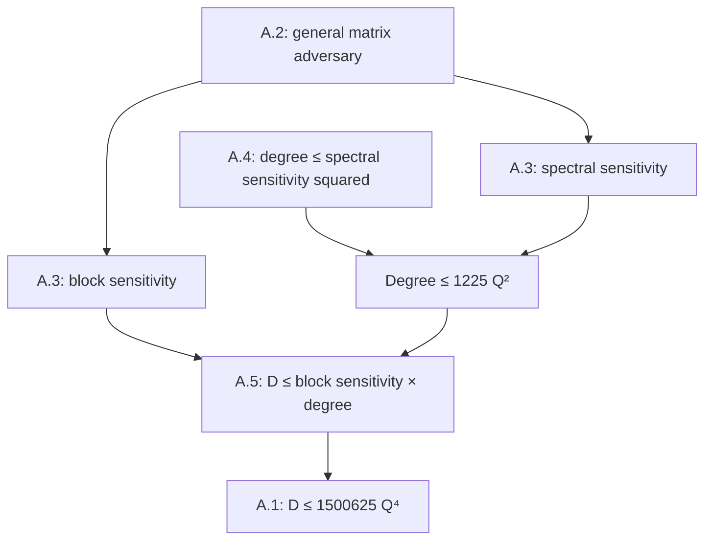

# Appendix A: the universal quartic bound

**AI assistance.** Will Cook directed the work. AI agents based on large language models produced the mathematics, the Lean proofs and this manuscript; no person has yet reviewed them.

<!-- passage:result -->
For every total Boolean function, the proposed assembly proves

\[
 R(f)\le D(f)\le 1{,}500{,}625\,Q(f)^4.
\]

The coefficient is \(35^4\). Both parts of Lemma A.3 use the general nonnegative adversary theorem; Lemma A.4 uses an actual maximum-degree face, the displayed recursive signed cube, and extension by zero into the original sensitivity graph. Lemma A.5 uses Midrijānis's maximal-monomial argument through the existing exact decision-tree bridge. This is an implementation of the Appendix A argument of the supplied OpenAI preprint, with explicit constants, not a new mathematical upper bound. The source is in `lean/QuarticQuery/Paper/AppendixA.lean`, principally `QuarticQuery.Paper.appendixA_D_le_Q_pow_four` and `appendixA_theoremA1`.

**Verification boundary.** Every new Lean file is **unelaborated**. No Lean compiler, Lake, Comparator or external-kernel replay was available or run for these files. Complete proposed proof bodies and source/API review are supplied; successful elaboration may still require repairs. The historical build evidence in the input applies to its recorded declarations and revisions only. The final proof uses the paper's sequence of ingredients; the equal-multiplicity calculation uses parity conjugation as a local alternative to the paper's trace argument. The final-overlap estimate uses the library's measurement-splitting inequality and a short algebraic specialization.

## 1. Library map

<!-- passage:library-map -->
The following map is against complexitylib revision `62ca5c21461b2482e8bd12b7cb9b4937d887a33a`, cslib revision `254e30e6d4299c51323aaeaf5f51a4763b375d4a`, and Mathlib revision `69552756cd8a2d2d48763cf7279fd814d6a1224d`. The requested toolchain is `leanprover/lean4:v4.36.0-rc2`. The project source revision recorded by the input is `4c7544f8dcdfc18d3ecf8476ebd8c1090cd46f15`. All 66 packaged complexitylib Lean files were compared byte-for-byte with their counterparts at the pinned public revision; they agree. The additional foundation files were obtained at that same pin. Exact paths, hashes and input-integrity checks are recorded in `source_manifest.json`.

Path abbreviations in this table are defined immediately below it. Every declaration in the last column is in namespace `QuarticQuery.Paper`. A private library identifier is a source locator, not a public name used by the new proofs.

| Row | Closest existing declaration and file | Exact difference | Principal proposed declaration |
| --- | --- | --- | --- |
| `def-deg` | `Cslib.QueryComplexity.degree`, `degree_le_iff_mem_lowDegree`, `degree_eq_totalDegree_signVal` in QD | Natural degree of a finite-cube function; bit/Fourier spans agree. All constants have degree zero. | `appendixA_degree_le_iff_fourier` |
| `def-bs` | `Cslib.QueryComplexity.IsSensitiveBlock`, `IsSensitiveFamily`, `blockSensitivityAt`, `blockSensitivity` in CM | Nonemptiness follows from sensitivity; finite natural suprema are genuine maxima. | `appendixA_isSensitiveBlock_iff`, `appendixA_blockSensitivity_eq` |
| `def-Gamma-i` | No arbitrary-matrix mask in the supplied query files; `Cslib.Quantum.inner_phaseOracle_update_not` in QA is an adjacent-input identity | The new mask accepts arbitrary input pairs and explicitly uses Euclidean operator norm. | `appendixAGammaCoord`, `appendixAMatrixNorm` |
| `claim-perron` | No corresponding public Perron existence theorem in the supplied query files; Mathlib Rayleigh APIs supply the analytic ingredients | Nonnegative unit eigenvector for the operator norm, including the zero matrix; irreducibility is unnecessary. | `appendixA_perron` |
| `def-adv-progress` | Private source definition `progress` in QA | Existing progress uses absolute overlaps, two vectors and sensitivity edges. The new sum is complex-valued and uses one Perron vector and arbitrary Γ. | `appendixAProgress` |
| `claim-per-query` | Private `progress_sub_progress_succ_le` and public `inner_phaseOracle_update_not` in QA | Existing estimate is specialized to sensitivity edges; the new estimate proves the full quadratic-form inequality for arbitrary Γ. | `appendixAProgress_query_quadratic`, `appendixAProgress_query_le` |
| `claim-final-overlap` | `Cslib.Quantum.norm_inner_run_le` in QA; `norm_inner_sq_add_sq_measureProb_sub_le_one` in QM | General error parameter and algorithm states. A new standalone two-state version and weighted Γ conclusion expose the whole row. | `appendixA_unit_states_final_overlap`, `appendixAProgress_final` |
| `lem-A.2` | `Cslib.Quantum.one_sub_mul_spectralSensitivity_le` in QA; project `QuarticQuery.exists_fixedSequence` in BD | The former is only the sensitivity-graph case. The latter only defers measurements. Neither is the general adversary theorem. | `appendixA_lemmaA2` |
| `def-Sf` | `Cslib.BitString.sensitivityGraph`, `spectralSensitivity` in QS | Exact graph and unnormalised Euclidean norm; only the project vocabulary needs transport. | `appendixA_sensitivityGraph_adj_iff`, `appendixA_spectralSensitivity_eq` |
| `lem-A.3.bs` | `Cslib.Quantum.blockSensitivity_le_sixteen_mul_sq` in QP | Existing constant 16 uses the polynomial method. The new star proof uses A.2 and gives 1225. | `appendixA_blockSensitivity_star_le_Q_sq` |
| `lem-A.3.lambda` | `Cslib.Quantum.spectralSensitivity_le_thirty_six_mul` in QA | Existing constant 36 comes from specialized absolute-overlap progress. The new sensitivity-matrix application of A.2 gives 35. | `appendixA_spectralSensitivity_adversary_le_Q` |
| `lem-A.3` | The preceding two library inequalities | Explicit constants and constant-function coverage replace informal uniform big-O notation. | `appendixA_lemmaA3_adversary` |
| `claim-restrict-parity` | `Cslib.BitString.fourierCoeff_piecewise` in FR; `exists_two_pow_lt_two_mul_card_forall_isSensitiveCoord` in QH | Existing fiber theorem is on the ambient cube. The new theorem reindexes the genuine face to `Fin #S` and makes the parity fiber explicit, for every outside assignment. | `appendixA_restriction_parity_face` |
| `def-huang` | `Cslib.BitString.signedAdjacency` in FH | Existing definition is a directional linear operator. The new definition is the literal block recursion, with an equivalence to ordinary bit inputs. | `huangMatrix`, `abs_huangMatrix`, `huangAdjacent_iff_cubeEdge` |
| `claim-huang-spectrum` | `Cslib.BitString.signedAdjacency_signedAdjacency` in FH | Existing public result gives the square identity; a private helper chooses a sufficiently large eigenspace. Exact positive and negative multiplicities are newly exposed. | `huangMatrix_square`, `huangMatrix_trace`, `huangEnd_eigenspaces_half` |
| `claim-interlace` | `Cslib.BitString.exists_nonneg_ne_zero_sqrt_card_mul_le_sum` in FH | Existing witness has already taken absolute values and hides the eigenvalue sign. The new witness exposes the positive eigenvector and support in U. | `huang_positive_rayleigh_witness` |
| `lem-A.4` | `Cslib.QueryComplexity.degree_le_spectralSensitivity_sq` in QS | Exact endpoint already exists, by a full-cube directional proof. The new assembled route uses the actual face and recursive matrix. | `appendixA4_paper_route` |
| `claim-round-block` | `Cslib.QueryComplexity.exists_card_eq_degree_forall_exists_isSensitiveBlock_subset` in QMId; `Cslib.BitString.exists_ne_on_face_of_fourierCoeff_maximal` in FM | Existing support lemma is exact. Additional transport and counting lemmas expose the same original input and disjoint rounds. | `appendixA_exists_maximal_round_support`, `appendixA_sensitiveBlock_of_restriction`, `appendixA_round_count_le` |
| `lem-A.5` | `Cslib.DecisionTree.complexity_le_degree_mul_blockSensitivity` in QMId | Exact inequality, with factors commuted; project D is identified by the existing bidirectional bridge. | `appendixA_lemmaA5` |

All paths below are relative to the indicated source repository.

| Abbreviation | Exact path |
| --- | --- |
| QD | complexitylib `Complexity/Computability/QueryComplexity/Degree.lean` |
| CM | cslib `Cslib/Computability/QueryComplexity/Measures.lean` |
| QA | complexitylib `Complexity/Computability/QueryComplexity/Quantum/Adversary.lean` |
| QP | complexitylib `Complexity/Computability/QueryComplexity/Quantum/Polynomial.lean` |
| QM | complexitylib `Complexity/Foundations/Quantum/Measurement/Overlap.lean` |
| QS | complexitylib `Complexity/Computability/QueryComplexity/SpectralSensitivity.lean` |
| QH | complexitylib `Complexity/Computability/QueryComplexity/Huang.lean` |
| QMId | complexitylib `Complexity/Computability/QueryComplexity/Midrijanis.lean` |
| FH | complexitylib `Complexity/Foundations/BooleanAnalysis/Hypercube.lean` |
| FR | complexitylib `Complexity/Foundations/BooleanAnalysis/FourierRestriction.lean` |
| FM | complexitylib `Complexity/Foundations/BooleanAnalysis/MaximalSupport.lean` |
| BD | project `lean/QuarticQuery/Bridge/Deferred.lean` |

### Models, normalisation and evidence classes

<!-- passage:models -->
The project uses `TotalBool (Fin n)`, definitionally a function from `Fin n → Bool` to `Bool`. `totalise` embeds it into the project's promised-function vocabulary. Its `D`, `R` and `Q` are minima over worst-case query caps, with success at least two thirds on every promised input for the randomized and quantum models. They are not expected query costs. The existing `QLe_Q` theorem supplies a witness at the minimum. The constant-function alternative in `QLe` also handles an empty coordinate type, whose physical query register has no unit vector. Sources: project `lean/QuarticQuery/Statement.lean`, the definitions from `BitInput` through `Q`; `Model/Quantum.lean` for attainment; `Bridge/DecisionTree.lean` for `D_totalise_eq_complexity`.

The library quantum state is `EuclideanSpace ℂ (Fin n × Bool × W)`. Its oracle multiplies a basis amplitude by the phase controlled by the input bit and the Boolean control register. The existing `exists_fixedSequence` bridge maps the adaptive bit-oracle program into that model with exactly the same syntactic query cap and the same acceptance probabilities. Its entry map is an isometry. The new helper `appendixA_QLe_total_cases` preserves a constant-function case and packages this transport. The paper allows a constant-factor simulation overhead; no additional overhead is inserted in this implementation because the supplied bridge already preserves the cap. Sources: BD, `FixedSim.build` and `exists_fixedSequence`; complexitylib `Quantum/Search.lean`, `State`, `phaseOracle`, `ctrlProj`; returned `AppendixASensitivity.lean`.

All real matrix norms in these files mean `‖Matrix.toEuclideanCLM (𝕜 := ℝ) A‖`. There is no division by the number of cube vertices and no substitution of an entrywise or row-sum norm. The squared Euclidean norm is the sum of squared coordinates. Uniform expectation occurs only in Fourier coefficients. The restriction lemmas use the correct normalization for each cube, and coordinate reindexing preserves the resulting averages exactly. The coefficient on a maximum support survives restriction by a separate maximal-support argument. This distinction prevents a spurious factor of the cube size when a face vector is extended by zero.

In `coverage_plan.json`, `class` means the intended mathematical relation between the new declared statement and the existing row: `exact`, `stronger`, `partial`, `weaker`, or `none`. This convention is defined here because the brief specifies the key but no enum. It is independent of `compiled`, which is false for every new declaration, and of `route`, which distinguishes the mathematical proof. A private helper's source spelling is recorded only as a locator. A `Ledger:` comment proposes a correspondence; it is not a kernel receipt or proof of membership in the headline theorem's compiled dependency closure.

## 2. Entries in appendix reading order

The Lean signatures below are **unelaborated source statements**. They are shown in the ambient namespace `QuarticQuery.Paper`, with `n : ℕ`, the finite-index instances and the open namespaces declared by their source modules. Full proof bodies and exact implicit parameters are in the returned Lean files. Each entry identifies any local substitution in the proof route.

<!-- passage:row-def-deg -->
### `def-deg`: polynomial degree

**Class:** exact definition bridge. **Source:** preprint extracted line 725; QD, `degree` at line 105 and its low-degree characterization; foundation `BooleanAnalysis/LowDegree.lean`, `lowDegree_eq_map_restrictTotalDegree` at line 199; foundation `BooleanAnalysis/Degree.lean`, the Fourier characterizations.

The degree is the largest cardinality of a support with a nonzero coefficient in the real multilinear representation, using degree zero for every constant function. The corrected input row already specifies that convention. The library defines the same natural number through membership in spans of square-free bit monomials. It proves equality of these spans with the corresponding Fourier spans and with evaluations of real polynomials of bounded total degree. The unique representation is mathematical background; this bridge does not introduce a second syntactic `MvPolynomial` representation or a separate uniqueness proof.

```lean
theorem appendixA_degree_le_iff_fourier (f : TotalBool (Fin n)) (d : ℕ) :
    degree f ≤ d ↔
      ∀ S : Finset (Fin n), d < #S →
        fourierCoeff (fun x => bitVal ℝ (f x)) S = 0
```

The proof composes `degree_le_iff_mem_lowDegree` with `mem_lowDegree_iff_fourierCoeff_eq_zero`. `appendixA_degree_eq_sign` supplies output conversion; `appendixA_degree_const` explicitly checks both constants. Thus the Fourier supports later used by Huang and Midrijānis have exactly the paper's degree. Retain the existing zero-function correction; changing to a polynomial degree valued at negative infinity would change this row's convention.

<!-- passage:row-def-bs -->
### `def-bs`: block sensitivity

**Class:** exact definition bridge. **Source:** preprint lines 727–729; CM, sensitive blocks and finite sensitive families at lines 120–152; complexitylib `Relations.lean`, `IsSensitiveBlock.nonempty` at line 117.

A sensitive block at x is a nonempty set B whose simultaneous flip changes the output. Block sensitivity is the maximum number of pairwise disjoint such blocks, maximized over the input. The library's predicate states only the output inequality because that inequality already implies nonemptiness.

```lean
theorem appendixA_isSensitiveBlock_iff (f : TotalBool (Fin n))
    (x : BitInput (Fin n)) (B : Finset (Fin n)) :
    IsSensitiveBlock f x B ↔ B.Nonempty ∧ f (flipBlock B x) ≠ f x
```

The forward implication uses `IsSensitiveBlock.nonempty`; the reverse implication projects the output inequality. `appendixA_blockSensitivity_eq` identifies the two finite suprema exactly. Empty sensitive families are allowed and contribute zero, so no nonconstantness assumption is needed. `appendixA_blockSensitivity_const` handles the constant boundary.

<!-- passage:row-def-Gamma-i -->
### `def-Gamma-i`: coordinate masks and matrix norms

**Class:** exact new definition. **Source:** preprint lines 737–747. The supplied query library has no general Γ-mask definition; its nearest public oracle identity is QA, `inner_phaseOracle_update_not` at line 89.

For an input-indexed real matrix, the mask is

\[
 (\Gamma_i)_{xy}=\Gamma_{xy}\mathbf1\{x_i\ne y_i\}.
\]

```lean
theorem appendixAGammaCoord_apply (Γ : AppendixAMatrix n) (i : Fin n)
    (x y : BitInput (Fin n)) :
    appendixAGammaCoord Γ i x y = if x i ≠ y i then Γ x y else 0
```

`appendixAMatrixNorm` explicitly uses the Euclidean continuous linear map associated to the matrix. `appendixACoordinateMax` takes a finite supremum of nonnegative operator norms, with value zero for the empty coordinate set. `appendixA_coord_le_max` and `appendixACoordinateMax_pos` establish the properties required before dividing by it. No generic matrix norm instance is relied upon.

<!-- passage:row-claim-perron -->
### `claim-perron`: a nonnegative norm eigenvector

**Class:** stronger, because the zero matrix is also allowed. **Source:** preprint line 755. The supplied query files do not publicly state this Perron theorem. Pinned Mathlib suppliers are `Matrix.isSymmetric_toEuclideanLin_iff` in `Analysis/Matrix/Hermitian.lean`, `ContinuousLinearMap.norm_eq_iSup_rayleighQuotient` and `IsSelfAdjoint.eq_smul_self_of_isLocalExtrOn_real` in `Analysis/InnerProductSpace/Rayleigh.lean`.

For symmetric entrywise nonnegative Γ, choose a nonnegative unit vector v such that

\[
 \Gamma v=\|\Gamma\|v.
\]

```lean
theorem appendixA_perron {n : ℕ} (Γ : AppendixAMatrix n)
    (hsym : ∀ x y, Γ x y = Γ y x) (hpos : ∀ x y, 0 ≤ Γ x y) :
    ∃ v, AppendixAPerronWitness Γ v
```

The proof maximizes the real quadratic form on the compact unit sphere. Replacing each coordinate by its absolute value preserves the norm and cannot decrease the form. More strongly, the absolute value of any quadratic form is bounded by the quadratic form of the absolute vector. The nonnegative maximizer therefore bounds the absolute Rayleigh quotient, identifying its value with the operator norm. The Rayleigh extremum theorem then gives the eigenvector equation.

This absolute-value argument matters because Γ need not be positive semidefinite: the star has both a positive and a negative extreme eigenvalue. Irreducibility and strict positivity of v are unnecessary. The input-index space is nonempty even when n is zero. `appendixA_perronObligation` discharges the proposition named `AppendixAPerronObligation`; that definition is not used as an assumed theorem.

<!-- passage:row-def-adv-progress -->
### `def-adv-progress`: the paper's progress sum

**Class:** exact new definition. **Source:** preprint lines 757–765; compare QA's private `progress` at line 141.

For normalized algorithm states, the paper uses

\[
 W_t=\sum_{x,y}v_xv_y\Gamma_{xy}\langle\psi_x^t,\psi_y^t\rangle.
\]

```lean
noncomputable def appendixAProgress (Γ : AppendixAMatrix n)
    (v : BitInput (Fin n) → ℝ)
    (Ψ : BitInput (Fin n) → Cslib.Quantum.State n W) : ℂ :=
  ∑ x, ∑ y, ((v x * v y * Γ x y : ℝ) : ℂ) * inner ℂ (Ψ x) (Ψ y)
```

The new definition keeps the complex inner products inside the weighted sum. The library's private progress instead sums absolute overlaps over sensitivity edges with two different weight vectors. Those are different objects. `appendixAProgress_initial` and `appendixA_perron_form` prove the initial norm value; `appendixAProgress_isometry` proves invariance under input-independent gates. The eventual telescoping uses complex norms, so it requires no assumption that later progress values are nonnegative real numbers.

<!-- passage:row-claim-per-query -->
### `claim-per-query`: the arbitrary-matrix query estimate

**Class:** exact conclusion, with the controlled-phase realization of the project model. **Source:** preprint lines 766–783; QA private `progress_sub_progress_succ_le` at line 167 is only the sensitivity-graph version.

Let \(u_i(x)=v_x\|\Pi_i\psi_x\|\), where \(\Pi_i\) selects query index i and the active phase-control bit. Then

\[
 |W_{t+1}-W_t|\le 2\sum_i u_i^{\mathsf T}\Gamma_i u_i
 \le 2\max_i\|\Gamma_i\|.
\]

```lean
theorem appendixAProgress_query_quadratic
    (Γ : AppendixAMatrix n) (v : BitInput (Fin n) → ℝ)
    (Ψ : BitInput (Fin n) → Cslib.Quantum.State n W)
    (hΓ : ∀ x y, 0 ≤ Γ x y) (hv : ∀ x, 0 ≤ v x) :
    ‖appendixAProgress Γ v (fun x => Cslib.Quantum.phaseOracle x (Ψ x)) -
      appendixAProgress Γ v Ψ‖ ≤
      2 * ∑ i : Fin n, ∑ x, ∑ y,
        (v x * ‖Cslib.Quantum.ctrlProj i (Ψ x)‖) *
        (v y * ‖Cslib.Quantum.ctrlProj i (Ψ y)‖) * appendixAGammaCoord Γ i x y
```

`appendixA_inner_phaseOracle` expands the inner product for arbitrary input pairs. Only indices on which the inputs differ contribute, and each changed phase contributes a factor two. The triangle inequality and Cauchy–Schwarz then give the displayed quadratic sum. `appendixA_quadratic_le_norm` bounds each term by the Euclidean operator norm times the squared norm of its real weight vector. This helper does not assume positive semidefiniteness.

For the bit-oracle decomposition in the paper, all query-register pieces have total squared norm one. The controlled-phase proof selects only active pieces, so their total squared norm is at most one; the remaining mass is in the inactive control. `appendixA_query_weights_le_one` proves precisely the sufficient inequality. `appendixAProgress_query_le` and `appendixA_perQuery_of_bounds` complete the per-query bound for the fixed sequence. The same-cost bridge above ties it to the original adaptive algorithm.

<!-- passage:row-claim-final-overlap -->
### `claim-final-overlap`: output separation and final progress

**Class:** exact statement. **Source:** preprint lines 785–791; QA, `norm_inner_run_le` at line 109; QM, the measurement-overlap-square inequality at line 36.

Unit states with output-one probabilities at most one third and at least two thirds have overlap at most \(2\sqrt2/3\). Consequently,

\[
 |W_T|\le \frac{2\sqrt2}{3}\|\Gamma\|.
\]

```lean
theorem appendixA_unit_states_final_overlap
    {ι : Type*} [Fintype ι] (ψ φ : EuclideanSpace ℂ ι)
    (hψ : ‖ψ‖ = 1) (hφ : ‖φ‖ = 1) (S : Finset ι)
    (hp : Cslib.Quantum.measureProb ψ S ≤ 1 / 3)
    (hq : 2 / 3 ≤ Cslib.Quantum.measureProb φ S) :
    ‖inner ℂ ψ φ‖ ≤ 2 * Real.sqrt 2 / 3
```

The underlying library proof splits the state into the accepting and rejecting subspaces and applies Cauchy–Schwarz. It packages the result as the sum of squared overlap and squared probability difference being at most one. The new standalone theorem specializes this to the thresholds in the row; `appendixA_final_overlap` supplies the algorithm-state version. This is a local algebraic specialization of the paper's measurement-splitting argument.

The weighted step is proved separately in `appendixAProgress_final_of_overlap`. Equal-output terms vanish by support of Γ. Every other coefficient is nonnegative, so summing termwise norm bounds gives the final estimate; `appendixAProgress_final` uses the Perron form to identify the coefficient sum. Merely citing a two-state bound would leave this weighted conclusion unstated.

<!-- passage:row-lem-A.2 -->
### `lem-A.2`: nonnegative spectral adversary

**Class:** stronger explicit-constant statement. **Source:** preprint lines 739–791; [Špalek–Szegedy 2006, Theorem 3.1 and equation (3.1), p. 6](https://theoryofcomputing.org/articles/v002a001/v002a001.pdf), with the original attribution to Barnum, Saks and Szegedy. The old `exists_fixedSequence` tie remains partial for this row.

For a nonzero symmetric entrywise nonnegative Γ supported on opposite outputs, the proposed theorem gives

\[
 Q(f)\ge \frac1{35}\frac{\|\Gamma\|}{\max_i\|\Gamma_i\|}.
\]

```lean
theorem appendixA_lemmaA2
    (f : TotalBool (Fin n)) (Γ : AppendixAMatrix n)
    (hsym : ∀ x y, Γ x y = Γ y x) (hΓ : ∀ x y, 0 ≤ Γ x y)
    (hzero : ∀ x y, f x = f y → Γ x y = 0) (hne : Γ ≠ 0) :
    (1 / 35 : ℝ) * (appendixAMatrixNorm Γ / appendixACoordinateMax Γ) ≤
      (Q (totalise f) : ℝ)
```

The complex progress telescopes from its initial value to the final overlap bound. `appendixA_adversary_of_perron` proves the exact progress inequality for the fixed sequence; `appendixA_perron` supplies its witness. The elementary estimate used in `appendixA_adversary_thirty_five_of_perron` rounds the reciprocal coefficient upward to 35. `appendixA_matrixNorm_le_of_QLe` then transports to the project model, including constants: the support condition forces Γ to be zero when f is constant. The nonzero hypothesis in the ratio theorem implies nonconstantness, so a separate redundant assumption is unnecessary.

The maximum mask norm is proved positive before division. This does not assume that a nonzero matrix exists on the zero-dimensional cube. Such a matrix cannot satisfy opposite-output support there. The full theorem has no undischarged Perron or per-query hypothesis. Its conditional arithmetic helpers are applied to proofs of those hypotheses.

The sharper reciprocal belonging to this particular progress proof is approximately 34.97056. It is not the coefficient printed in the cited equivalence theorem. The exact rounding and the source-note correction are separated in Section 4.

<!-- passage:row-def-Sf -->
### `def-Sf`: the sensitivity matrix

**Class:** exact definition bridge. **Source:** preprint lines 794–796; QS, `sensitivityGraph` and `spectralSensitivity`, lines 103–150; [ABKRT, Definition 7, p. 6](https://arxiv.org/pdf/2010.12629v1).

The matrix \(S_f\) has entry one exactly for a single-bit edge whose endpoints have different outputs, and \(\lambda(f)=\|S_f\|\).

```lean
theorem appendixA_sensitivityGraph_adj_iff (f : TotalBool (Fin n))
    (x y : BitInput (Fin n)) :
    (sensitivityGraph f).Adj x y ↔
      f x ≠ f y ∧ ∃ i : Fin n, Function.update x i (!x i) = y

theorem appendixA_spectralSensitivity_eq (f : TotalBool (Fin n)) :
    spectralSensitivity f =
      ‖Matrix.toEuclideanCLM (𝕜 := ℝ) (appendixA_sensitivityMatrix f)‖
```

The graph bridge converts the library's sensitive-coordinate predicate into the paper's endpoint condition. The norm bridge is definitional. The spectral quantity is different from maximum sensitivity, which counts the largest number of neighbors of a vertex. The quartic chain uses \(\deg(f)\le\lambda(f)^2\) together with \(\lambda(f)\le35Q(f)\). The weaker inequality \(\deg(f)\le s(f)^2\) does not combine with that spectral query bound.

<!-- passage:row-lem-A.3.bs -->
### `lem-A.3.bs`: the star application

**Class:** stronger explicit-constant statement, using the paper's star. **Source:** preprint lines 798–807. The prior library supplier is QP, `blockSensitivity_le_sixteen_mul_sq` at line 252, an alternative polynomial-method proof; [Beals et al., arXiv v3, Theorem 4.13, p. 7](https://arxiv.org/pdf/quant-ph/9802049v3) is the relevant original bound.

The new source-route conclusion is

\[
 \operatorname{bs}(f)\le 1225\,Q(f)^2.
\]

```lean
theorem appendixA_blockSensitivity_star_le_Q_sq (f : TotalBool (Fin n)) :
    blockSensitivity f ≤ 1225 * Q (totalise f) ^ 2
```

At any input, take a disjoint family of sensitive blocks and make the flipped inputs the leaves of a star. The flip map is injective, the center is not a leaf, and every leaf has the opposite output. Applying the star to the unit center vector gives the lower norm bound. Finite Cauchy–Schwarz applied to the sum of leaf coordinates gives the matching upper bound. `appendixA_star_norm_eq_sqrt_card` therefore states the paper's exact star-norm equality, including the empty star.

Each coordinate occurs in at most one block. `appendixA_mask_star_norm_le_one` identifies its mask with zero or one edge and bounds its Euclidean norm by one. The general A.2 bound gives the square-root lower bound on queries. Taking the two finite maxima gives the displayed estimate. The proof uses A.2 for every sensitive family and does not need to select a maximizing family in advance.

The exact finite checker includes a negative control with overlapping blocks for two-bit OR. A coordinate mask then has more than one edge at the center and fails the unit-norm bound. Disjointness is doing essential work. The optional polynomial-method wrapper remains separate and gives the better coefficient 16.

<!-- passage:row-lem-A.3.lambda -->
### `lem-A.3.lambda`: the sensitivity-graph application

**Class:** stronger explicit-constant statement, using the paper's matrix choice. **Source:** preprint lines 808–811; [ABKRT, Lemma 9, p. 8](https://arxiv.org/pdf/2010.12629v1); QA, `one_sub_mul_spectralSensitivity_le` at line 250 and `spectralSensitivity_le_thirty_six_mul` at line 276.

The proposed theorem gives

\[
 \lambda(f)\le35\,Q(f).
\]

```lean
theorem appendixA_spectralSensitivity_adversary_le_Q (f : TotalBool (Fin n)) :
    spectralSensitivity f ≤ 35 * Q (totalise f)
```

Set Γ equal to the sensitivity matrix. The i-th mask sends a vector's coordinate at x to the coordinate at the flipped input when that edge is sensitive, and to zero otherwise. A single-bit flip is an involution. Reindexing the squared-coordinate sum therefore shows the mask contracts Euclidean norm. This is the precise partial-matching argument, proved in `appendixA_sensitivity_mask_mulVec` and `appendixA_sensitivity_mask_norm_le_one`.

The matrix is symmetric, nonnegative and supported on opposite outputs, so the generic bound applies. The original library's result proves the same type of conclusion with a two-vector absolute-overlap argument specialized to the sensitivity graph. It does not supply arbitrary-matrix A.2. Both implementations are preserved with distinct declarations.

<!-- passage:row-lem-A.3 -->
### `lem-A.3`: the two quantum lower bounds

**Class:** stronger explicit uniform conjunction. **Source:** preprint lines 798–811.

```lean
theorem appendixA_lemmaA3_adversary (f : TotalBool (Fin n)) :
    blockSensitivity f ≤ 1225 * Q (totalise f) ^ 2 ∧
      spectralSensitivity f ≤ 35 * Q (totalise f)
```

The conjunction packages the star and the sensitivity-graph applications of the same generic theorem at the attained quantum minimum. The constants are independent of f and n, and the result includes constants and n equal to zero. Lemma A.3 is not a direct comparison between block sensitivity and the square of spectral sensitivity. The two arms use different adversary matrices.

The companion `appendixA_lemmaA3` has numerical constants 16 and 36 and records the two original library routes. The main assembly uses `appendixA_lemmaA3_adversary`'s ingredients. The different declarations keep the stronger polynomial bound available without attributing its proof to the star construction.

<!-- passage:row-claim-restrict-parity -->
### `claim-restrict-parity`: every outside assignment and an actual face

**Class:** exact explicit-face statement. **Source:** preprint lines 814–823; FR, `fourierCoeff_piecewise` at line 74; [ABKRT, proof of Theorem 1, Section 3, p. 7](https://arxiv.org/pdf/2010.12629v1). The supplied TeX locator is `quartic.tex`, lines 706–715.

Choose a nonzero sign Fourier support S of cardinality equal to the degree. For every assignment z outside S, the coefficient on S survives unchanged. Reindex the face to \(\{0,1\}^{|S|}\). Its sign output has nonzero full-parity correlation, so one parity-agreement fiber has more than half the face vertices and all internal cube edges are sensitive.

```lean
theorem appendixA_restriction_parity_face (f : TotalBool (Fin n)) (hf : degree f ≠ 0) :
    ∃ S : Finset (Fin n), #S = degree f ∧ ∀ z : BitInput (Fin n),
      fourierCoeff (fun y => signVal (appendixAFaceFin f S z y)) univ ≠ 0 ∧
      ∃ c : Bool,
        2 ^ #S < 2 * #{y : BitInput (Fin #S) |
          appendixAFaceFin f S z y ^^ parityOn univ y = c} ∧
        ∀ y, appendixAFaceFin f S z y ^^ parityOn univ y = c →
          ∀ i : Fin #S,
            appendixAFaceFin f S z (update y i (!y i)) ^^
              parityOn univ (update y i (!y i)) = c →
                IsSensitiveCoord (appendixAFaceFin f S z) y i
```

`fourierCoeff_piecewise` expresses the restricted coefficient as a sum over original supports T with intersection S. Such T contain S. Every strict superset has cardinality larger than the degree and hence zero coefficient. Only S remains. The quantifiers are one maximum support followed by every outside assignment; an existence claim for a lucky restriction would be weaker than the paper's assertion.

`appendixAFaceFill` fills the frozen coordinates, `appendixAFaceEmbedding` reindexes the free coordinates by `Fin #S`, and `appendixAFaceFin` is the genuine face function. `Fintype.expect_restrict_coordinates` and `expect_comp_arrowCongr` prove the exact normalized Fourier transport; no repeated-copy cardinality factor is left implicit. `appendixA_parityFiber_explicit` specifies the fiber using Boolean XOR with parity; the Boolean choice corresponds to the paper's sign σ. `appendixAFaceEmbedding_update` and `appendixAFaceEmbedding_sensitive` prove the required edge transport.

Inclusion maximality supplies the coefficient-survival conclusion. The two-bit AND negative control has a nonzero singleton coefficient which vanishes on one outside assignment. The coefficient-survival proof correctly uses absence of all strict supersets, not mere nonzeroness; maximum cardinality is a sufficient way to obtain this condition.

<!-- passage:row-def-huang -->
### `def-huang`: the recursive signed cube

**Class:** exact definition after an explicit indexing equivalence. **Source:** preprint lines 824–831; [Huang, arXiv v2, Lemma 2.2, p. 4](https://arxiv.org/pdf/1907.00847v2); ABKRT Section 3, equation (6), p. 7. FH's `signedAdjacency` at line 88 is a different presentation.

The definition is the paper's recursion:

\[
 H'_1=\begin{pmatrix}0&1\\1&0\end{pmatrix},\qquad
 H'_{d+1}=\begin{pmatrix}H'_d&I\\ I&-H'_d\end{pmatrix}.
\]

```lean
def huangMatrix : (d : ℕ) → Matrix (HuangVertex d) (HuangVertex d) ℝ
  | 0 => 0
  | d + 1 => Matrix.fromBlocks (huangMatrix d) 1 1 (-(huangMatrix d))
```

The recursive index type has one vertex at dimension zero and is the disjoint union of two predecessor types at each successor. `huangVertexEquivInput` identifies it with `Fin d → Bool`. `huangAdjacent_iff_cubeEdge` and `appendixACubeEdge_iff_update` identify adjacency with a single-bit flip. Thus this is an indexing choice, not a different graph.

`huangMatrix_one` proves the displayed base case. `abs_huangMatrix` and `huangCubeMatrix_eq_ite` prove that the entrywise absolute value is ordinary cube adjacency. The zero-dimensional base is a convenient extension used for induction. This signed adjacency is distinct from the Walsh–Hadamard matrix used in the paper's Forrelation construction.

<!-- passage:row-claim-huang-spectrum -->
### `claim-huang-spectrum`: square, trace and multiplicities

**Class:** exact after making the positive-dimension scope explicit. **Source:** preprint lines 831–835; Huang, arXiv v2, Lemma 2.2, p. 4; FH, `signedAdjacency_signedAdjacency` at line 125.

The recursive matrix is symmetric, squares to d times the identity and has trace zero. For d at least one, its eigenvalues are the two distinct roots \(\pm\sqrt d\), each of multiplicity \(2^{d-1}\).

```lean
theorem huangMatrix_square (d : ℕ) :
    huangMatrix d * huangMatrix d = (d : ℝ) • (1 : Matrix (HuangVertex d) _ ℝ)

theorem huangMatrix_trace (d : ℕ) : Matrix.trace (huangMatrix d) = 0

theorem huangEnd_eigenspaces_half (d : ℕ) (hd : 0 < d) :
    finrank ℝ ((huangEnd d).eigenspace √(d : ℝ)) = 2 ^ (d - 1) ∧
      finrank ℝ ((huangEnd d).eigenspace (-√(d : ℝ))) = 2 ^ (d - 1)
```

Block multiplication proves the square identity by cancellation of the off-diagonal blocks. Trace zero follows from cancellation of the diagonal traces. `huangEnd_eigenvalue` also exposes the conclusion that every eigenvalue is one of the two roots.

For multiplicities, the new source uses a local alternative proof: multiplying coordinates by parity is a linear involution that anticommutes with the signed adjacency. It identifies the positive and negative eigenspaces. The square identity gives a decomposition into these two spaces, and they have zero intersection for positive d. Their equal dimensions sum to the number of cube vertices. The trace statement is still separately proved, but the multiplicity proof does not use it.

`STATEMENT_CHANGES.json` proposes adding d at least one to the standalone spectrum row. The paper already works in that branch. The square and trace identities also hold at dimension zero; the assertion about two distinct half-dimensional eigenspaces does not. The finite checker exercises both boundaries.

<!-- passage:row-claim-interlace -->
### `claim-interlace`: a supported positive eigenvector

**Class:** exact witness and induced-graph inequality. **Source:** preprint lines 833–842; Huang's arXiv v2 spectral remark on p. 5; ABKRT Theorem 1 proof, p. 7. The closest public library result is FH, `exists_nonneg_ne_zero_sqrt_card_mul_le_sum` at line 262.

For d at least one, if U contains more than half the cube vertices, the positive eigenspace contains a nonzero vector supported on U. Taking absolute values gives the induced unsigned Rayleigh inequality from the row.

```lean
theorem huang_positive_rayleigh_witness (d : ℕ) (hd : 0 < d)
    (U : Finset (HuangVertex d)) (hU : 2 ^ (d - 1) < #U) :
    ∃ v : HuangVertex d → ℝ,
      huangEnd d v = √(d : ℝ) • v ∧ v ≠ 0 ∧ (∀ x ∉ U, v x = 0) ∧
      √(d : ℝ) * (∑ x, |v x| ^ 2) ≤
        ∑ x ∈ U, ∑ y ∈ U, |v x| * huangCubeMatrix d x y * |v y|
```

Restrict a positive eigenvector to the complement of U. The codomain dimension is smaller than the eigenspace dimension, so this restriction map has a nonzero kernel. The kernel condition is exactly support on U. The proof uses `LinearMap.ker_ne_bot_of_finrank_lt`; a general interlacing theorem is unnecessary for the argument written in this appendix.

The absolute value of the signed eigenvalue equation gives the unsigned inequality. Multiplying by the absolute coordinate and summing yields the quadratic form. Support removes all terms outside U. The returned witness exposes the positive root, the original real eigenvector and its support; it does not merely invoke a nearby already-absolute-valued library witness.

<!-- passage:row-lem-A.4 -->
### `lem-A.4`: the spectral form of Huang's inequality

**Class:** stronger domain coverage, since constants are included. **Source:** preprint lines 812–842; [ABKRT, Theorem 1, pp. 1 and 6, with its proof on p. 7](https://arxiv.org/pdf/2010.12629v1); QS, `degree_le_spectralSensitivity_sq` at line 269.

\[
 \deg(f)\le\lambda(f)^2.
\]

```lean
theorem appendixA4_paper_route (f : TotalBool (Fin n)) :
    (degree f : ℝ) ≤ spectralSensitivity f ^ 2
```

The zero-degree case is immediate. Otherwise take a maximum Fourier support, restrict to its actual face, choose the explicit large parity fiber and transfer it to the recursive cube index. The face embedding is injective and maps every relevant cube edge to a sensitivity edge of the original function.

`appendixA_quadratic_embedding` defines the original-cube vector by `Function.extend` with value zero off the image. Two finite-sum transport identities preserve its squared Euclidean norm and identify its quadratic form. Nonnegativity of the absolute vector then allows additional sensitivity edges to increase the form. `appendixA_spectral_of_cube_embedding` combines that comparison with the recursive matrix's supported positive eigenvector. Dividing by the positive squared norm gives the square-root lower bound on λ, and squaring gives the displayed conclusion.

This final candidate uses the literal face and recursive matrix; no representation obligation or spectral-degree endpoint is assumed. `appendixA4` in `AppendixAHuang.lean` separately retains the original full-cube directional proof for comparison. Its existence must not be used to relabel that older route as a check of the new one. The weaker library theorem `degree_le_sensitivity_sq` would not suffice: the quartic argument needs the spectral quantity bounded in A.3.

<!-- passage:row-claim-round-block -->
### `claim-round-block`: blocks at the same original input

**Class:** exact mathematical ingredients, with an explicit algorithm-scope qualification below. **Source:** preprint lines 847–860; [Midrijānis v2, Lemma 3 and the proof of Theorem 4, pp. 3–4](https://arxiv.org/pdf/quant-ph/0403168v2); QMId, the maximal-support theorem at line 57; FM, `exists_ne_on_face_of_fourierCoeff_maximal` at line 88.

For each nonconstant current restriction, a maximum-degree support contains a nonempty sensitive block at every actual input. Fixing all other free variables at that input preserves the coefficient. Blocks from disjoint query rounds remain disjoint at the original full input.

```lean
theorem appendixA_exists_maximal_round_support (f : TotalBool (Fin n))
    (hf : degree f ≠ 0) :
    ∃ S : Finset (Fin n), #S = degree f ∧
      ∀ x, ∃ B : Finset (Fin n), B ⊆ S ∧ B.Nonempty ∧ IsSensitiveBlock f x B

theorem appendixA_sensitiveBlock_of_restriction {f : TotalBool (Fin n)}
    (x : BitInput (Fin n)) (F B : Finset (Fin n)) (hBF : Disjoint B F)
    (hB : IsSensitiveBlock (fun y => f (F.piecewise x y)) x B) :
    IsSensitiveBlock f x B
```

The first result follows from the maximal-support face theorem: some assignment on the support changes the value, and its difference set is a nonempty block. The second result explicitly transports a sensitive block through a restriction whose already-fixed coordinates are disjoint from that block. It keeps the same original input x throughout.

`appendixA_roundBlocks_pairwise_disjoint` and `appendixA_round_count_le` convert disjoint supports into a sensitive family at x and bound the number of rounds by the block sensitivity at x. The library's final decision-tree proof expresses the same accounting by a decrease in the remaining block sensitivity after querying one support; `appendixA_round_decreases_blockSensitivity` exposes that invariant.

These are the exact support, restriction and counting claims. A second syntactic execution-trace datatype for the whole pseudocode is not implemented. The final decision tree is supplied by the library's recursive construction, whose proof was inspected. This distinction concerns the presentation of the algorithm, not an extra mathematical hypothesis in A.5.

<!-- passage:row-lem-A.5 -->
### `lem-A.5`: deterministic complexity

**Class:** exact project-model bridge. **Source:** preprint lines 844–861; QMId, `Cslib.DecisionTree.complexity_le_degree_mul_blockSensitivity` at line 86; Midrijānis v2, proof of Theorem 4, p. 4.

\[
 D(f)\le\operatorname{bs}(f)\deg(f).
\]

```lean
theorem appendixA_lemmaA5 (f : TotalBool (Fin n)) :
    D (totalise f) ≤ blockSensitivity f * degree f
```

The proof rewrites the project's D using `QuarticQuery.D_totalise_eq_complexity`, invokes the exact library theorem, and commutes the product. The library chooses a maximum support, queries its variables, and inducts on the decreased block sensitivity. Restriction does not increase degree, so every round costs at most the original degree. The preceding fixed-input lemmas explain why the equivalent round-count argument in the preprint is valid.

The citation must point inside the proof of Theorem 4. Its headline is the cubic degree bound. Theorem 5 concerns exact quantum queries and is not the bounded-error ingredient used here. This precise locator is already corrected in the supplied statement record and is retained.

## 3. Assembly and constants

<!-- passage:assembly -->
The new implementation proves the following chain at one and the same adaptive query cap T:

\[
 \operatorname{bs}(f)\le1225T^2,\qquad
 \lambda(f)\le35T,\qquad
 \deg(f)\le\lambda(f)^2\le1225T^2,
\]

and hence

\[
 D(f)\le\operatorname{bs}(f)\deg(f)
 \le1225^2T^4=1{,}500{,}625T^4.
\]

```lean
theorem appendixA_D_le_of_QLe {f : TotalBool (Fin n)} {t : ℕ}
    (hq : QLe (totalise f) t) : D (totalise f) ≤ 1500625 * t ^ 4

theorem appendixA_theoremA1 (f : TotalBool (Fin n)) :
    (R (totalise f) : ℝ) ≤ D (totalise f) ∧
      (D (totalise f) : ℝ) ≤
        1500625 * (1 + (Q (totalise f) : ℝ)) ^ 4
```

The main proof body invokes the star bound, the sensitivity-matrix adversary bound, `appendixA4_paper_route`, and the Midrijānis bridge. It does not invoke `Cslib.Quantum.complexity_le_mul_pow_four` or `QuarticQuery.D_le_Q_pow_four`. Substituting `QLe_Q` gives the minimum-query form. Viewing a deterministic decision tree as a randomized program gives the first inequality in A.1. Adding one to Q only weakens the upper bound and recovers exactly the paper's displayed convention. Constant functions already have zero cost. `appendixA_universalPower_four` also places exponent four in the project's admissible-power set.



The new constants and intermediate query-cap statement are registered in `NEW_STATEMENTS.json`. This diagram records intended mathematical dependence. The actual Lean dependency closure must be extracted after compilation; a diagram or text search cannot replace that receipt.

<!-- passage:constant-comparison -->
The original imported endpoint and two proposed assemblies have different numerical provenance:

| Route | Block-sensitivity coefficient | Spectral coefficient | Quartic coefficient | Status |
| --- | ---: | ---: | ---: | --- |
| Existing project endpoint through complexitylib | 16, polynomial method | 36, specialized progress | 20736 = 16 × 36² | Historical input build evidence only |
| New appendix assembly | 1225, star adversary | 35, general adversary | 1500625 = 35⁴ | Unelaborated |
| Optional hybrid | 16, polynomial method | 35, general adversary | 19600 = 16 × 35² | Unelaborated |

The new appendix coefficient is larger than the old coefficient. Its purpose is to expose the intermediate claims and the chosen proof route. The hybrid is a small rational-constant refinement of existing inequalities and carries no novelty claim. It is exported separately as `appendixA_D_le_Q_pow_four_hybrid`; its block-sensitivity proof has the explicitly alternative polynomial route. ABKRT's proof of Theorem 2 already permits that route, while the supplied Appendix A chooses a star for A.3.

The original 20736 is explained directly by QA, `complexity_le_mul_pow_four`: it multiplies the degree coefficient 1296 by the polynomial block-sensitivity coefficient 16. Thus it is not evidence for the Appendix A star proof, and it should not be reinterpreted as a hidden query-simulation loss.

The polynomial coefficient 16 specifically uses the acceptance polynomial's values lying between zero and one. Its supplier is `Cslib.QueryComplexity.one_sub_two_mul_mul_blockSensitivity_le_of_mem_Icc` in `NisanSzegedy.lean`, used by QP's quantum bound. Invoking only the generic approximate-degree estimate would lose this numerical coefficient. This matters when reconstructing 20736 or the optional 19600 from the actual source.

## 4. Corrections and citation precision

<!-- passage:source-correction -->
The supplied Špalek–Szegedy annex note `n003` misreads the error-dependent prefactor. On printed p. 6, Theorem 3.1 of the [publisher PDF](https://theoryofcomputing.org/articles/v002a001/v002a001.pdf) divides Q by one minus twice the square root of the error product; there is no square root around the entire denominator. The note's numerical coefficient about 0.239 at error one third therefore does not follow. The printed factor is about 0.05719. This was checked against the rendered theorem, not just the extracted formula.

The direct progress calculation used here has a per-query factor two. Its coefficient is about 0.0285955 before rounding to one thirty-fifth; the reciprocal is about 34.97056. The coefficient as printed in the 2006 theorem also needs a separate qualification: an exact one-query algorithm for two-bit parity, with a spectral adversary ratio of two, contradicts that prefactor under the paper's own query and norm conventions. `SOURCE_COEFFICIENT_CHECK.md` gives the complete finite witness and exact checks. Høyer, Lee and Špalek's later paper states the factor-two version explicitly in Definition 1 and Theorem 1 on p. 3 of the [author PDF](https://www.ucw.cz/~robert/papers/madv.pdf). This is a localized coefficient discrepancy, separate from the erroneous outer square root in the supplied annex note. It does not refute the equivalences among adversary formulations or the Appendix A asymptotic bound. `SOURCE_CORRECTIONS.json` records the source distinctions and their effect.

The standalone `claim-huang-spectrum` record needs the positive-dimension hypothesis already present in the paper's context. The degree-zero convention and Midrijānis locator are already corrected in the supplied records and are preserved. `STATEMENT_CHANGES.json` retains the original statements and distinguishes that correction from optional explicit-constant strengthenings. No input file was overwritten.

<!-- passage:citations -->
For the eventual mathematical text, the essential citations are:

| Mathematical use | Exact citation and version |
| --- | --- |
| Overall quartic bound and spectral formulation | Aaronson, Ben-David, Kothari, Rao and Tal, arXiv:2010.12629v1: Theorem 1, pp. 1 and 6, with its Section 3 proof on p. 7; Theorem 2 and equation (4), p. 2; Lemma 9, p. 8. Cite all five authors. |
| Signed hypercube | Huang, arXiv:1907.00847v2: Lemma 2.2, p. 4, and the spectral remark on p. 5. The journal publication is Annals of Mathematics 190 (2019), 949–955; those journal pages are separate from the arXiv locators. |
| Nonnegative adversary formulation | Špalek and Szegedy, publisher edition, Theorem 3.1 and equation (3.1), p. 6, crediting Barnum, Saks and Szegedy. The BSS full text was not obtained here; do not claim an independently checked BSS theorem locator. |
| Error-dependent adversary coefficient | Høyer, Lee and Špalek, *Negative weights make adversaries stronger*, Definition 1 and Theorem 1, p. 3 of the 29-page author PDF. This states the factor one half consistent with the direct progress proof. The 2006 printed coefficient needs the separate qualification above. |
| Deterministic degree–block-sensitivity bound | Midrijānis, arXiv:quant-ph/0403168v2: Lemma 3, p. 3, and the proof of Theorem 4, p. 4. |
| Optional polynomial-method block bound | Beals, Buhrman, Cleve, Mosca and de Wolf, arXiv:quant-ph/9802049v3: Theorem 4.13, p. 7. The journal citation is JACM 48 (2001), 778–797. |

`references.bib` includes these sources, the supplied OpenAI preprint, the Nisan–Szegedy background for the alternative route, and all three source pins. Citations to theorem numbers use the versions actually read. The bibliography does not transfer a theorem number from an arXiv edition to a different journal pagination. The broad title of the 2006 adversary paper concerns its nonnegative formulations; no claim about later negative-weight adversaries is needed here.

## 5. Verification and integration

<!-- passage:verification -->
The proposed proofs were reviewed against actual source at the recorded pins. Independent agent review checked the Perron absolute-Rayleigh step, the recursive matrix spectrum, the genuine-face normalization, the extension-by-zero identities, the star norm and the final constant assembly. This is source inspection, not Lean elaboration. One definite implementation issue found during review was a missing `noncomputable` modifier on face definitions that use `Finset.equivFin`; it was repaired. Other finite-sum rewrites, coercions and tactic elaboration remain subject to the compiler.

The reproducible scripts in `checks/` perform complementary checks. Exact rational arithmetic checks the controlled-phase overlap identity on 1,920 cases, with a numerical check of the generic progress estimate on 100 seeded instances. Exact integer enumeration covers every Boolean function on at most three input bits, computes degree, block sensitivity and optimal deterministic depth, and checks star and mask identities. A further script checks recursive matrix square, trace, symmetry and absolute adjacency through dimension eight, and coefficient survival and parity fibers on every maximum-support face through dimension three. The separate source-coefficient checker verifies the entire two-bit parity witness using exact integer and rational arithmetic. Numerical spectral checks are explicitly identified as numerical. The negative controls exercise overlapping blocks, nonmaximal supports and the dimension-zero boundary. All passed in the recorded runs. They cannot establish the general theorems or typecheck Lean.

All requested JSON records are valid JSON. The return's static validator checks identifiers, correspondence anchors, required keys, file labels, local module imports and the absence of proof placeholders or new axiom declarations. Its output is `validation.json`. It is a local integrity checker, not the project's absent corpus-schema tool or Comparator. `READING_LOG.md` states which documents and source portions were read and which materials were unavailable. `LEAN_GAPS.md` lists the remaining verification work and local proof-route differences in reading order.

<!-- passage:integration -->
To integrate, copy the returned `lean/QuarticQuery/Paper/AppendixA*.lean` modules into the project at its recorded pins and build `QuarticQuery.Paper.AppendixA` with the pinned toolchain. Build the auxiliary matrix and restriction modules as needed to isolate elaboration failures. The terminal build command is proposed, not executed:

```bash
lake build QuarticQuery.Paper.AppendixA
```

After successful elaboration, record the actual command, toolchain, source hashes and result, inspect the axioms of the final declaration, and extract the compiled dependency closure. A Comparator challenge for these exact new statements is subsequent work; none is included or claimed here. Keep the old deferred-measurement ties partial for A.2 and add new ties only for the new exact theorem. Preserve the existing imported quartic endpoint as a separate implementation. The advice and files are ready for the project team to compile and adjudicate; no repository merge or change to historical evidence was performed.
